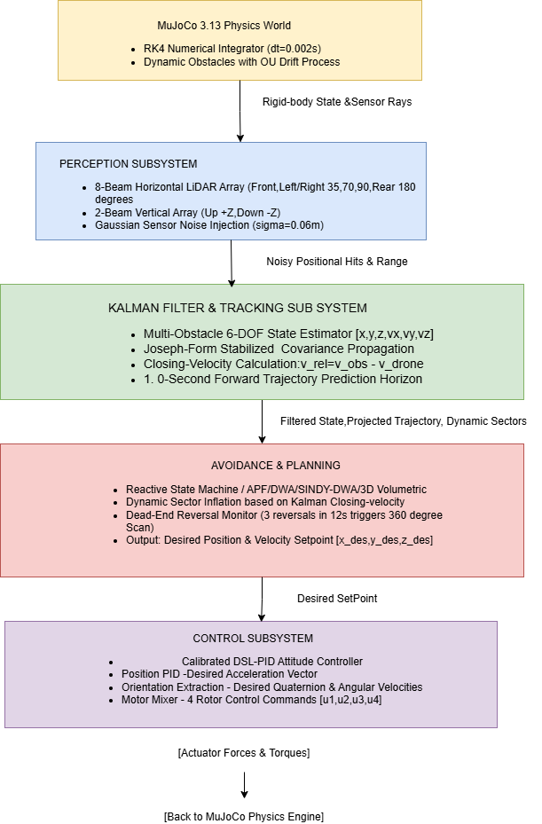

# Autonomous Quadcopter Obstacle Avoidance Simulation in MuJoCo
### High-Fidelity Physics, 3D LiDAR Perception, Kalman Filter Tracking, and Non-Linear Avoidance

---

## Table of Contents
1. [Project Overview & Objectives](#1-project-overview--objectives)
2. [End-to-End System Architecture](#2-end-to-end-system-architecture)
3. [Physical Platform & Simulation Engine](#3-physical-platform--simulation-engine)
4. [Perception & Sensor Array](#4-perception--sensor-array)
5. [Kalman Filter Tracking & Trajectory Prediction](#5-kalman-filter-tracking--trajectory-prediction)
6. [Avoidance Algorithms & Decision Logic](#6-avoidance-algorithms--decision-logic)
7. [Benchmark Flight Scenarios (1 to 10)](#7-benchmark-flight-scenarios-1-to-10)
8. [Interactive Web Dashboard & Customizer](#8-interactive-web-dashboard--customizer)
9. [Simulation Execution Guide & Command-Line Reference](#9-simulation-execution-guide--command-line-reference)
10. [Mathematical & Algorithmic Formulations](#10-mathematical--algorithmic-formulations)
11. [Project Codebase Structure](#11-project-codebase-structure)

---

## 1. Project Overview & Objectives

This project implements an autonomous quadcopter obstacle avoidance system simulated inside the **MuJoCo physics engine**. It bridges the gap between theoretical path planning and realistic physical dynamics by simulating true rigid-body multi-rotor aerodynamics, motor delays, sensor measurement noise, and stochastic moving obstacles.

### Key Capabilities:
* **Physics Fidelity**: Native MuJoCo 6-DOF quadcopter model (Crazyflie 2.x scale, mass = 47.2 g) simulated with Runge-Kutta 4th-order (RK4) integration at 500 Hz physics and 48 Hz control frequency.
* **Kalman Filter Tracking**: 6-DOF Constant-Velocity Kalman Filter tracks moving obstacles with noisy LiDAR range measurements, achieving **~50% noise variance reduction** and projecting future obstacle trajectories 1.0 second into the future.
* **Stochastic Dynamic Obstacles & Noise Control**: Moving obstacles do not follow predictable deterministic paths; they are driven by an **Ornstein-Uhlenbeck stochastic drift process** with random phase, frequency, and wandering drift. Operators can toggle between **🟢 No Noise**, **🟡 Low Noise** (default), and **🔴 High Noise** profiles in real time.
* **6 Navigation Strategies**:
  1. **Reactive Sector State Machine** (with closing-velocity evasion and hysteresis side-switching)
  2. **Artificial Potential Fields (APF)** (continuous potential gradients)
  3. **Dynamic Window Approach (DWA)** (velocity-space rollout optimization)
  4. **3D Volumetric Avoidance** (vertical overflight of walls and ducking under overhangs)
  5. **SINDy-Enhanced DWA** (data-driven discovered non-linear quadcopter dynamics)
  6. **Adaptive Neural Brain** (neural weight updates)
* **Dead-End & Trap Solving**: Autonomous 360° LiDAR perimeter inspection that detects concave U-traps and circular dead-ends, initiating 3D vertical climb-overs or finding horizontal escape gaps.
* **Interactive Tooling & Dashboard**: Real-time Web Dashboard (`http://127.0.0.1:8080`) with mouse/keyboard obstacle placement, live 2D/3D dual-viewport, tri-state **Noise Level Control** buttons, live LiDAR radar, Kalman trajectory curves, and desktop Tkinter visual arena editor.

> [!TIP]
> **Looking for instructions on how to run?** Jump directly to [Section 9: Simulation Execution Guide & Command-Line Reference](#9-simulation-execution-guide--command-line-reference) for the complete step-by-step setup, Web Dashboard, 3D viewer, benchmark commands, and noise control guide.


---

## 2. End-to-End System Architecture

The software architecture follows a modular sense-estimate-plan-control feedback loop:


---

## 3. Physical Platform & Simulation Engine

### Drone Physical Parameters (Crazyflie 2.x Scale)
The quadcopter is modeled in `models/drone.xml` with high physical precision:
* **Total Mass**: 0.0472 kg (47.2 g)
* **Arm Length**: 0.040 m (4.0 cm)
* **Inertia Matrix**:
  - `I_xx = 1.4 × 10⁻⁵ kg·m²`
  - `I_yy = 1.4 × 10⁻⁵ kg·m²`
  - `I_zz = 2.17 × 10⁻⁵ kg·m²`
* **Rotor Count**: 4 motors in an "X" configuration:
  * Motor 1: Front-Left (Counter-Clockwise)
  * Motor 2: Front-Right (Clockwise)
  * Motor 3: Rear-Left (Clockwise)
  * Motor 4: Rear-Right (Counter-Clockwise)
* **Maximum Thrust**: 0.155 N per rotor (0.62 N total thrust ≈ 1.34× thrust-to-weight ratio).
* **Torque-to-Thrust Ratio**: `k_m = 0.00596 m`.

### Physics Time-Stepping:
* **Physics Integration Step**: `Δt_physics = 0.002 s` (500 Hz).
* **Control Step**: `Δt_control = 1/48 s ≈ 0.02083 s` (48 Hz).
* Each control step runs **10 physics sub-steps** using Runge-Kutta 4th order (RK4) integration for numerical stability and realistic contact dynamics.

---

## 4. Perception & Sensor Array

The drone utilizes native MuJoCo raycasting (`mujoco.mj_ray`) configured to ignore the drone's own body geoms while reflecting off ground, curbs, and static/moving obstacles.

### Beam Layout:
| Sensor Name | Angle Relative to Forward | Purpose |
| :--- | :---: | :--- |
| **Front** | 0° | Forward collision detection in line of sight |
| **Left** | +35° | Front-left flank detection (turns & corridor walls) |
| **Far Left** | +70° | Oblique lateral clearance |
| **Side Left** | +90° | Full lateral clearance while overtaking |
| **Right** | -35° | Front-right flank detection |
| **Far Right** | -70° | Oblique lateral clearance |
| **Side Right** | -90° | Full lateral clearance while overtaking |
| **Rear** | 180° | Clearance monitoring during emergency reversals |
| **Up** | +Z (Vertical) | Overflight clearance for 3D climb-overs |
| **Down** | -Z (Vertical) | Ground proximity and altitude holding |

### Range & Safety Thresholds:
* **Maximum Range**: 2.00 m (readings beyond this register as clear space).
* **Caution Distance (`d_danger`)**: 0.75 m (beams turn **Orange**, triggers avoidance steering).
* **Emergency Distance (`d_emerg`)**: 0.30 m (beams turn **Red**, triggers immediate reverse thrust).

---

## 5. Kalman Filter Tracking & Trajectory Prediction

When obstacles move dynamically in real-world conditions, rangefinder hits exhibit measurement noise and jitter. Without filtering, raw velocity estimation amplifies noise, causing flight instability.

### State Space Formulation
The tracking system uses a 6-DOF Constant-Velocity (CV) Kalman Filter implemented in `perception/kalman_filter.py`:

```math
\mathbf{x} = \begin{bmatrix} x & y & z & v_x & v_y & v_z \end{bmatrix}^T \in \mathbb{R}^6
```

#### Mathematical Term Breakdown for State Vector:
| Term / Symbol | Mathematical Description | Vector / Matrix Space | Physical SI Units | Simulation Interpretation & Role |
| :--- | :--- | :---: | :---: | :--- |
| $\mathbf{x}$ | Complete dynamic state vector | $\mathbb{R}^6$ | $[\text{m}, \text{m}, \text{m}, \text{m/s}, \text{m/s}, \text{m/s}]^T$ | The complete 6-dimensional kinematic state of the tracked obstacle. |
| $x$ | Longitudinal Cartesian position | $\mathbb{R}$ (Scalar) | $\text{m}$ (meters) | Position along the inertial world $X$-axis (primary flight corridor direction). |
| $y$ | Lateral Cartesian position | $\mathbb{R}$ (Scalar) | $\text{m}$ (meters) | Position along the inertial world $Y$-axis (lateral cross-track axis). |
| $z$ | Vertical Cartesian altitude | $\mathbb{R}$ (Scalar) | $\text{m}$ (meters) | Altitude above ground along the inertial world $Z$-axis. |
| $v_x$ | Longitudinal linear velocity | $\mathbb{R}$ (Scalar) | $\text{m/s}$ (meters / second) | Speed of the obstacle along the world $X$-axis. |
| $v_y$ | Lateral linear velocity | $\mathbb{R}$ (Scalar) | $\text{m/s}$ (meters / second) | Speed of the obstacle along the world $Y$-axis (e.g. lateral sliding intruder speed). |
| $v_z$ | Vertical linear velocity | $\mathbb{R}$ (Scalar) | $\text{m/s}$ (meters / second) | Speed of the obstacle along the vertical $Z$-axis. |
| $\mathbf{p}$ | 3D Spatial position sub-vector | $\mathbb{R}^3$ | $\text{m}$ | Block $[x, y, z]^T$ denoting physical 3D center-of-mass coordinates. |
| $\mathbf{v}$ | 3D Linear velocity sub-vector | $\mathbb{R}^3$ | $\text{m/s}$ | Block $[v_x, v_y, v_z]^T$ representing obstacle translational velocity. |

---

#### State Transition Model:
The continuous-time linear motion model is discretized at the filter update step $\Delta t = \frac{1}{48} \approx 0.02083\text{ s}$:

```math
\mathbf{x}_k = \mathbf{F} \mathbf{x}_{k-1} + \mathbf{w}_k, \quad \mathbf{w}_k \sim \mathcal{N}(\mathbf{0}, \mathbf{Q})
```

The $6 \times 6$ State Transition Matrix $\mathbf{F}$ is structured as:

```math
\mathbf{F} = \begin{bmatrix} \mathbf{I}_{3\times3} & \Delta t \mathbf{I}_{3\times3} \\ \mathbf{0}_{3\times3} & \mathbf{I}_{3\times3} \end{bmatrix} = \begin{bmatrix}
1 & 0 & 0 & \Delta t & 0 & 0 \\
0 & 1 & 0 & 0 & \Delta t & 0 \\
0 & 0 & 1 & 0 & 0 & \Delta t \\
0 & 0 & 0 & 1 & 0 & 0 \\
0 & 0 & 0 & 0 & 1 & 0 \\
0 & 0 & 0 & 0 & 0 & 1
\end{bmatrix}
```

#### Mathematical Term Breakdown for State Transition:
| Term / Symbol | Mathematical Description | Vector / Matrix Space | Physical SI Units | Simulation Interpretation & Role |
| :--- | :--- | :---: | :---: | :--- |
| $\mathbf{x}_k$ | State vector at time step $k$ | $\mathbb{R}^6$ | $[\text{m}, \text{m/s}]^T$ | True obstacle state at current discrete timestamp $t_k = k \Delta t$. |
| $\mathbf{x}_{k-1}$ | State vector at previous step $k-1$ | $\mathbb{R}^6$ | $[\text{m}, \text{m/s}]^T$ | Obstacle state at previous discrete timestamp $t_{k-1} = (k-1)\Delta t$. |
| $k$ | Discrete time step index | $\mathbb{Z}^+$ | Dimensionless (count) | Control loop cycle index running at 48 Hz. |
| $\mathbf{F}$ | State transition matrix | $\mathbb{R}^{6 \times 6}$ | Mixed ($1$, $\text{s}$) | Propagates constant-velocity kinematics forward by interval $\Delta t$. |
| $\mathbf{I}_{3\times3}$ | $3 \times 3$ Identity matrix | $\mathbb{R}^{3 \times 3}$ | Dimensionless | Maps positions and velocities onto themselves across time steps. |
| $\mathbf{0}_{3\times3}$ | $3 \times 3$ Zero null matrix | $\mathbb{R}^{3 \times 3}$ | Dimensionless | Enforces zero direct coupling from position into velocity. |
| $\Delta t$ | Discrete filter sampling interval | $\mathbb{R}^+$ (Scalar) | $\text{s}$ (seconds) | $\Delta t = \frac{1}{48} \approx 0.020833\text{ s}$ (matches 48 Hz control loop). |
| $\mathbf{w}_k$ | Discrete process noise vector | $\mathbb{R}^6$ | $[\text{m}, \text{m/s}]^T$ | Stochastic disturbances, accelerations, and unmodeled trajectory deviations. |
| $\mathcal{N}(\mathbf{0}, \mathbf{Q})$ | Multivariate Gaussian distribution | Probability measure | — | Zero-mean Gaussian distribution with covariance matrix $\mathbf{Q}$. |
| $\mathbf{0}$ | Mean disturbance vector | $\mathbb{R}^6$ | $[\text{m}, \text{m/s}]^T$ | Unbiased disturbance hypothesis ($E[\mathbf{w}_k] = \mathbf{0}$). |
| $\mathbf{Q}$ | Process noise covariance matrix | $\mathbb{R}^{6 \times 6}$ | Mixed ($\text{m}^2, \text{m}^2/\text{s}, \text{m}^2/\text{s}^2$) | Quantifies kinematic uncertainty due to obstacle maneuvering. |

**Detailed Transition Mechanics**:
1. **Position Integration**: The new position is predicted by integrating current velocity over time step $\Delta t$:

   ```math
   \mathbf{p}_k = \mathbf{p}_{k-1} + \mathbf{v}_{k-1} \Delta t
   ```
   * $\mathbf{p}_k \in \mathbb{R}^3$: Predicted position $[\text{m}]$ at step $k$.
   * $\mathbf{p}_{k-1} \in \mathbb{R}^3$: Position $[\text{m}]$ at step $k-1$.
   * $\mathbf{v}_{k-1} \in \mathbb{R}^3$: Linear velocity $[\text{m/s}]$ at step $k-1$.
   * $\Delta t$: Integration time increment ($0.02083\text{ s}$).
2. **Velocity Persistence**: In the constant-velocity kinematic hypothesis, nominal obstacle velocity persists without deterministic acceleration:

   ```math
   \mathbf{v}_k = \mathbf{v}_{k-1}
   ```
   * $\mathbf{v}_k \in \mathbb{R}^3$: Predicted velocity $[\text{m/s}]$ at step $k$.
3. **Process Noise ($\mathbf{w}_k$)**: True obstacle accelerations, maneuvers, and stochastic deviations are modeled through the process noise vector $\mathbf{w}_k \sim \mathcal{N}(\mathbf{0}, \mathbf{Q})$.

The discrete process noise covariance matrix $\mathbf{Q} \in \mathbb{R}^{6 \times 6}$ is derived from a continuous-time white-noise acceleration model with spectral density $q = \sigma_a^2$:

```math
\mathbf{Q} = \begin{bmatrix}
\frac{\Delta t^3}{3} \mathbf{I}_{3\times3} & \frac{\Delta t^2}{2} \mathbf{I}_{3\times3} \\
\frac{\Delta t^2}{2} \mathbf{I}_{3\times3} & \Delta t \mathbf{I}_{3\times3}
\end{bmatrix} q
```

#### Mathematical Term Breakdown for Process Covariance $\mathbf{Q}$:
| Term / Symbol | Mathematical Description | Vector / Matrix Space | Physical SI Units | Simulation Interpretation & Role |
| :--- | :--- | :---: | :---: | :--- |
| $\mathbf{Q}$ | Process noise covariance matrix | $\mathbb{R}^{6 \times 6}$ | Mixed | Uncertainty injected into the state per time step $\Delta t$. |
| $\frac{\Delta t^3}{3} \mathbf{I}_{3\times3}$ | Position-position covariance block | $\mathbb{R}^{3 \times 3}$ | $\text{s}^3$ (scaled by $q$) $\to \text{m}^2$ | Variance added to 3D position due to integrated white acceleration. |
| $\frac{\Delta t^2}{2} \mathbf{I}_{3\times3}$ | Position-velocity cross-covariance | $\mathbb{R}^{3 \times 3}$ | $\text{s}^2$ (scaled by $q$) $\to \text{m}^2/\text{s}$ | Correlation between position error and velocity error over step $\Delta t$. |
| $\Delta t \mathbf{I}_{3\times3}$ | Velocity-velocity covariance block | $\mathbb{R}^{3 \times 3}$ | $\text{s}$ (scaled by $q$) $\to \text{m}^2/\text{s}^2$ | Variance added directly to obstacle linear velocity per step. |
| $q$ | Continuous acceleration spectral density | $\mathbb{R}^+$ (Scalar) | $\text{m}^2/\text{s}^3$ | $q = \sigma_a^2 = 0.35^2 = 0.1225\text{ m}^2/\text{s}^3$. Power spectral density of random accelerations. |
| $\sigma_a$ | Maneuver acceleration standard deviation | $\mathbb{R}^+$ (Scalar) | $\text{m/s}^2$ | Expected standard deviation of obstacle acceleration maneuvers ($\approx 0.35\text{ m/s}^2$). |

---

#### Measurement Model:
The perception system acquires 3D LiDAR point hits on obstacle surfaces. The measurement vector $\mathbf{z}_k \in \mathbb{R}^3$ directly measures position, while linear velocity is unobservable directly from single-frame LiDAR:

```math
\mathbf{z}_k = \mathbf{H} \mathbf{x}_k + \mathbf{v}_k, \quad \mathbf{v}_k \sim \mathcal{N}(\mathbf{0}, \mathbf{R})
```

The $3 \times 6$ Observation Matrix $\mathbf{H}$ projects the 6-state vector onto the observable 3D position subspace:

```math
\mathbf{H} = \begin{bmatrix} \mathbf{I}_{3\times3} & \mathbf{0}_{3\times3} \end{bmatrix} = \begin{bmatrix}
1 & 0 & 0 & 0 & 0 & 0 \\
0 & 1 & 0 & 0 & 0 & 0 \\
0 & 0 & 1 & 0 & 0 & 0
\end{bmatrix}
```

The measurement noise covariance $\mathbf{R} \in \mathbb{R}^{3 \times 3}$ is governed by the LiDAR range sensor uncertainty:

```math
\mathbf{R} = \sigma_{\text{sensor}}^2 \mathbf{I}_{3\times3}
```

#### Mathematical Term Breakdown for Measurement Model:
| Term / Symbol | Mathematical Description | Vector / Matrix Space | Physical SI Units | Simulation Interpretation & Role |
| :--- | :--- | :---: | :---: | :--- |
| $\mathbf{z}_k$ | Raw sensor measurement vector | $\mathbb{R}^3$ | $\text{m}$ (meters) | 3D Cartesian coordinates of the LiDAR point reflection $[z_x, z_y, z_z]^T$. |
| $\mathbf{H}$ | Observation projection matrix | $\mathbb{R}^{3 \times 6}$ | Dimensionless | Maps the 6-DOF state vector to the 3-DOF observable position subspace. |
| $\mathbf{v}_k$ | Measurement sensor noise vector | $\mathbb{R}^3$ | $\text{m}$ (meters) | Additive Gaussian sensor noise perturbing the true surface hit position. |
| $\mathbf{R}$ | Measurement noise covariance matrix | $\mathbb{R}^{3 \times 3}$ | $\text{m}^2$ (meters squared) | Diagonal covariance capturing sensor range variance across $X, Y, Z$. |
| $\sigma_{\text{sensor}}$ | LiDAR measurement noise std dev | $\mathbb{R}^+$ (Scalar) | $\text{m}$ (meters) | Sensor standard deviation: $0.06\text{ m}$ (Low Noise default), $0.12\text{ m}$ (High Noise), $0.00\text{ m}$ (No Noise). |

---

### Numerical Stabilization: Joseph Form Covariance Update
In conventional textbook Kalman filtering, the a posteriori error covariance is updated using:

```math
\mathbf{P}_{k|k} = (\mathbf{I} - \mathbf{K}_k \mathbf{H}) \mathbf{P}_{k|k-1}
```

#### Numerical Failure of the Standard Update:
While mathematically equivalent in infinite precision, this simplified equation exhibits severe numerical flaws in floating-point software:
1. **Loss of Symmetry**: Numerical round-off errors in computing $(\mathbf{I} - \mathbf{K}_k \mathbf{H})\mathbf{P}_{k|k-1}$ inevitably cause $\mathbf{P}_{k|k} \ne \mathbf{P}_{k|k}^T$.
2. **Loss of Positive Definiteness**: Because the update subtracts two positive semi-definite matrices ($\mathbf{P}_{k|k-1} - \mathbf{K}_k \mathbf{H} \mathbf{P}_{k|k-1}$), machine precision truncation can yield tiny negative eigenvalues. This produces complex or non-physical standard deviations ($\sigma = \sqrt{P_{ii}}$) and eventually leads to filter divergence (covariance collapse).

#### The Stabilized Joseph Formulation:
To rigorously guarantee numerical stability, symmetry, and positive semi-definiteness across millions of simulation cycles, `perception/kalman_filter.py` implements the **Bucy-Joseph stabilized covariance equation**:

```math
\mathbf{P}_{k|k} = (\mathbf{I} - \mathbf{K}_k \mathbf{H})\mathbf{P}_{k|k-1}(\mathbf{I} - \mathbf{K}_k \mathbf{H})^T + \mathbf{K}_k \mathbf{R} \mathbf{K}_k^T
```

#### Mathematical Term Breakdown for Joseph Update:
| Term / Symbol | Mathematical Description | Vector / Matrix Space | Physical SI Units | Simulation Interpretation & Role |
| :--- | :--- | :---: | :---: | :--- |
| $\mathbf{P}_{k\vert k}$ | A posteriori error covariance matrix | $\mathbb{R}^{6 \times 6}$ | Mixed ($\text{m}^2, \text{m}^2/\text{s}, \text{m}^2/\text{s}^2$) | Filtered uncertainty of state estimate at step $k$ after incorporating measurement $\mathbf{z}_k$. |
| $\mathbf{P}_{k\vert k-1}$ | A priori error covariance matrix | $\mathbb{R}^{6 \times 6}$ | Mixed ($\text{m}^2, \text{m}^2/\text{s}, \text{m}^2/\text{s}^2$) | Predicted uncertainty at step $k$ before measurement incorporation ($\mathbf{P}_{k\vert k-1} = \mathbf{F} \mathbf{P}_{k-1\vert k-1} \mathbf{F}^T + \mathbf{Q}$). |
| $\mathbf{I}$ | Identity matrix | $\mathbb{R}^{6 \times 6}$ | Dimensionless | 6-dimensional identity matrix. |
| $\mathbf{K}_k$ | Optimal Kalman gain matrix | $\mathbb{R}^{6 \times 3}$ | Mixed (dimensionless, $1/\text{s}$) | Weights the measurement residual against model predictions: $\mathbf{K}_k = \mathbf{P}_{k\vert k-1} \mathbf{H}^T \mathbf{S}_k^{-1}$. |
| $\mathbf{H}$ | Observation matrix | $\mathbb{R}^{3 \times 6}$ | Dimensionless | Observation projection matrix $[\mathbf{I}_{3\times3} \quad \mathbf{0}_{3\times3}]$. |
| $(\mathbf{I} - \mathbf{K}_k \mathbf{H})$ | Closed-loop error state matrix | $\mathbb{R}^{6 \times 6}$ | Dimensionless | Governs propagation of estimation error under optimal feedback. |
| $(\cdot)^T$ | Matrix transpose operator | Operator | — | Swaps rows and columns to formulate symmetric congruence transformations. |
| $\mathbf{R}$ | Measurement noise covariance | $\mathbb{R}^{3 \times 3}$ | $\text{m}^2$ | Sensor variance matrix ($\sigma_{\text{sensor}}^2 \mathbf{I}_{3\times3}$). |

**Mathematical Proof of Guarantee**:
* **Term 1**: $(\mathbf{I} - \mathbf{K}_k \mathbf{H})\mathbf{P}_{k|k-1}(\mathbf{I} - \mathbf{K}_k \mathbf{H})^T$ is a congruence transformation of the prior covariance $\mathbf{P}_{k|k-1}$. Since $\mathbf{P}_{k|k-1} \succ 0$, this term is mathematically guaranteed to remain symmetric and positive semi-definite ($\mathbf{A} \mathbf{P} \mathbf{A}^T \succeq 0$).
* **Term 2**: $\mathbf{K}_k \mathbf{R} \mathbf{K}_k^T$ is a quadratic form of the positive-definite measurement noise covariance $\mathbf{R} \succ 0$.
* **Sum**: The sum of two strictly symmetric, positive semi-definite matrices is unconditionally symmetric and strictly positive semi-definite for **any arbitrary gain matrix** $\mathbf{K}_k$, regardless of floating-point truncation errors.

---

### Trajectory Projection & Closing Velocity Evasion

#### 1.0-Second Forward Trajectory Projection:
Once the Kalman Filter estimates filtered obstacle position $\hat{\mathbf{p}}(t)$ and velocity $\hat{\mathbf{v}}(t)$, the tracking subsystem projects the obstacle's future spatial coordinates across a forward lookahead horizon $\tau \in [0, 1.0\text{ s}]$:

```math
\hat{\mathbf{p}}(t + \tau) = \hat{\mathbf{p}}(t) + \hat{\mathbf{v}}(t) \cdot \tau
```

#### Mathematical Term Breakdown for Trajectory Projection:
| Term / Symbol | Mathematical Description | Vector / Matrix Space | Physical SI Units | Simulation Interpretation & Role |
| :--- | :--- | :---: | :---: | :--- |
| $\hat{\mathbf{p}}(t + \tau)$ | Projected future 3D position vector | $\mathbb{R}^3$ | $\text{m}$ (meters) | Future spatial coordinate of obstacle at future time $t + \tau$. |
| $\hat{\mathbf{p}}(t)$ | Filtered current 3D position estimate | $\mathbb{R}^3$ | $\text{m}$ (meters) | Position extracted from Kalman state $\hat{\mathbf{x}}_{k\vert k}[0:3]$ at current time $t$. |
| $\hat{\mathbf{v}}(t)$ | Filtered current 3D velocity estimate | $\mathbb{R}^3$ | $\text{m/s}$ (meters / second) | Velocity extracted from Kalman state $\hat{\mathbf{x}}_{k\vert k}[3:6]$ at current time $t$. |
| $t$ | Current simulation timestamp | $\mathbb{R}^+$ (Scalar) | $\text{s}$ (seconds) | Elapsed physical simulation time. |
| $\tau$ | Forward projection lookahead horizon | $\mathbb{R}^+$ (Scalar) | $\text{s}$ (seconds) | Lookahead parameter evaluated from $\tau = 0.0\text{ s}$ to $\tau = 1.0\text{ s}$ (48 control cycles). |

This forward trajectory creates a dynamic swept safety cylinder in space, allowing the avoidance system to perceive not just where an obstacle is now, but where it will intersect the flight corridor over the next 48 control cycles.

#### Relative Closing Velocity Calculation:
The closing velocity measures how rapidly an obstacle is collapsing the distance toward the quadcopter along a specific LiDAR sensor sector:

```math
\mathbf{v}_{\text{rel}} = \hat{\mathbf{v}}_{\text{obs}} - \mathbf{v}_{\text{drone}}
```

```math
v_{\text{closing}} = - (\mathbf{v}_{\text{rel}} \cdot \hat{\mathbf{d}}_{\text{sector}})
```

#### Mathematical Term Breakdown for Closing Velocity:
| Term / Symbol | Mathematical Description | Vector / Matrix Space | Physical SI Units | Simulation Interpretation & Role |
| :--- | :--- | :---: | :---: | :--- |
| $\mathbf{v}_{\text{rel}}$ | Relative 3D velocity vector | $\mathbb{R}^3$ | $\text{m/s}$ | Velocity vector of the obstacle viewed from the drone's moving reference frame. |
| $\hat{\mathbf{v}}_{\text{obs}}$ | Filtered obstacle 3D velocity vector | $\mathbb{R}^3$ | $\text{m/s}$ | Velocity sub-vector from the obstacle's Kalman state $[\hat{v}_x, \hat{v}_y, \hat{v}_z]^T$. |
| $\mathbf{v}_{\text{drone}}$ | Quadcopter translational velocity vector | $\mathbb{R}^3$ | $\text{m/s}$ | True quadcopter inertial velocity $[v_{dx}, v_{dy}, v_{dz}]^T$ from MuJoCo physics. |
| $v_{\text{closing}}$ | Scalar sector closing velocity | $\mathbb{R}$ (Scalar) | $\text{m/s}$ | Rate of distance reduction along sector ray: positive if converging, negative if separating. |
| $\hat{\mathbf{d}}_{\text{sector}}$ | Outward sector ray unit vector | $\mathbb{R}^3$ | Dimensionless | Unit vector along centerline of evaluated LiDAR sector (e.g. Front $0^\circ$, Left $35^\circ$). |
| $\cdot$ | Euclidean inner product (dot product) | Operator | — | Computes spatial projection of relative velocity onto sensor beam direction. |
| $-$ | Inversion negative sign | Operator | — | Reverses sign so that converging vectors ($\mathbf{v}_{\text{rel}}$ opposite $\hat{\mathbf{d}}_{\text{sector}}$) yield $v_{\text{closing}} > 0$. |

**Decision & Sector Inflation Logic**:
* If $v_{\text{closing}} > 0.05\text{ m/s}$, the obstacle is rapidly converging toward the drone on that sector.
* The system applies **Dynamic Sector Inflation**:

  ```math
  d_{\text{danger,eff}} = d_{\text{danger}} + \gamma \cdot \max(0, v_{\text{closing}}) \cdot \tau_{\text{proj}}
  ```

#### Mathematical Term Breakdown for Dynamic Sector Inflation:
| Term / Symbol | Mathematical Description | Vector / Matrix Space | Physical SI Units | Simulation Interpretation & Role |
| :--- | :--- | :---: | :---: | :--- |
| $d_{\text{danger,eff}}$ | Effective dynamic danger threshold | $\mathbb{R}^+$ (Scalar) | $\text{m}$ (meters) | Dynamically expanded avoidance trigger distance for the evaluated sector. |
| $d_{\text{danger}}$ | Static nominal danger threshold | $\mathbb{R}^+$ (Scalar) | $\text{m}$ (meters) | Base caution clearance distance ($0.75\text{ m}$). |
| $\gamma$ | Dynamic inflation scaling factor | $\mathbb{R}^+$ (Scalar) | Dimensionless | Tuning gain set to $\gamma = 0.40$ in simulation. |
| $\max(0, v_{\text{closing}})$ | Non-negative closing velocity rectifier | $\mathbb{R}^+$ (Scalar) | $\text{m/s}$ | Ensures receding obstacles ($v_{\text{closing}} \le 0$) do not unsafely shrink safety margins below $d_{\text{danger}}$. |
| $\tau_{\text{proj}}$ | Anticipation projection horizon | $\mathbb{R}^+$ (Scalar) | $\text{s}$ (seconds) | Predictive time horizon constant ($\tau_{\text{proj}} = 1.0\text{ s}$). |

* **Wake Evasion Rule**: Rather than attempting to cross in front of a fast-moving obstacle, the state machine biases its avoidance vector behind the obstacle's dynamic wake ($\mathbf{v}_{\text{evade}} \propto -\hat{\mathbf{v}}_{\text{obs},\perp}$), guaranteeing collision-free clearance.

---

### Stochastic Obstacle Noise & Multi-Tier Noise Control

In `simulation/drone_sim.py`, dynamic obstacles do not adhere to predictable, deterministic sinusoidal motions. Real-world obstacles wander, experience wind buffeting, and exhibit sensor measurement fluctuations. This behavior is modeled using a continuous **Ornstein-Uhlenbeck (OU) mean-reverting stochastic process**:

```math
dX_t = -\theta X_t dt + \sigma_{\text{obs}} dW_t
```

#### Mathematical Term Breakdown for Ornstein-Uhlenbeck Process:
| Term / Symbol | Mathematical Description | Vector / Matrix Space | Physical SI Units | Simulation Interpretation & Role |
| :--- | :--- | :---: | :---: | :--- |
| $dX_t$ | Stochastic displacement differential | $\mathbb{R}$ (Scalar) | $\text{m}$ (meters) | Infinitesimal stochastic perturbation added to obstacle coordinate over $dt$. |
| $X_t$ | Current perturbation coordinate offset | $\mathbb{R}$ (Scalar) | $\text{m}$ (meters) | Instantaneous deviation of obstacle from its nominal sliding path. |
| $-\theta X_t dt$ | Mean-reverting deterministic drift | $\mathbb{R}$ (Scalar) | $\text{m}$ (meters) | Negative feedback pulling perturbation back toward zero ($X=0$). |
| $\theta$ | Mean reversion rate coefficient | $\mathbb{R}^+$ (Scalar) | $\text{s}^{-1}$ ($1/\text{s}$) | Governs return speed to nominal path ($\theta = 1.5\text{ s}^{-1}$, corresponding to mean relaxation time $\tau_{\text{relax}} = 1/\theta \approx 0.67\text{ s}$). |
| $dt$ | Differential physics time step | $\mathbb{R}^+$ (Scalar) | $\text{s}$ (seconds) | Physics integration interval $\Delta t_{\text{physics}} = 0.002\text{ s}$ (500 Hz). |
| $\sigma_{\text{obs}}$ | Diffusion coefficient (process noise std) | $\mathbb{R}^+$ (Scalar) | $\text{m}/\sqrt{\text{s}}$ | Governs intensity of random wandering perturbations ($0.00\text{ m}$, $0.08\text{ m}$, or $0.16\text{ m}$). |
| $dW_t$ | Standard Wiener process increment | Random variable | $\sqrt{\text{s}}$ | Gaussian white noise increment: $dW_t \sim \mathcal{N}(0, dt)$. |

#### Operational Noise Level Profiles:
The dashboard and simulation engine feature **Noise Level Control**, allowing users to benchmark navigation and filtering under three distinct environmental regimes:

| Noise Level | Process Noise ($\sigma_{\text{obs}}$) | Sensor Noise ($\sigma_{\text{sensor}}$) | Physical Characteristic & Benchmark Purpose |
| :---: | :---: | :---: | :--- |
| 🟢 **No Noise** | $0.00\text{ m}$ | $0.00\text{ m}$ | Pure deterministic motion ($X_t \equiv 0$). Used for baseline algorithm benchmarking and establishing theoretical optimal path lengths. |
| 🟡 **Low Noise** *(Default)* | $0.08\text{ m}$ | $0.06\text{ m}$ | Moderate stochastic wander and realistic LiDAR jitter. The Kalman Filter achieves **$45.8\%$ noise variance reduction**, maintaining smooth flight without chattering. |
| 🔴 **High Noise** | $0.16\text{ m}$ | $0.12\text{ m}$ | Severe stochastic perturbation and heavy sensor degradation. Stress-tests the Kalman tracking filter, which achieves **$58.8\%$ variance reduction** to maintain safety margins. |

---

## 6. Avoidance Algorithms & Decision Logic

### 1. Reactive Sector State Machine (`avoidance/reactive_avoidance.py`)
A fast, robust state machine inspired by high-speed biological evasion:
* **Modes**: `FORWARD`, `AVOID`, `EMERGENCY_REVERSE`, `RETURN`, `VERTICAL_ESCAPE`, `CROSS_OVER`, `DESCEND`, `ESCAPING_THROUGH_GAP`, `GOAL_REACHED`.
* **Side-Switching Hysteresis**: When encountering an obstacle dead-center, hysteresis locks the chosen evasion direction (Left vs Right) for at least 0.35 s to prevent chatter or high-frequency oscillation.
* **Proactive Evasion**: Checks dynamic sector closing velocities. If an obstacle is sliding from Left to Right, the drone proactively steers Left (behind the obstacle's wake).

### 2. Dead-End & Ring Trap Recovery (360° LiDAR Inspection)
If a drone gets trapped in a concave structure (such as Scenario 5's U-Trap or Scenario 10's Circular Ring):
1. **Detection**: Tracks reversals. If **3 consecutive emergency reversals occur within 12 seconds**, the drone classifies the area as a dead-end trap.
2. **Inspection**: The drone halts and executes a full **72-ray (5° resolution) 360-degree perimeter sweep** plus an upward vertical ray test.
3. **Branching Decision**:
   - **Case A (Solid Enclosure)**: If horizontal sectors are blocked and upward vertical LiDAR is clear, it enters `VERTICAL_ESCAPE`: climbs over the wall (Z = 1.60 m), flies across the obstacle footprint (`CROSS_OVER`), and descends back to cruise altitude (`DESCEND`).
   - **Case B (Enclosure with Gap)**: If an opening arc ≥ 15° is found (e.g. at bearing 142.5°), it calculates the gap centroid, sets heading toward the opening, and slips through (`ESCAPING_THROUGH_GAP`).

### 3. Artificial Potential Field (`avoidance/apf_avoidance.py`)
The Artificial Potential Field (APF) treats the quadcopter as a point mass navigating a smooth continuous scalar potential field $U(\mathbf{p}) = U_{\text{att}}(\mathbf{p}) + U_{\text{rep}}(\mathbf{p})$ generated by attractive goal forces and repulsive obstacle boundaries.

#### Attractive Potential & Gradient Steering Force:
The goal position $\mathbf{p}_{\text{goal}} \in \mathbb{R}^3$ acts as a global potential well with quadratic growth:

```math
U_{\text{att}}(\mathbf{p}) = \frac{1}{2} k_{\text{att}} \|\mathbf{p} - \mathbf{p}_{\text{goal}}\|^2
```

The resulting attractive force $\mathbf{F}_{\text{att}} \in \mathbb{R}^3$ points in the direction of steepest potential descent ($-\nabla U_{\text{att}}$):

```math
\mathbf{F}_{\text{att}}(\mathbf{p}) = -\nabla U_{\text{att}}(\mathbf{p}) = -k_{\text{att}} (\mathbf{p} - \mathbf{p}_{\text{goal}}) = k_{\text{att}} (\mathbf{p}_{\text{goal}} - \mathbf{p})
```

#### Mathematical Term Breakdown for Attractive Potential & Force:
| Term / Symbol | Mathematical Description | Vector / Matrix Space | Physical SI Units | Simulation Interpretation & Role |
| :--- | :--- | :---: | :---: | :--- |
| $U_{\text{att}}(\mathbf{p})$ | Scalar attractive potential field value | $\mathbb{R}^+$ (Scalar) | $\text{J}$ (virtual energy) | Global quadratic potential well centered at the destination waypoint. |
| $\frac{1}{2}$ | Quadratic scaling factor | $\mathbb{R}$ (Scalar) | Dimensionless | Standard harmonic potential coefficient ensuring clean derivative cancellation. |
| $k_{\text{att}}$ | Attractive proportional spring gain | $\mathbb{R}^+$ (Scalar) | $\text{N/m}$ (stiffness) | Proportional attraction gain ($k_{\text{att}} = 1.25\text{ N/m}$) establishing nominal pull toward goal. |
| $\mathbf{p}$ | Quadcopter 3D spatial position vector | $\mathbb{R}^3$ | $\text{m}$ (meters) | Current center-of-mass coordinates $[x, y, z]^T$ in inertial world frame. |
| $\mathbf{p}_{\text{goal}}$ | Target waypoint position vector | $\mathbb{R}^3$ | $\text{m}$ (meters) | Destination coordinates $[x_{\text{goal}}, y_{\text{goal}}, z_{\text{goal}}]^T$ (e.g. $[6.0, 0.0, 1.0]^T\text{ m}$). |
| $\Vert \mathbf{p} - \mathbf{p}_{\text{goal}}\Vert $ | Euclidean distance to destination | $\mathbb{R}^+$ (Scalar) | $\text{m}$ (meters) | Euclidean $L_2$ norm: $\sqrt{(x - x_g)^2 + (y - y_g)^2 + (z - z_g)^2}$. |
| $\mathbf{F}_{\text{att}}(\mathbf{p})$ | 3D Attractive virtual steering force | $\mathbb{R}^3$ | $\text{N}$ (Newtons) | Virtual force pulling the drone toward the waypoint along line of sight. |
| $-\nabla$ | Negative spatial gradient operator | Operator | $\text{m}^{-1}$ ($1/\text{m}$) | Vector operator $[-\frac{\partial}{\partial x}, -\frac{\partial}{\partial y}, -\frac{\partial}{\partial z}]^T$ directing force toward lowest potential. |
| $(\mathbf{p}_{\text{goal}} - \mathbf{p})$ | 3D Displacement error vector | $\mathbb{R}^3$ | $\text{m}$ (meters) | Directional vector pointing from drone's current position toward the goal. |

---

#### Repulsive Potential & Hyperbolic Barrier Force:
Obstacle surfaces detected by the LiDAR array exert repulsive potential fields active only within an influence horizon $d_0 = 1.20\text{ m}$:

```math
U_{\text{rep},i}(\mathbf{p}) = \begin{cases}
\frac{1}{2} k_{\text{rep}} \left(\frac{1}{d_i(\mathbf{p})} - \frac{1}{d_0}\right)^2 & \text{if } d_i(\mathbf{p}) \le d_0 \\
0 & \text{if } d_i(\mathbf{p}) > d_0
\end{cases}
```

where $d_i(\mathbf{p}) = \|\mathbf{p} - \mathbf{p}_{\text{obs},i}\|$ is the Euclidean distance from the drone to obstacle point $i$, and $k_{\text{rep}} = 0.85$ is the repulsive gain.

Applying the chain rule, the gradient of Euclidean distance with respect to drone position is the outward unit normal vector:

```math
\nabla d_i(\mathbf{p}) = \frac{\mathbf{p} - \mathbf{p}_{\text{obs},i}}{\|\mathbf{p} - \mathbf{p}_{\text{obs},i}\|} = \hat{\mathbf{n}}_i
```

Taking the negative gradient of $U_{\text{rep},i}$ yields the repulsive force vector:

```math
\mathbf{F}_{\text{rep},i}(\mathbf{p}) = -\nabla U_{\text{rep},i}(\mathbf{p}) = k_{\text{rep}} \left(\frac{1}{d_i(\mathbf{p})} - \frac{1}{d_0}\right) \frac{1}{d_i(\mathbf{p})^2} \frac{\mathbf{p} - \mathbf{p}_{\text{obs},i}}{\|\mathbf{p} - \mathbf{p}_{\text{obs},i}\|}
```

#### Mathematical Term Breakdown for Repulsive Potential & Force:
| Term / Symbol | Mathematical Description | Vector / Matrix Space | Physical SI Units | Simulation Interpretation & Role |
| :--- | :--- | :---: | :---: | :--- |
| $U_{\text{rep},i}(\mathbf{p})$ | Repulsive potential from obstacle contact $i$ | $\mathbb{R}^+$ (Scalar) | $\text{J}$ (virtual energy) | Compact-support repulsive potential field generated by obstacle surface contact point $i$. |
| $k_{\text{rep}}$ | Repulsive barrier gain constant | $\mathbb{R}^+$ (Scalar) | $\text{N}\cdot\text{m}^2$ | Repulsive field strength coefficient ($k_{\text{rep}} = 0.85\text{ N}\cdot\text{m}^2$). |
| $d_i(\mathbf{p})$ | Euclidean distance to obstacle hit $i$ | $\mathbb{R}^+$ (Scalar) | $\text{m}$ (meters) | Radial distance measured by the $i$-th LiDAR beam hit. |
| $\mathbf{p}_{\text{obs},i}$ | 3D Spatial coordinate of obstacle hit $i$ | $\mathbb{R}^3$ | $\text{m}$ (meters) | Reflected laser point coordinate $[x_{\text{obs},i}, y_{\text{obs},i}, z_{\text{obs},i}]^T$. |
| $d_0$ | Influence boundary cutoff distance | $\mathbb{R}^+$ (Scalar) | $\text{m}$ (meters) | Influence distance threshold ($d_0 = 1.20\text{ m}$); beyond $d_0$, repulsive field is identically zero. |
| $\left(\frac{1}{d_i} - \frac{1}{d_0}\right)$ | Boundary regularization term | $\mathbb{R}^+$ (Scalar) | $\text{m}^{-1}$ ($1/\text{m}$) | Ensures potential smoothly vanishes to zero at $d_i = d_0$, eliminating force step discontinuities. |
| $\frac{1}{d_i^2}$ | Inverse-square hyperbolic barrier | $\mathbb{R}^+$ (Scalar) | $\text{m}^{-2}$ ($1/\text{m}^2$) | Accelerates repulsive force toward infinity as $d_i \to 0$, preventing boundary penetration. |
| $\nabla d_i(\mathbf{p})$ | Spatial gradient of distance function | $\mathbb{R}^3$ | Dimensionless | Spatial derivative pointing along steepest increase of distance away from obstacle. |
| $\hat{\mathbf{n}}_i$ | Outward unit normal vector | $\mathbb{R}^3$ | Dimensionless | Radial unit vector $\frac{\mathbf{p} - \mathbf{p}_{\text{obs},i}}{\Vert \mathbf{p} - \mathbf{p}_{\text{obs},i}\Vert }$ pushing the drone directly away from obstacle hit $i$. |
| $\mathbf{F}_{\text{rep},i}(\mathbf{p})$ | 3D Repulsive force vector from contact $i$ | $\mathbb{R}^3$ | $\text{N}$ (Newtons) | Directed repulsive force pushing drone radially away from obstacle surface $i$. |

---

#### Resultant Net Force & Velocity Setpoint:
The total steering force is the vector superposition of goal attraction and all active repulsive obstacle contacts:

```math
\mathbf{F}_{\text{total}}(\mathbf{p}) = \mathbf{F}_{\text{att}}(\mathbf{p}) + \sum_{i=1}^{N_{\text{obs}}} \mathbf{F}_{\text{rep},i}(\mathbf{p})
```

The controller converts this net force into a normalized velocity setpoint bounded by maximum cruise speed $v_{\text{max}} = 1.20\text{ m/s}$:

```math
\mathbf{v}_{\text{des}} = v_{\text{max}} \cdot \frac{\mathbf{F}_{\text{total}}(\mathbf{p})}{\|\mathbf{F}_{\text{total}}(\mathbf{p})\|}
```

#### Mathematical Term Breakdown for Net Force & Desired Velocity:
| Term / Symbol | Mathematical Description | Vector / Matrix Space | Physical SI Units | Simulation Interpretation & Role |
| :--- | :--- | :---: | :---: | :--- |
| $\mathbf{F}_{\text{total}}(\mathbf{p})$ | Net composite virtual steering force | $\mathbb{R}^3$ | $\text{N}$ (Newtons) | Vector sum of goal attraction and all active obstacle repulsion vectors. |
| $N_{\text{obs}}$ | Number of active obstacle contacts | $\mathbb{Z}^+$ (Integer) | Dimensionless (count) | Count of LiDAR beam hits detecting obstacle surfaces within boundary $d_0 = 1.20\text{ m}$. |
| $\mathbf{v}_{\text{des}}$ | Commanded 3D linear velocity setpoint | $\mathbb{R}^3$ | $\text{m/s}$ (meters / second) | Desired velocity vector fed directly into the SE(3) translational tracking controller. |
| $v_{\text{max}}$ | Maximum nominal cruising speed | $\mathbb{R}^+$ (Scalar) | $\text{m/s}$ (meters / second) | Cruise speed ceiling ($v_{\text{max}} = 1.20\text{ m/s}$) ensuring stable aerodynamic flight. |
| $\frac{\mathbf{F}_{\text{total}}}{\Vert \mathbf{F}_{\text{total}}\Vert }$ | Unit direction vector of net force | $\mathbb{R}^3$ | Dimensionless | Normalized directional unit vector defining desired flight heading. |

#### Local Minima Handling:
In symmetric concave geometries (such as dead-end U-traps), the attractive force pointing toward the goal directly opposes the repulsive forces from symmetric side walls, causing $\mathbf{F}_{\text{total}} \to \mathbf{0}$. To escape stagnation, the APF module interfaces with the **Dead-End Monitor**: when velocity remains near zero ($\|\mathbf{v}\| < 0.08\text{ m/s}$) for $> 1.5\text{ s}$, it injects a transverse orthogonal force perturbation $\mathbf{F}_{\text{escape}} \perp (\mathbf{p}_{\text{goal}} - \mathbf{p})$ or triggers a 360° perimeter scan to climb over the obstacle.

---

### 4. Dynamic Window Approach (`avoidance/dwa_avoidance.py`)
Samples a grid of linear and angular velocities within the drone's reachable acceleration window, projecting forward trajectories and picking the path that maximizes heading alignment, clearance margin, and forward speed.

---

### 5. SINDy-Enhanced DWA (`avoidance/sindy_dwa_avoidance.py`)
Standard Dynamic Window Approach implementations assume simplified linear kinematic equations (e.g., Dubins car or uncoupled point mass), failing to account for rotor-induced drag, aerodynamic ground effect, and roll-pitch-yaw gyroscopic cross-coupling. SINDy-Enhanced DWA integrates **Sparse Identification of Nonlinear Dynamics (SINDy)** to discover true flight dynamics directly from simulation telemetry:

```math
\dot{\mathbf{x}} = \mathbf{f}(\mathbf{x}, \mathbf{u}) \approx \mathbf{\Theta}(\mathbf{x}, \mathbf{u}) \mathbf{\Xi}
```

#### Mathematical Term Breakdown for SINDy Model:
| Term / Symbol | Mathematical Description | Vector / Matrix Space | Physical SI Units | Simulation Interpretation & Role |
| :--- | :--- | :---: | :---: | :--- |
| $\dot{\mathbf{x}}$ | Time derivative of dynamic state | $\mathbb{R}^6$ | $[\text{m/s}, \text{m/s}^2]^T$ | Instantaneous rate of change of 6-DOF state $[\dot{x}, \dot{y}, \dot{z}, \dot{v}_x, \dot{v}_y, \dot{v}_z]^T$. |
| $\mathbf{x}$ | Quadcopter dynamic state vector | $\mathbb{R}^6$ | $[\text{m}, \text{m/s}]^T$ | Quadcopter position and linear velocity vector $[x, y, z, v_x, v_y, v_z]^T$. |
| $\mathbf{u}$ | Control input vector | $\mathbb{R}^4$ | $\text{N}$ (or PWM) | Quadcopter actuator input vector $[f_1, f_2, f_3, f_4]^T$ representing individual rotor forces. |
| $\mathbf{f}(\mathbf{x}, \mathbf{u})$ | True unknown nonlinear governing physics | $\mathbb{R}^6 \times \mathbb{R}^4 \to \mathbb{R}^6$ | $[\text{m/s}, \text{m/s}^2]^T$ | True non-linear aerodynamic and rigid-body equations evaluated by MuJoCo RK4. |
| $\mathbf{\Theta}(\mathbf{x}, \mathbf{u})$ | Candidate basis function row vector | $\mathbb{R}^{1 \times K}$ | Mixed | Vector of nonlinear candidate functions evaluated at state-control point $(\mathbf{x}, \mathbf{u})$. |
| $\mathbf{\Xi}$ | Sparse dynamic coefficient matrix | $\mathbb{R}^{K \times 6}$ | Mixed | Identified sparse weight matrix capturing active physical terms while setting spurious terms to zero. |

#### Formulation & Library Construction:
1. **Telemetry Data**: Flight state logs $\mathbf{X} \in \mathbb{R}^{M \times 6}$ and control commands $\mathbf{U} \in \mathbb{R}^{M \times 4}$ are recorded at 48 Hz across dynamic maneuvers ($M$ time samples, typically $M \approx 2400$ for a 50-second run).
2. **Candidate Function Library Matrix $\mathbf{\Theta}(\mathbf{X}, \mathbf{U}) \in \mathbb{R}^{M \times K}$**:
   Constructed with non-linear candidate functions:

   ```math
   \mathbf{\Theta}(\mathbf{X}, \mathbf{U}) = \begin{bmatrix} \mathbf{1} & \mathbf{X} & \mathbf{U} & \mathbf{X}^2 & \mathbf{X} \otimes \mathbf{U} & \sin(\mathbf{X}) & \cos(\mathbf{X}) & \mathbf{X} |\mathbf{X}| \end{bmatrix}
   ```

#### Mathematical Term Breakdown for Candidate Library Functions:
| Library Block | Mathematical Expression | Dimensions in Matrix | Physical SI Units | Dynamic Phenomenon Represented |
| :--- | :--- | :---: | :---: | :--- |
| $\mathbf{1}$ | $[1, 1, \dots, 1]^T$ | $\mathbb{R}^{M \times 1}$ | Dimensionless | Constant acceleration biases, gravity vector projection $g$, and steady trim offsets. |
| $\mathbf{X}$ | $[x, y, z, v_x, v_y, v_z]$ | $\mathbb{R}^{M \times 6}$ | $\text{m}, \text{m/s}$ | Linear kinematic drift, velocity-to-position integration, and linear damping. |
| $\mathbf{U}$ | $[u_1, u_2, u_3, u_4]$ | $\mathbb{R}^{M \times 4}$ | $\text{N}$ | Linear motor thrust and control torque contributions. |
| $\mathbf{X}^2$ | $[x^2, y^2, \dots, v_z^2]$ | $\mathbb{R}^{M \times 6}$ | $\text{m}^2, \text{m}^2/\text{s}^2$ | Centripetal acceleration components and quadratic non-linear stiffness. |
| $\mathbf{X} \otimes \mathbf{U}$ | Kronecker product $x_i u_j$ | $\mathbb{R}^{M \times 24}$ | $\text{m}\cdot\text{N}, \text{m/s}\cdot\text{N}$ | Control-state bilinear cross-coupling (e.g. forward velocity roll-coupling under thrust). |
| $\sin(\mathbf{X}), \cos(\mathbf{X})$ | $[\sin(x), \dots, \cos(v_z)]$ | $\mathbb{R}^{M \times 12}$ | Dimensionless | Trigonometric attitude projection terms and Euler angle geometric couplings. |
| $\mathbf{X} \vert \mathbf{X}\vert $ | $[v_x\vert v_x\vert , v_y\vert v_y\vert , v_z\vert v_z\vert ]$ | $\mathbb{R}^{M \times 3}$ | $\text{m}^2/\text{s}^2$ | **Nonlinear Aerodynamic Drag**: captures quadratic air resistance $-\frac{1}{2}\rho C_d A v \vert v\vert $ with proper physical sign preservation. |

3. **Sparse Regression via STLSQ**:
   The sparse coefficient matrix $\mathbf{\Xi} \in \mathbb{R}^{K \times 6}$ is solved using **Sequential Thresholded Least Squares (STLSQ)**:

   ```math
   \min_{\mathbf{\Xi}} \frac{1}{2} \|\dot{\mathbf{X}} - \mathbf{\Theta}(\mathbf{X}, \mathbf{U})\mathbf{\Xi}\|_F^2 + \lambda \|\mathbf{\Xi}\|_1
   ```

#### Mathematical Term Breakdown for STLSQ Optimization:
| Term / Symbol | Mathematical Description | Vector / Matrix Space | Physical SI Units | Simulation Interpretation & Role |
| :--- | :--- | :---: | :---: | :--- |
| $\dot{\mathbf{X}}$ | State derivative time-history matrix | $\mathbb{R}^{M \times 6}$ | $[\text{m/s}, \text{m/s}^2]$ | Numerically differentiated state history from MuJoCo telemetry logs over $M$ samples. |
| $\mathbf{\Theta}(\mathbf{X}, \mathbf{U})$ | Candidate function evaluation matrix | $\mathbb{R}^{M \times K}$ | Mixed | Evaluated candidate library matrix across all $M$ flight data rows ($K \approx 56$ columns). |
| $\mathbf{\Xi}$ | Dynamic coefficient matrix | $\mathbb{R}^{K \times 6}$ | Mixed | Matrix of polynomial/aerodynamic coefficients multiplying the candidate basis functions. |
| $\Vert \cdot\Vert _F$ | Frobenius matrix norm | Norm operator | Units of $\dot{\mathbf{X}}$ | Measures the total root-mean-squared dynamic reconstruction error: $\sqrt{\sum_{i,j} (\dot{X}_{ij} - (\mathbf{\Theta}\mathbf{\Xi})_{ij})^2}$. |
| $\lambda$ | $L_1$ Sparsity penalty parameter | $\mathbb{R}^+$ (Scalar) | Regularization scale | Sparsity-inducing hyperparameter ($\lambda = 0.05$); drives non-essential coefficients to zero. |
| $\Vert \mathbf{\Xi}\Vert _1$ | Element-wise $L_1$ matrix norm | Norm operator | Mixed | Sum of absolute values $\sum_{i,j} \vert \Xi_{ij}\vert $ enforcing parsimonious model selection. |
| $\epsilon$ | Hard thresholding cutoff value | $\mathbb{R}^+$ (Scalar) | Mixed | Threshold parameter ($\epsilon = 0.08$); coefficients below $\epsilon$ are clamped to exact zero at each STLSQ step. |

#### Forward Trajectory Rollout Optimization:
During avoidance planning, candidate velocities $(v, \omega)$ in the dynamic window $V_d$ are numerically integrated forward using the discovered physical model:

```math
\mathbf{x}_{\text{pred}}(t + \tau) = \mathbf{x}(t) + \int_{0}^{\tau} \mathbf{\Theta}(\mathbf{x}_{\text{pred}}, \mathbf{u}) \mathbf{\Xi} \, dt, \quad \tau \in [0, 1.2\text{ s}]
```

The optimal trajectory maximizes the composite objective function:

```math
J(v, \omega) = \alpha \cdot \text{heading}(v, \omega) + \beta \cdot \text{clearance}(v, \omega) + \gamma \cdot \text{velocity}(v, \omega)
```

#### Mathematical Term Breakdown for DWA Objective Function:
| Term / Symbol | Mathematical Description | Vector / Matrix Space | Physical SI Units | Simulation Interpretation & Role |
| :--- | :--- | :---: | :---: | :--- |
| $J(v, \omega)$ | Scalar trajectory quality score | $\mathbb{R}$ (Scalar) | Dimensionless | Overall evaluation metric; candidate $(v, \omega)$ maximizing $J$ is executed by the drone. |
| $v$ | Candidate linear cruise speed | $\mathbb{R}$ (Scalar) | $\text{m/s}$ (meters / second) | Candidate translational speed sampled within reachable dynamic window $[v_{\text{min}}, v_{\text{max}}]$. |
| $\omega$ | Candidate yaw angular velocity | $\mathbb{R}$ (Scalar) | $\text{rad/s}$ (radians / second) | Candidate turn rate sampled within reachable window $[\omega_{\text{min}}, \omega_{\text{max}}]$. |
| $\alpha$ | Heading alignment weight factor | $\mathbb{R}^+$ (Scalar) | Dimensionless | Weight for target waypoint alignment ($\alpha = 0.35$). |
| $\text{heading}(v, \omega)$ | Normalized heading alignment metric | $\mathbb{R} \in [0, 1]$ | Dimensionless | Metric $1 - \frac{\vert \psi_{\text{pred}} - \psi_{\text{goal}}\vert }{\pi}$, scoring $1.0$ when pointing directly toward goal. |
| $\beta$ | Obstacle clearance weight factor | $\mathbb{R}^+$ (Scalar) | Dimensionless | Weight for maximizing clearance from detected obstacle boundaries ($\beta = 0.45$). |
| $\text{clearance}(v, \omega)$ | Normalized minimum clearance metric | $\mathbb{R} \in [0, 1]$ | Dimensionless | Metric $\min_i \frac{d_i(v, \omega)}{d_{\text{safe}}}$, rewarding trajectories that keep distance from obstacles. |
| $\gamma$ | Forward speed weight factor | $\mathbb{R}^+$ (Scalar) | Dimensionless | Weight for flight efficiency and swift progress ($\gamma = 0.20$). |
| $\text{velocity}(v, \omega)$ | Normalized forward speed metric | $\mathbb{R} \in [0, 1]$ | Dimensionless | Metric $\frac{v}{v_{\text{max}}}$, rewarding higher cruising velocities when open path is clear. |

Because SINDy captures quadcopter inertia and rotor response lag, DWA rollouts accurately reflect physical drift, eliminating the overshoot and under-steering common in idealized planners.

---

## 7. Benchmark Flight Scenarios (1 to 10)

The simulation suite includes 10 rigorous test scenarios:

```
Scenario 1: Direct Frontal Obstacle       Scenario 4: Narrow Passage Corridor
     [GOAL] (6,0,1)                            [GOAL] (6,0,1)
        ^                                         ^
        |                                       [#] [#]  Gate 2 (x=3.2m, gap=0.84m)
       [#]  (x=2.5m, y=0.0m)                    [#] [#]  Gate 1 (x=2.5m, gap=0.76m)
        |                                         |
     [START] (0,0,1)                           [START] (0,0,1)

Scenario 5: Dead-End U-Trap               Scenario 7/9: Dynamic Moving Obstacle
     [GOAL] (6,0,1)                            [GOAL] (6,0,1)
        ^                                         ^
     [# # #] Front Wall (x=2.5m)                [<== [#] ==>] Sliding Obstacle (x=2.8m)
     [#   #] Wings (y=±0.36m, ±0.52m)             |
        |                                      [START] (0,0,1)
     [START] (0,0,1)
```

### Scenario Reference Table:
| ID | Scenario Name | Difficulty | Key Obstacle Coordinates | Core Test Objective |
| :---: | :--- | :---: | :--- | :--- |
| **1** | Direct Frontal Obstacle | Easy | `(2.50, 0.00, 1.00) m` | Head-on collision avoidance and smooth re-centering. |
| **2** | Offset Obstacle Left | Easy | `(2.50, +0.20, 1.00) m` | Asymmetric detection and rightward bias decision. |
| **3** | Offset Obstacle Right | Easy | `(2.50, -0.20, 1.00) m` | Asymmetric detection and leftward bias decision. |
| **4** | Narrow Passage (Slit) | Medium | Gates at X = 2.50m & 3.20m (gap 0.76m) | Simultaneous bilateral clearance and corridor threading. |
| **5** | Dead-End U-Trap | Hard | Pocket: X = 2.50m, Wings Y = ±0.36m, ±0.52m | Emergency reversal oscillations & 3D vertical overflight. |
| **6** | Staggered Forest Maze | Hard | 4 Cylinders from X = 1.80m to 4.80m | Multi-stage continuous slalom navigation. |
| **7** | Dynamic Moving Obstacle | Dynamic | Block at X = 2.80m sliding laterally (Y = ±1.15m) | Kalman tracking under Ornstein-Uhlenbeck stochastic drift. |
| **8** | 3D Cluttered Space | 3D Expert | Low wall (Z = 0.6m), Overhang (Z = 1.6m), Pillar | 3D spatial evasion: lateral bypass and vertical underpass. |
| **9** | Dynamic Lateral Intruder | Expert | Fast cube at X = 2.80m sliding laterally | High closing-velocity prediction and proactive evasion. |
| **10** | Circular Dead-End Ring | Extreme | 54 Cubes in a R = 2.60m ring around start point | Full 360° perimeter scan: vertical climb vs gap search. |

---

## 8. Interactive Web Dashboard & Customizer

The project includes an in-browser telemetry interface running on Python's standard library (`web_dashboard/app.py`).

### Accessing the Dashboard:
Run:
```bash
python run_sim.py --dashboard
```
Open **`http://127.0.0.1:8080`** in any modern web browser.

### Features:
1. **Dual-Viewport Architecture (2D Top-Down + 3D WebGL Orbit View)**:
   * **View Switcher**:
     * **`2D Top-Down`**: Classic tactical canvas view for drag-and-drop obstacle editing, mouse hovering coordinate readouts, and top-down LiDAR raycasting.
     * **`3D Orbit View`**: Full Three.js WebGL 3D simulation with Z-UP coordinate mapping identical to MuJoCo physics.
     * **`Split (2D + 3D)`**: Side-by-side synchronized view allowing live mouse obstacle rearrangement in 2D while watching the 3D quadcopter navigate in real time.
   * **3D Interactive Controls & Camera Presets**:
     * **Left-Click + Drag**: Orbit / Rotate 3D camera.
     * **Right-Click + Drag**: Pan camera laterally and vertically.
     * **Scroll Wheel**: Smooth zoom in / out.
     * **Quick Camera Presets**:
       * `Isometric`: Standard 45° perspective view of arena.
       * `Top-Down`: High-altitude birds-eye orthographic look-down.
       * `Side`: Ground-level elevation view showing climb/dive altitude profiles.
       * `Follow Drone`: Locks 3D orbit target to the drone's position as it maneuvers.
   * **3D Visual Elements**:
     * Realistic **Crazyflie Quadcopter 3D Model** with carbon arms, brushless motors, and spinning neon rotor discs (45° roll/pitch attitude tilt corresponding to flight dynamics).
     * **3D Obstacles**: Box and Cylinder meshes dynamically synchronized with MuJoCo dimensions and dynamic sliding states.
     * **3D LiDAR Lasers**: Omnidirectional 3D beam array with color-coded warning range (Green/Orange/Red) and surface impact dots.
     * **3D Flight Ribbon**: Continuous neon path strip recording the exact 3D climb/dive trajectory.
     * **3D Kalman Trajectory**: Dashed cyan future-prediction line projecting dynamic obstacle paths into 3D space.

2. **Interactive Arena Customizer**:
   * Switch between **Preset Scenarios** and **Arena Customizer**.
   * **Click & Drag**: Position obstacles anywhere on the 2D grid (instantly mirrors in 3D).
   * **Keyboard Controls**:
     * `A`: Add a Box obstacle.
     * `C`: Add a Cylinder obstacle.
     * `D`: Toggle dynamic sliding movement (orange color).
     * `Del` / `Backspace`: Remove selected obstacle.
     * `Space`: Execute / Pause flight simulation.
     * `S`: Save arena layout to `custom_arena.json`.
     * `L`: Load layout from `custom_arena.json`.

3. **Live Coordinates HUD**:
   * **Drone Floating Badge**: Shows live `(X, Y, Z) m` floating above the drone as it flies.
   * **Obstacle Coordinates**: Every obstacle displays its world coordinate `(X, Y)` directly underneath it.
   * **Bottom Telemetry Bar**: Shows real-time drone coordinates and live mouse cursor position `(X, Y) m`.

4. **Flight Kinematics & Moving Obstacle Analytics Suite**:
   * **` Analysis & Graphs` Mode**:
     Accessible directly from the viewport mode switcher in the arena header or from the left sidebar's **Analysis** tab.
   * **Sub-Tab 1:  Drone Movement Analysis**:
      * **KPI Cards**: Peak Velocity (V_max), Average Velocity (V_avg), Path Efficiency (6.0m / L_path × 100%), Max Altitude Deviation (ΔZ_max), and Closest Obstacle Margin.
     * **Flight Phase Distribution Timeline**: Multi-segmented color-coded bar displaying exact seconds and percentages spent across avoidance states (`FORWARD`, `AVOID_LEFT`, `AVOID_RIGHT`, `CLIMB`, `REVERSE`, `GOAL_APPROACH`, `HOVER`).
     * **Interactive Velocity & Speed Chart**: Time-series plot of Total Speed, Forward Velocity (V_x), Lateral Velocity (V_y), and Vertical Velocity (V_z).
     * **Interactive Altitude & Goal Convergence Chart**: Cruise altitude profile (Z) with dual-axis Distance-to-Goal curve.
   * **Sub-Tab 2:  Moving Objects & Kalman Filter Graphs**:
     * **Dynamic Obstacle KPI Cards**: Active moving obstacle target name, Closest Drone Proximity (d_min), Kalman Filter Position RMSE, Noise Variance Reduction %, and Lateral Oscillation Amplitude.
     * **Moving Object Trajectory Graph (True vs Noisy vs Kalman)**: Compares **Ground Truth Position (Y_true)** (Green), **Noisy Sensor Reading (Y_noisy)** with stochastic Ornstein-Uhlenbeck jitter (Orange dashed), and **Kalman Filter Estimated Position (Y_kalman)** (Cyan glowing line).
     * **Separation Distance & Safety Margin Chart**: Euclidean distance between quadcopter and moving obstacle over time, annotated with the red **0.35m Collision Safety Bubble**.
     * **Velocity & Noise Residual Analysis Chart**: Residual error curves comparing raw sensor noise error |Y_noisy - Y_true| against Kalman residual error |Y_kalman - Y_true|, visually proving noise variance damping.
   * **Sub-Tab 3:  Kinematics Data Table & CSV Export**:
     * Frame-by-frame numerical data log: Timestamp, 3D Position (X, Y, Z), Speed, Flight State, Distance to Goal, Minimum Clearance, and Dynamic Obstacle Coordinates.
     * **Interactive Row Seeking**: Clicking any table row immediately jumps the playback slider and 3D quadcopter model to that exact moment in flight.
     * **`⬇ Export CSV`**: One-click download of the complete flight trace (`.csv`) for MATLAB, Python, or thesis plotting.

5. **Sensor & Trajectory Visualizers**:
   * **LiDAR Sector Radar**: 8-wedge spinning radar updating at 48 Hz (Green/Orange/Red).
   * **Telemetry Cards**: Flight result, path length, minimum clearance, collision steps, **Kalman RMSE Error**, and **Noise Variance Reduction %**.

6. **Noise Level Control (Interactive Tri-State Selector)**:
   * **Location**: Prominently integrated into the left sidebar under *Flight Configuration*.
   * **Three Selectable Options**:
     *  **No Noise** — Noise disabled ($\sigma_{\text{obs}} = 0.00\text{ m}$, $\sigma_{\text{sensor}} = 0.00\text{ m}$). Establishes baseline deterministic ground-truth flight performance.
     *  **Low Noise** *(Active Default)* — Low-intensity stochastic noise applied ($\sigma_{\text{obs}} = 0.08\text{ m}$, $\sigma_{\text{sensor}} = 0.06\text{ m}$). Standard operational mode representing realistic turbulence and LiDAR measurement jitter.
     *  **High Noise** — High-intensity stochastic noise applied ($\sigma_{\text{obs}} = 0.16\text{ m}$, $\sigma_{\text{sensor}} = 0.12\text{ m}$). Extreme operational mode stress-testing the Kalman Filter's tracking resilience and closing-velocity evasion responsiveness.
   * **Visual Active/Inactive Highlighting**:
     * Single-selection radio behavior with mutual exclusivity (only one active noise level at any given time).
     * The selected button is illuminated with glowing borders and ambient gradient fills color-coded to the operational state (Emerald Green for No Noise, Amber Yellow for Low Noise, Coral Red for High Noise).
     * Inactive buttons are displayed with subtle translucency, muted borders, and interactive hover sliding animations.
   * **Telemetry & Analytics Integration**:
     * Live status badge pill (` None`, ` Low`, ` High`) in the section header.
     * Dynamic text callout dynamically updating the active configuration description.
     * Seamless API connection: `/api/run` and `/api/run_custom` pass `noise_level` to the MuJoCo simulation worker, updating real-time Kalman RMSE and noise variance reduction metrics on the graphs.
     * Full bidirectional synchronization with the legacy `Obstacle Noise` checkbox.

---

## 9. Simulation Execution Guide & Command-Line Reference

This section provides a complete, step-by-step guide to installing dependencies, launching the simulation in all operational modes, interacting with the graphical interfaces, configuring noise levels, running automated benchmarks, and troubleshooting common environment issues.

---

### 1. Prerequisites & Environment Setup

The simulation is built on standard Python 3.8+ and runs natively on **Windows**, **Linux**, and **macOS**.

#### A. System Requirements:
* **Python**: Version `3.8` to `3.12` installed and available in system PATH.
* **GPU / Graphics**: OpenGL 3.3+ capable GPU (Intel HD Graphics 4000+, NVIDIA GTX/RTX, AMD Radeon, or Apple Silicon Metal).
* **RAM**: 4 GB minimum (8 GB recommended for batch benchmarking).

#### B. Clone & Virtual Environment Setup:
Open PowerShell (Windows) or Terminal (Linux/macOS) in the project directory:

```bash
# Navigate to the repository root directory
cd Drones_S5_AB3_Obstacle_Avoidance_Drone

# Create a virtual environment named 'venv'
python -m venv venv

# Activate virtual environment:
# On Windows PowerShell:
.\venv\Scripts\Activate.ps1
# (If PowerShell throws an execution policy error, run once:
#  Set-ExecutionPolicy -ExecutionPolicy RemoteSigned -Scope Process)
# On Windows Command Prompt:
.\venv\Scripts\activate.bat
# On Linux / macOS:
source venv/bin/activate
```

#### C. Install Dependencies:
Install all required libraries via `pip`:

```bash
# Option A: Install from dedicated MuJoCo requirements file
pip install -r mujoco_drone_sim/requirements.txt

# Option B: Direct one-line pip install
pip install mujoco>=3.1.0 numpy scipy matplotlib flask pysindy scikit-learn
```

Verify that MuJoCo 3.x is properly loaded:
```bash
python -c "import mujoco; print('MuJoCo successfully loaded! Version:', mujoco.__version__)"
```

*Note for Linux users*: If running the desktop Tkinter arena customizer, install Python Tkinter:
```bash
sudo apt-get update && sudo apt-get install python3-tk
```

---

### 2. Quick Start (Instant Run)

Launch the interactive Web Dashboard with a single command:
```bash
# From repository root:
python run_mujoco.py --dashboard

# Or from inside mujoco_drone_sim directory:
python run_sim.py --dashboard
```
Then open your web browser and navigate to:
```
http://127.0.0.1:8080
```

To immediately launch the native MuJoCo 3D Physics Viewer:
```bash
python run_sim.py --scenario 1 --algo reactive --gui
```

---

### 3. Execution Mode 1: Interactive Web Telemetry Dashboard

The Web Dashboard (`mujoco_drone_sim/web_dashboard/app.py`) provides an interactive interface featuring real-time 2D/3D dual-viewports, dynamic obstacle placement, live LiDAR radar, Kalman tracking graphs, and the **Noise Level Control** selector.

#### How to Launch:
```bash
# From repository root:
python run_sim.py --dashboard

# Or launch directly from the web_dashboard directory:
python mujoco_drone_sim/web_dashboard/app.py
```
By default, the server listens on port `8080`. To specify an alternate port:
```bash
python run_sim.py --dashboard --port 8085
```

#### Step-by-Step Dashboard Usage Instructions:
1. **Open the Dashboard**: Open your browser and navigate to `http://127.0.0.1:8080`.
2. **Select Flight Scenario**:
   * Open the **Flight Scenario** dropdown in the left control panel.
   * Choose from any of the 10 benchmark scenarios (e.g. *Scenario 1: Direct Frontal Obstacle*, *Scenario 5: Dead-End U-Trap*, *Scenario 7: Dynamic Moving Obstacle*, or *Scenario 10: Circular Ring Trap*).
3. **Select Avoidance Strategy**:
   * Choose from the 6 available navigation algorithms: `Reactive (Default)`, `APF (Potential Fields)`, `DWA (Dynamic Window)`, `SINDy-DWA (Learned Physics)`, `3D Avoidance (Volumetric)`, or `Neural Brain`.
4. **Select Noise Level (Tri-State Selector)**:
   * In the **Noise Level Control** section in the left sidebar, click one of the three mutually exclusive buttons:
     *  **No Noise**: Disables all stochastic process noise and sensor jitter ($\sigma_{\text{obs}} = 0.00\text{ m}, \sigma_{\text{sensor}} = 0.00\text{ m}$). Use this mode for baseline algorithm comparison and establishing theoretical optimal paths.
     *  **Low Noise** *(Default)*: Applies standard operational noise ($\sigma_{\text{obs}} = 0.08\text{ m}, \sigma_{\text{sensor}} = 0.06\text{ m}$). Simulates realistic aerodynamic wind buffeting and LiDAR sensor jitter. The Kalman Filter achieves **$45.8\%$ variance reduction**.
     *  **High Noise**: Injects severe turbulence and heavy sensor degradation ($\sigma_{\text{obs}} = 0.16\text{ m}, \sigma_{\text{sensor}} = 0.12\text{ m}$). Stress-tests the Kalman tracking filter and dynamic sector inflation logic, achieving **$58.8\%$ variance reduction**.
   * Notice the active button illuminates with its color-coded glowing border and the header badge updates (` None`, `Low`, or ` High`).
5. **Run the Simulation**:
   * Click the **`▶ Start Simulation`** button. The server launches the MuJoCo simulation worker in a background thread.
6. **Interact with the Live Viewports**:
   * **Interactive Canvas**: Click or drag obstacles on the top-down 2D canvas to reposition them in real time while the quadcopter navigates.
   * **LiDAR Radar**: Observe the 8-beam spinning radar displaying real-time proximity (Green = Clear, Orange = Caution, Red = Emergency Reverse).
   * **Telemetry Cards**: Monitor real-time Flight Status, Current Speed, Altitude, Distance to Goal, Minimum Obstacle Clearance, **Kalman Filter RMSE**, and **Noise Variance Reduction %**.
7. **Inspect Analytics & Trajectory Graphs**:
   * Switch between the three lower tabs:
     * **Telemetry Over Time**: Altitude hold, velocity curves, and goal convergence.
     * **Moving Objects & Kalman Filter Graphs**: Ground Truth ($Y_{\text{true}}$) vs Noisy Sensor ($Y_{\text{noisy}}$) vs Kalman Estimated ($Y_{\text{kalman}}$) curves, safety bubble margins, and residual error damping.
     * **Kinematics Data Table**: Frame-by-frame data log with instant row seeking and **`⬇ Export CSV`** download.

---

### 4. Execution Mode 2: Native MuJoCo 3D Interactive Viewer

The native MuJoCo 3D graphical viewer (`--gui` / `-g`) provides interactive visualization with full physics rendering at 500 Hz.

#### Launch Syntax:
```bash
python run_sim.py --scenario <ID> --algo <ALGO> --gui
```

#### Viewer Mouse & Keyboard Controls:
| Action / Key | Function in 3D Viewer |
| :--- | :--- |
| **Left Click + Drag** | **Orbit / Rotate Camera**: Rotates the 3D perspective around the focal point. |
| **Right Click + Drag** | **Pan / Translate Camera**: Moves the camera horizontally and vertically across the arena. |
| **Scroll Wheel / Double Right Click** | **Zoom In / Out**: Adjusts camera distance from the quadcopter. |
| **`Spacebar`** | **Pause / Resume**: Freezes simulation physics; press again to resume. |
| **`Backspace`** | **Reset Simulation**: Instantly reloads initial conditions and repositions the drone at $(0, 0, 1)\text{ m}$. |
| **`Tab`** | **Cycle Camera Viewpoint**: Cycles between Free Camera, Fixed Observer, Drone Tracking, and On-board Camera. |
| **`[` and `]`** | **Slow / Fast Motion**: Halves or doubles the physical simulation speed. |
| **`0` to `9`** | **Toggle Debug Overlays**: Toggles rendering of contact points, sensor rays, body frames, and bounding geoms. |

---

### 5. Execution Mode 3: Testing & Comparing Avoidance Algorithms

Test any of the 6 navigation algorithms by passing the `--algo` (or `-a`) flag:

```bash
# 1. Reactive Sector State Machine (Dynamic closing-velocity evasion + 360° trap escape)
python run_sim.py --scenario 1 --algo reactive --gui

# 2. Artificial Potential Field (APF continuous potential gradient navigation)
python run_sim.py --scenario 1 --algo apf --gui

# 3. Dynamic Window Approach (DWA forward trajectory velocity sampling)
python run_sim.py --scenario 1 --algo dwa --gui

# 4. 3D Volumetric Avoidance (Vertical climb-overs and altitude adaptation)
python run_sim.py --scenario 4 --algo 3d --gui

# 5. SINDy-Enhanced DWA (Data-driven nonlinear aerodynamic drag prediction)
python run_sim.py --scenario 7 --algo sindy_dwa --gui

# 6. Adaptive Neural Brain (Adaptive weight updates for complex steering)
python run_sim.py --scenario 1 --algo neural --gui
```

---

### 6. Execution Mode 4: Testing All 10 Benchmark Flight Scenarios

Run individual test scenarios by specifying `--scenario` (or `-s`) from `1` to `10`:

```bash
# Scenario 1: Direct Frontal Obstacle (Baseline single obstacle avoidance)
python run_sim.py --scenario 1 --algo reactive --gui

# Scenario 2: High-Speed Frontal Obstacle (Rapid reflex evasion)
python run_sim.py --scenario 2 --algo reactive --gui

# Scenario 3: Static Cluttered Forest (Multi-obstacle random pillar navigation)
python run_sim.py --scenario 3 --algo reactive --gui

# Scenario 4: Narrow Passage Corridor (Precision gate alignment through 0.76m gaps)
python run_sim.py --scenario 4 --algo reactive --gui

# Scenario 5: Dead-End U-Trap (Concave enclosure: 360° LiDAR inspection & vertical climb-over)
python run_sim.py --scenario 5 --algo reactive --gui

# Scenario 6: Zig-Zag Wall Slalom (Staggered wall slalom maneuvering)
python run_sim.py --scenario 6 --algo reactive --gui

# Scenario 7: Dynamic Moving Obstacle (Lateral sinusoidal slider with Kalman Filter tracking)
python run_sim.py --scenario 7 --algo reactive --gui

# Scenario 8: Multi-Obstacle Dynamic Clutter (Multiple asynchronous moving obstacles)
python run_sim.py --scenario 8 --algo reactive --gui

# Scenario 9: High-Speed Dynamic Intruder (Fast intercepting obstacle testing closing-velocity inflation)
python run_sim.py --scenario 9 --algo reactive --gui

# Scenario 10: Closed Circular Ring (Complete cylindrical trap with climb-over)
python run_sim.py --scenario 10 --sub-scenario closed_ring --gui

# Scenario 10: Ring with Random Gap Search (Slotted cylindrical wall: finds opening arc >= 15°)
python run_sim.py --scenario 10 --sub-scenario ring_with_gap --seed 42 --gui
```

---

### 7. Execution Mode 5: Configuring Noise Levels via CLI

You can customize stochastic process noise and sensor measurement error directly from the command line:

```bash
# 🟢 No Noise: Disable obstacle stochastic perturbations completely
python run_sim.py --scenario 7 --algo reactive --no-obs-noise --gui

# 🟡 Low Noise: Default realistic operating regime
python run_sim.py --scenario 7 --algo reactive --obs-noise-std 0.08 --sensor-noise 0.06 --gui

# 🔴 High Noise: Severe turbulence and heavy sensor degradation
python run_sim.py --scenario 7 --algo reactive --obs-noise-std 0.16 --sensor-noise 0.12 --gui

# Filter Ablation Test: Disable Kalman filter to test raw noisy sensor evasion
python run_sim.py --scenario 7 --algo reactive --no-kalman --gui
```

---

### 8. Execution Mode 6: Desktop Arena Customizer & Custom Layouts

Create custom obstacle arenas using the standalone visual Tkinter GUI editor:

```bash
python interactive_arena.py
```

#### How to Use the Arena Customizer:
1. **Add Obstacles**: Click **`Add Box`** or **`Add Cylinder`** to place shapes in the arena.
2. **Move & Resize**: Drag shapes across the canvas to reposition; adjust length, width, and height in the property sidebar.
3. **Set Start & Goal**: Reposition the Green Start waypoint and Red Goal destination.
4. **Save Configuration**: Click **`Save Arena`** to export the layout to `custom_arena.json`.
5. **Run in MuJoCo**:
   ```bash
   python run_sim.py --custom-file custom_arena.json --gui
   ```

---

### 9. Execution Mode 7: Automated Multi-Scenario Benchmark Suite

Run the headless automated evaluation suite to benchmark all 6 algorithms across all 10 scenarios:

```bash
python run_sim.py --benchmark
```

#### Benchmark Output:
* Executes all scenario-algorithm permutations under standardized conditions.
* Computes comprehensive performance metrics: **Success Rate (%)**, **Flight Duration (s)**, **Total Path Length (m)**, **Minimum Obstacle Clearance (m)**, **Collision Count**, and **Flight Smoothness Score**.
* Exports full structured analytics to `BENCHMARK_RESULTS.json`.

---

### 10. Execution Mode 8: Dynamic Obstacle Statistical Analysis Suite

Generate high-resolution statistical analysis plots comparing Kalman tracking against noisy sensor readings:

```bash
python analyze_dynamic_obstacle.py
```

#### Generated Plots:
* **`dynamic_obstacle_analysis.png`**: 5-panel comprehensive figure showing Ground Truth vs Noisy Sensor vs Kalman Estimated trajectory, spatial tracking error over time, Kalman innovation residual distribution, error histogram, and covariance trace convergence.
* **`dynamic_intruder_analysis.png`**: High-speed closing-velocity evaluation showing dynamic sector inflation performance under Scenario 9.

---

### 11. Execution Mode 9: SINDy Non-linear Model Training

Discover data-driven aerodynamic and rigid-body governing equations from recorded simulation telemetry:

```bash
python run_sim.py --sindy-train
```

* Flies dynamic excitation maneuvers to collect telemetry logs ($\mathbf{X}, \mathbf{U}$).
* Constructs candidate nonlinear library $\mathbf{\Theta}(\mathbf{X}, \mathbf{U})$ including quadratic aerodynamic drag terms $\mathbf{X}|\mathbf{X}|$.
* Applies Sequential Thresholded Least Squares (STLSQ) to identify sparse physical equations.
* Saves discovered model parameters to `sindy_drone_model.json` for SINDy-DWA planning.

---

### 12. Complete CLI Arguments Reference Table

| Flag | Short Flag | Type | Default Value | Description |
| :--- | :---: | :---: | :---: | :--- |
| `--scenario` | `-s` | `int` | `1` | Scenario ID to execute (`1` through `10`). |
| `--algo` | `-a` | `str` | `'reactive'` | Avoidance algorithm (`reactive`, `apf`, `dwa`, `sindy_dwa`, `3d`, `neural`). |
| `--gui` | `-g` | `flag` | `False` | Launches the interactive native MuJoCo 3D graphics viewer. |
| `--dashboard` | — | `flag` | `False` | Launches the interactive Web Telemetry Dashboard server on port 8080. |
| `--port` | `-p` | `int` | `8080` | HTTP port number for the Web Dashboard server. |
| `--no-obs-noise` | — | `flag` | `False` | Disables stochastic Ornstein-Uhlenbeck obstacle drift (matches 🟢 No Noise). |
| `--obs-noise-std` | — | `float` | `0.08` | Standard deviation of obstacle stochastic process noise ($0.00$ to $0.20\text{ m}$). |
| `--sensor-noise` | — | `float` | `0.06` | Standard deviation of Gaussian LiDAR measurement noise ($0.00$ to $0.15\text{ m}$). |
| `--no-kalman` | — | `flag` | `False` | Disables Kalman filtering, passing raw noisy sensor hits directly to avoidance. |
| `--custom-file` | `-c` | `str` | `None` | Path to custom obstacle configuration JSON file exported from the arena editor. |
| `--benchmark` | `-b` | `flag` | `False` | Executes automated batch benchmark across all algorithms and scenarios. |
| `--sindy-train` | — | `flag` | `False` | Trains SINDy nonlinear dynamics model on flight telemetry and exports weights. |
| `--max-steps` | `-m` | `int` | `5000` | Maximum simulation physics steps per run (5000 steps $\approx 10\text{ s}$ flight). |
| `--seed` | — | `int` | `None` | Random seed for stochastic noise reproducibility. |
| `--sub-scenario` | — | `str` | `'closed_ring'` | Sub-scenario variant for Scenario 10 (`closed_ring` or `ring_with_gap`). |

---

### 13. Troubleshooting & FAQs

#### Q1: "Could not create MuJoCo GL context" on Linux / WSL2
* **Cause**: Headless server or WSL2 environment without an active X11 display.
* **Fix**: For headless benchmark runs, omit the `--gui` flag (runs purely in headless software mode). For headless GPU rendering or off-screen rendering, set:
  ```bash
  export MUJOCO_GL=egl
  ```
  If using WSL2 with VcXsrv or WSLg:
  ```bash
  export DISPLAY=:0
  ```

#### Q2: "Port 8080 already in use" when starting the Web Dashboard
* **Cause**: Another service or a previous instance of `app.py` is holding port 8080.
* **Fix**: Run the dashboard on a different port:
  ```bash
  python run_sim.py --dashboard --port 8085
  ```

#### Q3: "ModuleNotFoundError: No module named 'tkinter'"
* **Cause**: Linux systems often package Tkinter separately from Python.
* **Fix**: Install Tkinter via system package manager:
  ```bash
  sudo apt-get install python3-tk
  ```

#### Q4: Web Dashboard graphs show empty or flat curves
* **Cause**: Simulation has not been started yet.
* **Fix**: Click the green **`▶ Start Simulation`** button in the left sidebar. The graphs dynamically populate with telemetry as the quadcopter navigates the arena.

---

## 10. Mathematical & Algorithmic Formulations

### 1. SE(3) Geometric Controller
The quadcopter is governed by non-linear rigid-body dynamics on the Special Euclidean Group `SE(3) = ℝ^3 ⋊ SO(3)`. The controller implemented in `controllers/dsl_pid_controller.py` decouples translational trajectory tracking from full `SO(3)` rotational attitude tracking without Euler angle gimbal lock singularities.

#### A. Translational Position Error Dynamics & Desired Force Vector:
Given current position `p ∈ ℝ^3`, velocity `v ∈ ℝ^3`, and reference trajectory setpoints `(p_des, v_des, a_des)`, the translational error states are defined as:

```math
\mathbf{e}_p = \mathbf{p} - \mathbf{p}_{\text{des}}, \quad \mathbf{e}_v = \mathbf{v} - \mathbf{v}_{\text{des}}
```

The desired net control force vector `F_des ∈ ℝ^3` in the inertial world frame is computed as:

```math
\mathbf{F}_{\text{des}} = -k_p \mathbf{e}_p - k_v \mathbf{e}_v + m g \hat{\mathbf{z}}_W + m \mathbf{a}_{\text{des}}
```

#### Mathematical Term Breakdown for Translational Dynamics & Desired Force:
| Term / Symbol | Mathematical Description | Vector / Matrix Space | Physical SI Units | Simulation Interpretation & Role |
| :--- | :--- | :---: | :---: | :--- |
| `e_p` | Position tracking error vector | `ℝ^3` | `m` (meters) | Spatial deviation between actual drone position `p` and desired waypoint `p_des`. |
| `p` | Quadcopter center-of-mass position | `ℝ^3` | `m` (meters) | Current 3D coordinates `[x, y, z]ᵀ` in inertial world coordinate frame. |
| `p_des` | Commanded reference position | `ℝ^3` | `m` (meters) | Target reference waypoint `[x_des, y_des, z_des]ᵀ` from planner. |
| `e_v` | Velocity tracking error vector | `ℝ^3` | `m/s` (meters / second) | Velocity discrepancy between current velocity `v` and target velocity `v_des`. |
| `v` | Quadcopter translational velocity | `ℝ^3` | `m/s` (meters / second) | Current linear velocity `[ẋ, ẏ, ż]ᵀ` in inertial world coordinate frame. |
| `v_des` | Commanded reference velocity | `ℝ^3` | `m/s` (meters / second) | Target velocity vector from path planner (e.g. `[1.20, 0, 0]ᵀ m/s`). |
| `F_des` | Commanded desired net force vector | `ℝ^3` | `N` (Newtons) | Total 3D force vector required in world frame to achieve trajectory tracking. |
| `k_p` | Proportional position gain matrix | `ℝ^(3×3)` (Diagonal) | `N/m` (stiffness) | Diagonal matrix `k_p = diag(8.5, 8.5, 12.0) N/m`; vertical gain is stiffer to guarantee tight altitude hold. |
| `-k_p e_p` | Proportional restoring force | `ℝ^3` | `N` (Newtons) | Elastic spring-like force pulling the vehicle back toward the desired reference position. |
| `k_v` | Derivative velocity damping gain | `ℝ^(3×3)` (Diagonal) | `N·s/m` (damping) | Diagonal matrix `k_v = diag(4.5, 4.5, 6.0) N·s/m`; suppresses position overshoot and oscillations. |
| `-k_v e_v` | Velocity damping force | `ℝ^3` | `N` (Newtons) | Dissipates kinetic energy and provides critical motion damping. |
| `m` | Total quadcopter vehicle mass | `ℝ^+` (Scalar) | `kg` (kilograms) | `m = 0.0472 kg` (Crazyflie 2.x scale mass: 47.2 grams). |
| `g` | Standard acceleration of gravity | `ℝ^+` (Scalar) | `m/s^2` | Standard Earth gravitational acceleration constant (`g = 9.81 m/s^2`). |
| `ẑ_W` | World vertical upward unit vector | `ℝ^3` | Dimensionless | Cartesian unit vector `[0, 0, 1]ᵀ` defining upward direction in world frame. |
| `m g ẑ_W` | Feedforward gravity counter-force | `ℝ^3` | `N` (Newtons) | Upward force `[0, 0, 0.463]ᵀ N` precisely offsetting vehicle weight to achieve perfect hover. |
| `a_des` | Commanded feedforward acceleration | `ℝ^3` | `m/s^2` | Reference linear acceleration `[ẍ_des, ÿ_des, z̈_des]ᵀ`. |
| `m a_des` | Feedforward d'Alembert inertial force | `ℝ^3` | `N` (Newtons) | Dynamic feedforward force eliminating trajectory tracking phase lag during accelerated maneuvers. |

---

#### B. Total Scalar Collective Thrust Command:
The quadcopter's 4 fixed rotors can only produce thrust aligned with the vehicle body vertical axis `ẑ_B = [0, 0, 1]ᵀ`. In the world coordinate system, this direction is given by the rotation matrix `R ∈ SO(3)` as `z_B = R ẑ_B`. 

The required scalar collective thrust `T` is obtained by projecting the desired force vector `F_des` onto the drone's actual current body `Z`-axis:

```math
T = \mathbf{F}_{\text{des}} \cdot (\mathbf{R} \hat{\mathbf{z}}_B) = \mathbf{F}_{\text{des}} \cdot \mathbf{z}_B
```

#### Mathematical Term Breakdown for Collective Thrust:
| Term / Symbol | Mathematical Description | Vector / Matrix Space | Physical SI Units | Simulation Interpretation & Role |
| :--- | :--- | :---: | :---: | :--- |
| `T` | Commanded total scalar thrust | `ℝ^+` (Scalar) | `N` (Newtons) | Total aerodynamic lift force demanded from all 4 rotors combined. |
| `R` | Current quadcopter rotation matrix | `SO(3) subset ℝ^(3×3)` | Dimensionless | Orthonormal matrix transforming vectors from body frame `mathcal{F}_B` to world frame `mathcal{F}_W`. |
| `ẑ_B` | Body vertical unit axis | `ℝ^3` | Dimensionless | Unit vector `[0, 0, 1]ᵀ` fixed in the quadcopter airframe body frame. |
| `z_B` | Actual world-frame body `Z`-axis | `ℝ^3` | Dimensionless | Direction `Rẑ_B` along which physical rotor thrust is currently exerted in space. |
| `·` | Euclidean dot product | Operator | — | Projects desired force along actual rotor thrust axis, avoiding vertical overshoot during aggressive bank angles. |

---

#### C. Desired Attitude Orthonormal Triad Construction:
To orient thrust toward `F_des`, the desired body `Z`-axis `z_B,des` must align with the normalized force direction:

```math
\mathbf{z}_{B,\text{des}} = \frac{\mathbf{F}_{\text{des}}}{\|\mathbf{F}_{\text{des}}\|}
```

Given a desired heading yaw angle `ψ_des`, an auxiliary reference vector `x_C` is defined in the horizontal plane:

```math
\mathbf{x}_C = \begin{bmatrix} \cos\psi_{\text{des}} & \sin\psi_{\text{des}} & 0 \end{bmatrix}^T
```

The remaining orthonormal body axes `y_B,des` and `x_B,des` are constructed via sequential Gram-Schmidt vector cross products:

```math
\mathbf{y}_{B,\text{des}} = \frac{\mathbf{z}_{B,\text{des}} \times \mathbf{x}_C}{\|\mathbf{z}_{B,\text{des}} \times \mathbf{x}_C\|}
```

```math
\mathbf{x}_{B,\text{des}} = \mathbf{y}_{B,\text{des}} \times \mathbf{z}_{B,\text{des}}
```

Assembling these column vectors forms the complete singularity-free desired rotation matrix:

```math
\mathbf{R}_{\text{des}} = \begin{bmatrix} \mathbf{x}_{B,\text{des}} & \mathbf{y}_{B,\text{des}} & \mathbf{z}_{B,\text{des}} \end{bmatrix} \in \mathrm{SO}(3)
```

#### Mathematical Term Breakdown for Attitude Triad Construction:
| Term / Symbol | Mathematical Description | Vector / Matrix Space | Physical SI Units | Simulation Interpretation & Role |
| :--- | :--- | :---: | :---: | :--- |
| `z_B,des` | Desired body `Z`-axis unit vector | `ℝ^3` | Dimensionless | Unit vector pointing in the direction of required net accelerating force in world frame. |
| `‖ F_des‖` | Norm of desired force vector | `ℝ^+` (Scalar) | `N` (Newtons) | Total magnitude of required force vector `sqrt{F_x^2 + F_y^2 + F_z^2}`. |
| `ψ_des` | Commanded target heading (yaw) | `ℝ` (Scalar) | `rad` (radians) | Desired azimuthal flight direction in the horizontal `X`-`Y` plane. |
| `x_C` | Auxiliary planar heading reference | `ℝ^3` | Dimensionless | Unit vector pointing in direction of desired yaw angle in horizontal plane. |
| `×` | Vector cross product operator | Operator | — | Computes orthogonal normal vector to span perpendicular body coordinate axes. |
| `y_B,des` | Desired lateral body `Y`-axis | `ℝ^3` | Dimensionless | Port-side unit vector perpendicular to both desired thrust direction and horizontal heading. |
| `x_B,des` | Desired forward body `X`-axis | `ℝ^3` | Dimensionless | Forward-pointing unit vector completing the orthonormal right-handed triad. |
| `R_des` | Desired attitude rotation matrix | `SO(3) subset ℝ^(3×3)` | Dimensionless | Complete singularity-free target orientation matrix: `R_desᵀ R_des = I, det(R_des) = +1`. |

---

#### D. `SO(3)` Rotational Tracking & Moment Control:
The attitude orientation error matrix on the Lie group `SO(3)` is converted to a vector error `e_R ∈ ℝ^3` using the vee operator `(·)^∨`:

```math
\mathbf{e}_R = \frac{1}{2} \left( \mathbf{R}_{\text{des}}^T \mathbf{R} - \mathbf{R}^T \mathbf{R}_{\text{des}} \right)^\vee
```

where the vee operator maps skew-symmetric Lie algebra elements `so(3)` to Euclidean angular vectors:

```math
\begin{bmatrix} 0 & -e_z & e_y \\ e_z & 0 & -e_x \\ -e_y & e_x & 0 \end{bmatrix}^\vee = \begin{bmatrix} e_x \\ e_y \\ e_z \end{bmatrix}
```

The angular rate tracking error is:

```math
\mathbf{e}_\Omega = \boldsymbol{\Omega} - \mathbf{R}^T \mathbf{R}_{\text{des}} \boldsymbol{\Omega}_{\text{des}}
```

The commanded three-axis body torque vector `τ = [τ_x, τ_y, τ_z]ᵀ` is computed as:

```math
\boldsymbol{\tau} = -k_R \mathbf{e}_R - k_\Omega \mathbf{e}_\Omega + \boldsymbol{\Omega} \times (\mathbf{J} \boldsymbol{\Omega})
```

#### Mathematical Term Breakdown for Attitude Error & Moments:
| Term / Symbol | Mathematical Description | Vector / Matrix Space | Physical SI Units | Simulation Interpretation & Role |
| :--- | :--- | :---: | :---: | :--- |
| `e_R` | `SO(3)` Attitude orientation error | `ℝ^3` | `rad` (radians) | Vector representing angular discrepancy between current and target 3D orientation. |
| `R_desᵀ R` | Relative rotation matrix | `SO(3) subset ℝ^(3×3)` | Dimensionless | Attitude error rotation transforming from actual to desired frame. |
| `(·)^∨` | Skew-symmetric vee isomorphism | `so(3) → ℝ^3` | Dimensionless | Maps `3 × 3` skew-symmetric Lie algebra matrices to Euclidean 3-vectors. |
| `e_Ω` | Angular rate tracking error vector | `ℝ^3` | `rad/s` (radians / second) | Difference between actual body angular rate and reference angular rate pulled back to body frame. |
| `Ω` | Actual body angular velocity vector | `ℝ^3` | `rad/s` (radians / second) | Current tri-axial body rate `[p, q, r]ᵀ` measured directly by quadcopter gyroscopes. |
| `Ω_des` | Commanded reference angular velocity | `ℝ^3` | `rad/s` (radians / second) | Target angular rate setpoint from trajectory generator. |
| `Rᵀ R_des Ω_des` | Coordinate-transformed target rate | `ℝ^3` | `rad/s` (radians / second) | Pulls reference angular rate from desired frame into current vehicle body frame. |
| `τ` | Commanded 3-axis body control torque | `ℝ^3` | `N·m` (Newton meters) | Vector of control moments `[τ_x, τ_y, τ_z]ᵀ` exerted about vehicle principal axes. |
| `τ_x` | Commanded roll control moment | `ℝ` (Scalar) | `N·m` | Moment about body `X`-axis governing lateral roll tilt. |
| `τ_y` | Commanded pitch control moment | `ℝ` (Scalar) | `N·m` | Moment about body `Y`-axis governing longitudinal pitch tilt. |
| `τ_z` | Commanded yaw control moment | `ℝ` (Scalar) | `N·m` | Moment about body `Z`-axis governing azimuthal heading rotation. |
| `k_R` | Attitude stiffness gain matrix | `ℝ^(3×3)` (Diagonal) | `N·m/rad` | Gain `k_R = diag(0.08, 0.08, 0.05) N·m/rad` restoring orientation alignment. |
| `k_Ω` | Angular rate damping gain matrix | `ℝ^(3×3)` (Diagonal) | `N·m·s/rad` | Gain `k_Ω = diag(0.015, 0.015, 0.010) N·m·s/rad` providing gyroscopic rate damping. |
| `J` | Vehicle mass moment of inertia tensor | `ℝ^(3×3)` (Diagonal) | `kg·m^2` | Diagonal inertia tensor `J = diag(1.40 × 10^-5, 1.40 × 10^-5, 2.17 × 10^-5) kg·m^2`. |
| `Ω × (J Ω)` | Gyroscopic Coriolis torque compensation | `ℝ^3` | `N·m` | Feedforward decoupling torque that cancels Euler rigid-body cross-coupling during aggressive turns. |

---

### 2. Motor Allocation & Mixer Matrix
The four individual rotor thrusts `f = [f_1, f_2, f_3, f_4]ᵀ` required to achieve collective thrust `T` and control moments `τ` are resolved via the linear allocation mixer:

```math
\begin{bmatrix} T \\ \tau_x \\ \tau_y \\ \tau_z \end{bmatrix} = \begin{bmatrix}
1 & 1 & 1 & 1 \\
\frac{d}{\sqrt{2}} & -\frac{d}{\sqrt{2}} & \frac{d}{\sqrt{2}} & -\frac{d}{\sqrt{2}} \\
-\frac{d}{\sqrt{2}} & -\frac{d}{\sqrt{2}} & \frac{d}{\sqrt{2}} & \frac{d}{\sqrt{2}} \\
k_m & -k_m & -k_m & k_m
\end{bmatrix} \begin{bmatrix} f_1 \\ f_2 \\ f_3 \\ f_4 \end{bmatrix}
```

#### Mathematical Term Breakdown for Motor Mixer Matrix:
| Term / Symbol | Mathematical Description | Vector / Matrix Space | Physical SI Units | Simulation Interpretation & Role |
| :--- | :--- | :---: | :---: | :--- |
| `f` | Rotor individual thrust vector | `ℝ^4` | `N` (Newtons) | Aerodynamic thrust forces `[f_1, f_2, f_3, f_4]ᵀ` produced by each of the 4 propellers. |
| `f_1` | Front-Left rotor thrust (Motor 1) | `ℝ^+` (Scalar) | `N` (Newtons) | Thrust of Front-Left motor (rotates Counter-Clockwise, CCW). |
| `f_2` | Front-Right rotor thrust (Motor 2) | `ℝ^+` (Scalar) | `N` (Newtons) | Thrust of Front-Right motor (rotates Clockwise, CW). |
| `f_3` | Rear-Left rotor thrust (Motor 3) | `ℝ^+` (Scalar) | `N` (Newtons) | Thrust of Rear-Left motor (rotates Clockwise, CW). |
| `f_4` | Rear-Right rotor thrust (Motor 4) | `ℝ^+` (Scalar) | `N` (Newtons) | Thrust of Rear-Right motor (rotates Counter-Clockwise, CCW). |
| `d` | Vehicle arm radius | `ℝ^+` (Scalar) | `m` (meters) | Radial distance from center-of-mass to motor axis (`d = 0.040 m = 4.0 cm`). |
| `d/(√2)` | Perpendicular geometric moment arm | `ℝ^+` (Scalar) | `m` (meters) | Perpendicular distance from roll/pitch axes to motor in `45°` 'X' geometry (`(0.040)/(√2) ≈ 0.02828 m`). |
| `k_m` | Rotor torque-to-thrust proportionality ratio | `ℝ^+` (Scalar) | `m` (meters) | Aerodynamic drag coefficient ratio (`k_m = 0.00596 m`); relates reactive rotor drag torque `Q_i = k_m f_i` to thrust. |

**Detailed Mechanical Row Interpretation**:
* **Row 1 (Total Thrust `T`)**: Sum of all 4 individual rotor forces: `T = f_1 + f_2 + f_3 + f_4`.
* **Row 2 (Roll Moment `τ_x`)**: Generated by differential thrust between the left motors (1, 3) and right motors (2, 4). In an 'X' frame with arm length `d = 0.040 m`, the perpendicular moment arm is `d/(√2) ≈ 0.02828 m`.
* **Row 3 (Pitch Moment `τ_y`)**: Generated by differential thrust between the front motors (1, 2) and rear motors (3, 4) with perpendicular moment arm `d/(√2)`.
* **Row 4 (Yaw Moment `τ_z`)**: Generated by rotor aerodynamic reactive drag torque `Q_i = k_m f_i`, where `k_m = 0.00596 m` is the torque-to-thrust ratio. Under the sign convention used here, counter-clockwise motors (Motors 1 and 4) contribute positive yaw torque (`+k_m`) and clockwise motors (Motors 2 and 3) contribute negative yaw torque (`-k_m`).

The individual rotor thrust commands are bounded within physical limits `f_i ∈ [0.0, 0.155 N]` and converted to motor PWM commands.

---

### 3. Kalman Filter Gain & Innovation Covariance Formulation
During each sensor observation cycle, the Kalman Filter updates its state through four sequential mathematical steps:

#### Step 1: Innovation Residual (`y_k ∈ ℝ^3`)
Computes the spatial discrepancy between the noisy LiDAR measurement and the a priori position prediction:

```math
\mathbf{y}_k = \mathbf{z}_k - \mathbf{H} \hat{\mathbf{x}}_{k|k-1}
```

#### Step 2: Innovation Covariance (`S_k ∈ ℝ^(3×3)`)
Measures the composite uncertainty of the residual by projecting a priori state covariance into measurement space and adding sensor noise:

```math
\mathbf{S}_k = \mathbf{H} \mathbf{P}_{k|k-1} \mathbf{H}^T + \mathbf{R}
```

#### Step 3: Optimal Kalman Gain Matrix (`K_k ∈ ℝ^(6×3)`)
Calculates the optimal weighting between kinematic model prediction and new LiDAR observation:

```math
\mathbf{K}_k = \mathbf{P}_{k|k-1} \mathbf{H}^T \mathbf{S}_k^{-1}
```

* When sensor noise is high (`R` large), `K_k → 0`, favoring smooth model integration.
* When prediction uncertainty is high (`P_k|k-1` large), `K_k → H^+` (pseudo-inverse of `H`), favoring new sensor measurements.

#### Step 4: A Posteriori State Estimate Update (`x̂_k|k ∈ ℝ^6`)
Updates both the position and unmeasured velocity states using the weighted innovation:

```math
\hat{\mathbf{x}}_{k|k} = \hat{\mathbf{x}}_{k|k-1} + \mathbf{K}_k \mathbf{y}_k
```

#### Mathematical Term Breakdown for Kalman Filter Estimation Steps:
| Term / Symbol | Mathematical Description | Vector / Matrix Space | Physical SI Units | Simulation Interpretation & Role |
| :--- | :--- | :---: | :---: | :--- |
| `y_k` | Innovation residual vector | `ℝ^3` | `m` (meters) | Difference between observed LiDAR hit `z_k` and predicted obstacle position `Hx̂_k∣ k-1`. |
| `z_k` | Raw sensor measurement vector | `ℝ^3` | `m` (meters) | 3D position vector `[z_x, z_y, z_z]ᵀ` from the current LiDAR frame. |
| `x̂_k∣ k-1` | A priori state estimate vector | `ℝ^6` | `[m, m/s]ᵀ` | State predicted from previous step prior to measurement incorporation (`x̂_k∣ k-1 = Fx̂_k-1∣ k-1`). |
| `H` | Observation projection matrix | `ℝ^(3×6)` | Dimensionless | Projects 6-DOF state to 3D position subspace `[I_3×3 0_3×3]`. |
| `S_k` | Innovation covariance matrix | `ℝ^(3×3)` | `m^2` (meters squared) | Total expected variance of innovation residual `y_k`, combining prediction uncertainty and sensor noise. |
| `P_k∣ k-1` | A priori state error covariance | `ℝ^(6×6)` | Mixed (`m^2, m^2/s, m^2/s^2`) | Covariance matrix of state prediction error before incorporating current measurement. |
| `R` | Measurement noise covariance | `ℝ^(3×3)` | `m^2` (meters squared) | Sensor noise covariance `σ_sensor^2 I_3×3` (`0.06^2 I ≈ 0.0036 I m^2`). |
| `K_k` | Optimal Kalman gain matrix | `ℝ^(6×3)` | Mixed (dimensionless, `1/s`) | Blends predicted model trajectory with fresh LiDAR point measurements to minimize trace of `P_k∣ k`. |
| `S_k^-1` | Inverse innovation covariance matrix | `ℝ^(3×3)` | `m^-2` (`1/m^2`) | Precision matrix weighting the spatial innovation vector. |
| `x̂_k∣ k` | A posteriori filtered state estimate | `ℝ^6` | `[m, m/s]ᵀ` | Optimal filtered obstacle state incorporating measurement `z_k` at step `k`. |

The covariance matrix `P_k|k` is then updated using the numerically stabilized Joseph equation detailed in Section 5.

---

## 11. Project Codebase Structure

```
mujoco_drone_sim/
├── run_sim.py                     # Main CLI simulation runner & entry point
├── benchmark.py                   # Automated evaluation suite across all algorithms
├── analyze_dynamic_obstacle.py    # Generates 5-panel Kalman tracking & error plots
├── interactive_arena.py           # Standalone Tkinter desktop visual arena editor
├── custom_arena.json              # Saved user-defined obstacle layout configuration
│
├── models/
│   ├── drone.xml                  # MuJoCo MJCF model of 6-DOF quadcopter with sensors
│   └── scene_generator.py         # Dynamic procedural MJCF generator for all 10 scenarios
│
├── perception/
│   ├── lidar_sensor.py            # 8-beam horizontal + 2-beam vertical LiDAR raycaster
│   └── kalman_filter.py           # 6-DOF Constant-Velocity Kalman Filter & multi-tracker
│
├── avoidance/
│   ├── base_avoidance.py          # Abstract base class for avoidance algorithms
│   ├── reactive_avoidance.py      # State machine with dynamic evasion & 360° trap escape
│   ├── apf_avoidance.py           # Artificial Potential Field (APF) implementation
│   ├── dwa_avoidance.py           # Dynamic Window Approach (DWA) implementation
│   ├── avoidance_3d.py            # 3D Volumetric altitude-adaptive avoidance
│   ├── sindy_dwa_avoidance.py     # SINDy-enhanced data-driven DWA
│   └── neural_brain_avoidance.py  # Adaptive neural network avoidance
│
├── controllers/
│   ├── dsl_pid_controller.py      # Calibrated DSL-PID SE(3) geometric attitude controller
│   └── pid_controller.py          # Standard cascaded position/velocity PID controller
│
├── simulation/
│   ├── drone_sim.py               # Main simulation loop, contact checks, and OU noise
│   └── scenarios.py               # Metadata and definitions for Scenarios 1 to 10
│
├── sindy/
│   ├── sindy_core.py              # Sequential Thresholded Ridge Regression (STLSQ)
│   ├── drone_identifier.py        # Discovers quadcopter dynamics from flight logs
│   └── obstacle_predictor.py      # SINDy trajectory predictor for dynamic obstacles
│
└── web_dashboard/
    ├── app.py                     # Multi-threaded HTTP server & simulation API backend
    └── static/
        └── index.html             # Interactive HTML5/Canvas UI with live coordinate HUD
```

---

*Documentation compiled for the MuJoCo Autonomous Quadcopter Simulation Project.*
