<p align="center">
  
</p>

<h1 align="center">Autonomous Obstacle Avoidance for Quadrotor Drones</h1>

<p align="center">
  <b>Data-Driven Control & Bio-Inspired Reactive Navigation in PyBullet & MuJoCo Simulation</b><br>
  Team S5 AB3 &bull; Amrita Vishwa Vidyapeetham &bull; School of Artificial Intelligence
</p>

<p align="center">
  
  
  
  
  
  
</p>

---

## Team Members

| S. No. | Name | Roll Number | Email |
|:---:|---|---|---|
| 1 | Gade Varshitha | CB.SC.U4AIE24114 | varshithareddygade54@gmail.com |
| 2 | Jampana Lakshmi Tejaswi | CB.SC.U4AIE24116 | jlakshmitejaswi@gmail.com |
| 3 | Konkimalla Laxmi Vignesh | CB.SC.U4AIE24124 | laxmivigneshkonkimalla@gmail.com |
| 4 | Koruprolu Sri Durga Varalakshmi | CB.SC.U4AIE24125 | varshakoruprolu19@gmail.com |
| 5 | Ch. Mounica | CB.SC.U4AIE24169 | mounikachevvakula@gmail.com |

**Amrita Vishwa Vidyapeetham** | School of Artificial Intelligence | Coimbatore Campus | 2026

---

<a id="table-of-contents"></a>
## Table of Contents

- [1. Project Title & Executive Summary](#1-project-title--executive-summary)
- [2. Project Overview](#2-project-overview)
- [3. Key Features](#3-key-features)
- [4. How the Project Works (Architecture & Workflow)](#4-how-the-project-works-architecture--workflow)
- [5. Technologies Used](#5-technologies-used)
- [6. Project Folder Structure](#6-project-folder-structure)
- [7. Complete Mathematical Foundations & Equations](#7-complete-mathematical-foundations--equations)
  - [7.1 Coordinate Systems & Vector Kinematics](#71-coordinate-systems--vector-kinematics)
  - [7.2 Virtual Ray-Casting & Obstacle Perception](#72-virtual-ray-casting--obstacle-perception)
  - [7.3 Reactive State Machine (FSM) Decision Mathematics](#73-reactive-state-machine-fsm-decision-mathematics)
  - [7.4 Bio-Inspired Adaptive Neural Brain Dynamics](#74-bio-inspired-adaptive-neural-brain-dynamics)
  - [7.5 Synaptic Plasticity & Memory Hysteresis](#75-synaptic-plasticity--memory-hysteresis)
  - [7.6 Frustration Dynamics & Deadlock Detour Vector](#76-frustration-dynamics--deadlock-detour-vector)
  - [7.7 Speed Neuron & Safe Braking Distance](#77-speed-neuron--safe-braking-distance)
  - [7.8 DSLPID Flight Control Mathematics](#78-dslpid-flight-control-mathematics)
  - [7.9 Data-Driven Physics Discovery via SINDy & SINDYc](#79-data-driven-physics-discovery-via-sindy--sindyc)
- [8. High-Fidelity MuJoCo Simulation Suite](#8-high-fidelity-mujoco-simulation-suite)
  - [8.1 End-to-End System Architecture](#81-end-to-end-system-architecture)
  - [8.2 Physical Platform & Simulation Engine](#82-physical-platform--simulation-engine)
  - [8.3 Perception & Sensor Array](#83-perception--sensor-array)
  - [8.4 Kalman Filter Tracking & Trajectory Prediction](#84-kalman-filter-tracking--trajectory-prediction)
  - [8.5 Avoidance Algorithms & Decision Logic](#85-avoidance-algorithms--decision-logic)
  - [8.6 Flight Control & Motor Allocation (SE(3))](#86-flight-control--motor-allocation-se3)
  - [8.7 Interactive Web Dashboard & Customizer](#87-interactive-web-dashboard--customizer)
- [9. Test Scenarios (1 to 10)](#9-test-scenarios-1-to-10)
  - [9.1 PyBullet Scenarios](#91-pybullet-scenarios)
  - [9.2 MuJoCo Scenarios](#92-mujoco-scenarios)
- [10. Prerequisites](#10-prerequisites)
- [11. Installation and Setup](#11-installation-and-setup)
- [12. How to Run the Project](#12-how-to-run-the-project)
  - [12.1 Running the Reactive FSM Controller](#121-running-the-reactive-fsm-controller)
  - [12.2 Running the Adaptive Neural Brain](#122-running-the-adaptive-neural-brain)
  - [12.3 Running SINDy Dynamic Identification](#123-running-sindy-dynamic-identification)
  - [12.4 Running ArduPilot SITL + Gazebo Harmonic](#124-running-ardupilot-sitl--gazebo-harmonic)
  - [12.5 High-Fidelity MuJoCo Simulation Suite](#125-high-fidelity-mujoco-simulation-suite)
- [13. Example Usage & Step-by-Step Walkthrough](#13-example-usage--step-by-step-walkthrough)
- [14. Code and Module Explanation](#14-code-and-module-explanation)
- [15. Datasets, Logs & Input Specifications](#15-datasets-logs--input-specifications)
- [16. Experimental Results and Outputs](#16-experimental-results-and-outputs)
  - [16.1 Reactive FSM Scenario Benchmark](#161-reactive-fsm-scenario-benchmark)
  - [16.2 SINDy Discovered Mathematical Models & Accuracy](#162-sindy-discovered-mathematical-models--accuracy)
  - [16.3 MuJoCo Suite: Kalman Tracking & Noise-Level Results](#163-mujoco-suite-kalman-tracking--noise-level-results)
- [17. Testing and Validation](#17-testing-and-validation)
- [18. Troubleshooting Guide](#18-troubleshooting-guide)
- [19. Limitations](#19-limitations)
- [20. Future Improvements](#20-future-improvements)
- [21. Contributing](#21-contributing)
- [22. License and Acknowledgements](#22-license-and-acknowledgements)
- [23. References](#23-references)

---

<a id="1-project-title--executive-summary"></a>
## 1. Project Title & Executive Summary

**Autonomous Obstacle Avoidance for Quadrotor Drones: Data-Driven Control & Bio-Inspired Navigation**

This repository implements, evaluates, and mathematically identifies an end-to-end autonomous navigation and obstacle-avoidance system for a micro-quadrotor drone (Bitcraze Crazyflie 2.X) in the **PyBullet** physics engine using the **gym-pybullet-drones** environment. A second, high-fidelity testbed in the **MuJoCo** physics engine (Section 8) adds true 6-DOF rigid-body dynamics, noisy 3D LiDAR, Kalman-filter tracking of stochastic moving obstacles, and six interchangeable avoidance algorithms.

The system addresses the challenge of real-time collision avoidance in cluttered, unknown, dynamic, and dead-end environments without requiring heavy SLAM or expensive GPUs. It provides two distinct, fully implemented navigation paradigms, plus a data-driven system-identification pipeline:
1. **Hierarchical Finite State Machine (FSM):** A deterministic, rule-based controller that evaluates directional range sensors, balances lateral opening scores, executes emergency reversals, and checks progress with a sliding-window stuck detector.
2. **Bio-Inspired Adaptive Neural Brain:** An implementation inspired by the research of *Arne Devos, Emad Ebeid, and Poramate Manoonpong (2018)*, employing a recurrent non-spiking neural network with plastic Hebbian self-synapses, mutual inhibition, and an internal frustration leaky integrator to escape complex local minima, traps, and U-shaped dead ends.
3. **Data-Driven Equation Discovery (SINDy / SINDYc):** A machine learning pipeline utilizing *Sparse Identification of Nonlinear Dynamics* (Brunton et al., PNAS 2016) that mines raw flight simulation telemetry to discover the true underlying translational physics (recovering gravitational acceleration $g = 9.80\,\text{m/s}^2$ with $R^2 > 0.999$), quadrotor angular accelerations, aerodynamic body torques ($\boldsymbol{\tau} = \mathbf{I}\dot{\boldsymbol{\omega}}$ matching analytical URDF parameters within $< 0.8\%$), and closed-loop control dynamics.
4. **High-Fidelity MuJoCo Suite:** A 6-DOF MuJoCo testbed (Crazyflie 2.x scale, RK4 physics at 500 Hz, control at 48 Hz) with an 8+2-beam 3D LiDAR, a 6-state Kalman-filter obstacle tracker, Ornstein-Uhlenbeck stochastic moving obstacles with selectable noise levels, six avoidance algorithms (Reactive FSM, APF, DWA, 3D Volumetric, SINDy-DWA, Adaptive Neural Brain), SE(3) geometric control, and a live web dashboard.

In the PyBullet reactive-FSM benchmark (Scenarios 1 to 6, Section 16.1), the system achieves a **100% mission success rate** with **zero recorded collisions**.

---

<a id="2-project-overview"></a>
## 2. Project Overview

### What the Project Does
The project equips an autonomous quadrotor with omnidirectional virtual range perception and fast local planning algorithms that safely guide it from a launch coordinate $p_0 = (0.0, 0.0, 1.0)\text{ m}$ to a target waypoint $p_{\text{goal}} = (6.0, 0.0, 1.0)\text{m}$. Along this route, the drone autonomously detects obstacles, dynamically computes collision-free trajectories, escapes traps, and stabilizes itself at $48\,\text{Hz}$ via position-attitude PID control. The same mission is repeated in the MuJoCo testbed (Section 8), which adds sensor noise, Kalman-filtered tracking of stochastic moving obstacles, and a choice of six avoidance algorithms.

### What Problem It Solves
Traditional obstacle-avoidance techniques for micro-air vehicles (MAVs) present difficult trade-offs:
- **Global Path Planners (A\*, RRT\*, PRM):** Require a full prior 3D map of the environment and cannot handle dynamic moving obstacles in real time.
- **Deep Reinforcement Learning (DRL):** Demands millions of trial-and-error training steps, functions as an uninterpretable "black box", and frequently fails when encountering out-of-distribution obstacle shapes.
- **Vision/LiDAR SLAM Pipelines:** Demand massive onboard computing power and heavy payload sensors that drain miniature drone batteries within minutes.

This project solves these limitations by implementing computationally lightweight reactive and bio-inspired controllers that operate using only low-dimensional distance measurements.

### Why the Project Is Useful & Who Benefits
- **Robotics Researchers & Students:** Provides a transparent, fully open-source PyBullet codebase with reproducible benchmarks, exact mathematical derivations, and clean modular code.
- **Micro-UAV Developers:** Demonstrates real-time obstacle avoidance that can be executed on ultra-low-power microcontrollers (such as STM32 / ARM Cortex-M4 running at 168 MHz) onboard drones like the Crazyflie 2.1.
- **System Identification Engineers:** Demonstrates how SINDy can be applied to real drone telemetry to extract interpretable, sparse governing differential equations directly from flight logs.

---

<a id="3-key-features"></a>
## 3. Key Features

- **Dual Navigation Architectures:**
  - **Deterministic FSM Engine (`obstacle_avoidance.py`):** 5-state navigation machine (`FORWARD`, `AVOID`, `RETURN`, `EMERGENCY_REVERSE`, `GOAL_REACHED`).
  - **Bio-Inspired Neural Brain (`brain_avoidance.py` & `brain/neural_brain.py`):** 2-neuron recurrent steering network with Hebbian plasticity, continuous heading steering, speed regulation neuron, and frustration-driven goal detours.
- **Comprehensive 10-Scenario Benchmark Suite:**
  - Stationary cube barriers, offset obstacles, narrow slits, U-traps, cylindrical forest slaloms, oscillating lateral obstacles, 3D vertical climbing tiers, dynamic high-speed intruders, and 54-cube circular ring traps.
- **Dynamic Obstacle Physics Support:**
  - Real-time kinematics update for time-varying moving obstacles ($y(t) = y_0 + A \sin(\omega t)$) with active collision checking.
- **Virtual Range Sensor Array:**
  - 6-beam horizontal array in FSM ($0^\circ, \pm 35^\circ, \pm 70^\circ, 180^\circ$) and 12-beam body-fixed ray fan in Neural Brain ($-90^\circ$ to $+180^\circ$) simulated via PyBullet ray-testing.
- **Full Closed-Loop Physics Simulation:**
  - 240 Hz PyBullet multi-body rigid-body dynamics coupled with 48 Hz `DSLPIDControl` computing individual rotor RPMs ($0$ to $21{,}702\,\text{RPM}$).
- **SINDy Telemetry Discovery Engine:**
  - STLSQ (Sequentially Thresholded Least Squares) sparse regressor discovering translational forces, motor torque mixing matrices, and closed-loop velocity transfer functions directly from `.npz` flight logs.
- **Automatic Trajectory & Metric Logging:**
  - Tracks total flight time, distance travelled, control iterations, collision contact counts, avoidance transitions, and emergency reversals.
- **High-Fidelity MuJoCo Testbed (Section 8):**
  - **Physics:** native MuJoCo 6-DOF Crazyflie 2.x model (47.2 g), RK4 integration at 500 Hz with 48 Hz control.
  - **Perception & Estimation:** 8-beam horizontal + 2-beam vertical LiDAR with Gaussian noise; 6-state constant-velocity Kalman filter (Joseph-form covariance) with 1.0 s trajectory prediction and closing-velocity evasion.
  - **Stochastic Obstacles:** Ornstein-Uhlenbeck drift with a tri-state **No / Low / High Noise** selector.
  - **6 Avoidance Strategies:** Reactive FSM, Artificial Potential Fields, Dynamic Window Approach, 3D Volumetric, SINDy-Enhanced DWA, Adaptive Neural Brain.
  - **Trap Solving:** 360-degree LiDAR inspection with vertical climb-over or gap-escape for U-traps and circular rings.
  - **Tooling:** web dashboard (2D + 3D viewports, live LiDAR radar, Kalman graphs, CSV export), native MuJoCo viewer, Tkinter arena editor, automated benchmark suite.

---

<a id="4-how-the-project-works-architecture--workflow"></a>
## 4. How the Project Works (Architecture & Workflow)

The system operates as a closed-loop perception-planning-control pipeline executed at $48\,\text{Hz}$ on top of the $240\,\text{Hz}$ PyBullet physical simulator.

### System Architecture Diagram
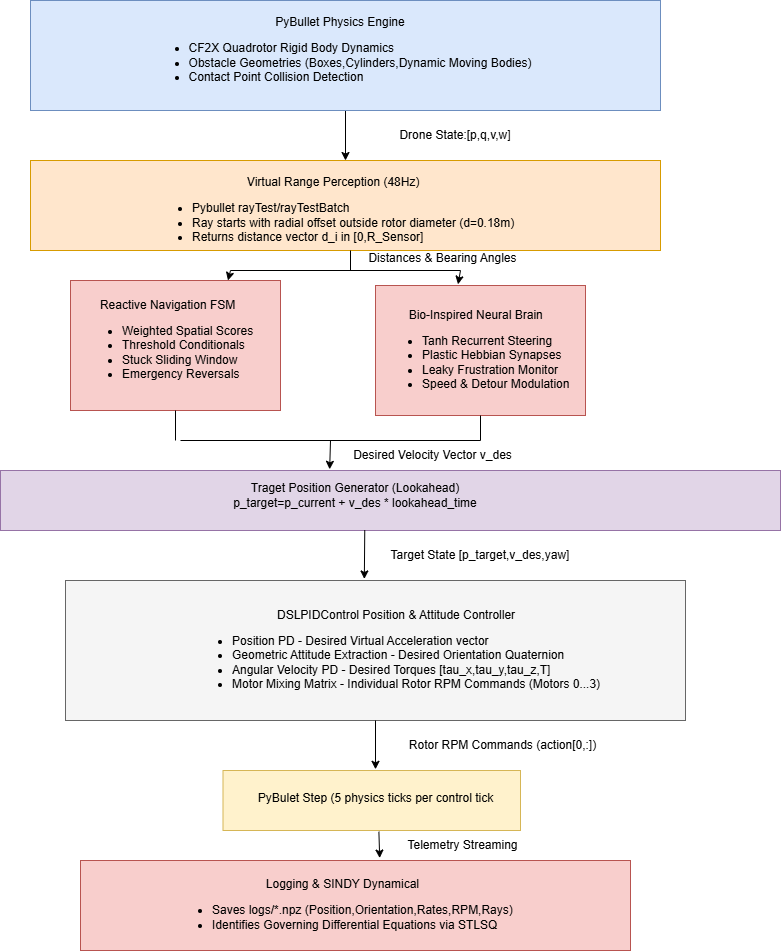

The MuJoCo suite follows the same sense-estimate-plan-control pattern with an added Kalman-filter estimation stage; its full architecture diagram is given in [Section 8.1](#81-end-to-end-system-architecture).

---

<a id="5-technologies-used"></a>
## 5. Technologies Used

| Technology / Library | Version / Scope | Purpose in Project |
|---|---|---|
| **Python** | 3.10+ | Core programming language for all logic, physics interfaces, and math routines. |
| **PyBullet** | $\ge 3.2.5$ | Real-time multi-body physics engine providing rigid-body collision detection and ray-casting. |
| **gym-pybullet-drones** | Master (utiasDSL) | Quadrotor simulation framework providing the Crazyflie 2.X model, environments, and control classes. |
| **NumPy** | $\ge 1.22$ | Fast vectorized mathematical operations, matrix inversions, quaternions, and ray fans. |
| **SciPy** | $\ge 1.9$ | Signal processing tools including the Savitzky-Golay filter (`savgol_filter`) for numerical differentiation. |
| **Matplotlib** | $\ge 3.5$ | Plotting trajectory comparisons, neural activations, phase portraits, and SINDy validation graphs. |
| **DSLPIDControl** | Built-in | Non-linear geometric cascaded PID tracking controller tuned specifically for the CF2X quadrotor. |
| **SINDy / SINDYc** | Custom Implementation | Sparse Identification of Nonlinear Dynamics discovering equations of motion from simulation data. |
| **MuJoCo** | 3.1.0 or newer | High-fidelity 6-DOF rigid-body physics (RK4, 500 Hz) and native ray-casting for the MuJoCo suite (Section 8). |
| **PySINDy, scikit-learn** | Listed MuJoCo dependencies | Data-driven dynamics discovery and regression utilities for the SINDy-DWA planner. |
| **Web dashboard stack** | Python HTTP server + HTML5 Canvas + Three.js | Browser telemetry dashboard with 2D top-down and 3D WebGL viewports. |
| **Tkinter** | Python standard library | Desktop arena customizer (`interactive_arena.py`). |
| **ArduPilot SITL + Gazebo Harmonic** | See `ArduPilot_Gazebo/README.md` | High-level autopilot integration with a 360-degree GPU LiDAR. |

---

<a id="6-project-folder-structure"></a>
## 6. Project Folder Structure

The directory is structured modularly to separate rule-based navigation, neural control, mathematical modeling, and experimental results:

```text
Drones_S5_AB3_Obstacle_Avoidance_Drone/
│
├── README.md                      # Master documentation, architecture & complete mathematical derivations
├── RESULTS.md                     # Quantitative benchmark tables and metrics (Scenarios 1-6)
├── FRP.md                         # Final Review Proposal detailing objectives, methodology & scope
├── Base_Paper.pdf                 # Reference research paper (Devos, Ebeid, Manoonpong, DSD 2018)
├── requirements.txt               # Unified root dependency manifest
├── obstacle_avoidance.py          # Quick-launch root copy of the reactive FSM navigation controller
│
├── pybullet/                      # Core PyBullet simulation, bio-inspired RNN & SINDy research testbed
│   ├── obstacle_avoidance.py      # Primary FSM navigation engine (10 scenarios, dynamic obstacles, metrics)
│   ├── brain_avoidance.py         # Testbed running the Adaptive Neural Brain across scenarios 1-10
│   │
│   ├── brain/                     # Bio-inspired neural navigation package
│   │   ├── __init__.py            # Module exports (AdaptiveNeuralBrain, BrainConfig, RAY_ANGLES_DEG)
│   │   └── neural_brain.py        # Non-spiking RNN architecture with Hebbian plasticity and frustration
│   │
│   ├── sindy/                     # Sparse Identification of Nonlinear Dynamics package
│   │   ├── __init__.py            # Module exports (SINDy, PolynomialLibrary, stlsq, finite_difference)
│   │   ├── sindy.py               # Lightweight STLSQ sparse regression and polynomial library
│   │   └── identify_dynamics.py   # Script identifying translational, rotational, torque, and closed-loop models
│   │
│   ├── models/                    # Discovered governing equations stored as serialized JSON
│   │   ├── sindy_translational.json  # Discovered translational physics (recovers gravity g = 9.80 m/s^2)
│   │   ├── sindy_rotational.json     # Discovered quadrotor angular acceleration matrix for X-configuration
│   │   ├── sindy_torque.json         # Discovered physical body torques (tau = I * dw/dt)
│   │   └── sindy_closed_loop.json    # Discovered velocity response transfer function (SINDYc)
│   │
│   ├── results/                   # Experimental plots, graphs, and performance reports
│   │   └── sindy/
│   │       ├── A_translational.png       # Parity plots: predicted vs actual accelerations (ax, ay, az)
│   │       ├── B_rotational.png          # Parity plots: predicted vs actual angular accelerations (dw)
│   │       ├── C_torque.png              # Parity plots: predicted vs actual aerodynamic body torques (tau)
│   │       ├── D_rollout_brain_s4.png    # Free RK4 integration rollout on held-out Scenario 4
│   │       └── report.json               # Quantitative R^2 scores, residual errors, and formulas
│   │
│   └── logs/                      # Telemetry datasets recorded from 48 Hz simulation runs (.npz)
│       ├── brain_s1.npz .. brain_s10.npz # Scenarios 1 to 10 full flight telemetry logs
│
├── sindy/                         # Top-level SINDy module proxy (allows running python -m sindy from repo root)
│
├── ArduPilot_Gazebo/              # ArduPilot SITL + Gazebo Harmonic autopilot integration suite
│   ├── README.md                  # Comprehensive setup and flight guide for ArduPilot + Gazebo
│   ├── requirements.txt           # Python dependencies (pymavlink, numpy)
│   ├── obstacle_controller.py     # High-level navigation controller interfacing via MAVLink
│   └── iris_runway.sdf            # Gazebo Harmonic world with Iris quadcopter and 360° GPU LiDAR
│
├── mujoco_drone_sim/              # High-fidelity MuJoCo 6-DOF simulation suite (Section 8)
│   ├── PROJECT_DOCUMENTATION.md   # Detailed engineering documentation for the MuJoCo testbed
│   ├── requirements.txt           # MuJoCo suite dependencies (Section 11, Step 5)
│   ├── run_sim.py                 # Main CLI simulation runner & entry point (GUI / headless / dashboard)
│   ├── benchmark.py               # Automated benchmark suite across all avoidance algorithms
│   ├── analyze_dynamic_obstacle.py # Generates 5-panel Kalman tracking & error plots
│   ├── interactive_arena.py       # Standalone Tkinter desktop visual arena editor
│   ├── custom_arena.json          # Saved user-defined obstacle layout configuration
│   │
│   ├── models/
│   │   ├── drone.xml              # MuJoCo MJCF model of the 6-DOF quadcopter with sensors
│   │   └── scene_generator.py     # Procedural MJCF generator for all 10 scenarios
│   │
│   ├── perception/
│   │   ├── lidar_sensor.py        # 8-beam horizontal + 2-beam vertical LiDAR raycaster
│   │   └── kalman_filter.py       # 6-state constant-velocity Kalman filter & multi-tracker
│   │
│   ├── avoidance/
│   │   ├── base_avoidance.py      # Abstract base class for avoidance algorithms
│   │   ├── reactive_avoidance.py  # State machine with dynamic evasion & 360-degree trap escape
│   │   ├── apf_avoidance.py       # Artificial Potential Field (APF)
│   │   ├── dwa_avoidance.py       # Dynamic Window Approach (DWA)
│   │   ├── avoidance_3d.py        # 3D volumetric altitude-adaptive avoidance
│   │   ├── sindy_dwa_avoidance.py # SINDy-enhanced data-driven DWA
│   │   └── neural_brain_avoidance.py # Adaptive neural network avoidance
│   │
│   ├── controllers/
│   │   ├── dsl_pid_controller.py  # Calibrated DSL-PID SE(3) geometric attitude controller
│   │   └── pid_controller.py      # Standard cascaded position/velocity PID controller
│   │
│   ├── simulation/
│   │   ├── drone_sim.py           # Main simulation loop, contact checks, and OU obstacle noise
│   │   └── scenarios.py           # Metadata and definitions for Scenarios 1 to 10
│   │
│   ├── sindy/
│   │   ├── sindy_core.py          # Sequential thresholded regression (STLSQ)
│   │   ├── drone_identifier.py    # Discovers quadcopter dynamics from flight logs
│   │   └── obstacle_predictor.py  # SINDy trajectory predictor for dynamic obstacles
│   │
│   └── web_dashboard/
│       ├── app.py                 # Multi-threaded HTTP server & simulation API backend
│       └── static/
│           └── index.html         # Interactive HTML5/Canvas UI with live coordinate HUD
│
├── terminalResults/               # Captured terminal output logs verifying Scenarios 1-6
│   ├── scenario1.txt .. scenario6.txt
│
├── matlab/                        # MATLAB scripts that generate the figures of Section 7
│   └── section7/
│       ├── run_all_section7_plots.m       # Regenerates every Section 7 figure in one call
│       └── plot_7_1_*.m .. plot_7_9_*.m   # One script per subsection (10 scripts, incl. plot_7_2b_elliptical_bubble.m)
│
└── assets/                        # University branding and graphics
    ├── amrita_logo.jpg            # Amrita Vishwa Vidyapeetham official emblem
    ├── GymPybullet.drawio.png     # System architecture diagram (Section 4)
    └── section7/
        └── fig_7_1_*.png .. fig_7_9_*.png # 10 MATLAB-rendered figures embedded in Section 7
```

---

<a id="7-complete-mathematical-foundations--equations"></a>
## 7. Complete Mathematical Foundations & Equations

> **What this section does.** Section 7 is the mathematical backbone of the project. It lists, in the order the data flows through the system, every equation the code evaluates: from "where is the goal?" (§7.1), through perception (§7.2), the two decision-making paradigms (§7.3 rule-based FSM; §7.4 to §7.7 bio-inspired neural brain), down to the flight controller that spins the four rotors (§7.8), and finally the data-driven step that *recovers* governing equations from flight logs (§7.9).
>
> **Practical purpose.** It lets you (i) trace every line of the Python code back to a formula, (ii) understand what each tuning constant physically means before you change it, and (iii) check the theory against numbers: each subsection gives a plain-language explanation, a definition of every symbol (with units), a worked numerical example, a pointer to the implementing function, and a MATLAB plot of the subsection's main formula.

### How Section 7 fits together

| § | Stage of the pipeline | Question it answers | Main output |
|---|---|---|---|
| 7.1 | Geometry | In which direction is the goal? | unit direction vector toward the goal |
| 7.2 | Perception | How far is the nearest obstacle along each beam, and when does it count as a threat? | beam distances, reactive-bubble radius |
| 7.3 | Reactive FSM | Which side should I pass on, and am I stuck? | LEFT / RIGHT decision, stuck flag |
| 7.4 | Neural brain: neuron dynamics | How do two neurons turn range readings into a steering preference? | steering activities (a_L, a_R) |
| 7.5 | Neural brain: plasticity | How does the brain *remember* an obstacle after it leaves the sensor cone? | self-weights (w_LL, w_RR) |
| 7.6 | Neural brain: frustration | How does it escape dead ends? | frustration F, detour angle, yaw rate |
| 7.7 | Neural brain: speed | How fast may the drone fly given the clearance ahead? | forward speed |
| 7.8 | Flight control | How does a velocity command become four rotor speeds? | thrust, torques, rotor RPM |
| 7.9 | System identification | Which equations do the logged flights actually obey? | sparse models (A, B, C) |

**Notation conventions used throughout**

- **Bold** symbols are vectors or matrices; a hat (for example $\hat{\mathbf{d}}_g$) marks a unit-length vector. Subscript $W$ denotes the world (inertial) frame, subscript $B$ the drone body frame.
- Distances are in metres, time in seconds, angles in radians unless a degree sign is written. A positive angle is counter-clockwise when viewed from above, i.e. a turn to the drone's **left**.
- The control loop runs at $48\,\text{Hz}$, so one control tick lasts $\Delta t = 1/48 \approx 0.0208\,\text{s}$.
- A few letters are reused in different subsections with different meanings (for example $\tau$ is a neuron time constant in §7.4 but a torque in §7.8). Every subsection defines its own symbols, and the clash is pointed out where it matters.

**About the MATLAB figures.** Every subsection ends with a plot of its main formula. The scripts live in [`matlab/section7/`](matlab/section7) and write PNG files to [`assets/section7/`](assets/section7); run `run('matlab/section7/run_all_section7_plots.m')` in MATLAB R2020a or newer to regenerate all of them. Constants are taken from this section; where the project does not fix a value (the PID gains in §7.8, the corridor width in §7.2, the synthetic data in §7.9) the script and caption say so.

### Mathematical Architecture Summary (Quick Reference)

This cheat sheet repeats the key formulas without derivations. Each group points to the subsection that explains it fully.

#### 1. Geometry & Perception (§7.1, §7.2)
* **Horizontal Goal Direction:**

  ```math
  \hat{\mathbf{d}}_g = \frac{\mathbf{p}_{\text{goal}} - \mathbf{p}(t)}{\|\mathbf{p}_{\text{goal}} - \mathbf{p}(t)\|_2}
  ```

* **Parametric Ray-Casting Fan:**

  ```math
  \mathbf{r}_i(s) = \mathbf{r}_{\text{start}, i} + s \cdot (\mathbf{r}_{\text{end}, i} - \mathbf{r}_{\text{start}, i}), \quad s \in [0, 1]
  ```

* **Elliptical Reactive Bubble:**

  ```math
  R_{\text{react}}(\theta) = \frac{a \cdot b}{\sqrt{(b \cos\theta)^2 + (a \sin\theta)^2}}
  ```

#### 2. Decision & Reactive FSM (§7.3)
* **Spatial Free-Space Scores:**

  ```math
  S_{\text{left}} = 0.65 d_{\text{left}} + 0.35 d_{\text{far-left}}, \quad S_{\text{right}} = 0.65 d_{\text{right}} + 0.35 d_{\text{far-right}}
  ```

* **Decision Hysteresis Dead-Band:**

  ```math
  |S_{\text{left}} - S_{\text{right}}| \ge \delta_{\text{hysteresis}} = 0.08\,\text{m}
  ```

* **Sliding-Window Progress & Stuck Detector:**

  ```math
  \Delta p_{\text{progress}} = \|\mathbf{p}_k[0:2] - \mathbf{p}_{k-W+1}[0:2]\|_2 < 0.10\,\text{m}
  ```

#### 3. Bio-Inspired Neural Brain (§7.4 to §7.7)
* **Leaky Membrane ODE:**

  ```math
  \tau \frac{dx_i}{dt} = -x_i(t) + \text{drive}_i(t)
  ```

* **Activity-Dependent Hebbian Plasticity:**

  ```math
  \frac{dw_{ii}}{dt} = \mu (1 + 2F) I_i a_i - \gamma (w_{ii} - w_{\text{self}, 0})
  ```

* **Frustration Leaky Integrator:**

  ```math
  \frac{dF}{dt} = +\alpha_{\text{rise}} = 0.35\,\text{s}^{-1} \quad (\text{stalled in local minima})
  ```

* **Adaptive Heading Steering Rate:**

  ```math
  \omega = \text{clip}\left(K_{\text{goal}} e_{\text{attract}} G_{\text{attract}} - K_{\text{turn}} (a_L - a_R)(1 - 0.5F), \; -\Omega_{\max}, \; +\Omega_{\max}\right)
  ```

#### 4. Flight Control & Dynamics (§7.8)
* **Cascaded Position Control Law:**

  ```math
  \mathbf{a}_{\text{des}} = \mathbf{K}_p \mathbf{e}_p + \mathbf{K}_d \mathbf{e}_v + \mathbf{K}_i \int_0^t \mathbf{e}_p(t') \, dt' + g \mathbf{z}_W
  ```

* **Thrust Allocation & Body Orientation Extraction:**

  ```math
  T_{\text{des}} = m \|\mathbf{a}_{\text{des}}\|_2, \quad \mathbf{z}_{B, \text{des}} = \frac{\mathbf{a}_{\text{des}}}{\|\mathbf{a}_{\text{des}}\|_2}
  ```

* **Motor Thrust Allocation (Crazyflie 2.X X-Frame), rotor speeds in RPM:**

  ```math
  T = k_f \sum_{i=0}^3 n_i^2, \quad \boldsymbol{\tau} = \mathbf{M}_{\text{mix}} \begin{bmatrix} n_0^2 \\ n_1^2 \\ n_2^2 \\ n_3^2 \end{bmatrix}
  ```

#### 5. Data-Driven Physics Discovery, SINDy (§7.9)
* **Sparse Nonlinear Dynamics Formulation:**

  ```math
  \dot{\mathbf{X}} = \Theta(\mathbf{X}, \mathbf{U}) \, \Xi
  ```

* **STLSQ Optimization:**

  ```math
  \min_{\Xi} \; \| \dot{\mathbf{X}} - \Theta \, \Xi \|_2^2 + \alpha \, \| \Xi \|_F^2 \qquad \text{with coefficients below } \lambda \text{ set to zero}
  ```

---

<a id="71-coordinate-systems--vector-kinematics"></a>
### 7.1 Coordinate Systems & Vector Kinematics

> **What this section does.** It fixes the reference frame in which every other equation is written and computes the one geometric quantity the navigation layers need on every control tick: *the direction in which the goal lies*.
>
> **Practical purpose.** Both planners steer relative to this direction. The FSM measures its left/right sectors from it (§7.3), and the neural brain converts it into an attraction heading (§7.6). Using a **unit** vector separates "which way" from "how far", so speed and avoidance logic can scale the direction independently.

The simulation operates in a right-handed inertial Cartesian frame $\mathcal{F}_W = \{\mathbf{x}_W, \mathbf{y}_W, \mathbf{z}_W\}$ where $\mathbf{z}_W$ points upward against gravity.

#### Equation: Horizontal Unit Direction toward Goal

```math
\mathbf{d}_{\text{goal}} = \mathbf{p}_{\text{goal}} - \mathbf{p}(t) = \begin{bmatrix} x_{\text{goal}} - x(t) \\ y_{\text{goal}} - y(t) \\ 0 \end{bmatrix}
```

```math
\hat{\mathbf{d}}_g = \frac{\mathbf{d}_{\text{goal}}}{\|\mathbf{d}_{\text{goal}}\|_2} = \begin{bmatrix} \frac{x_{\text{goal}} - x}{\sqrt{(x_{\text{goal}} - x)^2 + (y_{\text{goal}} - y)^2}} \\ \frac{y_{\text{goal}} - y}{\sqrt{(x_{\text{goal}} - x)^2 + (y_{\text{goal}} - y)^2}} \\ 0 \end{bmatrix}
```

**What the equations say.** The first equation subtracts the drone's position from the goal position to get the displacement vector pointing from the drone to the goal. Its vertical component is forced to zero because avoidance is planned in the horizontal plane (the start and goal are both at $z = 1.0\,\text{m}$). The second equation divides that displacement by its own length (the Euclidean norm), which keeps the direction but throws away the distance. The result always has length 1, whether the drone is 6 m or 6 cm from the goal.

**Variables**
- $\mathbf{p}(t) = [x(t), y(t), z(t)]^T$: instantaneous 3D position of the drone in world coordinates ($\text{m}$); $t$ is time ($\text{s}$).
- $\mathbf{p}_{\text{goal}} = [x_{\text{goal}}, y_{\text{goal}}, z_{\text{goal}}]^T = [6.0, 0.0, 1.0]^T$: fixed 3D destination ($\text{m}$).
- $\mathbf{d}_{\text{goal}}$: horizontal displacement from drone to goal ($\text{m}$), with the $z$-component set to $0$.
- $\|\cdot\|_2$: Euclidean (L2) norm, the vector's length: $\|\mathbf{d}_{\text{goal}}\|_2 = \sqrt{(x_{\text{goal}}-x)^2 + (y_{\text{goal}}-y)^2}$ ($\text{m}$). The direction is undefined when this is exactly zero (drone directly above the goal), so any implementation needs a small-distance guard there.
- $\hat{\mathbf{d}}_g$: dimensionless horizontal unit vector pointing from the drone toward the goal.

- **Implementation:** `horizontal_unit_vector()` and `goal_direction()` in [pybullet/obstacle_avoidance.py](pybullet/obstacle_avoidance.py#L341-L381).
- **Step-by-Step Numerical Example:**
  Suppose the drone has moved to $\mathbf{p} = [2.00, 0.50, 1.00]^T$:
  1. Difference vector: $\mathbf{d}_{\text{goal}} = [6.0 - 2.0, 0.0 - 0.5, 0.0]^T = [4.0, -0.5, 0.0]^T$.
  2. Euclidean norm: $\|\mathbf{d}_{\text{goal}}\| = \sqrt{4.0^2 + (-0.5)^2} = \sqrt{16.0 + 0.25} = \sqrt{16.25} \approx 4.0311\,\text{m}$.
  3. Normalized vector: $\hat{\mathbf{d}}_g = \left[\frac{4.0}{4.0311}, \frac{-0.5}{4.0311}, 0\right]^T \approx [0.9923, -0.1240, 0.0]^T$.

#### Equation: 2D Planar Rotation Matrix
To project sensor rays or lateral avoidance vectors at an angle $\theta$ relative to $\hat{\mathbf{d}}_g$:

```math
\mathbf{R}_z(\theta) = \begin{bmatrix} \cos\theta & -\sin\theta & 0 \\ \sin\theta & \cos\theta & 0 \\ 0 & 0 & 1 \end{bmatrix}, \quad \hat{\mathbf{u}}_\theta = \mathbf{R}_z(\theta) \hat{\mathbf{d}}_g
```

**What the equation says.** Multiplying a vector by $\mathbf{R}_z(\theta)$ spins it counter-clockwise by the angle $\theta$ about the vertical axis, leaving its length and its $z$-component unchanged. Applying it to $\hat{\mathbf{d}}_g$ produces a new unit vector pointing $\theta$ to the left of the goal direction (negative $\theta$ points to the right). This is how the FSM aims a beam or an avoidance manoeuvre at, say, $+35^\circ$ or $-70^\circ$ from the goal line.

**Variables**
- $\theta$: rotation angle ($\text{rad}$ in the formula; the project quotes it in degrees), positive counter-clockwise seen from above.
- $\mathbf{R}_z(\theta)$: $3 \times 3$ rotation matrix about $\mathbf{z}_W$. Its top-left $2 \times 2$ block rotates the $xy$-plane; the $1$ in the last diagonal entry keeps $z$ fixed.
- $\hat{\mathbf{d}}_g$: unit goal direction from the previous equation.
- $\hat{\mathbf{u}}_\theta$: resulting unit direction, rotated by $\theta$ from the goal direction.

- **Numerical example:** with $\hat{\mathbf{d}}_g = [0.9923, -0.1240, 0]^T$ and $\theta = +35^\circ$ ($\cos 35^\circ = 0.8192$, $\sin 35^\circ = 0.5736$): $\hat{\mathbf{u}}_\theta = [0.8192 \cdot 0.9923 - 0.5736 \cdot (-0.1240),\; 0.5736 \cdot 0.9923 + 0.8192 \cdot (-0.1240),\; 0]^T \approx [0.8840, 0.4676, 0]^T$. Its heading is $\text{atan2}(0.4676, 0.8840) \approx 27.9^\circ$, which equals the goal heading ($-7.1^\circ$) plus $35^\circ$, as expected.
- **Implementation:** `rotate_horizontal(vector, angle_degrees)` in [pybullet/obstacle_avoidance.py](pybullet/obstacle_avoidance.py#L357-L371).

#### MATLAB Plot: Horizontal Unit Direction toward the Goal (main formula of §7.1)

<details>
<summary><b>MATLAB code</b> &mdash; <code>matlab/section7/plot_7_1_goal_direction.m</code></summary>

```matlab
% plot_7_1_goal_direction.m
% Section 7.1 - Horizontal unit direction toward the goal
%     d_g = (p_goal - p) / || p_goal - p ||_2        (xy-plane only)
% Whatever the drone position, d_g always points at the goal and has length 1.

pGoal = [6.0, 0.0];                                  % goal (x, y) in metres
[X, Y] = meshgrid(0:1:5, -2:1:2);                    % grid of possible drone positions

Dx  = pGoal(1) - X;   Dy = pGoal(2) - Y;             % horizontal part of p_goal - p
Nrm = hypot(Dx, Dy);                                 % || p_goal - p ||_2
Ux  = Dx ./ Nrm;      Uy = Dy ./ Nrm;                % unit direction d_g at every grid point

% Worked example from the text: drone at p = [2.0, 0.5, 1.0]
p  = [2.0, 0.5];
dg = (pGoal - p) / norm(pGoal - p);                  % -> [0.9923, -0.1240]

blue = [0.00 0.45 0.74];  orange = [0.85 0.33 0.10];  gray = [0.55 0.55 0.55];

fig = figure('Color', 'w', 'Position', [100 100 900 620]);
try, theme(fig, 'light'); catch, end   % force light colours (R2025a+ follows the OS dark mode)
hold on; grid on; box on;
h1 = quiver(X, Y, 0.5*Ux, 0.5*Uy, 'AutoScale', 'off', 'Color', gray, 'LineWidth', 1);
h2 = plot([p(1) pGoal(1)], [p(2) pGoal(2)], '--', 'Color', blue, 'LineWidth', 1.4);
h3 = quiver(p(1), p(2), dg(1), dg(2), 'AutoScale', 'off', 'Color', orange, ...
            'LineWidth', 2.8, 'MaxHeadSize', 0.8);
plot(p(1), p(2), 'o', 'MarkerFaceColor', orange, 'MarkerEdgeColor', 'k', 'MarkerSize', 8);
h4 = plot(pGoal(1), pGoal(2), 'p', 'MarkerFaceColor', [0.93 0.69 0.13], ...
          'MarkerEdgeColor', 'k', 'MarkerSize', 16);
text(p(1) - 0.15, p(2), {sprintf('p = (%.1f, %.1f)', p), sprintf('d_g = [%.4f, %.4f]', dg)}, ...
     'FontSize', 11, 'HorizontalAlignment', 'right');
text(pGoal(1) - 0.05, pGoal(2) + 0.45, 'p_{goal}', 'FontSize', 11, 'HorizontalAlignment', 'center');

axis equal; xlim([-1.2 6.6]); ylim([-2.7 2.7]);
xlabel('x  (m)'); ylabel('y  (m)');
title('d_g = (p_{goal} - p) / || p_{goal} - p ||_2   (horizontal plane)');
legend([h1 h2 h3 h4], {'d_g at other drone positions (drawn at half length)', ...
       'd_{goal} = p_{goal} - p (worked example)', ...
       'd_g at the worked-example point (length = 1)', 'goal'}, ...
       'Location', 'southoutside', 'NumColumns', 1);
set(gca, 'FontSize', 11);

outDir = fullfile(fileparts(mfilename('fullpath')), '..', '..', 'assets', 'section7');
if ~exist(outDir, 'dir'), mkdir(outDir); end
exportgraphics(fig, fullfile(outDir, 'fig_7_1_goal_direction.png'), 'Resolution', 200);
```

</details>

<p align="center">
  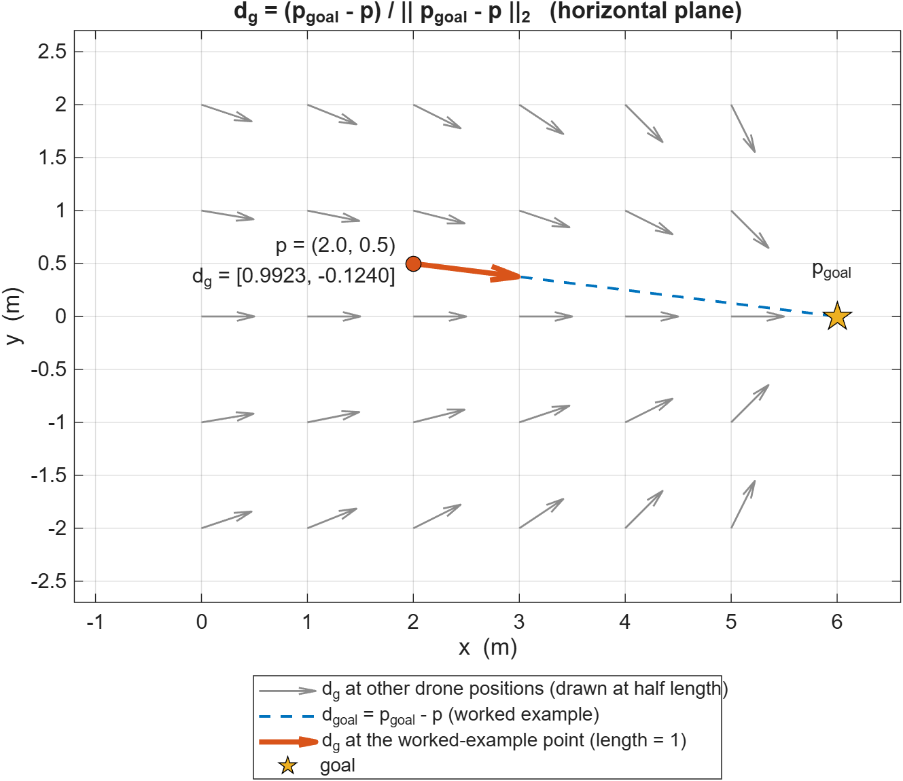
</p>
<p align="center"><b>Figure 7.1</b> &ndash; The unit vector <code>d_g</code> at many drone positions (grey, drawn at half length) and at the worked-example point (orange, true length 1). Every arrow points at the goal star; only the direction changes with position, never the length.</p>

---

<a id="72-virtual-ray-casting--obstacle-perception"></a>
### 7.2 Virtual Ray-Casting & Obstacle Perception

> **What this section does.** It describes how the drone "sees". Instead of cameras or a map, it fires a fan of virtual rays into the PyBullet world and records how far each ray travels before it hits something. It then defines the *elliptical reactive bubble*: a direction-dependent distance threshold that decides when a reading counts as a threat.
>
> **Practical purpose.** These few distances are the **only** sensory input to both planners, which keeps the computation light enough for micro-controller-class hardware (see §2): no SLAM and no GPU. The bubble stops the drone from panicking at corridor walls it can safely fly past, while still reacting early to obstacles dead ahead.

The drone perceives its local surroundings by querying the PyBullet collision world via geometric rays.

#### Equation: Ray Parametrization & Distance Extraction
Each ray $i$ originating from the drone body is parametrized by $s \in [0, 1]$:

```math
\mathbf{r}_i(s) = \mathbf{r}_{\text{start}, i} + s \cdot (\mathbf{r}_{\text{end}, i} - \mathbf{r}_{\text{start}, i})
```

where:

```math
\mathbf{r}_{\text{start}, i} = \mathbf{p} + d_{\text{offset}} \hat{\mathbf{u}}_{\theta_i}, \quad \mathbf{r}_{\text{end}, i} = \mathbf{r}_{\text{start}, i} + R_{\text{sensor}} \hat{\mathbf{u}}_{\theta_i}
```

PyBullet's `p.rayTest` returns the normalized intersection fraction $f_i \in [0, 1]$ and the collided object identifier $\text{id}_{\text{hit}}$:

```math
d_i = \begin{cases} R_{\text{sensor}}, & \text{if } \text{id}_{\text{hit}} = -1 \text{ (no hit)} \\ f_i \cdot R_{\text{sensor}}, & \text{if } \text{id}_{\text{hit}} \ge 0 \text{ (obstacle detected)} \end{cases}
```

**What the equations say.** A ray is just a straight segment. The first equation is the standard "start point plus a fraction of the way to the end point" formula: at $s = 0$ you are at the start, at $s = 1$ at the end. The second pair of equations builds that segment: it begins a small distance $d_{\text{offset}}$ *outside* the drone along the beam direction (so the ray cannot hit the drone's own propellers) and extends $R_{\text{sensor}}$ further. The third equation turns PyBullet's answer into a distance: if the ray hit nothing the reading saturates at the maximum range; otherwise the hit fraction $f_i$ is scaled by the ray length.

**Variables**
- $i$: beam index (6 beams in the FSM, 12 in the neural brain).
- $\mathbf{r}_i(s)$: the point at fraction $s$ along beam $i$ ($\text{m}$); $s$ is the dimensionless ray parameter (not the clearance $s$ of §7.7).
- $\mathbf{r}_{\text{start}, i}$, $\mathbf{r}_{\text{end}, i}$: first and last point of the beam ($\text{m}$).
- $\mathbf{p}$: drone position ($\text{m}$).
- $\hat{\mathbf{u}}_{\theta_i}$: unit direction of beam $i$, at bearing $\theta_i$ (from §7.1's rotation for the FSM; a fixed body-frame angle for the brain's fan).
- $d_{\text{offset}} = 0.18\,\text{m}$ (FSM) or $0.10\,\text{m}$ (Brain): radial clearance ensuring rays originate outside the quadrotor's rotor footprint (about $0.065\,\text{m}$ radius) to avoid self-detection.
- $R_{\text{sensor}} = 1.60\,\text{m}$: maximum sensor detection range.
- $f_i \in [0, 1]$: fraction of the ray length at which the first hit occurs.
- $\text{id}_{\text{hit}}$: PyBullet's identifier of the body that was hit, $-1$ when nothing was hit.
- $d_i$: measured distance to the obstacle along bearing $\theta_i$ ($\text{m}$), measured from $\mathbf{r}_{\text{start}, i}$, always in $[0, R_{\text{sensor}}]$.

- **Numerical example (also shown in Figure 7.2):** drone at the origin heading along $+x$, beam $\theta = 0^\circ$, $d_{\text{offset}} = 0.18\,\text{m}$, $R_{\text{sensor}} = 1.60\,\text{m}$, obstacle face at $x = 1.0\,\text{m}$. Then $\mathbf{r}_{\text{start}} = (0.18, 0)$, $\mathbf{r}_{\text{end}} = (1.78, 0)$, the hit fraction is $f = (1.0 - 0.18)/1.60 = 0.5125$, so $d = 0.5125 \times 1.60 = 0.82\,\text{m}$. Beams that miss the obstacle report $d = 1.60\,\text{m}$.
- **Implementation:** `cast_sensor_ray()` in [pybullet/obstacle_avoidance.py](pybullet/obstacle_avoidance.py#L387-L431) and `cast_rays()` in [pybullet/brain_avoidance.py](pybullet/brain_avoidance.py#L71-L89).

#### MATLAB Plot: Ray-Casting Fan and Distance Extraction (main formula of §7.2)

<details>
<summary><b>MATLAB code</b> &mdash; <code>matlab/section7/plot_7_2_ray_casting.m</code></summary>

```matlab
% plot_7_2_ray_casting.m
% Section 7.2 - Ray parametrisation and distance extraction
%     r_i(s) = r_start,i + s (r_end,i - r_start,i),   s in [0, 1]
%     d_i    = R_sensor            if the ray hits nothing
%            = f_i * R_sensor      if it hits at fraction f_i
% Top-down view of the 6-beam FSM fan meeting one rectangular obstacle.

p      = [0 0];                              % drone position (x, y); heading = +x
angles = [0 35 -35 70 -70 180];              % FSM beam bearings (deg), relative to heading
dOff   = 0.18;                               % ray start offset d_offset (m)
Rs     = 1.60;                               % maximum sensor range R_sensor (m)
obs    = [1.0 1.4 -0.35 0.85];               % obstacle [xmin xmax ymin ymax] (m)

u      = [cosd(angles(:)), sind(angles(:))]; % unit direction of every beam
rStart = p + dOff * u;                       % r_start,i
rEnd   = rStart + Rs * u;                    % r_end,i
n      = numel(angles);
f      = ones(n, 1);                         % hit fraction (1 = no hit)
hit    = false(n, 1);
lo     = obs([1 3]);  hi = obs([2 4]);

for k = 1:n                                  % slab test of each ray against the box
    D = rEnd(k,:) - rStart(k,:);
    tNear = 0;  tFar = 1;  ok = true;
    for a = 1:2
        if abs(D(a)) < 1e-12
            if rStart(k,a) < lo(a) || rStart(k,a) > hi(a), ok = false; end
        else
            t1 = (lo(a) - rStart(k,a)) / D(a);
            t2 = (hi(a) - rStart(k,a)) / D(a);
            tNear = max(tNear, min(t1, t2));
            tFar  = min(tFar,  max(t1, t2));
        end
    end
    if ok && tNear <= tFar, f(k) = tNear; hit(k) = true; end
end
d = f * Rs;                                  % measured distances d_i
fprintf('Beam %+4d deg : d = %.2f m\n', [angles(:), d]');

blue = [0.00 0.45 0.74];  orange = [0.85 0.33 0.10];  green = [0.13 0.55 0.13];

fig = figure('Color', 'w', 'Position', [100 100 900 560]);
try, theme(fig, 'light'); catch, end   % force light colours (R2025a+ follows the OS dark mode)
hold on; grid on; box on;
fill(obs([1 2 2 1]), obs([3 3 4 4]), [0.78 0.78 0.78], 'EdgeColor', 'k', 'LineWidth', 1.5);
text(1.2, 0.97, 'obstacle', 'HorizontalAlignment', 'center', 'FontSize', 11);
th = linspace(0, 2*pi, 200);
plot(dOff*cos(th), dOff*sin(th), '--', 'Color', [0.5 0.5 0.5]);        % start-offset ring

for k = 1:n
    pHit = rStart(k,:) + f(k) * (rEnd(k,:) - rStart(k,:));
    if hit(k), c = orange; else, c = green; end
    plot([rStart(k,1) pHit(1)], [rStart(k,2) pHit(2)], '-', 'Color', c, 'LineWidth', 2.2);
    if hit(k)
        plot([pHit(1) rEnd(k,1)], [pHit(2) rEnd(k,2)], ':', 'Color', c, 'LineWidth', 1.2);
        plot(pHit(1), pHit(2), 'o', 'MarkerFaceColor', c, 'MarkerEdgeColor', 'k', 'MarkerSize', 7);
    end
    plot(rStart(k,1), rStart(k,2), '.', 'Color', 'k', 'MarkerSize', 12);
    if hit(k)                                              % label to the right of the obstacle
        lab = [obs(2) + 0.10, pHit(2) + 0.10];  al = 'left';
    elseif abs(u(k,2)) < 1e-9                              % rear beam: label above its middle
        lab = (rStart(k,:) + rEnd(k,:)) / 2 + [0 0.12];  al = 'center';
    else                                                   % label beyond the ray tip
        lab = rEnd(k,:) + 0.08 * sign(u(k,:));  al = 'left';
    end
    text(lab(1), lab(2), sprintf('%d^{\\circ}: d = %.2f m', angles(k), d(k)), 'FontSize', 10, ...
         'Color', c * 0.8, 'FontWeight', 'bold', ...
         'HorizontalAlignment', al, 'VerticalAlignment', 'middle');
end

plot(0, 0, 's', 'MarkerFaceColor', blue, 'MarkerEdgeColor', 'k', 'MarkerSize', 10);
quiver(0, 0, 0.35, 0, 'AutoScale', 'off', 'Color', blue, 'LineWidth', 2, 'MaxHeadSize', 1);
text(-0.25, -0.22, 'drone', 'HorizontalAlignment', 'right', 'FontSize', 10, 'Color', blue);
text(-0.15, 0.30, 'd_{offset}', 'HorizontalAlignment', 'right', 'FontSize', 10, 'Color', [0.4 0.4 0.4]);

hh(1) = plot(NaN, NaN, '-', 'Color', orange, 'LineWidth', 2.2);
hh(2) = plot(NaN, NaN, '-', 'Color', green,  'LineWidth', 2.2);
hh(3) = plot(NaN, NaN, 'o', 'MarkerFaceColor', orange, 'MarkerEdgeColor', 'k');
legend(hh, {'ray with a hit:  d_i = f_i R_{sensor} < R_{sensor}', ...
            'ray with no hit:  d_i = R_{sensor}', 'hit point  (s = f_i)'}, 'Location', 'southwest');
axis equal; xlim([-2.0 3.0]); ylim([-2.0 2.0]);
xlabel('x  (m)'); ylabel('y  (m)');
title('Ray-casting fan:  r_i(s) = r_{start,i} + s (r_{end,i} - r_{start,i}),  s \in [0, 1]');
set(gca, 'FontSize', 11);

outDir = fullfile(fileparts(mfilename('fullpath')), '..', '..', 'assets', 'section7');
if ~exist(outDir, 'dir'), mkdir(outDir); end
exportgraphics(fig, fullfile(outDir, 'fig_7_2_ray_casting.png'), 'Resolution', 200);
```

</details>

<p align="center">
  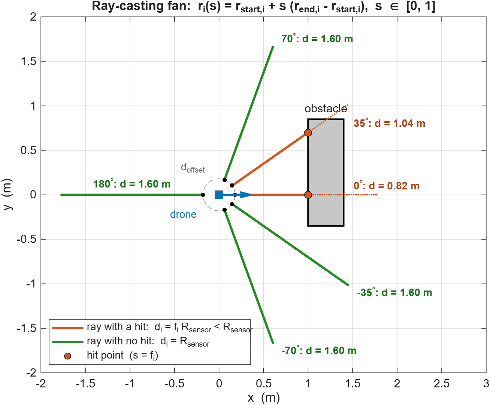
</p>
<p align="center"><b>Figure 7.2</b> &ndash; The six FSM beams. Orange beams hit the obstacle (<code>d &lt; R_sensor</code>, measured from the beam's start point); green beams find nothing and saturate at <code>R_sensor = 1.60 m</code>. The small dashed ring is the start offset <code>d_offset</code>.</p>

#### Equation: Elliptical Reactive Bubble (Neural Brain)

**What it does.** A distance reading only matters if it is *short enough to be dangerous*, and "short enough" depends on the direction: an obstacle 1 m straight ahead is something to steer around now, whereas a wall 0.5 m to the side is harmless when flying parallel to it. The reactive bubble is therefore not a circle but an **ellipse** centred on the drone and stretched along its heading. A reading in direction $\theta$ triggers avoidance only when it is shorter than $R_{\text{react}}(\theta)$, the distance from the drone to the ellipse boundary in that direction. To prevent the drone from false-triggering avoidance on corridor side-walls when flying down narrow passages, the reaction threshold varies continuously with heading angle $\theta$ following an ellipse:

```math
R_{\text{react}}(\theta) = \frac{a \cdot b}{\sqrt{(b \cos\theta)^2 + (a \sin\theta)^2}}
```

**Where the formula comes from.** An ellipse with semi-axis $a$ along the heading ($x$) and $b$ sideways ($y$) satisfies $x^2/a^2 + y^2/b^2 = 1$. Writing a boundary point in polar form, $x = R\cos\theta$ and $y = R\sin\theta$, gives $R^2\left(\cos^2\theta / a^2 + \sin^2\theta / b^2\right) = 1$; solving for $R$ yields the expression above.

**Variables**
- $R_{\text{react}}(\theta)$: reaction radius in direction $\theta$ ($\text{m}$); an obstacle closer than this along that bearing counts as a threat.
- $\theta$: bearing of the sensor beam measured from the drone's heading ($\theta = 0$ straight ahead, $\pm 90^\circ$ directly to the sides).
- $a = 1.10\,\text{m}$: major semi-axis straight ahead ($\theta = 0^\circ$).
- $b = 0.32\,\text{m}$: minor semi-axis directly sideways ($\theta = \pm 90^\circ$).

- **Numerical Example:**
  - Ahead ($\theta = 0^\circ$): $R_{\text{react}}(0^\circ) = \frac{1.10 \times 0.32}{\sqrt{(0.32 \times 1)^2 + 0}} = 1.10\,\text{m}$.
  - Oblique ($\theta = 45^\circ$): $\cos(45^\circ) = \sin(45^\circ) \approx 0.7071$.
    $\sqrt{(0.32 \times 0.7071)^2 + (1.10 \times 0.7071)^2} = \sqrt{0.0512 + 0.6050} = \sqrt{0.6562} \approx 0.8101$.
    $R_{\text{react}}(45^\circ) = \frac{0.352}{0.8101} \approx 0.4345\,\text{m}$.
  - Sideways ($\theta = 90^\circ$): $R_{\text{react}}(90^\circ) = 0.32\,\text{m}$.
- **Implementation:** [pybullet/brain/neural_brain.py](pybullet/brain/neural_brain.py#L112-L113).

**Visual explanation.**

<p align="center">
  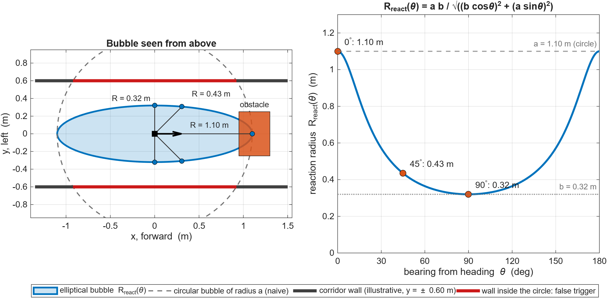
</p>
<p align="center"><b>Figure 7.2b</b> &ndash; <b>Left:</b> the drone (black square, arrow = heading) sits inside its elliptical bubble (blue). A plain circular bubble of radius <code>a = 1.10 m</code> (dashed grey) would report both corridor walls (<code>y = &plusmn;0.60 m</code>, an illustrative width) as threats along the red stretches, so the drone would swerve for no reason. The ellipse is only <code>0.32 m</code> wide sideways, so the walls are ignored, yet the orange obstacle ahead still intrudes into the bubble and triggers a reaction. <b>Right:</b> the same <code>R_react(&theta;)</code> plotted against bearing; it drops from <code>1.10 m</code> ahead to <code>0.43 m</code> at 45&deg; and <code>0.32 m</code> sideways.</p>

<details>
<summary><b>MATLAB code</b> &mdash; <code>matlab/section7/plot_7_2b_elliptical_bubble.m</code></summary>

```matlab
% plot_7_2b_elliptical_bubble.m
% Section 7.2 - Elliptical Reactive Bubble
%     R_react(theta) = a b / sqrt( (b cos(theta))^2 + (a sin(theta))^2 )
% Left : top-down picture of the bubble (ellipse) versus a plain circular bubble.
% Right: the reaction radius as a function of the bearing theta.

a = 1.10;                                    % semi-axis straight ahead   (m)
b = 0.32;                                    % semi-axis directly sideways (m)
wallY = 0.60;                                % half-width of an example corridor (m)

th = linspace(-pi, pi, 721);
R  = a*b ./ sqrt((b*cos(th)).^2 + (a*sin(th)).^2);   % R_react(theta)
ex = R .* cos(th);   ey = R .* sin(th);              % ellipse outline (x forward, y left)

blue = [0.00 0.45 0.74];  orange = [0.85 0.33 0.10];  red = [0.80 0.10 0.10];  gray = [0.45 0.45 0.45];

fig = figure('Color', 'w', 'Position', [100 100 1100 520]);
try, theme(fig, 'light'); catch, end   % force light colours (R2025a+ follows the OS dark mode)
tl  = tiledlayout(1, 2, 'TileSpacing', 'compact', 'Padding', 'compact');

% ---------- (a) top-down view -------------------------------------------------
nexttile; hold on; box on; grid on;
fill(ex, ey, blue, 'FaceAlpha', 0.20, 'EdgeColor', blue, 'LineWidth', 2.2);
plot(a*cos(th), a*sin(th), '--', 'Color', gray, 'LineWidth', 1.4);          % naive circular bubble

xw = sqrt(a^2 - wallY^2);                                                   % wall part inside the circle
for s = [-1 1]
    plot([-1.35 1.5], s*wallY*[1 1], '-', 'Color', [0.25 0.25 0.25], 'LineWidth', 4);
    plot([-xw xw],    s*wallY*[1 1], '-', 'Color', red, 'LineWidth', 4);    % false-trigger zone
end
fill([0.95 1.30 1.30 0.95], [-0.25 -0.25 0.25 0.25], orange, 'FaceAlpha', 0.85, 'EdgeColor', 'k');
text(1.125, 0.33, 'obstacle', 'HorizontalAlignment', 'center', 'FontSize', 10);

for ang = [0 45 90 -45 -90]                                                  % sample bearings
    r = a*b / sqrt((b*cosd(ang))^2 + (a*sind(ang))^2);
    plot([0 r*cosd(ang)], [0 r*sind(ang)], '-', 'Color', [0.2 0.2 0.2], 'LineWidth', 1);
    plot(r*cosd(ang), r*sind(ang), 'o', 'MarkerFaceColor', blue, 'MarkerEdgeColor', 'k', 'MarkerSize', 6);
end
text(0.40, 0.05, 'R = 1.10 m', 'FontSize', 10, 'VerticalAlignment', 'bottom');
text(0.42, 0.45, sprintf('R = %.2f m', a*b/sqrt((b*cosd(45))^2 + (a*sind(45))^2)), 'FontSize', 10);
text(-0.05, 0.40, 'R = 0.32 m', 'FontSize', 10, 'HorizontalAlignment', 'right');

plot(0, 0, 's', 'MarkerFaceColor', 'k', 'MarkerEdgeColor', 'k', 'MarkerSize', 9);   % drone
quiver(0, 0, 0.30, 0, 'AutoScale', 'off', 'Color', 'k', 'LineWidth', 2, 'MaxHeadSize', 1.2);

hh(1) = fill(NaN, NaN, blue, 'FaceAlpha', 0.20, 'EdgeColor', blue, 'LineWidth', 2.2);
hh(2) = plot(NaN, NaN, '--', 'Color', gray, 'LineWidth', 1.4);
hh(3) = plot(NaN, NaN, '-', 'Color', [0.25 0.25 0.25], 'LineWidth', 4);
hh(4) = plot(NaN, NaN, '-', 'Color', red, 'LineWidth', 4);
lgd = legend(hh, {'elliptical bubble  R_{react}(\theta)', 'circular bubble of radius a (naive)', ...
                  'corridor wall (illustrative, y = \pm 0.60 m)', 'wall inside the circle: false trigger'}, ...
             'NumColumns', 4);
lgd.Layout.Tile = 'south';
axis equal; xlim([-1.4 1.55]); ylim([-0.95 0.95]);
xlabel('x, forward  (m)'); ylabel('y, left  (m)');
title('Bubble seen from above');
set(gca, 'FontSize', 11);

% ---------- (b) R_react versus bearing ---------------------------------------
nexttile; hold on; box on; grid on;
tdeg = rad2deg(th(th >= 0));
plot(tdeg, R(th >= 0), '-', 'Color', blue, 'LineWidth', 2.5);
yline(a, '--', 'Color', gray, 'LineWidth', 1.4);
yline(b, ':',  'Color', gray, 'LineWidth', 1.4);
mk = [0 45 90];
rk = a*b ./ sqrt((b*cosd(mk)).^2 + (a*sind(mk)).^2);
plot(mk, rk, 'o', 'MarkerFaceColor', orange, 'MarkerEdgeColor', 'k', 'MarkerSize', 8);
for q = 1:3
    text(mk(q) + 4, rk(q) + 0.05, sprintf('%d^{\\circ}: %.2f m', mk(q), rk(q)), 'FontSize', 11);
end
text(178, a + 0.04, 'a = 1.10 m (circle)', 'HorizontalAlignment', 'right', 'Color', gray, 'FontSize', 10);
text(178, b + 0.04, 'b = 0.32 m', 'HorizontalAlignment', 'right', 'Color', gray, 'FontSize', 10);
xlim([0 180]); ylim([0 1.3]); xticks(0:30:180);
xlabel('bearing from heading  \theta  (deg)'); ylabel('reaction radius  R_{react}(\theta)  (m)');
title('R_{react}(\theta) = a b / \surd((b cos\theta)^2 + (a sin\theta)^2)');
set(gca, 'FontSize', 11);

outDir = fullfile(fileparts(mfilename('fullpath')), '..', '..', 'assets', 'section7');
if ~exist(outDir, 'dir'), mkdir(outDir); end
exportgraphics(fig, fullfile(outDir, 'fig_7_2b_elliptical_bubble.png'), 'Resolution', 200);
```

</details>

---

<a id="73-reactive-state-machine-fsm-decision-mathematics"></a>
### 7.3 Reactive State Machine (FSM) Decision Mathematics

> **What this section does.** It gives the arithmetic behind the rule-based navigator: how the six range readings are condensed into a "free space on the left" score and a "free space on the right" score, how the drone picks a side without flip-flopping, and how it recognises that it is stuck.
>
> **Practical purpose.** When a frontal obstacle appears the FSM must decide *quickly* and *consistently* whether to pass on the left or the right. The hysteresis dead-band prevents rapid left-right chatter in front of symmetric obstacles, and the stuck detector is what triggers the `EMERGENCY_REVERSE` state in dead ends.

The FSM divides the horizontal plane around the drone into six directional sectors relative to $\hat{\mathbf{d}}_g$:
- $\text{Far Left } (+70^\circ)$, $\text{Left } (+35^\circ)$, $\text{Front } (0^\circ)$, $\text{Right } (-35^\circ)$, $\text{Far Right } (-70^\circ)$, $\text{Rear } (180^\circ)$.

```text
                       Front (0°)
                           ▲
             Left (+35°)   │   Right (-35°)
                  \        │        /
                   \       │       /
         Far-Left   \      │      /   Far-Right
          (+70°)     \     │     /     (-70°)
               ◄─────── Drone ───────►
                           │
                           │
                           ▼
                      Rear (180°)
```

#### Equation: Spatial Free-Space Scores

```math
S_{\text{left}} = 0.65 \cdot d_{\text{left}} + 0.35 \cdot d_{\text{far-left}}
```

```math
S_{\text{right}} = 0.65 \cdot d_{\text{right}} + 0.35 \cdot d_{\text{far-right}}
```

**What the equations say.** Each score is a weighted average of the two range readings on one side of the drone, so it behaves like an "effective free distance" on that side (the weights add up to $1$, so the score keeps the unit of metres). The $35^\circ$ beam gets the larger weight because it looks where the drone will actually fly after turning; the $70^\circ$ beam adds context about the wider surroundings, so a narrow gap seen by one beam does not dominate the decision.

**Variables**
- $S_{\text{left}}$, $S_{\text{right}}$: free-space scores of the left and right side ($\text{m}$); larger means more room.
- $d_{\text{left}}$, $d_{\text{right}}$: distance readings ($\text{m}$) of the $+35^\circ$ and $-35^\circ$ beams, from §7.2.
- $d_{\text{far-left}}$, $d_{\text{far-right}}$: distance readings ($\text{m}$) of the $+70^\circ$ and $-70^\circ$ beams.
- $0.65$ weights the primary turning zone ($35^\circ$), while $0.35$ provides contextual clearance in the wider periphery ($70^\circ$).

#### Equation: Side Decision with Hysteresis

```math
\text{Side}^* = \begin{cases} \text{Previous Side}, & \text{if } |S_{\text{left}} - S_{\text{right}}| < 0.08\,\text{m} \text{ and Previous Side is set} \\ \text{LEFT}, & \text{if } S_{\text{left}} \ge S_{\text{right}} \\ \text{RIGHT}, & \text{if } S_{\text{right}} > S_{\text{left}} \end{cases}
```

**What the equation says.** The cases are checked from top to bottom. If the two scores are nearly equal (within $0.08\,\text{m}$) and the drone has already chosen a side, it *keeps* that side. Only when one side is clearly better does the choice change, to the side with the larger score. This is called **hysteresis**: the threshold for switching away from the current side is higher than the threshold for staying.

**Variables**
- $\text{Side}^*$: the chosen avoidance side, either LEFT or RIGHT.
- $\text{Previous Side}$: the side chosen on the previous decision (undefined at the start of a manoeuvre).
- $0.08\,\text{m}$: the hysteresis dead-band $\delta_{\text{hysteresis}}$ on the score difference $S_{\text{left}} - S_{\text{right}}$.

- **Purpose:** The $0.08\,\text{m}$ dead-band hysteresis prevents high-frequency limit-cycle chatter (rapid left-right oscillations) when facing symmetric obstacles.
- **Numerical example:** with $d_{\text{left}} = 1.20$, $d_{\text{far-left}} = 0.90$, $d_{\text{right}} = 0.80$, $d_{\text{far-right}} = 1.00$ (all $\text{m}$): $S_{\text{left}} = 0.65 \cdot 1.20 + 0.35 \cdot 0.90 = 1.095$, $S_{\text{right}} = 0.65 \cdot 0.80 + 0.35 \cdot 1.00 = 0.870$, the difference $0.225 \ge 0.08$, so the drone chooses **LEFT**. On the next tick suppose the scores become $0.930$ and $0.980$: the difference is only $-0.05$, inside the dead-band, so the drone **stays LEFT** even though the right side is now marginally freer.
- **Implementation:** `calculate_side_scores()` & `choose_avoidance_side()` in [pybullet/obstacle_avoidance.py](pybullet/obstacle_avoidance.py#L475-L515).

#### Equation: Stuck & Trap Detection
Let the position history buffer of length $W = 96$ ticks ($2.0\,\text{s}$ at $48\,\text{Hz}$) be $\mathcal{H}_p = \{\mathbf{p}_{k-W+1}, \dots, \mathbf{p}_k\}$.

```math
\Delta p_{\text{progress}} = \|\mathbf{p}_k[0:2] - \mathbf{p}_{k-W+1}[0:2]\|_2
```

The stuck flag is asserted when:

```math
\text{Stuck} = \left(\Delta p_{\text{progress}} < 0.10\,\text{m}\right) \;\land\; \left(\|\mathbf{p}_k - \mathbf{p}_{\text{goal}}\| > 0.25\,\text{m}\right)
```

**What the equations say.** The first equation measures how far the drone has moved *horizontally* between the oldest and the newest entry of a sliding window covering the last $2\,\text{s}$. The second equation raises the stuck flag only if two things hold at once: that net displacement is tiny, **and** the drone is not already at the goal (so simply arriving and hovering is not mistaken for being trapped).

**Variables**
- $W = 96$: window length in control ticks ($96 / 48\,\text{Hz} = 2.0\,\text{s}$).
- $\mathcal{H}_p$: the stored position history (a rolling buffer).
- $k$: index of the current control tick; $\mathbf{p}_k$ is the position at that tick and $\mathbf{p}_{k-W+1}$ the oldest position in the window ($\text{m}$).
- $\mathbf{p}[0:2]$: Python-style slice meaning the first two components, the horizontal coordinates $(x, y)$.
- $\Delta p_{\text{progress}}$: net horizontal progress over the window ($\text{m}$).
- $0.10\,\text{m}$: minimum progress expected over the window; $0.25\,\text{m}$: radius of the goal circle.
- $\land$: logical AND; $\text{Stuck}$: Boolean flag.

- **Interpretation:** If the drone covers less than $10\,\text{cm}$ in $2$ seconds while still outside the goal circle, it is trapped against a corner or dead-end, triggering `EMERGENCY_REVERSE`.
- **Numerical example:** the position $96$ ticks ago was $(1.00, 0.20)$ and is now $(1.04, 0.23)$: $\Delta p_{\text{progress}} = \sqrt{0.04^2 + 0.03^2} = 0.05\,\text{m} < 0.10\,\text{m}$, and the goal is about $4.97\,\text{m}$ away ($> 0.25\,\text{m}$), so $\text{Stuck}$ is true.
- **Implementation:** `progress_is_too_small()` in [pybullet/obstacle_avoidance.py](pybullet/obstacle_avoidance.py#L517-L533).

#### MATLAB Plot: Side Decision with Hysteresis (main formula of §7.3)

<details>
<summary><b>MATLAB code</b> &mdash; <code>matlab/section7/plot_7_3_side_selection.m</code></summary>

```matlab
% plot_7_3_side_selection.m
% Section 7.3 - Side selection from the free-space scores, with hysteresis
%     S_left  = 0.65 d_left  + 0.35 d_far-left      S_right = 0.65 d_right + 0.35 d_far-right
%     Side*   = previous side            if |S_left - S_right| < 0.08 m and a previous side exists
%             = LEFT                     if S_left >= S_right
%             = RIGHT                    otherwise
% (a) the decision rule as a function of dS = S_left - S_right
% (b) the same rule fed with a noisy dS: it flips far less often than a plain "larger score wins".

delta = 0.08;                                 % hysteresis dead-band (m)
LEFT  = +1;   RIGHT = -1;
side  = @(dS, prev) ((abs(dS) < delta) & (prev ~= 0)) .* prev + ...
                    ~((abs(dS) < delta) & (prev ~= 0)) .* (2*(dS >= 0) - 1);

% ---- (a) decision rule ---------------------------------------------------------
dS = linspace(-0.25, 0.25, 1001);
fromLeft  = side(dS, LEFT);                   % previous side = LEFT
fromRight = side(dS, RIGHT);                  % previous side = RIGHT

% ---- (b) noisy example, 10 s at 48 Hz -------------------------------------------
rng(7);
t     = (0:1/48:10)';
dSsig = 0.03*sin(2*pi*0.4*t) + 0.025*randn(size(t));   % S_left - S_right measured with noise
plain = 2*(dSsig >= 0) - 1;                   % no hysteresis: larger score wins
held  = zeros(size(t));
prev  = 0;                                    % no side chosen yet
for k = 1:numel(t)
    held(k) = side(dSsig(k), prev);
    prev    = held(k);
end
nPlain = nnz(diff(plain) ~= 0);
nHeld  = nnz(diff(held)  ~= 0);
fprintf('Side switches in 10 s:  without hysteresis = %d,  with hysteresis = %d\n', nPlain, nHeld);

blue = [0.00 0.45 0.74];  orange = [0.85 0.33 0.10];  red = [0.80 0.10 0.10];  gray = [0.55 0.55 0.55];

fig = figure('Color', 'w', 'Position', [100 100 1100 560]);
try, theme(fig, 'light'); catch, end   % force light colours (R2025a+ follows the OS dark mode)
tl  = tiledlayout(2, 2, 'TileSpacing', 'compact', 'Padding', 'compact');

nexttile(1, [2 1]); hold on; box on; grid on;
fill([-delta delta delta -delta], [-1.3 -1.3 1.3 1.3], gray, 'FaceAlpha', 0.20, 'EdgeColor', 'none');
h1 = plot(dS, fromLeft  + 0.04, '-',  'Color', blue,   'LineWidth', 2.6);
h2 = plot(dS, fromRight - 0.04, '--', 'Color', orange, 'LineWidth', 2.6);
text(0, 0.55, {'dead-band', '|dS| < 0.08 m', 'keep previous side'}, 'HorizontalAlignment', 'center', 'FontSize', 10);
yticks([-1 1]); yticklabels({'RIGHT', 'LEFT'}); ylim([-1.3 1.3]); xlim([-0.25 0.25]);
xlabel('dS = S_{left} - S_{right}  (m)'); ylabel('chosen side  Side^*');
title('(a) Decision rule');
legend([h1 h2], {'previous side = LEFT', 'previous side = RIGHT'}, 'Location', 'southeast');
set(gca, 'FontSize', 11);

nexttile(2); hold on; box on; grid on;
plot(t, dSsig, '-', 'Color', [0.35 0.35 0.35], 'LineWidth', 1);
yline( delta, '--', 'Color', red); yline(-delta, '--', 'Color', red); yline(0, '-', 'Color', gray);
ylabel('dS  (m)'); title('(b) Noisy score difference and the resulting decisions');
set(gca, 'FontSize', 11, 'XTickLabel', []);

nexttile(4); hold on; box on; grid on;
h3 = plot(t, plain + 0.06, '-', 'Color', red,  'LineWidth', 1);
h4 = plot(t, held  - 0.06, '-', 'Color', blue, 'LineWidth', 2.2);
yticks([-1 1]); yticklabels({'RIGHT', 'LEFT'}); ylim([-1.4 1.4]);
xlabel('time  (s)'); ylabel('chosen side');
legend([h3 h4], {sprintf('no hysteresis (%d switches)', nPlain), ...
                 sprintf('with 0.08 m dead-band (%d switches)', nHeld)}, 'Location', 'east');
set(gca, 'FontSize', 11);

outDir = fullfile(fileparts(mfilename('fullpath')), '..', '..', 'assets', 'section7');
if ~exist(outDir, 'dir'), mkdir(outDir); end
exportgraphics(fig, fullfile(outDir, 'fig_7_3_side_selection.png'), 'Resolution', 200);
```

</details>

<p align="center">
  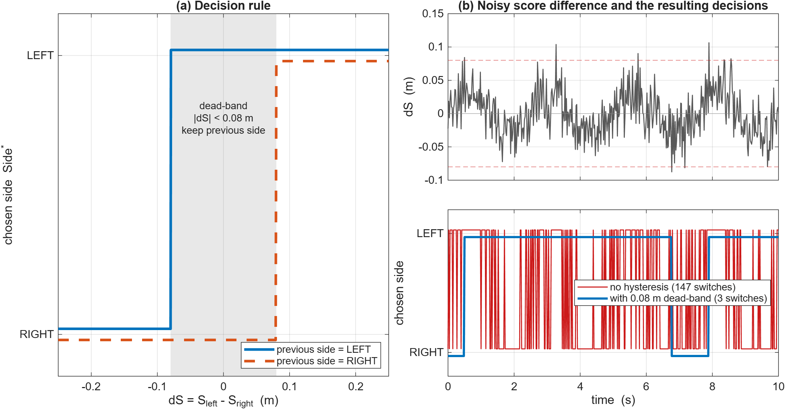
</p>
<p align="center"><b>Figure 7.3</b> &ndash; <b>(a)</b> The decision rule as a function of the score difference <code>dS = S_left &minus; S_right</code>: inside the shaded dead-band the output depends on the previous side (two different curves). <b>(b)</b> A noisy synthetic <code>dS</code> signal fed through the rule: a plain "larger score wins" rule flips the side 147 times in 10 s, the rule with the 0.08 m dead-band only 3 times.</p>

---

<a id="74-bio-inspired-adaptive-neural-brain-dynamics"></a>
### 7.4 Bio-Inspired Adaptive Neural Brain Dynamics

> **What this section does.** It defines the "steering circuit" of the Adaptive Neural Brain: two coupled artificial neurons, one for the left side and one for the right. Each neuron *integrates* sensory evidence over time (like a leaky bucket), the two neurons *inhibit* each other so that one wins, and the difference of their activities becomes the turning command.
>
> **Practical purpose.** Compared with the FSM's hard if/else rules, this circuit reacts smoothly: a single noisy ray reading cannot make the drone jerk, a decision, once made, is held for a moment, and the same few equations produce the left-or-right choice, the turn strength, and the memory used in §7.5 and §7.6. The model follows the insect-inspired work of *Devos et al., 2018*.

The Adaptive Neural Brain models the biological neural circuits observed in insects and flying organisms for obstacle avoidance (*Devos et al., 2018*).

```text
   Left Sensors                Front Sensor               Right Sensors
  [+8° to +90°]                    [0°]                   [-8° to -90°]
        │                           │                           │
        ▼                           ▼                           ▼
   Proximity I_L ──────────► [Frontal Cone] ◄────────── Proximity I_R
        │                           │                           │
        ▼ w_in                      ▼                           ▼ w_in
 ┌──────────────┐            Speed Neuron S             ┌──────────────┐
 │ Steering     │                   │                   │ Steering     │
 │ Neuron L     │◄──── w_cross ─────┼───── w_cross ────►│ Neuron R     │
 │ (self w_LL)  │                   │                   │ (self w_RR)  │
 └──────┬───────┘                   ▼                   └──────┬───────┘
        │                 v = V_MAX * s(S)                     │
        ▼                                                      ▼
  Activity a_L                                           Activity a_R
        │                                                      │
        └───────────────────────┬──────────────────────────────┘
                                ▼
               Steering: steer = a_L - a_R
               Heading:  d(psi)/dt = omega(steer, F, goal)
```

The recurrent steering network contains two coupled, continuous-time, leaky-integrator neurons:
- Left Steering Neuron $L$
- Right Steering Neuron $R$

#### Equation: Membrane Potential Leaky ODE

```math
\tau \frac{dx_L}{dt} = -x_L(t) + \text{drive}_L(t)
```

```math
\tau \frac{dx_R}{dt} = -x_R(t) + \text{drive}_R(t)
```

where $\tau = 0.18\,\text{s}$ is the membrane relaxation time constant. Discretized via forward Euler at step $\Delta t = 1/48\,\text{s}$:

```math
x_L[k+1] = x_L[k] + \frac{\Delta t}{\tau} \left(-x_L[k] + \text{drive}_L[k]\right)
```

```math
x_R[k+1] = x_R[k] + \frac{\Delta t}{\tau} \left(-x_R[k] + \text{drive}_R[k]\right)
```

**What the equations say.** The membrane potential $x$ is pulled toward whatever the neuron is currently being driven to ($\text{drive}$), but only gradually: the $-x$ term is a "leak" that makes $x$ move a fraction of the remaining gap per unit time. If the drive stays constant, $x$ approaches it exponentially and covers $63\%$ of the gap after one time constant $\tau$. The discrete version is the same statement for the computer: each control tick, the potential moves a fraction $\Delta t / \tau \approx 0.116$ of the way toward the drive (stable because the fraction is well below $1$).

**Variables**
- $x_L$, $x_R$: membrane potentials of the left and right neuron (dimensionless).
- $\tau = 0.18\,\text{s}$: membrane time constant (the speed of the neuron; not to be confused with the torque $\boldsymbol{\tau}$ of §7.8). It equals about $8.6$ control ticks.
- $t$: continuous time ($\text{s}$); $k$: control-tick index; $\Delta t = 1/48\,\text{s}$: tick length.
- $\text{drive}_L$, $\text{drive}_R$: total input to each neuron, defined in the next equation (dimensionless).

#### Equation: Synaptic Drive Equations

```math
\text{drive}_L = w_{LL} a_L[k] + w_{\text{cross}} a_R[k] + w_{\text{in}} I_L + \text{bias} - \Delta_{\text{free}} - h_{\text{side}}
```

```math
\text{drive}_R = w_{RR} a_R[k] + w_{\text{cross}} a_L[k] + w_{\text{in}} I_R + \text{bias} + \Delta_{\text{free}} + h_{\text{side}}
```

- **Neuron Output & Normalized Firing Rate:**

```math
o_i = \tanh(x_i) \in (-1, 1), \quad a_i = \frac{o_i + 1}{2} \in [0, 1]
```

**What the equations say.** Each neuron's input is a sum of six contributions: (1) *self-excitation* $w_{LL} a_L$, a neuron that is active tends to stay active (short-term memory of a turn); (2) *cross-inhibition* $w_{\text{cross}} a_R$, with $w_{\text{cross}} < 0$ the active neuron suppresses its rival, so one side wins; (3) the *sensory input* $w_{\text{in}} I_L$, an obstacle on the left excites the left neuron; (4) a constant *bias* that keeps neurons quiet when nothing is near; (5) a *free-space term* $\Delta_{\text{free}}$ that nudges the drone toward the more open side (it lowers the left drive and raises the right drive when the left side is more open, which turns the drone left, toward the free space); and (6) a small *memory tie-breaker* $h_{\text{side}}$ that favours the side already committed to. The output equations squash the potential with $\tanh$ into $(-1, 1)$ and rescale it to a firing rate $a_i \in [0, 1]$ ($a = 0.5$ at $x = 0$; $a \to 0$ for very negative $x$; $a \to 1$ for large positive $x$).

**Variables**
- $w_{LL}$, $w_{RR}$: self-synapse weights of the two neurons; they start at $w_{\text{self}, 0}$ and adapt in §7.5.
- $a_L[k]$, $a_R[k]$: firing rates at tick $k$ (used with one-tick delay inside the drive).
- $I_L$, $I_R$: dimensionless proximity (obstacle-closeness) signals computed from the left-side and right-side range readings; they are $0$ when nothing is detected on that side (logged as `I_L`, `I_R`, see §14).
- $o_i$: neuron output in $(-1, 1)$; $a_i$: normalized firing rate in $[0, 1]$; $i \in \{L, R\}$.
- **Network parameters:**
  - $w_{\text{self}, 0} = 1.40$: Baseline excitatory self-weight providing short-term turning memory.
  - $w_{\text{cross}} = -1.60$: Mutual inhibitory weight enforcing winner-take-all competitive selection.
  - $w_{\text{in}} = 4.00$: Sensory input gain amplifying obstacle detection.
  - $\text{bias} = -2.20$: Constant hyperpolarizing bias keeping neurons inactive ($a_i \approx 0$) in obstacle-free space.
  - $\Delta_{\text{free}} = w_{\text{free}} \left(\frac{\bar{d}_{\text{left}}}{R_s} - \frac{\bar{d}_{\text{right}}}{R_s}\right)$ with $w_{\text{free}} = 0.8$: Free-space peripheral bias. Here $\bar{d}_{\text{left}}$ and $\bar{d}_{\text{right}}$ are the average range readings ($\text{m}$) on the left and right side, and $R_s$ is the maximum sensor range $R_{\text{sensor}}$ of §7.2, which makes the ratio dimensionless.
  - $h_{\text{side}} = 0.08 \cdot \sigma_{\text{committed}}$ ($\pm 1$): Memory tie-breaker breaking dead-center balance. $\sigma_{\text{committed}} \in \{-1, +1\}$ is the side the brain has committed to, where $+1$ means a counter-clockwise (left) turn, the same convention as the detour angle of §7.6.
- **Numerical example (steady state, ignoring $\Delta_{\text{free}}$ and $h_{\text{side}}$):**
  - *Open space* ($I_L = I_R = 0$): each potential settles at the bias, $x = -2.2$, so $o = \tanh(-2.2) = -0.976$ and $a = 0.012 \approx 0$: the neurons are silent.
  - *Obstacle on the left* ($I_L = 1$, $I_R = 0$): solving the two drives together gives $a_L \approx 0.998$ and $a_R \approx 0.0005$. The right neuron is held down by the left one, since $\text{drive}_R = 1.4 \cdot 0.0005 - 1.6 \cdot 0.998 - 2.2 \approx -3.80$. The steering signal $a_L - a_R \approx 1$ then commands a strong turn **right**, away from the obstacle (see §7.6).
  - *Obstacle on both sides* ($I_L = I_R = 1$): both neurons settle at $a \approx 0.96$, so $a_L - a_R \approx 0$. This tie is exactly what $\Delta_{\text{free}}$ and $h_{\text{side}}$ exist to break.
- **Implementation:** [pybullet/brain/neural_brain.py](pybullet/brain/neural_brain.py#L159-L167).

#### MATLAB Plot: Leaky Membrane Step Response (main formula of §7.4)

<details>
<summary><b>MATLAB code</b> &mdash; <code>matlab/section7/plot_7_4_membrane_response.m</code></summary>

```matlab
% plot_7_4_membrane_response.m
% Section 7.4 - Leaky membrane ODE of a steering neuron
%     tau dx/dt = -x(t) + drive(t),     a = (tanh(x) + 1) / 2
% Response to an obstacle that appears at 0.2 s and disappears at 1.2 s
% (only the sensory part of the drive is modelled: w_in * I + bias).

tau   = 0.18;                                 % membrane time constant (s)
dt    = 1/48;                                 % control step (s)
bias  = -2.20;   wIn = 4.00;                  % constant bias and sensory gain
tEnd  = 2.0;
tOn   = 0.2;     tOff = 1.2;                  % obstacle visible between these times (I = 1)

% ---- forward-Euler neuron, exactly as discretised in the text -------------------
t      = 0:dt:tEnd;
drive  = bias + wIn * (t >= tOn & t < tOff);
xEul   = zeros(size(t));   xEul(1) = bias;
for k = 1:numel(t)-1
    xEul(k+1) = xEul(k) + (dt/tau) * (-xEul(k) + drive(k));
end

% ---- exact continuous solution (piecewise-constant drive) -----------------------
tf     = linspace(0, tEnd, 2000);
xEx    = zeros(size(tf));
brk    = [0 tOn tOff tEnd];   lvl = [bias, bias + wIn, bias];
xStart = bias;
for seg = 1:3
    m = tf >= brk(seg) & tf <= brk(seg+1);
    xEx(m) = lvl(seg) + (xStart - lvl(seg)) * exp(-(tf(m) - brk(seg)) / tau);
    xStart = lvl(seg) + (xStart - lvl(seg)) * exp(-(brk(seg+1) - brk(seg)) / tau);
end
act = @(x) (tanh(x) + 1) / 2;                 % normalised firing rate a

blue = [0.00 0.45 0.74];  orange = [0.85 0.33 0.10];  gray = [0.45 0.45 0.45];

fig = figure('Color', 'w', 'Position', [100 100 900 600]);
try, theme(fig, 'light'); catch, end   % force light colours (R2025a+ follows the OS dark mode)
tl  = tiledlayout(2, 1, 'TileSpacing', 'compact', 'Padding', 'compact');

nexttile; hold on; grid on; box on;
stairs(t, drive, '-', 'Color', gray, 'LineWidth', 1.4);
plot(tf, xEx, '-', 'Color', blue, 'LineWidth', 2.4);
plot(t, xEul, 'o', 'Color', orange, 'MarkerSize', 4, 'MarkerFaceColor', orange);
xTau = bias + (1 - exp(-1)) * wIn;           % value reached one time constant after the step
plot(tOn + tau, xTau, 'ks', 'MarkerSize', 9, 'LineWidth', 1.5);
text(tOn + tau + 0.04, xTau - 0.35, '63.2 % of the step after t = \tau = 0.18 s', 'FontSize', 10);
ylabel('membrane potential  x'); ylim([-3 2.5]);
title('\tau dx/dt = -x + drive :  step response of one steering neuron');
legend({'drive = w_{in} I + bias', 'exact solution', 'forward Euler, \Delta t = 1/48 s'}, ...
       'Location', 'east');
set(gca, 'FontSize', 11, 'XTickLabel', []);

nexttile; hold on; grid on; box on;
plot(tf, act(xEx), '-', 'Color', blue, 'LineWidth', 2.4);
plot(t, act(xEul), 'o', 'Color', orange, 'MarkerSize', 4, 'MarkerFaceColor', orange);
xlabel('time  (s)'); ylabel('firing rate  a = (tanh x + 1)/2'); ylim([-0.05 1.05]);
set(gca, 'FontSize', 11);

outDir = fullfile(fileparts(mfilename('fullpath')), '..', '..', 'assets', 'section7');
if ~exist(outDir, 'dir'), mkdir(outDir); end
exportgraphics(fig, fullfile(outDir, 'fig_7_4_membrane_response.png'), 'Resolution', 200);
```

</details>

<p align="center">
  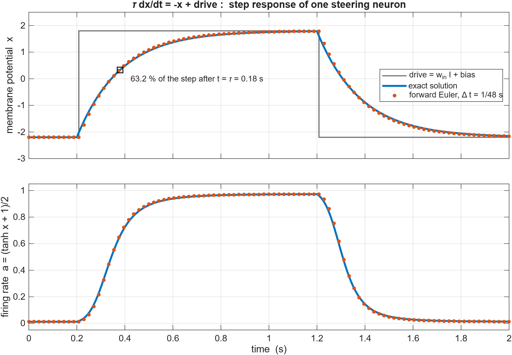
</p>
<p align="center"><b>Figure 7.4</b> &ndash; An obstacle is visible between 0.2 s and 1.2 s (only the sensory input and bias are modelled). The membrane potential (top) rises toward the new drive and falls back exponentially with time constant &tau; = 0.18 s; the forward-Euler samples at 48 Hz (orange) sit on the exact solution (blue). The firing rate <code>a = (tanh x + 1)/2</code> (bottom) turns that smooth curve into an on/off-like activity between about 0.01 and 0.97.</p>

---

<a id="75-synaptic-plasticity--memory-hysteresis"></a>
### 7.5 Synaptic Plasticity & Memory Hysteresis

> **What this section does.** It makes the steering neurons *learn on the fly*. The strength of each neuron's self-connection grows while an obstacle is being avoided and slowly relaxes afterwards. A stronger self-connection means the neuron keeps firing longer after the obstacle has left the sensor cone.
>
> **Practical purpose.** In U-shaped dead ends, a purely reactive system turns away from a wall, loses sight of it, turns straight back toward the goal, and oscillates forever. The plastic self-weights give the drone a short-lived *memory* that finishes the detour before the goal attraction takes over again.

In complex traps (such as U-shaped dead ends), standard reactive systems turn away from a wall, only to turn straight back toward the goal as soon as the obstacle exits the sensor cone, causing a fatal oscillation. The Adaptive Neural Brain solves this by dynamically adapting its self-excitatory weights $w_{LL}$ and $w_{RR}$ via Hebbian correlation learning.

#### Equation: Activity-Dependent Hebbian Plasticity

```math
\frac{dw_{ii}}{dt} = \mu \left(1 + 2F\right) \cdot I_i \cdot a_i - \gamma \left(w_{ii} - w_{\text{self}, 0}\right)
```

In discrete simulation:

```math
w_{ii}[k+1] = \text{clip}\left(w_{ii}[k] + \Delta t \left[\mu (1 + 2F) I_i a_i - \gamma (w_{ii}[k] - w_{\text{self}, 0})\right], \; w_{\text{self}, 0}, \; w_{\text{self}, \text{max}}\right)
```

**What the equations say.** The right-hand side has two competing terms. The first is a **Hebbian growth** term ("neurons that fire together wire together"): it is positive only when the sensory input $I_i$ *and* the neuron's own activity $a_i$ are both present, and it is amplified by $(1 + 2F)$, up to three times faster when the drone is frustrated. The second is **homeostatic forgetting**: a pull of strength $\gamma$ back toward the baseline weight $w_{\text{self}, 0}$. In the discrete version the weight is advanced by one Euler step and then clipped, so it can never fall below the baseline or exceed the ceiling.

**Variables**
- $w_{ii}$, $i \in \{L, R\}$: self-synapse weight of neuron $i$ (dimensionless), the quantity being learned.
- $\mu = 0.90\,\text{s}^{-1}$: Hebbian growth rate (potentiates synapses during concurrent obstacle presence $I_i$ and turning activity $a_i$).
- $F \in [0, 1]$: Frustration state scaling learning during stall events (defined in §7.6); $(1 + 2F)$ therefore ranges from $1$ to $3$.
- $I_i$: proximity input to neuron $i$ (§7.4); $a_i$: its firing rate in $[0, 1]$.
- $\gamma = 0.15\,\text{s}^{-1}$: Exponential homeostatic relaxation rate returning weights to baseline $w_{\text{self}, 0} = 1.4$ (time constant $1/\gamma \approx 6.7\,\text{s}$).
- $w_{\text{self}, \text{max}} = 3.20$: Upper synaptic ceiling preventing self-latching runaway dynamics.
- $\Delta t = 1/48\,\text{s}$: tick length; $k$: tick index; $\text{clip}(x, \ell, u) = \min(\max(x, \ell), u)$ limits $x$ to the interval $[\ell, u]$.

- **Physical Derivation of Hysteresis:**
  When $w_{ii}$ increases from $1.4$ toward $3.2$, the neuron's effective time-decay constant $\tau_{\text{eff}} = \frac{\tau}{1 - w_{ii} \frac{\partial a}{\partial x}}$ increases dramatically. The neuron remains active *even after the obstacle is no longer detected* ($I_i = 0$), forcing the drone to complete an extended detour until the obstacle is completely cleared.
  Here $\frac{\partial a}{\partial x} = \frac{1 - \tanh^2 x}{2}$ is the slope of the firing-rate curve (at most $0.5$), and $w_{ii}\frac{\partial a}{\partial x}$ is the strength of the neuron's positive self-feedback. The expression is the linearised (small-signal) time constant: the closer that feedback gets to $1$, the more slowly the neuron lets go.
- **Numerical example** (obstacle seen continuously with $I_i = a_i = 1$): with $F = 0$ the weight follows $w(t) = 1.4 + \tfrac{\mu}{\gamma}\left(1 - e^{-\gamma t}\right) = 1.4 + 6\left(1 - e^{-0.15\,t}\right)$ and reaches the ceiling $3.2$ after $t = -\ln(0.7)/0.15 \approx 2.4\,\text{s}$. With full frustration ($F = 1$) the growth rate triples and the ceiling is reached after only $\approx 0.7\,\text{s}$. Once the obstacle disappears ($I_i = 0$) the weight decays as $w = 1.4 + 1.8\,e^{-0.15\,\Delta t}$; for example $6\,\text{s}$ later it is still $\approx 2.13$, which is the "memory".
- **Implementation:** [pybullet/brain/neural_brain.py](pybullet/brain/neural_brain.py#L177-L180).

#### MATLAB Plot: Hebbian Self-Weight Growth and Decay (main formula of §7.5)

<details>
<summary><b>MATLAB code</b> &mdash; <code>matlab/section7/plot_7_5_hebbian_plasticity.m</code></summary>

```matlab
% plot_7_5_hebbian_plasticity.m
% Section 7.5 - Activity-dependent Hebbian plasticity of the self-weight w_ii
%     dw/dt = mu (1 + 2F) I a - gamma (w - w0),      w clipped to [w0, w_max]
% Simplification: the neuron is fully active (a = 1) and the obstacle signal is
% I = 1 between 1 s and 6 s, I = 0 otherwise.  Three frustration levels F are compared.

mu = 0.90;  gamma = 0.15;                     % growth and relaxation rates (1/s)
w0 = 1.40;  wMax  = 3.20;                     % baseline and ceiling of the self-weight
dt = 1/48;
t  = 0:dt:20;
I  = double(t >= 1 & t < 6);                  % obstacle present
a  = ones(size(t));                           % neuron fully active
Fv = [0 0.5 1];                               % frustration levels

blue = [0.00 0.45 0.74];  orange = [0.85 0.33 0.10];  red = [0.80 0.10 0.10];
col  = [blue; orange; red];

fig = figure('Color', 'w', 'Position', [100 100 900 520]);
try, theme(fig, 'light'); catch, end   % force light colours (R2025a+ follows the OS dark mode)
hold on; grid on; box on;
fill([1 6 6 1], [1.2 1.2 3.4 3.4], [0.85 0.85 0.85], 'FaceAlpha', 0.5, 'EdgeColor', 'none');
for j = 1:numel(Fv)
    w = zeros(size(t));   w(1) = w0;
    for k = 1:numel(t)-1
        dw     = mu * (1 + 2*Fv(j)) * I(k) * a(k) - gamma * (w(k) - w0);
        w(k+1) = min(max(w(k) + dt*dw, w0), wMax);        % clip to [w0, w_max]
    end
    hp(j) = plot(t, w, '-', 'Color', col(j,:), 'LineWidth', 2.4);
    tHit  = t(find(w >= wMax - 1e-9, 1));
    if ~isempty(tHit)
        fprintf('F = %.1f : w reaches w_max = %.1f at t = %.2f s (%.2f s after the obstacle appears)\n', ...
                Fv(j), wMax, tHit, tHit - 1);
    end
end
yline(wMax, '--k', 'w_{self,max} = 3.2', 'LabelHorizontalAlignment', 'left');
yline(w0,   '--k', 'w_{self,0} = 1.4',   'LabelHorizontalAlignment', 'right');
text(3.5, 1.28, 'obstacle present (I = 1)', 'HorizontalAlignment', 'center', 'FontSize', 10);
xlabel('time  (s)'); ylabel('self-weight  w_{ii}');
xlim([0 20]); ylim([1.2 3.4]);
title('Hebbian growth while the obstacle is seen, slow decay (1/\gamma = 6.7 s) afterwards');
legend(hp, {'F = 0', 'F = 0.5', 'F = 1'}, 'Location', 'northeast');
set(gca, 'FontSize', 11);

outDir = fullfile(fileparts(mfilename('fullpath')), '..', '..', 'assets', 'section7');
if ~exist(outDir, 'dir'), mkdir(outDir); end
exportgraphics(fig, fullfile(outDir, 'fig_7_5_hebbian_plasticity.png'), 'Resolution', 200);
```

</details>

<p align="center">
  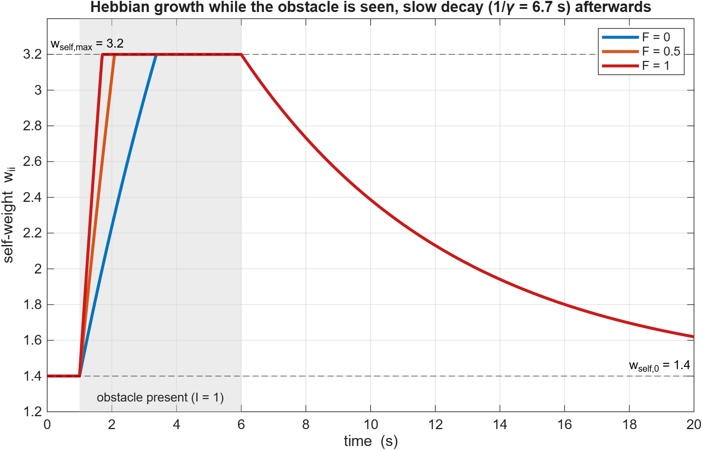
</p>
<p align="center"><b>Figure 7.5</b> &ndash; The self-weight rises from the baseline 1.4 while the obstacle is present (grey band, simplified to <code>I = a = 1</code>), faster for larger frustration <code>F</code>, saturates at the ceiling 3.2, and then decays slowly (<code>1/&gamma; = 6.7 s</code>) after the obstacle is gone. That slow decay is the memory that keeps the detour going.</p>

---

<a id="76-frustration-dynamics--deadlock-detour-vector"></a>
### 7.6 Frustration Dynamics & Deadlock Detour Vector

> **What this section does.** It adds a "patience" variable. A leaky integrator called **frustration** $F$ builds up while the drone is not getting closer to the goal and drains away once the way ahead is free again. Frustration then (i) speeds up the Hebbian memory of §7.5, (ii) rotates the goal-attraction direction away from the obstacle by up to $80^\circ$, and (iii) weakens the neural avoidance push, all so the drone eventually *breaks out of a deadlock*.
>
> **Practical purpose.** Even with memory, a drone can sit in a pocket where the goal pulls one way and the walls push the other. Frustration is the escalation mechanism that guarantees an escape from U-shaped traps and deep pockets without needing a map.

To guarantee escape from U-shaped traps and deep pockets, the brain tracks goal progress using a leaky integrator called **Frustration** ($F \in [0, 1]$).

#### Equation: Frustration Leaky Integrator
Let $D_{\text{goal}}(t) = \|\mathbf{p}(t) - \mathbf{p}_{\text{goal}}\|$ and $D_{\text{best}} = \min_{t' \le t} D_{\text{goal}}(t')$.

```math
\frac{dF}{dt} = \begin{cases} +\alpha_{\text{rise}} = 0.35\,\text{s}^{-1}, & \text{if } t_{\text{no-progress}} > 1.0\,\text{s} \;\land\; t_{\text{open}} < 1.0\,\text{s} \\ -\alpha_{\text{decay}} = 0.50\,\text{s}^{-1}, & \text{if } t_{\text{open}} \ge 1.0\,\text{s} \\ 0, & \text{otherwise} \end{cases}
```

**What the equation says.** $F$ has three behaviours. It **rises** at a constant rate while the drone has made no progress for more than $1\,\text{s}$ and the way ahead has *not* been free for $1\,\text{s}$ (a genuine stall). It **drains** at a constant rate once the front has been clear for at least $1\,\text{s}$ (the problem is solved). Otherwise it **holds** its value. $F$ is kept inside $[0, 1]$, so it saturates rather than growing without bound.

**Variables**
- $F \in [0, 1]$: frustration (dimensionless).
- $D_{\text{goal}}(t)$: distance from the drone to the goal ($\text{m}$); $D_{\text{best}}$: the smallest such distance achieved so far. (The capital $D$ distinguishes these scalars from the horizontal displacement vector $\mathbf{d}_{\text{goal}}$ of §7.1.)
- $t'$: dummy time variable running from the start up to the current time $t$.
- $t_{\text{no-progress}}$: time elapsed since the drone last improved on $D_{\text{best}}$ ($\text{s}$).
- $t_{\text{open}}$: time for which the path ahead has been continuously free ($\text{s}$).
- $\alpha_{\text{rise}} = 0.35\,\text{s}^{-1}$, $\alpha_{\text{decay}} = 0.50\,\text{s}^{-1}$: build-up and drain rates; $\land$: logical AND.

- **Numerical example:** a stall begins at $t = 0$ with the front blocked. $F$ stays $0$ for the first $1\,\text{s}$, then climbs linearly and reaches $F = 1$ after a further $1/0.35 \approx 2.9\,\text{s}$ (at $t \approx 3.9\,\text{s}$). Once the front has been free for $1\,\text{s}$ it falls back to $0$ in $1/0.50 = 2\,\text{s}$.

#### Equation: Adaptive Goal Detour & Heading Control
When $F > 0$, the drone rotates its goal attraction vector away from the obstacle by up to $\pm 80^\circ$:

```math
\theta_{\text{detour}} = \sigma_{\text{committed}} \cdot \theta_{\text{detour, max}} \cdot F(t) = \pm 80^\circ \cdot F(t)
```

```math
e_{\text{attract}} = \text{wrap}\left(\text{atan2}(y_{\text{goal}} - y(t), \, x_{\text{goal}} - x(t)) + \theta_{\text{detour}} - \psi(t)\right)
```

The heading angular velocity $\omega = \dot{\psi}$ command is synthesized as:

```math
\omega = \text{clip}\left(K_{\text{goal}} \cdot e_{\text{attract}} \cdot G_{\text{attract}} - K_{\text{turn}} \cdot (a_L - a_R) \cdot (1 - 0.5F), \; -\Omega_{\text{max}}, \; +\Omega_{\text{max}}\right)
```

**What the equations say.** The *detour angle* is just the maximum detour ($80^\circ$) scaled by frustration and signed by the committed side, so a calm drone aims straight at the goal and a very frustrated one aims $80^\circ$ to the side. The *attraction error* is the angle between where the drone is pointing and where it *wants* to point (the true bearing to the goal plus the detour); `wrap` folds it into $(-\pi, \pi]$ so that the drone always turns the short way round. The *yaw-rate command* then adds two pulls: a proportional steer toward the (detoured) goal, faded out while the neurons are busy avoiding (via $G_{\text{attract}}$), and the neural avoidance steer $-K_{\text{turn}}(a_L - a_R)$, which turns away from the active side and is weakened by up to half when frustrated. The result is limited to $\pm\Omega_{\text{max}}$.

**Variables**
- $\theta_{\text{detour}}$: detour angle added to the goal bearing ($\text{rad}$ inside the formula; $80^\circ = 1.396\,\text{rad}$); $\theta_{\text{detour, max}} = 80^\circ$.
- $\sigma_{\text{committed}} \in \{-1, +1\}$: committed detour side ($+1$ = left / counter-clockwise).
- $e_{\text{attract}}$: heading error toward the detoured goal ($\text{rad}$); $\text{atan2}(\Delta y, \Delta x)$: bearing from the drone to the goal ($\text{rad}$); $\psi(t)$: current heading (yaw) of the drone ($\text{rad}$); $\text{wrap}(\cdot)$: maps an angle into $(-\pi, \pi]$.
- $\omega = \dot{\psi}$: commanded yaw rate ($\text{rad/s}$); $\text{clip}(x, \ell, u)$: limits $x$ to $[\ell, u]$.
- $a_L$, $a_R$: steering-neuron firing rates (§7.4).
- **Gains:** $K_{\text{goal}} = 2.20\,\text{s}^{-1}$, $K_{\text{turn}} = 2.60\,\text{rad/s}$, $\Omega_{\text{max}} = 2.60\,\text{rad/s}$ (maximum yaw rate; this $\Omega$ is *not* a rotor speed, unlike the $n_i$ of §7.8).
- $G_{\text{attract}} = \max(1 - a_{\text{avoid}}, 0.6F)$: Attenuates goal attraction when avoiding obstacles, but preserves turning drive when frustrated. $a_{\text{avoid}} \in [0, 1]$ is the overall avoidance activity of the steering neurons ($0$ when nothing is being avoided).
- **Numerical example:** obstacle on the left with $a_L \approx 0.998$, $a_R \approx 0$ (so $a_{\text{avoid}} \approx 1$). With $F = 0$: $G_{\text{attract}} = \max(0.002, 0) \approx 0$, so $\omega \approx -2.60 \times 0.998 = -2.59\,\text{rad/s}$, a hard turn to the right. With $F = 1$ and a heading error $e_{\text{attract}} = 0.5\,\text{rad}$: $G_{\text{attract}} = \max(0.002, 0.6) = 0.6$, and $\omega = 2.20 \times 0.5 \times 0.6 - 2.60 \times 0.998 \times 0.5 = 0.66 - 1.30 \approx -0.64\,\text{rad/s}$: still turning away, but much more gently, so the goal pull can finally win.
- **Implementation:** [pybullet/brain/neural_brain.py](pybullet/brain/neural_brain.py#L182-L220).

#### MATLAB Plot: Frustration and Detour Angle versus Time (main formula of §7.6)

<details>
<summary><b>MATLAB code</b> &mdash; <code>matlab/section7/plot_7_6_frustration.m</code></summary>

```matlab
% plot_7_6_frustration.m
% Section 7.6 - Frustration leaky integrator and the goal-detour angle
%     dF/dt = +alpha_rise    if t_noprogress > 1 s and t_open < 1 s
%           = -alpha_decay   if t_open >= 1 s
%           =  0             otherwise                 (F clipped to [0, 1])
%     theta_detour = sigma * 80 deg * F
% Scenario: the drone makes no progress for 8 s (front blocked), then the way opens.

aRise  = 0.35;   aDecay = 0.50;               % 1/s
thMax  = 80;                                  % maximum detour angle (deg)
sigma  = +1;                                  % committed side (+1 = left)
dt     = 1/48;
t      = 0:dt:14;
tOpen0 = 8;                                   % the front becomes free at this time (s)

tNoProg = t .* (t < tOpen0) + (t - tOpen0) .* (t >= tOpen0);   % time since last progress
tOpen   = max(t - tOpen0, 0);                                  % time the front has been free

F = zeros(size(t));
for k = 1:numel(t)-1
    if tNoProg(k) > 1 && tOpen(k) < 1
        dF = +aRise;
    elseif tOpen(k) >= 1
        dF = -aDecay;
    else
        dF = 0;
    end
    F(k+1) = min(max(F(k) + dt*dF, 0), 1);
end
thetaDetour = sigma * thMax * F;              % detour angle (deg)
fprintf('F reaches 1 at t = %.2f s (analytic: 1 + 1/%.2f = %.2f s)\n', t(find(F >= 1 - 1e-9, 1)), aRise, 1 + 1/aRise);

blue = [0.00 0.45 0.74];  orange = [0.85 0.33 0.10];

fig = figure('Color', 'w', 'Position', [100 100 900 520]);
try, theme(fig, 'light'); catch, end   % force light colours (R2025a+ follows the OS dark mode)
hold on; grid on; box on;
fill([0 tOpen0 tOpen0 0], [-0.05 -0.05 1.1 1.1], [0.90 0.90 0.90], 'EdgeColor', 'none');
fill([tOpen0 14 14 tOpen0], [-0.05 -0.05 1.1 1.1], [0.88 0.95 0.88], 'EdgeColor', 'none');
yyaxis left
plot(t, F, '-', 'Color', blue, 'LineWidth', 2.8);
ylabel('frustration  F'); ylim([-0.05 1.1]); set(gca, 'YColor', blue);
yyaxis right
plot(t, thetaDetour, '--', 'Color', orange, 'LineWidth', 2);
ylabel('detour angle  \theta_{detour}  (deg)'); ylim([-0.05 1.1] * thMax); set(gca, 'YColor', orange);
text(4, 0.12*thMax, 'stalled: no progress, front blocked', 'HorizontalAlignment', 'center', 'FontSize', 10);
text(12.5, 0.12*thMax, 'front free', 'HorizontalAlignment', 'center', 'FontSize', 10);
text(2.4, 0.62*thMax, {'rise 0.35 s^{-1}', 'once stalled', 'for more than 1 s'}, 'HorizontalAlignment', 'right', 'FontSize', 10);
text(10.2, 0.62*thMax, {'decay 0.50 s^{-1}', 'once the front has', 'been free for 1 s'}, 'HorizontalAlignment', 'left', 'FontSize', 10);
xlabel('time  (s)'); xlim([0 14]);
title('Frustration F(t) and the resulting goal-detour angle');
set(gca, 'FontSize', 11);

outDir = fullfile(fileparts(mfilename('fullpath')), '..', '..', 'assets', 'section7');
if ~exist(outDir, 'dir'), mkdir(outDir); end
exportgraphics(fig, fullfile(outDir, 'fig_7_6_frustration.png'), 'Resolution', 200);
```

</details>

<p align="center">
  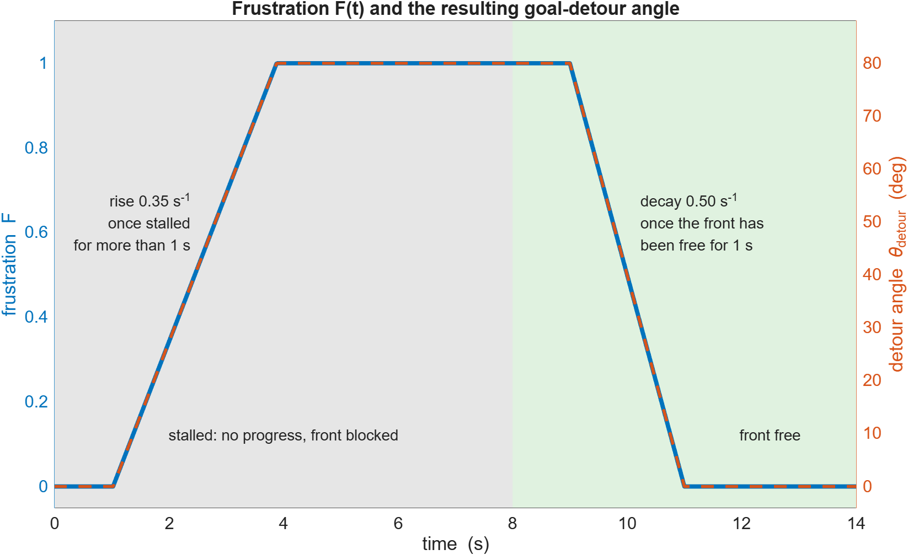
</p>
<p align="center"><b>Figure 7.6</b> &ndash; A scripted scenario: the drone is stalled with the front blocked until t = 8 s (grey), then the way opens (green). Frustration (blue, left axis) starts to grow after 1 s of no progress, saturates at 1, holds, and drains 1 s after the front opens. The detour angle <code>&theta;_detour = 80&deg; &middot; F</code> (orange dashed, right axis) is simply a scaled copy.</p>

---

<a id="77-speed-neuron--safe-braking-distance"></a>
### 7.7 Speed Neuron & Safe Braking Distance

> **What this section does.** It converts the clearance directly ahead into a forward speed. Far from obstacles the drone cruises at full speed, inside a braking window it slows down in proportion to the remaining space, and when it is very close it stops or (if there is room behind) backs away slowly.
>
> **Practical purpose.** Steering alone cannot save a fast drone from a wall that is too close. Tying speed to clearance guarantees there is always room to turn or stop, and the extra slow-down during sharp turns keeps the quadrotor within its controllable envelope.

Forward flight speed is regulated by the frontal range clearance $d_{\text{front}}$ to prevent high-speed collisions.

#### Equation: Normalized Frontal Clearance & Speed Law

```math
s = \text{clip}\left(\frac{d_{\text{front}} - d_{\text{stop}}}{d_{\text{slow}} - d_{\text{stop}}}, \; -1.0, \; 1.0\right)
```

where $d_{\text{stop}} = 0.28\,\text{m}$ and $d_{\text{slow}} = 0.85\,\text{m}$.

```math
v = \begin{cases} V_{\text{max}} \cdot s \cdot \left(1 - 0.5 \frac{|\omega|}{\Omega_{\text{max}}}\right), & \text{if } s \ge 0 \text{ (forward flight)} \\ V_{\text{reverse}} \cdot s, & \text{if } s < 0 \;\land\; d_{\text{rear}} > 0.35\,\text{m} \text{ (backing out)} \\ 0, & \text{if } s < 0 \;\land\; d_{\text{rear}} \le 0.35\,\text{m} \text{ (trapped rear)} \end{cases}
```

**What the equations say.** The first equation rescales the frontal clearance to a number $s$: it is $0$ at the stop distance, $1$ at the slow-down distance (and beyond), and negative when the obstacle is closer than $d_{\text{stop}}$, which is a straight-line "braking ramp" of $0.57\,\text{m}$. The second equation turns $s$ into a speed: forward flight scales linearly with $s$ (and is halved at the maximum yaw rate); a negative $s$ commands a slow *reverse* speed, but only if the rear is clear, otherwise the drone simply stops.

**Variables**
- $s$: normalized clearance (dimensionless; local to this section, unrelated to the ray parameter of §7.2). Because $d_{\text{front}} \ge 0$, in practice $s \ge -0.28/0.57 \approx -0.49$, so the lower clip at $-1$ is never active with these constants.
- $d_{\text{front}}$: range reading straight ahead ($\text{m}$), see the front sensor in §7.4.
- $d_{\text{stop}} = 0.28\,\text{m}$: clearance at which forward speed reaches zero; $d_{\text{slow}} = 0.85\,\text{m}$: clearance at which braking starts.
- $v$: commanded forward speed ($\text{m/s}$), positive forward and negative backward.
- $V_{\text{max}} = 0.40\,\text{m/s}$: Maximum cruise speed. $V_{\text{reverse}} = 0.18\,\text{m/s}$: Safe backing speed.
- $\omega$: current yaw-rate command (§7.6, $\text{rad/s}$), $\Omega_{\text{max}} = 2.60\,\text{rad/s}$ its limit; $\left(1 - 0.5 \frac{|\omega|}{\Omega_{\text{max}}}\right)$: Yaw-rate slowdown penalty (slows down during sharp turns).
- $d_{\text{rear}}$: range reading behind the drone ($\text{m}$); $0.35\,\text{m}$: minimum rear clearance for reversing.

- **Numerical example:** with $d_{\text{front}} = 0.50\,\text{m}$: $s = (0.50 - 0.28)/0.57 = 0.386$, so flying straight gives $v = 0.40 \times 0.386 = 0.154\,\text{m/s}$ (and $0.077\,\text{m/s}$ while turning at $\Omega_{\text{max}}$). With $d_{\text{front}} = 0.20\,\text{m}$: $s = -0.140$, so with a clear rear the drone backs out at $v = 0.18 \times (-0.140) = -0.025\,\text{m/s}$, and with $d_{\text{rear}} = 0.30\,\text{m}$ it stays at $v = 0$. For $d_{\text{front}} \ge 0.85\,\text{m}$, $s = 1$ and $v = 0.40\,\text{m/s}$.
- **Implementation:** [pybullet/brain/neural_brain.py](pybullet/brain/neural_brain.py#L222-L235).

#### MATLAB Plot: Speed versus Frontal Clearance (main formula of §7.7)

<details>
<summary><b>MATLAB code</b> &mdash; <code>matlab/section7/plot_7_7_speed_law.m</code></summary>

```matlab
% plot_7_7_speed_law.m
% Section 7.7 - Speed neuron: forward speed as a function of the frontal clearance
%     s = clip( (d_front - d_stop) / (d_slow - d_stop), -1, 1 )
%     v = V_max s (1 - 0.5 |omega|/Omega_max)          if s >= 0
%       = V_rev s                                      if s <  0 and d_rear > 0.35 m
%       = 0                                            if s <  0 and d_rear <= 0.35 m

Vmax = 0.40;   Vrev = 0.18;                   % cruise / reverse speed (m/s)
dStop = 0.28;  dSlow = 0.85;                  % braking window (m)
OmgMax = 2.60;                                % maximum yaw rate (rad/s)
dRearMin = 0.35;                              % minimum rear clearance for backing out (m)

dFront = linspace(0, 1.2, 601);
s      = min(max((dFront - dStop) / (dSlow - dStop), -1), 1);
speed  = @(omega, dRear) (s >= 0) .* Vmax .* s .* (1 - 0.5*abs(omega)/OmgMax) ...
                       + ((s < 0) & (dRear > dRearMin)) .* Vrev .* s;

vStraight = speed(0,      1.0);               % no turning, rear clear
vTurning  = speed(OmgMax, 1.0);               % turning at the maximum yaw rate, rear clear
vBlocked  = speed(0,      0.2);               % rear blocked: cannot back out
vBlocked(s >= 0) = NaN;                       % show only the part that differs

blue = [0.00 0.45 0.74];  orange = [0.85 0.33 0.10];  red = [0.80 0.10 0.10];  gray = [0.45 0.45 0.45];

fig = figure('Color', 'w', 'Position', [100 100 900 620]);
try, theme(fig, 'light'); catch, end   % force light colours (R2025a+ follows the OS dark mode)
hold on; grid on; box on;
fill([dStop dSlow dSlow dStop], [-0.12 -0.12 0.46 0.46], [0.93 0.93 0.93], 'EdgeColor', 'none');
h2 = plot(dFront, vTurning,  '-',  'Color', orange, 'LineWidth', 2.8);
h1 = plot(dFront, vStraight, '-',  'Color', blue,   'LineWidth', 2.8);   % drawn last: reverse branch is identical
h3 = plot(dFront, vBlocked,  '--', 'Color', red,    'LineWidth', 2.8);
xline(dStop, ':k', 'd_{stop} = 0.28 m', 'LabelVerticalAlignment', 'bottom');
xline(dSlow, ':k', 'd_{slow} = 0.85 m', 'LabelVerticalAlignment', 'bottom');
yline(0, '-', 'Color', gray);
text((dStop + dSlow)/2, 0.43, 'braking ramp', 'HorizontalAlignment', 'center', 'FontSize', 10);
text(0.14, -0.105, 'reverse', 'HorizontalAlignment', 'center', 'FontSize', 10);
text(1.02, 0.425, 'V_{max} = 0.40 m/s', 'HorizontalAlignment', 'center', 'FontSize', 10, 'Color', blue);
text(1.02, 0.225, '0.5 V_{max} when \omega = \Omega_{max}', 'HorizontalAlignment', 'center', 'FontSize', 10, 'Color', orange);
xlabel('frontal clearance  d_{front}  (m)'); ylabel('commanded forward speed  v  (m/s)');
xlim([0 1.2]); ylim([-0.12 0.46]);
title('Speed neuron:  v(d_{front})');
legend([h1 h2 h3], {'straight flight (\omega = 0), rear clear', ...
                    'turning at \omega = \Omega_{max}, rear clear', ...
                    'rear blocked (d_{rear} \leq 0.35 m): no reversing'}, 'Location', 'southoutside');
set(gca, 'FontSize', 11);

outDir = fullfile(fileparts(mfilename('fullpath')), '..', '..', 'assets', 'section7');
if ~exist(outDir, 'dir'), mkdir(outDir); end
exportgraphics(fig, fullfile(outDir, 'fig_7_7_speed_law.png'), 'Resolution', 200);
```

</details>

<p align="center">
  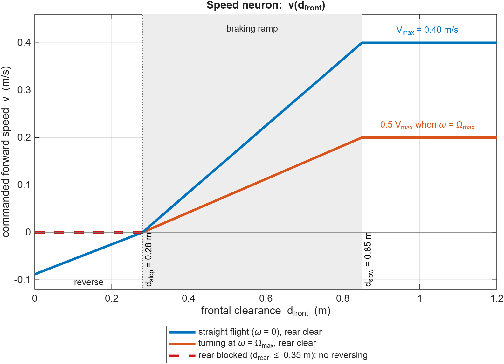
</p>
<p align="center"><b>Figure 7.7</b> &ndash; Speed law <code>v(d_front)</code>. Blue: straight flight with the rear clear. Orange: turning at the maximum yaw rate (speed halved). Below <code>d_stop = 0.28 m</code> the speed is negative (slow reversal); if the rear is blocked (red dashed) the drone just stays at zero speed.</p>

---

<a id="78-dslpid-flight-control-mathematics"></a>
### 7.8 DSLPID Flight Control Mathematics

> **What this section does.** It describes the lowest layer of the stack: how the planner's desired motion is turned into the four rotor speeds of the quadrotor. The planner's velocity command becomes a lookahead target position (§4); a PID law converts the position/velocity error into a desired *acceleration*; that acceleration fixes how hard and in which direction the thrust must point; an attitude loop produces torques; and a mixing matrix splits thrust and torques into the four rotor RPMs.
>
> **Practical purpose.** This is what makes the drone physically follow the plan: it sets how fast and how smoothly the drone reacts, how much it tilts, and whether the rotors have enough authority. It also generates the telemetry that the SINDy analysis in §7.9 learns from.

The high-level planner outputs a 2D velocity vector $\mathbf{v}_{\text{cmd}} = [v_x, v_y, 0]^T$. The low-level `DSLPIDControl` converts this into four individual motor RPMs ($n_0, n_1, n_2, n_3$) running at $48\,\text{Hz}$.

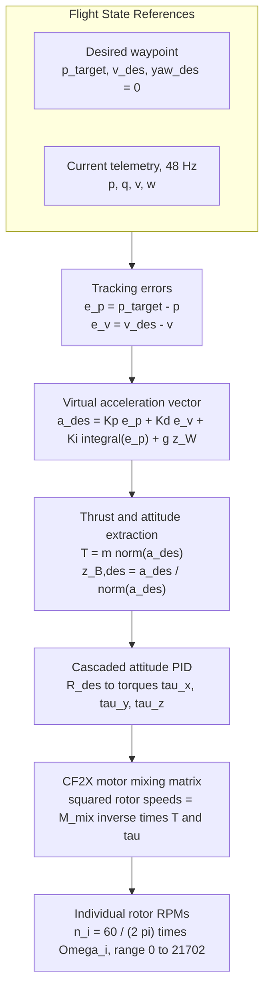

#### Equation: Cascaded Position Control
Let $\mathbf{e}_p = \mathbf{p}_{\text{target}} - \mathbf{p}$ and $\mathbf{e}_v = \mathbf{v}_{\text{target}} - \mathbf{v}$.

```math
\mathbf{a}_{\text{des}} = \mathbf{K}_p \mathbf{e}_p + \mathbf{K}_d \mathbf{e}_v + \mathbf{K}_i \int_0^t \mathbf{e}_p(t') \, dt' + g \mathbf{z}_W
```

**What the equation says.** This is a classic PID law written for acceleration. The *proportional* term pushes harder the farther the drone is from its target; the *derivative* term pushes against velocity error and damps the motion (prevents overshoot); the *integral* term accumulates position error over time and removes any steady offset (for example from wind or an imperfect model). The last term, $g\,\mathbf{z}_W$, is a feed-forward that cancels gravity so that zero error means hovering.

**Variables**
- $\mathbf{a}_{\text{des}}$: desired (virtual) acceleration vector ($\text{m/s}^2$).
- $\mathbf{e}_p$: position error ($\text{m}$); $\mathbf{p}_{\text{target}} = \mathbf{p} + \mathbf{v}_{\text{des}} \cdot t_{\text{lookahead}}$ is the lookahead target of §4, $\mathbf{p}$ the current position.
- $\mathbf{e}_v$: velocity error ($\text{m/s}$); $\mathbf{v}_{\text{target}} = \mathbf{v}_{\text{des}}$ the commanded velocity, $\mathbf{v}$ the measured velocity.
- $\mathbf{K}_p$, $\mathbf{K}_d$, $\mathbf{K}_i$: proportional, derivative and integral gain matrices (diagonal, one gain per axis); in acceleration form their units are $\text{s}^{-2}$, $\text{s}^{-1}$ and $\text{s}^{-3}$.
- $\int_0^t \mathbf{e}_p(t')\,dt'$: accumulated position error since $t = 0$ ($\text{m·s}$); $t'$ is the integration variable.
- $g = 9.81\,\text{m/s}^2$: gravitational acceleration; $\mathbf{z}_W$: world vertical unit vector, so the gravity term acts on the vertical axis only.

Total thrust along the drone's body z-axis $\mathbf{z}_B$ is:

```math
T_{\text{des}} = m \|\mathbf{a}_{\text{des}}\|_2
```

The drone tilts its thrust vector along $\mathbf{z}_{B, \text{des}} = \frac{\mathbf{a}_{\text{des}}}{\|\mathbf{a}_{\text{des}}\|}$, yielding desired roll ($\phi_{\text{des}}$) and pitch ($\theta_{\text{des}}$) angles:

```math
\phi_{\text{des}} = \frac{1}{g} (a_{\text{des}, x} \sin\psi_{\text{des}} - a_{\text{des}, y} \cos\psi_{\text{des}})
```

```math
\theta_{\text{des}} = \frac{1}{g} (a_{\text{des}, x} \cos\psi_{\text{des}} + a_{\text{des}, y} \sin\psi_{\text{des}})
```

**What the equations say.** A quadrotor can only push along its own body $z$-axis, so to accelerate sideways it must *tilt* until the thrust vector points along $\mathbf{a}_{\text{des}}$. The thrust magnitude must then equal mass times the length of $\mathbf{a}_{\text{des}}$. The last two equations give the roll and pitch needed for a given horizontal acceleration, rotated into the drone's yaw frame; they are the *small-angle* form (exact only for modest tilts).

**Variables**
- $T_{\text{des}}$: desired total thrust ($\text{N}$); $m = 0.027\,\text{kg}$: mass of the Crazyflie 2.X.
- $\mathbf{z}_B$: body $z$-axis (direction in which all rotors push); $\mathbf{z}_{B,\text{des}}$: its desired direction (unit vector).
- $\phi_{\text{des}}$, $\theta_{\text{des}}$: desired roll and pitch angles ($\text{rad}$); $\psi_{\text{des}}$: desired yaw ($\text{rad}$, $0$ in this project).
- $a_{\text{des}, x}$, $a_{\text{des}, y}$: horizontal components of $\mathbf{a}_{\text{des}}$ ($\text{m/s}^2$).

- **Numerical example:** suppose $\mathbf{a}_{\text{des}} = [1.0, -0.5, 10.01]^T\,\text{m/s}^2$ (gravity compensation $9.81$ plus $0.2$ upward). Then $\|\mathbf{a}_{\text{des}}\| = 10.07\,\text{m/s}^2$ and $T_{\text{des}} = 0.027 \times 10.07 = 0.272\,\text{N}$ (the drone weighs $0.265\,\text{N}$). With $\psi_{\text{des}} = 0$: $\phi_{\text{des}} = -(-0.5)/9.81 = 0.051\,\text{rad} \approx 2.9^\circ$ and $\theta_{\text{des}} = 1.0/9.81 = 0.102\,\text{rad} \approx 5.8^\circ$.

#### Equation: Motor Mixing for CF2X (X-Configuration)
The Crazyflie 2.X operates four fixed-pitch propellers mounted at $45^\circ$ from the body axes with arm length $L = 0.0397\,\text{m}$. With the rotor speeds $n_i$ in RPM:

```math
\begin{bmatrix} T \\ \tau_x \\ \tau_y \\ \tau_z \end{bmatrix} = \begin{bmatrix} k_f & k_f & k_f & k_f \\ -\frac{\sqrt{2}}{2} L k_f & -\frac{\sqrt{2}}{2} L k_f & \frac{\sqrt{2}}{2} L k_f & \frac{\sqrt{2}}{2} L k_f \\ -\frac{\sqrt{2}}{2} L k_f & \frac{\sqrt{2}}{2} L k_f & \frac{\sqrt{2}}{2} L k_f & -\frac{\sqrt{2}}{2} L k_f \\ -k_m & k_m & -k_m & k_m \end{bmatrix} \begin{bmatrix} n_0^2 \\ n_1^2 \\ n_2^2 \\ n_3^2 \end{bmatrix}
```

**What the equation says.** Every rotor produces thrust proportional to the square of its speed, so the vector of squared speeds is linearly related to the four quantities the controller wants: total thrust $T$ and the three torques. **Row 1** adds up the four thrusts. **Rows 2 and 3** (roll and pitch) take differences of thrust between rotors on opposite sides of the drone; because the arms sit at $45^\circ$ to the body axes, each rotor's lever arm about either axis is $L\sqrt{2}/2$. **Row 4** (yaw) comes from the rotors' aerodynamic drag torque, which alternates in sign because neighbouring rotors spin in opposite directions. The controller uses the *inverse* of this matrix: given the desired $T$ and torques it solves for $n_i^2$, takes the square root, and clips $n_i$ to the allowed range $0$ to $21{,}702\,\text{RPM}$.

**Variables**
- $T$: total thrust ($\text{N}$); $\tau_x$, $\tau_y$, $\tau_z$: roll, pitch and yaw torques ($\text{N}\cdot\text{m}$). (Here $\tau$ is a torque, unrelated to the neuron time constant of §7.4.)
- $L = 0.0397\,\text{m}$: arm length from the drone centre to a motor.
- $k_f = 3.16 \times 10^{-10}\,\text{N/RPM}^2$: Thrust coefficient (thrust of one rotor $= k_f\, n_i^2$).
- $k_m = 7.94 \times 10^{-12}\,\text{N}\cdot\text{m/RPM}^2$: Drag moment coefficient.
- $n_i$: speed of rotor $i$ in $\text{RPM}$ ($i = 0, \dots, 3$), related to the angular velocity $\Omega_i$ in $\text{rad/s}$ by $n_i = \frac{60}{2\pi} \Omega_i$. If you prefer to work with $\Omega_i$, multiply $k_f$ and $k_m$ by $(60/2\pi)^2 \approx 91.19$.
- $\mathbf{M}_{\text{mix}}$: the three torque rows (rows 2 to 4) of the mixing matrix above, which is how the Architecture Summary writes the torque relation.

- **Numerical example (hover):** the weight $mg = 0.027 \times 9.81 = 0.265\,\text{N}$ is shared by four rotors, $0.0662\,\text{N}$ each, so $n = \sqrt{0.0662 / 3.16 \times 10^{-10}} \approx 14{,}476\,\text{RPM}$, about $67\%$ of the $21{,}702\,\text{RPM}$ limit. At that limit the four rotors give $4 k_f n_{\max}^2 \approx 0.595\,\text{N}$, $2.25$ times the weight.

#### MATLAB Plot: PID Position Control Law (main formula of §7.8)

The plot applies the position-control law to one horizontal axis of a unit-mass drone that is hit by a constant disturbance. **The gains are illustrative, not the tuned `DSLPIDControl` gains.**

<details>
<summary><b>MATLAB code</b> &mdash; <code>matlab/section7/plot_7_8_position_control.m</code></summary>

```matlab
% plot_7_8_position_control.m
% Section 7.8 - Cascaded position control law (one horizontal axis)
%     a_des = Kp e_p + Kd e_v + Ki * integral(e_p dt)          (+ g z_W on the vertical axis only)
% The drone is modelled as a unit-mass double integrator, v' = a_des + a_dist, with a constant
% disturbance (e.g. wind).  The gains are ILLUSTRATIVE - they are not the tuned DSLPID gains.

Kp = 6;  Kd = 4;  Ki = 2;                     % illustrative per-axis gains
aDist = -0.5;                                 % constant disturbance acceleration (m/s^2)
dt = 1/48;
t  = 0:dt:12;
xT = double(t >= 0.5);                        % target position: 1 m step at t = 0.5 s

blue = [0.00 0.45 0.74];  orange = [0.85 0.33 0.10];  green = [0.13 0.55 0.13];  red = [0.80 0.10 0.10];

KiSet = [0 Ki];                               % PD only, then full PID
X = zeros(numel(KiSet), numel(t));
for c = 1:numel(KiSet)
    x = 0;  v = 0;  eInt = 0;
    for k = 1:numel(t)
        eP   = xT(k) - x;                     % position error
        eV   = 0 - v;                         % velocity error (target velocity = 0)
        eInt = eInt + eP*dt;                  % integral of the position error
        aP = Kp*eP;   aD = Kd*eV;   aI = KiSet(c)*eInt;
        aDes = aP + aD + aI;                  % control law
        X(c,k) = x;
        if c == 2, comp(:,k) = [aP; aD; aI]; end   %#ok<SAGROW>
        v = v + (aDes + aDist)*dt;            % semi-implicit Euler step
        x = x + v*dt;
    end
end
fprintf('Final position:  PD = %.3f m,  PID = %.3f m  (target 1 m)\n', X(1,end), X(2,end));

fig = figure('Color', 'w', 'Position', [100 100 900 640]);
try, theme(fig, 'light'); catch, end   % force light colours (R2025a+ follows the OS dark mode)
tl  = tiledlayout(2, 1, 'TileSpacing', 'compact', 'Padding', 'compact');

nexttile; hold on; grid on; box on;
stairs(t, xT, '-', 'Color', [0.45 0.45 0.45], 'LineWidth', 1.4);
plot(t, X(1,:), '--', 'Color', red,  'LineWidth', 2.4);
plot(t, X(2,:), '-',  'Color', blue, 'LineWidth', 2.8);
ylabel('position  x  (m)'); ylim([-0.1 1.3]);
title('a_{des} = K_p e_p + K_d e_v + K_i \int e_p dt   (unit mass, constant disturbance -0.5 m/s^2)');
legend({'target', 'P + D only: steady-state offset', 'P + I + D: offset removed'}, 'Location', 'southeast');
set(gca, 'FontSize', 11, 'XTickLabel', []);

nexttile; hold on; grid on; box on;
plot(t, comp(1,:), '-', 'Color', blue,   'LineWidth', 2);
plot(t, comp(2,:), '-', 'Color', orange, 'LineWidth', 2);
plot(t, comp(3,:), '-', 'Color', green,  'LineWidth', 2);
plot(t, sum(comp,1), 'k--', 'LineWidth', 1.4);
xlabel('time  (s)'); ylabel('acceleration command  (m/s^2)');
legend({'K_p e_p', 'K_d e_v', 'K_i \int e_p dt', 'a_{des} (sum)'}, 'Location', 'northeast');
set(gca, 'FontSize', 11);

outDir = fullfile(fileparts(mfilename('fullpath')), '..', '..', 'assets', 'section7');
if ~exist(outDir, 'dir'), mkdir(outDir); end
exportgraphics(fig, fullfile(outDir, 'fig_7_8_position_control.png'), 'Resolution', 200);
```

</details>

<p align="center">
  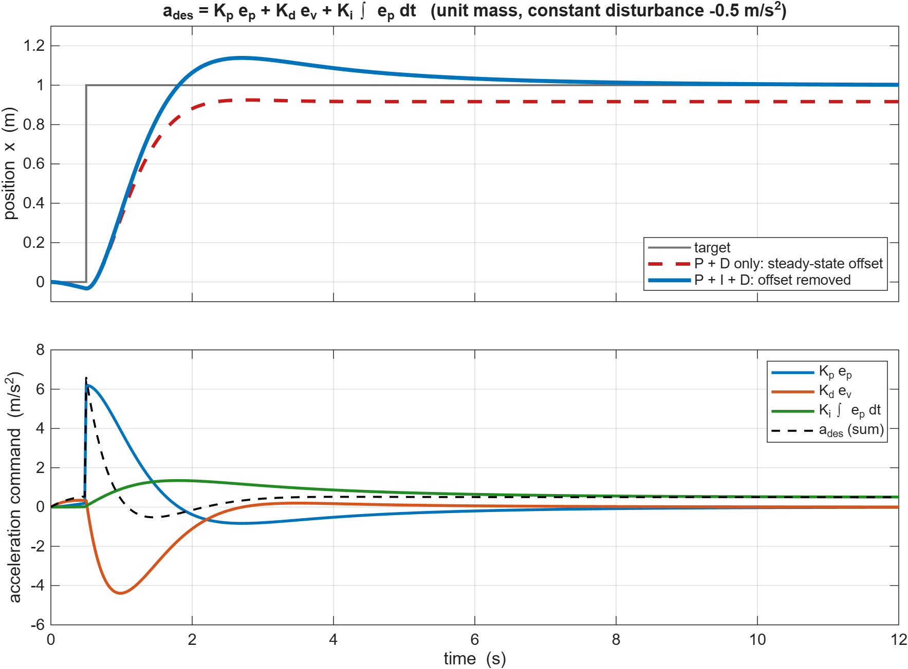
</p>
<p align="center"><b>Figure 7.8</b> &ndash; <b>Top:</b> a 1 m position step under a constant disturbance of &minus;0.5 m/s&sup2;. Without the integral term the drone settles 0.083 m short (red dashed); with it, the offset is removed (blue). <b>Bottom:</b> the individual terms of <code>a_des</code>: the proportional term reacts to the step, the derivative term brakes against velocity, and the integral term slowly grows to the 0.5 m/s&sup2; needed to cancel the disturbance.</p>

---

<a id="79-data-driven-physics-discovery-via-sindy--sindyc"></a>
### 7.9 Data-Driven Physics Discovery via SINDy & SINDYc

> **What this section does.** Instead of assuming the equations of motion, it *discovers* them from data. The recorded flight logs are turned into a table of state derivatives, a library of candidate terms (constants, velocities, thrust times tilt, ...) is built, and a sparse regression keeps only the few terms that really matter. The output is a short, readable differential equation per quantity.
>
> **Practical purpose.** It validates that the simulator obeys the expected physics (it re-discovers gravity without being told), delivers compact, interpretable models of the rotor mixing and of the closed-loop controller + airframe, and can supply fast surrogate models for planners and for analysis, without hand-deriving anything.

Rather than assuming ideal equations of motion, the project uses **Sparse Identification of Nonlinear Dynamics** (*Brunton, Proctor & Kutz, PNAS 2016*) to identify the governing differential equations directly from `.npz` flight logs.

#### Equation: SINDy Formulation & Candidate Library

Given $M$ snapshot measurements, let $\mathbf{X}$ be the $M \times n$ matrix of states and $\mathbf{U}$ the $M \times m$ matrix of control inputs. SINDy models the state derivatives as a sparse combination of candidate functions:

```math
\dot{\mathbf{X}} = \Theta(\mathbf{X}, \mathbf{U}) \, \Xi
```

Here $\Theta$ is the $M \times p$ library of candidate functions (constant, linear, quadratic, cross-products and thrust-tilt terms) and $\Xi$ is the sparse coefficient matrix:

```math
\Theta(\mathbf{X}, \mathbf{U}) = \begin{bmatrix} 1 & \mathbf{X} & \mathbf{U} & \mathbf{X}^2 & \mathbf{X} \otimes \mathbf{U} & T \cos\phi \cos\theta & T \sin\theta & T \sin\phi & \cdots \end{bmatrix}
```

**What the equations say.** Each row of the data corresponds to one time instant. $\Theta$ evaluates a long list of *possible* terms at every instant, one column per candidate (for example "the constant $1$", "the velocity", "thrust times $\cos\phi\cos\theta$"). The unknown $\Xi$ then says how much of each candidate is needed to explain each measured derivative, one column of $\Xi$ per state. "Sparse" means most entries of $\Xi$ are exactly zero, so the surviving terms *are* the equation. Including physics-motivated columns such as thrust-tilt terms gives the regression a chance to find the true law instead of an approximation.

**Variables**
- $M$: number of time samples (log rows); $n$: number of state variables; $m$: number of control inputs; $p$: number of candidate functions.
- $\mathbf{X}$: $M \times n$ matrix of measured states (for example velocities, angular rates); $\mathbf{U}$: $M \times m$ matrix of inputs (for example commanded velocities or rotor features).
- $\dot{\mathbf{X}}$: $M \times n$ matrix of state time-derivatives, estimated numerically from the logs (finite differences / Savitzky-Golay smoothing, see §5).
- $\Theta(\mathbf{X}, \mathbf{U})$: $M \times p$ candidate library. Its blocks are: $1$ (a constant column, e.g. gravity), $\mathbf{X}$ and $\mathbf{U}$ (linear terms), $\mathbf{X}^2$ (element-wise squares / quadratic terms), $\mathbf{X} \otimes \mathbf{U}$ (products of states with inputs), and the thrust-tilt terms; $\cdots$ stands for further columns.
- $T$: thrust input; $\phi$: roll angle ($\text{rad}$); $\theta$: pitch angle ($\text{rad}$). The three thrust-tilt terms are the components of the thrust vector projected on the world axes.
- $\Xi = [\xi_1, \dots, \xi_n]$: $p \times n$ sparse coefficient matrix; column $\xi_j$ is the recipe for the derivative of state $j$.
- $\otimes$: all pairwise products between the columns of the two matrices.

- **Small example:** for the vertical-velocity model (Model A below) only two of the $p$ columns survive, the constant $1$ and $T\cos\phi\cos\theta$, so the relevant column of $\Xi$ is $[-9.796,\; 1.170]$ at those two positions and $0$ everywhere else.

#### Equation: Sequentially Thresholded Least Squares (STLSQ)

The coefficient matrix is $\Xi = [\xi_1, \xi_2, \dots, \xi_n]$, solved one target column $\dot{x}_j$ at a time. Let $S$ be the current set of active library columns, and $\Theta_S$ the library restricted to those columns.

**Step 1.** Solve ridge regression on the active columns:

```math
\xi_j = \left( \Theta_S^T \Theta_S + \alpha I \right)^{-1} \Theta_S^T \dot{x}_j
```

**Step 2.** Keep only coefficients whose size is at least $\lambda$ times the largest one, and drop the rest:

```math
S_{k+1} = \{\, i \in S_k : |\xi_{i,j}| \ge \lambda \max_l |\xi_{l,j}| \,\}
```

**Step 3.** Repeat Steps 1 and 2 until the active set $S$ stops changing.

**What the equations say.** Step 1 is ordinary least squares with a tiny stabilising penalty (ridge regression): it finds the coefficients that best reproduce the measured derivative using only the currently active columns. Step 2 *prunes*: any coefficient that is small compared with the largest one is considered noise and its column is removed. Step 3 refits on the survivors and repeats, because removing junk terms changes the best values of the remaining ones. The loop normally settles after a few passes, leaving a sparse $\xi_j$.

**Variables**
- $j$: index of the state derivative being fitted; $\dot{x}_j$: the $j$-th column of $\dot{\mathbf{X}}$ (an $M$-vector).
- $\xi_j$: the $j$-th column of $\Xi$ (coefficients of every library term for state $j$); $\xi_{i,j}$: its $i$-th entry.
- $S$, $S_k$: set of indices of currently active library columns at iteration $k$; $\Theta_S$: $\Theta$ keeping only the columns in $S$.
- $\alpha$: small positive ridge penalty that keeps the matrix inverse well conditioned; $I$: identity matrix of matching size.
- $\lambda \in (0, 1)$: relative threshold; $\max_l |\xi_{l,j}|$: the largest coefficient magnitude of this column.
- In the overall optimisation problem of the Architecture Summary, $\|\cdot\|_F$ is the Frobenius norm (square root of the sum of squared entries).
- **Implementation:** `stlsq()` & `SINDy` class in [pybullet/sindy/sindy.py](pybullet/sindy/sindy.py#L93-L188).

#### MATLAB Plot: SINDy Regression with STLSQ (main formula of §7.9)

The script generates **synthetic** data from the form of Model A and lets STLSQ recover it from a nine-term library. It demonstrates the algorithm; it does not use the repository's logs. (The real-data parity plots are in [`pybullet/results/sindy/A_translational.png`](pybullet/results/sindy/A_translational.png).)

<details>
<summary><b>MATLAB code</b> &mdash; <code>matlab/section7/plot_7_9_sindy_stlsq.m</code></summary>

```matlab
% plot_7_9_sindy_stlsq.m
% Section 7.9 - SINDy:  X_dot = Theta(X, U) * Xi,  solved by sequentially thresholded least squares.
% Synthetic demonstration (NOT the repository logs): data are generated from the Model A form
%     dvz/dt = -9.796 + 1.170 T cos(roll) cos(pitch)  + noise
% and STLSQ has to rediscover it from a nine-term candidate library.

rng(1);
M     = 3000;                                 % number of snapshots
T     = 6 + 5*rand(M, 1);                     % thrust feature
roll  = 0.5*(2*rand(M, 1) - 1);               % rad
pitch = 0.5*(2*rand(M, 1) - 1);               % rad
vz    = 0.5*randn(M, 1);                      % m/s
dvz   = -9.796 + 1.170*T.*cos(roll).*cos(pitch) + 0.10*randn(M, 1);   % "measured" derivative

Theta = [ones(M,1), T.*cos(roll).*cos(pitch), T.*sin(pitch), T.*sin(roll), ...
         vz, roll, pitch, T, vz.^2];          % candidate library (M x p)
names = {'1', 'T cos\phi cos\theta', 'T sin\theta', 'T sin\phi', 'v_z', '\phi', '\theta', 'T', 'v_z^2'};
p     = size(Theta, 2);
truth = [-9.796; 1.170; 0; 0; 0; 0; 0; 0; 0];

alpha  = 1e-6;                                % ridge penalty
lambda = 0.05;                                % keep |xi| >= lambda * max|xi|
active = true(p, 1);
xi     = zeros(p, 1);
for it = 1:10                                 % STLSQ loop
    A = Theta(:, active);
    xi = zeros(p, 1);
    xi(active) = (A'*A + alpha*eye(nnz(active))) \ (A'*dvz);        % ridge on active columns
    if it == 1, xiRidge = xi; end
    keep = active & (abs(xi) >= lambda * max(abs(xi)));              % drop the small ones
    if isequal(keep, active), break; end
    active = keep;
end
pred = Theta * xi;
R2   = 1 - sum((dvz - pred).^2) / sum((dvz - mean(dvz)).^2);
fprintf('STLSQ finished after %d iterations, %d active terms, R^2 = %.5f\n', it, nnz(active), R2);
for q = find(active)'
    fprintf('  recovered term %-22s xi = %9.4f\n', names{q}, xi(q));
end

blue = [0.00 0.45 0.74];  orange = [0.85 0.33 0.10];  gray = [0.65 0.65 0.65];

fig = figure('Color', 'w', 'Position', [100 100 1100 520]);
try, theme(fig, 'light'); catch, end   % force light colours (R2025a+ follows the OS dark mode)
tl  = tiledlayout(1, 2, 'TileSpacing', 'compact', 'Padding', 'compact');

nexttile; hold on; grid on; box on;
Y = abs([truth, xiRidge, xi]);   Y(Y == 0) = NaN;       % exact zeros cannot be drawn on a log axis
hb = bar(1:p, Y, 'grouped');
set(hb, {'FaceColor'}, {[0.20 0.20 0.20]; gray; blue}, 'BaseValue', 1e-4);
set(gca, 'YScale', 'log', 'XTick', 1:p, 'XTickLabel', names, 'FontSize', 11); xtickangle(35);
ylim([1e-4 30]);
ylabel('|\xi_j|   (log scale)');
legend({'true model', 'first ridge fit (all terms)', 'after STLSQ'}, 'Location', 'northeast');
title('(a) Coefficient magnitudes for dv_z/dt  (no bar = exactly 0)');

nexttile; hold on; grid on; box on;
plot(dvz, pred, '.', 'Color', blue, 'MarkerSize', 6);
lim = [min(dvz) max(dvz)];
plot(lim, lim, 'k--', 'LineWidth', 1.6);
axis equal; xlim(lim); ylim(lim);
xlabel('"measured"  dv_z/dt  (m/s^2)'); ylabel('predicted  \Theta \xi  (m/s^2)');
text(lim(1) + 0.05*diff(lim), lim(2) - 0.08*diff(lim), sprintf('R^2 = %.5f', R2), ...
     'FontSize', 12, 'FontWeight', 'bold');
title('(b) Predicted versus actual acceleration');
set(gca, 'FontSize', 11);

outDir = fullfile(fileparts(mfilename('fullpath')), '..', '..', 'assets', 'section7');
if ~exist(outDir, 'dir'), mkdir(outDir); end
exportgraphics(fig, fullfile(outDir, 'fig_7_9_sindy_stlsq.png'), 'Resolution', 200);
```

</details>

<p align="center">
  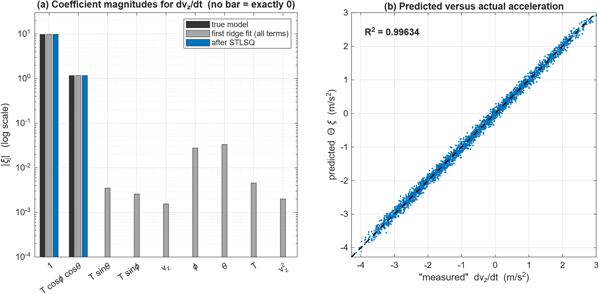
</p>
<p align="center"><b>Figure 7.9</b> &ndash; <b>(a)</b> Coefficient magnitudes (log scale). The first ridge fit (grey) already finds the two large terms but leaves small non-zero values on seven useless library terms; thresholding removes them, leaving exactly the two true terms (blue). <b>(b)</b> The sparse model reproduces the "measured" acceleration (R&sup2; &asymp; 0.996 with the added noise).</p>

#### Equation: Discovered Physical Models (From Actual JSON Artifacts)

Running `python -m sindy.identify_dynamics` across the flight logs extracted the following equations.

**Model A: Translational Dynamics**

```math
\frac{dv_z}{dt} = -9.796 + 1.170 \, T \cos(\text{roll}) \cos(\text{pitch}), \qquad R^2 = 0.9998
```

*What it says and what it means:* the vertical acceleration is the thrust component along the world vertical ($T\cos\phi\cos\theta$, scaled by $1.170$) minus a constant. The constant is gravity, so with $g \approx 9.796\,\text{m/s}^2$ SINDy independently discovered Earth's gravity from raw simulation state logs without human intervention. At hover ($dv_z/dt = 0$) the thrust feature must satisfy $T\cos\phi\cos\theta = 9.796/1.170 \approx 8.37$ in the log's thrust units.

- **Variables:** $v_z$: vertical velocity ($\text{m/s}$), so $dv_z/dt$ is the vertical acceleration ($\text{m/s}^2$); $T$: the thrust feature of the library (the factor $1.170$ absorbs the $1/m$ conversion and the unit scaling of $T$); $\text{roll} = \phi$, $\text{pitch} = \theta$: attitude angles ($\text{rad}$); $-9.796$: the constant term, equal to $-g$; $R^2$: coefficient of determination of the fit (here on held-out data).

**Model B: Rotational Angular Acceleration**

```math
\begin{bmatrix} \dot{\omega}_x \\ \dot{\omega}_y \\ \dot{\omega}_z \end{bmatrix} =
\begin{bmatrix}
-63.87 & -63.70 & 63.34 & 64.23 \\
-63.14 & 63.59 & 63.13 & -63.58 \\
-35.70 & 36.82 & -36.55 & 35.44
\end{bmatrix}
\begin{bmatrix} r_0 \\ r_1 \\ r_2 \\ r_3 \end{bmatrix}, \qquad R^2 > 0.998
```

*What it says and what it means:* each body angular acceleration is a weighted sum of the four rotor inputs. The sign pattern of the three rows, $(-,-,+,+)$, $(-,+,+,-)$ and $(-,+,-,+)$, is exactly the sign pattern of the torque rows of the mixing matrix in §7.8, and the roll and pitch rows have nearly equal magnitude ($\approx 63$ to $64$) as the symmetric X-frame requires. SINDy therefore reconstructed the exact quadrotor X-frame geometry and rotor rotation directions (motors 0 & 2 CCW, motors 1 & 3 CW).

- **Variables:** $\dot{\omega}_x$, $\dot{\omega}_y$, $\dot{\omega}_z$: roll, pitch and yaw angular accelerations of the body ($\text{rad/s}^2$); $r_0, \dots, r_3$: the per-rotor input features built from the logged rotor speeds (scaled squared rotor speed of motors $0$ to $3$); the $3 \times 4$ matrix: the identified coefficients (in $\text{rad/s}^2$ per unit of $r_i$).

**Model C: Aerodynamic Body Torques ($\boldsymbol{\tau} = \mathbf{I}\dot{\boldsymbol{\omega}}$)**

```math
\begin{bmatrix} \tau_x \\ \tau_y \\ \tau_z \end{bmatrix} =
\begin{bmatrix} I_{xx} \dot{\omega}_x \\ I_{yy} \dot{\omega}_y \\ I_{zz} \dot{\omega}_z \end{bmatrix} =
\begin{bmatrix}
-0.0008941 & -0.0008917 & 0.0008867 & 0.0008993 \\
-0.0008839 & 0.0008903 & 0.0008838 & -0.0008902 \\
-0.0007748 & 0.0007989 & -0.0007932 & 0.0007690
\end{bmatrix}
\begin{bmatrix} r_0 \\ r_1 \\ r_2 \\ r_3 \end{bmatrix}, \qquad R^2 > 0.998
```

*What it says and what it means:* multiplying the LHS of Model B by the quadrotor inertia tensor $\mathbf{I} = \text{diag}(I_{xx}, I_{yy}, I_{zz}) = \text{diag}(1.40\times 10^{-5}, 1.40\times 10^{-5}, 2.17\times 10^{-5})\,\text{kg}\cdot\text{m}^2$ recovers the physical aerodynamic body torques. The discovered coefficients match the CF2X analytical URDF ground truth: roll/pitch torque coefficient $L \cdot k_f = 8.8708\times 10^{-4}\,\text{N}\cdot\text{m}$ (identified $\approx 8.90\times 10^{-4}\,\text{N}\cdot\text{m}$, $< 0.8\%$ error) and yaw torque coefficient $k_m = 7.9400\times 10^{-4}\,\text{N}\cdot\text{m}$ (identified $\approx 7.93\times 10^{-4}\,\text{N}\cdot\text{m}$, $< 0.15\%$ error).

- **Variables:** $\tau_x, \tau_y, \tau_z$: roll, pitch, and yaw body torques ($\text{N}\cdot\text{m}$); $I_{xx}, I_{yy}, I_{zz}$: principal moments of inertia ($\text{kg}\cdot\text{m}^2$); $r_0, \dots, r_3$: scaled squared rotor inputs ($10^{-8} \cdot \text{rpm}_i^2$).

**Model D: Closed-Loop Command Response (SINDYc)**

```math
\dot{v}_x = 0.2088 - 3.459 \, v_x + 8.762 \, v_{cx} - 1.641 \, v_x^2 - 3.507 \, v_x v_y + \cdots
```

```math
\dot{v}_y = -0.0804 + 0.2534 \, v_x - 3.300 \, v_y + 9.426 \, v_{cy} + \cdots
```

*What it says and what it means:* models the entire PID + closed-loop airframe as a compact low-order polynomial filter mapping the command velocity $[v_{cx}, v_{cy}]$ to the drone acceleration $[\dot{v}_x, \dot{v}_y]$. In the $\dot{v}_x$ equation, $-3.459\,v_x$ is a damping term (the faster the drone moves, the more it decelerates), $8.762\,v_{cx}$ is the pull toward the commanded velocity, and the quadratic and cross terms are small nonlinear corrections. The ellipses mark additional terms omitted here, so these truncated expressions must not be used to compute quantities such as the steady-state gain.

- **Variables:** $v_x$, $v_y$: measured horizontal velocities ($\text{m/s}$); $v_{cx}$, $v_{cy}$: commanded horizontal velocities ($\text{m/s}$); $\dot{v}_x$, $\dot{v}_y$: horizontal accelerations ($\text{m/s}^2$); the numbers: identified coefficients with the units needed to make each term an acceleration.

---

<a id="8-high-fidelity-mujoco-simulation-suite"></a>
## 8. High-Fidelity MuJoCo Simulation Suite

The `mujoco_drone_sim/` suite re-implements the same mission in the **MuJoCo physics engine** with substantially higher physical and perceptual fidelity than the PyBullet testbed: true rigid-body multi-rotor dynamics, motor delays, noisy 3D LiDAR, a Kalman-filter obstacle tracker, stochastic (Ornstein-Uhlenbeck) moving obstacles, and six interchangeable avoidance strategies. This section documents the platform, perception, estimation, avoidance, and control design of that suite; run instructions are in [Section 12.5](#125-high-fidelity-mujoco-simulation-suite).

> [!TIP]
> **Looking for instructions on how to run the MuJoCo suite?** Jump to [Section 12.5: High-Fidelity MuJoCo Simulation Suite](#125-high-fidelity-mujoco-simulation-suite) for setup, the Web Dashboard, the 3D viewer, benchmark commands, and the noise-control guide.

#### Key Capabilities

* **Physics Fidelity**: Native MuJoCo 6-DOF quadcopter model (Crazyflie 2.x scale, mass = 47.2 g) simulated with Runge-Kutta 4th-order (RK4) integration at 500 Hz physics and 48 Hz control frequency.
* **Kalman Filter Tracking**: 6-State Constant-Velocity Kalman Filter tracks moving obstacles with noisy LiDAR range measurements, achieving **~50% noise variance reduction** and projecting future obstacle trajectories 1.0 second into the future.
* **Stochastic Dynamic Obstacles & Noise Control**: Moving obstacles do not follow predictable deterministic paths; they are driven by an **Ornstein-Uhlenbeck stochastic drift process** with random phase, frequency, and wandering drift. Operators can toggle between **🟢 No Noise**, **🟡 Low Noise** (default), and **🔴 High Noise** profiles in real time.
* **6 Navigation Strategies**:
  1. **Reactive Sector State Machine** (with closing-velocity evasion and hysteresis side-switching)
  2. **Artificial Potential Fields (APF)** (continuous potential gradients)
  3. **Dynamic Window Approach (DWA)** (velocity-space rollout optimization)
  4. **3D Volumetric Avoidance** (vertical overflight of walls and ducking under overhangs)
  5. **SINDy-Enhanced DWA** (data-driven discovered non-linear quadcopter dynamics)
  6. **Adaptive Neural Brain** (neural weight updates)
* **Dead-End & Trap Solving**: Autonomous 360° LiDAR perimeter inspection that detects concave U-traps and circular dead-ends, initiating 3D vertical climb-overs or finding horizontal escape gaps.
* **Interactive Tooling & Dashboard**: Real-time Web Dashboard (`http://127.0.0.1:8080`) with mouse/keyboard obstacle placement, live 2D/3D dual-viewport, tri-state **Noise Level Control** buttons, live LiDAR radar, Kalman trajectory curves, and desktop Tkinter visual arena editor.


<a id="81-end-to-end-system-architecture"></a>
### 8.1 End-to-End System Architecture

The software architecture follows a modular sense-estimate-plan-control feedback loop:

```
                  +----------------------------------------------+
                  |         MuJoCo 3.13 Physics World            |
                  |  - RK4 Numerical Integrator (dt = 0.002s)    |
                  |  - Dynamic Obstacles with OU Drift Process   |
                  +----------------------+-----------------------+
                                         |
                       [Rigid-body State & Sensor Rays]
                                         v
+--------------------------------------------------------------------------------+
|                           PERCEPTION SUBSYSTEM                                 |
|  * 8-Beam Horizontal LiDAR Array (Front, Left/Right 35°, 70°, 90°, Rear 180°)   |
|  * 2-Beam Vertical Array (Up +Z, Down -Z)                                      |
|  * Gaussian Sensor Noise Injection (sigma = 0.06m)                            |
+----------------------------------------+---------------------------------------+
                                         |
                        [Noisy Positional Hits & Range]
                                         v
+--------------------------------------------------------------------------------+
|                     KALMAN FILTER & TRACKING SUBSYSTEM                         |
|  * Multi-Obstacle 6-State Estimator [x, y, z, vx, vy, vz]                    |
|  * Joseph-Form Stabilized Covariance Propagation                               |
|  * Closing-Velocity Calculation: v_rel = v_obs - v_drone                       |
|  * 1.0-Second Forward Trajectory Prediction Horizon                            |
+----------------------------------------+---------------------------------------+
                                         |
               [Filtered State, Projected Trajectory, Dynamic Sectors]
                                         v
+--------------------------------------------------------------------------------+
|                        AVOIDANCE & PLANNING SUBSYSTEM                          |
|  * Reactive State Machine / APF / DWA / SINDy-DWA / 3D Volumetric              |
|  * Dynamic Sector Inflation based on Kalman closing-velocity                   |
|  * Dead-End Reversal Monitor (3 reversals in 12s triggers 360° Scan)          |
|  * Output: Desired Position & Velocity Setpoint [x_des, y_des, z_des]          |
+----------------------------------------+---------------------------------------+
                                         |
                               [Desired Setpoint]
                                         v
+--------------------------------------------------------------------------------+
|                           CONTROL SUBSYSTEM (SE3)                              |
|  * Calibrated DSL-PID Attitude Controller                                      |
|  * Position PID -> Desired Acceleration Vector                                 |
|  * Orientation Extraction -> Desired Quaternion & Angular Velocities           |
|  * Motor Mixer -> 4 Rotor PWM Control Commands [u1, u2, u3, u4]                |
+----------------------------------------+---------------------------------------+
                                         |
                            [Actuator Forces & Torques]
                                         v
                         (Back to MuJoCo Physics World)
```

<a id="82-physical-platform--simulation-engine"></a>
### 8.2 Physical Platform & Simulation Engine

#### Drone Physical Parameters (Crazyflie 2.x Scale)

The quadcopter is modeled in `models/drone.xml` with high physical precision:
* **Total Mass**: 0.0472 kg (47.2 g)
* **Arm Length**: 0.040 m (4.0 cm)
* **Inertia Matrix**:
  - `I_xx = 1.4 × 10⁻⁵ kg·m²`
  - `I_yy = 1.4 × 10⁻⁵ kg·m²`
  - `I_zz = 2.17 × 10⁻⁵ kg·m²`
* **Rotor Count**: 4 motors in an "X" configuration:
  * Motor 1: Front-Left (Counter-Clockwise)
  * Motor 2: Front-Right (Clockwise)
  * Motor 3: Rear-Left (Clockwise)
  * Motor 4: Rear-Right (Counter-Clockwise)
* **Maximum Thrust**: 0.155 N per rotor (0.62 N total thrust ≈ 1.34× thrust-to-weight ratio).
* **Torque-to-Thrust Ratio**: `k_m = 0.00596 m`.

#### Physics Time-Stepping

* **Physics Integration Step**: `Δt_physics = 0.002 s` (500 Hz).
* **Control Step**: `Δt_control = 1/48 s ≈ 0.02083 s` (48 Hz).
* Each control step runs about **10 physics sub-steps** (500 Hz ÷ 48 Hz ≈ 10.4) using Runge-Kutta 4th order (RK4) integration for numerical stability and realistic contact dynamics.

<a id="83-perception--sensor-array"></a>
### 8.3 Perception & Sensor Array

#### Beam Layout

| Sensor Name | Angle Relative to Forward | Purpose |
| :--- | :---: | :--- |
| **Front** | 0° | Forward collision detection in line of sight |
| **Left** | +35° | Front-left flank detection (turns & corridor walls) |
| **Far Left** | +70° | Oblique lateral clearance |
| **Side Left** | +90° | Full lateral clearance while overtaking |
| **Right** | -35° | Front-right flank detection |
| **Far Right** | -70° | Oblique lateral clearance |
| **Side Right** | -90° | Full lateral clearance while overtaking |
| **Rear** | 180° | Clearance monitoring during emergency reversals |
| **Up** | +Z (Vertical) | Overflight clearance for 3D climb-overs |
| **Down** | -Z (Vertical) | Ground proximity and altitude holding |

#### Range & Safety Thresholds

* **Maximum Range**: 2.00 m (readings beyond this register as clear space).
* **Caution Distance (`d_danger`)**: 0.75 m (beams turn **Orange**, triggers avoidance steering).
* **Emergency Distance (`d_emerg`)**: 0.30 m (beams turn **Red**, triggers immediate reverse thrust).

<a id="84-kalman-filter-tracking--trajectory-prediction"></a>
### 8.4 Kalman Filter Tracking & Trajectory Prediction

When obstacles move dynamically in real-world conditions, rangefinder hits exhibit measurement noise and jitter. Without filtering, raw velocity estimation amplifies noise, causing flight instability.

#### 8.4.1 State Space Formulation

The tracking system uses a 6-state Constant-Velocity (CV) Kalman Filter implemented in `perception/kalman_filter.py`:

```math
\mathbf{x} = \begin{bmatrix} x & y & z & v_x & v_y & v_z \end{bmatrix}^T \in \mathbb{R}^6
```

##### Mathematical Term Breakdown for State Vector:
| Term / Symbol | Mathematical Description | Vector / Matrix Space | Physical SI Units | Simulation Interpretation & Role |
| :--- | :--- | :---: | :---: | :--- |
| `x` | Complete dynamic state vector | `ℝ^6` | `[m, m, m, m/s, m/s, m/s]ᵀ` | The complete 6-dimensional kinematic state of the tracked obstacle. |
| `x` | Longitudinal Cartesian position | `ℝ` (Scalar) | `m` (meters) | Position along the inertial world `X`-axis (primary flight corridor direction). |
| `y` | Lateral Cartesian position | `ℝ` (Scalar) | `m` (meters) | Position along the inertial world `Y`-axis (lateral cross-track axis). |
| `z` | Vertical Cartesian altitude | `ℝ` (Scalar) | `m` (meters) | Altitude above ground along the inertial world `Z`-axis. |
| `v_x` | Longitudinal linear velocity | `ℝ` (Scalar) | `m/s` (meters / second) | Speed of the obstacle along the world `X`-axis. |
| `v_y` | Lateral linear velocity | `ℝ` (Scalar) | `m/s` (meters / second) | Speed of the obstacle along the world `Y`-axis (e.g. lateral sliding intruder speed). |
| `v_z` | Vertical linear velocity | `ℝ` (Scalar) | `m/s` (meters / second) | Speed of the obstacle along the vertical `Z`-axis. |
| `p` | 3D Spatial position sub-vector | `ℝ^3` | `m` | Block `[x, y, z]ᵀ` denoting physical 3D center-of-mass coordinates. |
| `v` | 3D Linear velocity sub-vector | `ℝ^3` | `m/s` | Block `[v_x, v_y, v_z]ᵀ` representing obstacle translational velocity. |

---

##### State Transition Model:
The continuous-time linear motion model is discretized at the filter update step `Δt = 1/48 ≈ 0.02083 s`:

```math
\mathbf{x}_k = \mathbf{F} \mathbf{x}_{k-1} + \mathbf{w}_k, \quad \mathbf{w}_k \sim \mathcal{N}(\mathbf{0}, \mathbf{Q})
```

The `6 × 6` State Transition Matrix `F` is structured as:

```math
\mathbf{F} = \begin{bmatrix} \mathbf{I}_{3\times3} & \Delta t \mathbf{I}_{3\times3} \\ \mathbf{0}_{3\times3} & \mathbf{I}_{3\times3} \end{bmatrix} = \begin{bmatrix}
1 & 0 & 0 & \Delta t & 0 & 0 \\
0 & 1 & 0 & 0 & \Delta t & 0 \\
0 & 0 & 1 & 0 & 0 & \Delta t \\
0 & 0 & 0 & 1 & 0 & 0 \\
0 & 0 & 0 & 0 & 1 & 0 \\
0 & 0 & 0 & 0 & 0 & 1
\end{bmatrix}
```

##### Mathematical Term Breakdown for State Transition:
| Term / Symbol | Mathematical Description | Vector / Matrix Space | Physical SI Units | Simulation Interpretation & Role |
| :--- | :--- | :---: | :---: | :--- |
| `x_k` | State vector at time step `k` | `ℝ^6` | `[m, m/s]ᵀ` | True obstacle state at current discrete timestamp `t_k = k Δt`. |
| `x_k-1` | State vector at previous step `k-1` | `ℝ^6` | `[m, m/s]ᵀ` | Obstacle state at previous discrete timestamp `t_k-1 = (k-1)Δt`. |
| `k` | Discrete time step index | `ℤ^+` | Dimensionless (count) | Control loop cycle index running at 48 Hz. |
| `F` | State transition matrix | `ℝ^(6×6)` | Mixed (`1`, `s`) | Propagates constant-velocity kinematics forward by interval `Δt`. |
| `I_3×3` | `3 × 3` Identity matrix | `ℝ^(3×3)` | Dimensionless | Maps positions and velocities onto themselves across time steps. |
| `0_3×3` | `3 × 3` Zero null matrix | `ℝ^(3×3)` | Dimensionless | Enforces zero direct coupling from position into velocity. |
| `Δt` | Discrete filter sampling interval | `ℝ^+` (Scalar) | `s` (seconds) | `Δt = 1/48 ≈ 0.020833 s` (matches 48 Hz control loop). |
| `w_k` | Discrete process noise vector | `ℝ^6` | `[m, m/s]ᵀ` | Stochastic disturbances, accelerations, and unmodeled trajectory deviations. |
| `N(0, Q)` | Multivariate Gaussian distribution | Probability measure | — | Zero-mean Gaussian distribution with covariance matrix `Q`. |
| `0` | Mean disturbance vector | `ℝ^6` | `[m, m/s]ᵀ` | Unbiased disturbance hypothesis (`E[w_k] = 0`). |
| `Q` | Process noise covariance matrix | `ℝ^(6×6)` | Mixed (`m^2, m^2/s, m^2/s^2`) | Quantifies kinematic uncertainty due to obstacle maneuvering. |

**Detailed Transition Mechanics**:
1. **Position Integration**: The new position is predicted by integrating current velocity over time step `Δt`:

   ```math
   \mathbf{p}_k = \mathbf{p}_{k-1} + \mathbf{v}_{k-1} \Delta t
   ```
   * `p_k ∈ ℝ^3`: Predicted position `[m]` at step `k`.
   * `p_k-1 ∈ ℝ^3`: Position `[m]` at step `k-1`.
   * `v_k-1 ∈ ℝ^3`: Linear velocity `[m/s]` at step `k-1`.
   * `Δt`: Integration time increment (`0.02083 s`).
2. **Velocity Persistence**: In the constant-velocity kinematic hypothesis, nominal obstacle velocity persists without deterministic acceleration:

   ```math
   \mathbf{v}_k = \mathbf{v}_{k-1}
   ```
   * `v_k ∈ ℝ^3`: Predicted velocity `[m/s]` at step `k`.
3. **Process Noise (`w_k`)**: True obstacle accelerations, maneuvers, and stochastic deviations are modeled through the process noise vector `w_k ~ N(0, Q)`.

The discrete process noise covariance matrix `Q ∈ ℝ^(6×6)` is derived from a continuous-time white-noise acceleration model with spectral density `q = σ_a^2`:

```math
\mathbf{Q} = \begin{bmatrix}
\frac{\Delta t^3}{3} \mathbf{I}_{3\times3} & \frac{\Delta t^2}{2} \mathbf{I}_{3\times3} \\
\frac{\Delta t^2}{2} \mathbf{I}_{3\times3} & \Delta t \mathbf{I}_{3\times3}
\end{bmatrix} q
```

##### Mathematical Term Breakdown for Process Covariance `Q`:
| Term / Symbol | Mathematical Description | Vector / Matrix Space | Physical SI Units | Simulation Interpretation & Role |
| :--- | :--- | :---: | :---: | :--- |
| `Q` | Process noise covariance matrix | `ℝ^(6×6)` | Mixed | Uncertainty injected into the state per time step `Δt`. |
| `(Δt^3)/3 I_3×3` | Position-position covariance block | `ℝ^(3×3)` | `s^3` (scaled by `q`) `→ m^2` | Variance added to 3D position due to integrated white acceleration. |
| `(Δt^2)/2 I_3×3` | Position-velocity cross-covariance | `ℝ^(3×3)` | `s^2` (scaled by `q`) `→ m^2/s` | Correlation between position error and velocity error over step `Δt`. |
| `Δt I_3×3` | Velocity-velocity covariance block | `ℝ^(3×3)` | `s` (scaled by `q`) `→ m^2/s^2` | Variance added directly to obstacle linear velocity per step. |
| `q` | Continuous acceleration spectral density | `ℝ^+` (Scalar) | `m^2/s^3` | `q = σ_a^2 = 0.35^2 = 0.1225 m^2/s^3`. Power spectral density of random accelerations. |
| `σ_a` | Maneuver acceleration standard deviation | `ℝ^+` (Scalar) | `m/s^2` | Expected standard deviation of obstacle acceleration maneuvers (`≈ 0.35 m/s^2`). |

---

##### Measurement Model:
The perception system acquires 3D LiDAR point hits on obstacle surfaces. The measurement vector `z_k ∈ ℝ^3` directly measures position, while linear velocity is unobservable directly from single-frame LiDAR:

```math
\mathbf{z}_k = \mathbf{H} \mathbf{x}_k + \mathbf{v}_k, \quad \mathbf{v}_k \sim \mathcal{N}(\mathbf{0}, \mathbf{R})
```

The `3 × 6` Observation Matrix `H` projects the 6-state vector onto the observable 3D position subspace:

```math
\mathbf{H} = \begin{bmatrix} \mathbf{I}_{3\times3} & \mathbf{0}_{3\times3} \end{bmatrix} = \begin{bmatrix}
1 & 0 & 0 & 0 & 0 & 0 \\
0 & 1 & 0 & 0 & 0 & 0 \\
0 & 0 & 1 & 0 & 0 & 0
\end{bmatrix}
```

The measurement noise covariance `R ∈ ℝ^(3×3)` is governed by the LiDAR range sensor uncertainty:

```math
\mathbf{R} = \sigma_{\text{sensor}}^2 \mathbf{I}_{3\times3}
```

##### Mathematical Term Breakdown for Measurement Model:
| Term / Symbol | Mathematical Description | Vector / Matrix Space | Physical SI Units | Simulation Interpretation & Role |
| :--- | :--- | :---: | :---: | :--- |
| `z_k` | Raw sensor measurement vector | `ℝ^3` | `m` (meters) | 3D Cartesian coordinates of the LiDAR point reflection `[z_x, z_y, z_z]ᵀ`. |
| `H` | Observation projection matrix | `ℝ^(3×6)` | Dimensionless | Maps the 6-state vector to the 3-dimensional observable position subspace. |
| `v_k` | Measurement sensor noise vector | `ℝ^3` | `m` (meters) | Additive Gaussian sensor noise perturbing the true surface hit position. |
| `R` | Measurement noise covariance matrix | `ℝ^(3×3)` | `m^2` (meters squared) | Diagonal covariance capturing sensor range variance across `X, Y, Z`. |
| `σ_sensor` | LiDAR measurement noise std dev | `ℝ^+` (Scalar) | `m` (meters) | Sensor standard deviation: `0.06 m` (Low Noise default), `0.12 m` (High Noise), `0.00 m` (No Noise). |

#### 8.4.2 Numerical Stabilization: Joseph Form Covariance Update

In conventional textbook Kalman filtering, the a posteriori error covariance is updated using:

```math
\mathbf{P}_{k|k} = (\mathbf{I} - \mathbf{K}_k \mathbf{H}) \mathbf{P}_{k|k-1}
```

##### Numerical Failure of the Standard Update:
While mathematically equivalent in infinite precision, this simplified equation exhibits severe numerical flaws in floating-point software:
1. **Loss of Symmetry**: Numerical round-off errors in computing `(I - K_k H)P_k|k-1` inevitably cause `P_k|k ≠ P_k|kᵀ`.
2. **Loss of Positive Definiteness**: Because the update subtracts two positive semi-definite matrices (`P_k|k-1 - K_k H P_k|k-1`), machine precision truncation can yield tiny negative eigenvalues. This produces complex or non-physical standard deviations (`σ = √P_ii`) and eventually leads to filter divergence (covariance collapse).

##### The Stabilized Joseph Formulation:
To rigorously guarantee numerical stability, symmetry, and positive semi-definiteness across millions of simulation cycles, `perception/kalman_filter.py` implements the **Bucy-Joseph stabilized covariance equation**:

```math
\mathbf{P}_{k|k} = (\mathbf{I} - \mathbf{K}_k \mathbf{H})\mathbf{P}_{k|k-1}(\mathbf{I} - \mathbf{K}_k \mathbf{H})^T + \mathbf{K}_k \mathbf{R} \mathbf{K}_k^T
```

##### Mathematical Term Breakdown for Joseph Update:
| Term / Symbol | Mathematical Description | Vector / Matrix Space | Physical SI Units | Simulation Interpretation & Role |
| :--- | :--- | :---: | :---: | :--- |
| `P_k∣k` | A posteriori error covariance matrix | `ℝ^(6×6)` | Mixed (`m^2, m^2/s, m^2/s^2`) | Filtered uncertainty of state estimate at step `k` after incorporating measurement `z_k`. |
| `P_k∣k-1` | A priori error covariance matrix | `ℝ^(6×6)` | Mixed (`m^2, m^2/s, m^2/s^2`) | Predicted uncertainty at step `k` before measurement incorporation (`P_k∣k-1 = F P_k-1∣k-1 Fᵀ + Q`). |
| `I` | Identity matrix | `ℝ^(6×6)` | Dimensionless | 6-dimensional identity matrix. |
| `K_k` | Optimal Kalman gain matrix | `ℝ^(6×3)` | Mixed (dimensionless, `1/s`) | Weights the measurement residual against model predictions: `K_k = P_k∣k-1 Hᵀ S_k^-1`. |
| `H` | Observation matrix | `ℝ^(3×6)` | Dimensionless | Observation projection matrix `[I_3×3 0_3×3]`. |
| `(I - K_k H)` | Closed-loop error state matrix | `ℝ^(6×6)` | Dimensionless | Governs propagation of estimation error under optimal feedback. |
| `(·)ᵀ` | Matrix transpose operator | Operator | — | Swaps rows and columns to formulate symmetric congruence transformations. |
| `R` | Measurement noise covariance | `ℝ^(3×3)` | `m^2` | Sensor variance matrix (`σ_sensor^2 I_3×3`). |

**Mathematical Proof of Guarantee**:
* **Term 1**: `(I - K_k H)P_k|k-1(I - K_k H)ᵀ` is a congruence transformation of the prior covariance `P_k|k-1`. Since `P_k|k-1 ≻ 0`, this term is mathematically guaranteed to remain symmetric and positive semi-definite (`A P Aᵀ ⪰ 0`).
* **Term 2**: `K_k R K_kᵀ` is a quadratic form of the positive-definite measurement noise covariance `R ≻ 0`.
* **Sum**: The sum of two strictly symmetric, positive semi-definite matrices is unconditionally symmetric and positive semi-definite for **any arbitrary gain matrix** `K_k`, regardless of floating-point truncation errors.

#### 8.4.3 Trajectory Projection & Closing Velocity Evasion

##### 1.0-Second Forward Trajectory Projection:
Once the Kalman Filter estimates filtered obstacle position `p̂(t)` and velocity `v̂(t)`, the tracking subsystem projects the obstacle's future spatial coordinates across a forward lookahead horizon `τ ∈ [0, 1.0 s]`:

```math
\hat{\mathbf{p}}(t + \tau) = \hat{\mathbf{p}}(t) + \hat{\mathbf{v}}(t) \cdot \tau
```

##### Mathematical Term Breakdown for Trajectory Projection:
| Term / Symbol | Mathematical Description | Vector / Matrix Space | Physical SI Units | Simulation Interpretation & Role |
| :--- | :--- | :---: | :---: | :--- |
| `p̂(t + τ)` | Projected future 3D position vector | `ℝ^3` | `m` (meters) | Future spatial coordinate of obstacle at future time `t + τ`. |
| `p̂(t)` | Filtered current 3D position estimate | `ℝ^3` | `m` (meters) | Position extracted from Kalman state `x̂_k∣k[0:3]` at current time `t`. |
| `v̂(t)` | Filtered current 3D velocity estimate | `ℝ^3` | `m/s` (meters / second) | Velocity extracted from Kalman state `x̂_k∣k[3:6]` at current time `t`. |
| `t` | Current simulation timestamp | `ℝ^+` (Scalar) | `s` (seconds) | Elapsed physical simulation time. |
| `τ` | Forward projection lookahead horizon | `ℝ^+` (Scalar) | `s` (seconds) | Lookahead parameter evaluated from `τ = 0.0 s` to `τ = 1.0 s` (48 control cycles). |

This forward trajectory creates a dynamic swept safety cylinder in space, allowing the avoidance system to perceive not just where an obstacle is now, but where it will intersect the flight corridor over the next 48 control cycles.

##### Relative Closing Velocity Calculation:
The closing velocity measures how rapidly an obstacle is collapsing the distance toward the quadcopter along a specific LiDAR sensor sector:

```math
\mathbf{v}_{\text{rel}} = \hat{\mathbf{v}}_{\text{obs}} - \mathbf{v}_{\text{drone}}
```

```math
v_{\text{closing}} = - (\mathbf{v}_{\text{rel}} \cdot \hat{\mathbf{d}}_{\text{sector}})
```

##### Mathematical Term Breakdown for Closing Velocity:
| Term / Symbol | Mathematical Description | Vector / Matrix Space | Physical SI Units | Simulation Interpretation & Role |
| :--- | :--- | :---: | :---: | :--- |
| `v_rel` | Relative 3D velocity vector | `ℝ^3` | `m/s` | Velocity vector of the obstacle viewed from the drone's moving reference frame. |
| `v̂_obs` | Filtered obstacle 3D velocity vector | `ℝ^3` | `m/s` | Velocity sub-vector from the obstacle's Kalman state `[v̂_x, v̂_y, v̂_z]ᵀ`. |
| `v_drone` | Quadcopter translational velocity vector | `ℝ^3` | `m/s` | True quadcopter inertial velocity `[v_dx, v_dy, v_dz]ᵀ` from MuJoCo physics. |
| `v_closing` | Scalar sector closing velocity | `ℝ` (Scalar) | `m/s` | Rate of distance reduction along sector ray: positive if converging, negative if separating. |
| `d̂_sector` | Outward sector ray unit vector | `ℝ^3` | Dimensionless | Unit vector along centerline of evaluated LiDAR sector (e.g. Front `0^°`, Left `35^°`). |
| `·` | Euclidean inner product (dot product) | Operator | — | Computes spatial projection of relative velocity onto sensor beam direction. |
| `-` | Inversion negative sign | Operator | — | Reverses sign so that converging vectors (`v_rel` opposite `d̂_sector`) yield `v_closing > 0`. |

**Decision & Sector Inflation Logic**:
* If `v_closing > 0.05 m/s`, the obstacle is rapidly converging toward the drone on that sector.
* The system applies **Dynamic Sector Inflation**:

  ```math
  d_{\text{danger,eff}} = d_{\text{danger}} + \gamma \cdot \max(0, v_{\text{closing}}) \cdot \tau_{\text{proj}}
  ```

##### Mathematical Term Breakdown for Dynamic Sector Inflation:
| Term / Symbol | Mathematical Description | Vector / Matrix Space | Physical SI Units | Simulation Interpretation & Role |
| :--- | :--- | :---: | :---: | :--- |
| `d_danger,eff` | Effective dynamic danger threshold | `ℝ^+` (Scalar) | `m` (meters) | Dynamically expanded avoidance trigger distance for the evaluated sector. |
| `d_danger` | Static nominal danger threshold | `ℝ^+` (Scalar) | `m` (meters) | Base caution clearance distance (`0.75 m`). |
| `γ` | Dynamic inflation scaling factor | `ℝ^+` (Scalar) | Dimensionless | Tuning gain set to `γ = 0.40` in simulation. |
| `max(0, v_closing)` | Non-negative closing velocity rectifier | `ℝ^+` (Scalar) | `m/s` | Ensures receding obstacles (`v_closing ≤ 0`) do not unsafely shrink safety margins below `d_danger`. |
| `τ_proj` | Anticipation projection horizon | `ℝ^+` (Scalar) | `s` (seconds) | Predictive time horizon constant (`τ_proj = 1.0 s`). |

* **Wake Evasion Rule**: Rather than attempting to cross in front of a fast-moving obstacle, the state machine biases its avoidance vector behind the obstacle's dynamic wake (`v_evade ∝ -v̂_obs,⊥`), guaranteeing collision-free clearance.

#### 8.4.4 Stochastic Obstacle Noise & Multi-Tier Noise Control

In `simulation/drone_sim.py`, dynamic obstacles do not adhere to predictable, deterministic sinusoidal motions. Real-world obstacles wander, experience wind buffeting, and exhibit sensor measurement fluctuations. This behavior is modeled using a continuous **Ornstein-Uhlenbeck (OU) mean-reverting stochastic process**:

```math
dX_t = -\theta X_t dt + \sigma_{\text{obs}} dW_t
```

##### Mathematical Term Breakdown for Ornstein-Uhlenbeck Process:
| Term / Symbol | Mathematical Description | Vector / Matrix Space | Physical SI Units | Simulation Interpretation & Role |
| :--- | :--- | :---: | :---: | :--- |
| `dX_t` | Stochastic displacement differential | `ℝ` (Scalar) | `m` (meters) | Infinitesimal stochastic perturbation added to obstacle coordinate over `dt`. |
| `X_t` | Current perturbation coordinate offset | `ℝ` (Scalar) | `m` (meters) | Instantaneous deviation of obstacle from its nominal sliding path. |
| `-θ X_t dt` | Mean-reverting deterministic drift | `ℝ` (Scalar) | `m` (meters) | Negative feedback pulling perturbation back toward zero (`X=0`). |
| `θ` | Mean reversion rate coefficient | `ℝ^+` (Scalar) | `s^-1` (`1/s`) | Governs return speed to nominal path (`θ = 1.5 s^-1`, corresponding to mean relaxation time `τ_relax = 1/θ ≈ 0.67 s`). |
| `dt` | Differential physics time step | `ℝ^+` (Scalar) | `s` (seconds) | Physics integration interval `Δt_physics = 0.002 s` (500 Hz). |
| `σ_obs` | Diffusion coefficient (process noise std) | `ℝ^+` (Scalar) | `m/√s` | Governs intensity of random wandering perturbations (`0.00 m`, `0.08 m`, or `0.16 m`). |
| `dW_t` | Standard Wiener process increment | Random variable | `√s` | Gaussian white noise increment: `dW_t ~ N(0, dt)`. |

##### Operational Noise Level Profiles:
The dashboard and simulation engine feature **Noise Level Control**, allowing users to benchmark navigation and filtering under three distinct environmental regimes:

| Noise Level | Process Noise (`σ_obs`) | Sensor Noise (`σ_sensor`) | Physical Characteristic & Benchmark Purpose |
| :---: | :---: | :---: | :--- |
| 🟢 **No Noise** | `0.00 m` | `0.00 m` | Pure deterministic motion (`X_t ≡ 0`). Used for baseline algorithm benchmarking and establishing theoretical optimal path lengths. |
| 🟡 **Low Noise** *(Default)* | `0.08 m` | `0.06 m` | Moderate stochastic wander and realistic LiDAR jitter. The Kalman Filter achieves **`45.8%` noise variance reduction**, maintaining smooth flight without chattering. |
| 🔴 **High Noise** | `0.16 m` | `0.12 m` | Severe stochastic perturbation and heavy sensor degradation. Stress-tests the Kalman tracking filter, which achieves **`58.8%` variance reduction** to maintain safety margins. |

#### 8.4.5 Kalman Filter Gain & Innovation Covariance Formulation

During each sensor observation cycle, the Kalman Filter updates its state through four sequential mathematical steps:

##### Step 1: Innovation Residual (`y_k ∈ ℝ^3`)
Computes the spatial discrepancy between the noisy LiDAR measurement and the a priori position prediction:

```math
\mathbf{y}_k = \mathbf{z}_k - \mathbf{H} \hat{\mathbf{x}}_{k|k-1}
```

##### Step 2: Innovation Covariance (`S_k ∈ ℝ^(3×3)`)
Measures the composite uncertainty of the residual by projecting a priori state covariance into measurement space and adding sensor noise:

```math
\mathbf{S}_k = \mathbf{H} \mathbf{P}_{k|k-1} \mathbf{H}^T + \mathbf{R}
```

##### Step 3: Optimal Kalman Gain Matrix (`K_k ∈ ℝ^(6×3)`)
Calculates the optimal weighting between kinematic model prediction and new LiDAR observation:

```math
\mathbf{K}_k = \mathbf{P}_{k|k-1} \mathbf{H}^T \mathbf{S}_k^{-1}
```

* When sensor noise is high (`R` large), `K_k → 0`, favoring smooth model integration.
* When prediction uncertainty is high (`P_k|k-1` large), `K_k → H^+` (pseudo-inverse of `H`), favoring new sensor measurements.

##### Step 4: A Posteriori State Estimate Update (`x̂_k|k ∈ ℝ^6`)
Updates both the position and unmeasured velocity states using the weighted innovation:

```math
\hat{\mathbf{x}}_{k|k} = \hat{\mathbf{x}}_{k|k-1} + \mathbf{K}_k \mathbf{y}_k
```

##### Mathematical Term Breakdown for Kalman Filter Estimation Steps:
| Term / Symbol | Mathematical Description | Vector / Matrix Space | Physical SI Units | Simulation Interpretation & Role |
| :--- | :--- | :---: | :---: | :--- |
| `y_k` | Innovation residual vector | `ℝ^3` | `m` (meters) | Difference between observed LiDAR hit `z_k` and predicted obstacle position `Hx̂_k∣k-1`. |
| `z_k` | Raw sensor measurement vector | `ℝ^3` | `m` (meters) | 3D position vector `[z_x, z_y, z_z]ᵀ` from the current LiDAR frame. |
| `x̂_k∣k-1` | A priori state estimate vector | `ℝ^6` | `[m, m/s]ᵀ` | State predicted from previous step prior to measurement incorporation (`x̂_k∣k-1 = Fx̂_k-1∣k-1`). |
| `H` | Observation projection matrix | `ℝ^(3×6)` | Dimensionless | Projects 6-state vector to 3D position subspace `[I_3×3 0_3×3]`. |
| `S_k` | Innovation covariance matrix | `ℝ^(3×3)` | `m^2` (meters squared) | Total expected variance of innovation residual `y_k`, combining prediction uncertainty and sensor noise. |
| `P_k∣k-1` | A priori state error covariance | `ℝ^(6×6)` | Mixed (`m^2, m^2/s, m^2/s^2`) | Covariance matrix of state prediction error before incorporating current measurement. |
| `R` | Measurement noise covariance | `ℝ^(3×3)` | `m^2` (meters squared) | Sensor noise covariance `σ_sensor^2 I_3×3` (`0.06^2 I ≈ 0.0036 I m^2`). |
| `K_k` | Optimal Kalman gain matrix | `ℝ^(6×3)` | Mixed (dimensionless, `1/s`) | Blends predicted model trajectory with fresh LiDAR point measurements to minimize trace of `P_k∣k`. |
| `S_k^-1` | Inverse innovation covariance matrix | `ℝ^(3×3)` | `m^-2` (`1/m^2`) | Precision matrix weighting the spatial innovation vector. |
| `x̂_k∣k` | A posteriori filtered state estimate | `ℝ^6` | `[m, m/s]ᵀ` | Optimal filtered obstacle state incorporating measurement `z_k` at step `k`. |

The covariance matrix `P_k|k` is then updated using the numerically stabilized Joseph equation detailed in §8.4.2 (Joseph Form Covariance Update).

<a id="85-avoidance-algorithms--decision-logic"></a>
### 8.5 Avoidance Algorithms & Decision Logic

#### 8.5.1 Reactive Sector State Machine (`avoidance/reactive_avoidance.py`)

A fast, robust state machine inspired by high-speed biological evasion:
* **Modes**: `FORWARD`, `AVOID`, `EMERGENCY_REVERSE`, `RETURN`, `VERTICAL_ESCAPE`, `CROSS_OVER`, `DESCEND`, `ESCAPING_THROUGH_GAP`, `GOAL_REACHED`.
* **Side-Switching Hysteresis**: When encountering an obstacle dead-center, hysteresis locks the chosen evasion direction (Left vs Right) for at least 0.35 s to prevent chatter or high-frequency oscillation.
* **Proactive Evasion**: Checks dynamic sector closing velocities. If an obstacle is sliding from Left to Right, the drone proactively steers Left (behind the obstacle's wake).

#### 8.5.2 Dead-End & Ring Trap Recovery (360° LiDAR Inspection)

If a drone gets trapped in a concave structure (such as Scenario 5's U-Trap or Scenario 10's Circular Ring):
1. **Detection**: Tracks reversals. If **3 consecutive emergency reversals occur within 12 seconds**, the drone classifies the area as a dead-end trap.
2. **Inspection**: The drone halts and executes a full **72-ray (5° resolution) 360-degree perimeter sweep** plus an upward vertical ray test.
3. **Branching Decision**:
   - **Case A (Solid Enclosure)**: If horizontal sectors are blocked and upward vertical LiDAR is clear, it enters `VERTICAL_ESCAPE`: climbs over the wall (Z = 1.60 m), flies across the obstacle footprint (`CROSS_OVER`), and descends back to cruise altitude (`DESCEND`).
   - **Case B (Enclosure with Gap)**: If an opening arc ≥ 15° is found (e.g. at bearing 142.5°), it calculates the gap centroid, sets heading toward the opening, and slips through (`ESCAPING_THROUGH_GAP`).

#### 8.5.3 Artificial Potential Field (`avoidance/apf_avoidance.py`)

The Artificial Potential Field (APF) treats the quadcopter as a point mass navigating a smooth continuous scalar potential field `U(p) = U_att(p) + U_rep(p)` generated by attractive goal forces and repulsive obstacle boundaries.

##### Attractive Potential & Gradient Steering Force:
The goal position `p_goal ∈ ℝ^3` acts as a global potential well with quadratic growth:

```math
U_{\text{att}}(\mathbf{p}) = \frac{1}{2} k_{\text{att}} \|\mathbf{p} - \mathbf{p}_{\text{goal}}\|^2
```

The resulting attractive force `F_att ∈ ℝ^3` points in the direction of steepest potential descent (`-∇ U_att`):

```math
\mathbf{F}_{\text{att}}(\mathbf{p}) = -\nabla U_{\text{att}}(\mathbf{p}) = -k_{\text{att}} (\mathbf{p} - \mathbf{p}_{\text{goal}}) = k_{\text{att}} (\mathbf{p}_{\text{goal}} - \mathbf{p})
```

##### Mathematical Term Breakdown for Attractive Potential & Force:
| Term / Symbol | Mathematical Description | Vector / Matrix Space | Physical SI Units | Simulation Interpretation & Role |
| :--- | :--- | :---: | :---: | :--- |
| `U_att(p)` | Scalar attractive potential field value | `ℝ^+` (Scalar) | `J` (virtual energy) | Global quadratic potential well centered at the destination waypoint. |
| `1/2` | Quadratic scaling factor | `ℝ` (Scalar) | Dimensionless | Standard harmonic potential coefficient ensuring clean derivative cancellation. |
| `k_att` | Attractive proportional spring gain | `ℝ^+` (Scalar) | `N/m` (stiffness) | Proportional attraction gain (`k_att = 1.25 N/m`) establishing nominal pull toward goal. |
| `p` | Quadcopter 3D spatial position vector | `ℝ^3` | `m` (meters) | Current center-of-mass coordinates `[x, y, z]ᵀ` in inertial world frame. |
| `p_goal` | Target waypoint position vector | `ℝ^3` | `m` (meters) | Destination coordinates `[x_goal, y_goal, z_goal]ᵀ` (e.g. `[6.0, 0.0, 1.0]ᵀ m`). |
| `‖p - p_goal‖` | Euclidean distance to destination | `ℝ^+` (Scalar) | `m` (meters) | Euclidean `L_2` norm: `√((x - x_g)^2 + (y - y_g)^2 + (z - z_g)^2)`. |
| `F_att(p)` | 3D Attractive virtual steering force | `ℝ^3` | `N` (Newtons) | Virtual force pulling the drone toward the waypoint along line of sight. |
| `-∇` | Negative spatial gradient operator | Operator | `m^-1` (`1/m`) | Vector operator `[-∂/(∂ x), -∂/(∂ y), -∂/(∂ z)]ᵀ` directing force toward lowest potential. |
| `(p_goal - p)` | 3D Displacement error vector | `ℝ^3` | `m` (meters) | Directional vector pointing from drone's current position toward the goal. |

---

##### Repulsive Potential & Hyperbolic Barrier Force:
Obstacle surfaces detected by the LiDAR array exert repulsive potential fields active only within an influence horizon `d_0 = 1.20 m`:

```math
U_{\text{rep},i}(\mathbf{p}) = \begin{cases}
\frac{1}{2} k_{\text{rep}} \left(\frac{1}{d_i(\mathbf{p})} - \frac{1}{d_0}\right)^2 & \text{if } d_i(\mathbf{p}) \le d_0 \\
0 & \text{if } d_i(\mathbf{p}) > d_0
\end{cases}
```

where `d_i(p) = ‖p - p_obs,i‖` is the Euclidean distance from the drone to obstacle point `i`, and `k_rep = 0.85` is the repulsive gain.

Applying the chain rule, the gradient of Euclidean distance with respect to drone position is the outward unit normal vector:

```math
\nabla d_i(\mathbf{p}) = \frac{\mathbf{p} - \mathbf{p}_{\text{obs},i}}{\|\mathbf{p} - \mathbf{p}_{\text{obs},i}\|} = \hat{\mathbf{n}}_i
```

Taking the negative gradient of `U_rep,i` yields the repulsive force vector:

```math
\mathbf{F}_{\text{rep},i}(\mathbf{p}) = -\nabla U_{\text{rep},i}(\mathbf{p}) = k_{\text{rep}} \left(\frac{1}{d_i(\mathbf{p})} - \frac{1}{d_0}\right) \frac{1}{d_i(\mathbf{p})^2} \frac{\mathbf{p} - \mathbf{p}_{\text{obs},i}}{\|\mathbf{p} - \mathbf{p}_{\text{obs},i}\|}
```

##### Mathematical Term Breakdown for Repulsive Potential & Force:
| Term / Symbol | Mathematical Description | Vector / Matrix Space | Physical SI Units | Simulation Interpretation & Role |
| :--- | :--- | :---: | :---: | :--- |
| `U_rep,i(p)` | Repulsive potential from obstacle contact `i` | `ℝ^+` (Scalar) | `J` (virtual energy) | Compact-support repulsive potential field generated by obstacle surface contact point `i`. |
| `k_rep` | Repulsive barrier gain constant | `ℝ^+` (Scalar) | `N·m^3` | Repulsive field strength coefficient (`k_rep = 0.85 N·m^3`). |
| `d_i(p)` | Euclidean distance to obstacle hit `i` | `ℝ^+` (Scalar) | `m` (meters) | Radial distance measured by the `i`-th LiDAR beam hit. |
| `p_obs,i` | 3D Spatial coordinate of obstacle hit `i` | `ℝ^3` | `m` (meters) | Reflected laser point coordinate `[x_obs,i, y_obs,i, z_obs,i]ᵀ`. |
| `d_0` | Influence boundary cutoff distance | `ℝ^+` (Scalar) | `m` (meters) | Influence distance threshold (`d_0 = 1.20 m`); beyond `d_0`, repulsive field is identically zero. |
| `(1/(d_i) - 1/(d_0))` | Boundary regularization term | `ℝ^+` (Scalar) | `m^-1` (`1/m`) | Ensures potential smoothly vanishes to zero at `d_i = d_0`, eliminating force step discontinuities. |
| `1/(d_i^2)` | Inverse-square hyperbolic barrier | `ℝ^+` (Scalar) | `m^-2` (`1/m^2`) | Accelerates repulsive force toward infinity as `d_i → 0`, preventing boundary penetration. |
| `∇ d_i(p)` | Spatial gradient of distance function | `ℝ^3` | Dimensionless | Spatial derivative pointing along steepest increase of distance away from obstacle. |
| `n̂_i` | Outward unit normal vector | `ℝ^3` | Dimensionless | Radial unit vector `(p - p_obs,i)/(‖p - p_obs,i‖)` pushing the drone directly away from obstacle hit `i`. |
| `F_rep,i(p)` | 3D Repulsive force vector from contact `i` | `ℝ^3` | `N` (Newtons) | Directed repulsive force pushing drone radially away from obstacle surface `i`. |

---

##### Resultant Net Force & Velocity Setpoint:
The total steering force is the vector superposition of goal attraction and all active repulsive obstacle contacts:

```math
\mathbf{F}_{\text{total}}(\mathbf{p}) = \mathbf{F}_{\text{att}}(\mathbf{p}) + \sum_{i=1}^{N_{\text{obs}}} \mathbf{F}_{\text{rep},i}(\mathbf{p})
```

The controller converts this net force into a normalized velocity setpoint bounded by maximum cruise speed `v_max = 1.20 m/s`:

```math
\mathbf{v}_{\text{des}} = v_{\text{max}} \cdot \frac{\mathbf{F}_{\text{total}}(\mathbf{p})}{\|\mathbf{F}_{\text{total}}(\mathbf{p})\|}
```

##### Mathematical Term Breakdown for Net Force & Desired Velocity:
| Term / Symbol | Mathematical Description | Vector / Matrix Space | Physical SI Units | Simulation Interpretation & Role |
| :--- | :--- | :---: | :---: | :--- |
| `F_total(p)` | Net composite virtual steering force | `ℝ^3` | `N` (Newtons) | Vector sum of goal attraction and all active obstacle repulsion vectors. |
| `N_obs` | Number of active obstacle contacts | `ℤ^+` (Integer) | Dimensionless (count) | Count of LiDAR beam hits detecting obstacle surfaces within boundary `d_0 = 1.20 m`. |
| `v_des` | Commanded 3D linear velocity setpoint | `ℝ^3` | `m/s` (meters / second) | Desired velocity vector fed directly into the SE(3) translational tracking controller. |
| `v_max` | Maximum nominal cruising speed | `ℝ^+` (Scalar) | `m/s` (meters / second) | Cruise speed ceiling (`v_max = 1.20 m/s`) ensuring stable aerodynamic flight. |
| `(F_total)/(‖F_total‖)` | Unit direction vector of net force | `ℝ^3` | Dimensionless | Normalized directional unit vector defining desired flight heading. |

##### Local Minima Handling:
In symmetric concave geometries (such as dead-end U-traps), the attractive force pointing toward the goal directly opposes the repulsive forces from symmetric side walls, causing `F_total → 0`. To escape stagnation, the APF module interfaces with the **Dead-End Monitor**: when velocity remains near zero (`‖v‖< 0.08 m/s`) for `> 1.5 s`, it injects a transverse orthogonal force perturbation `F_escape ⊥ (p_goal - p)` or triggers a 360° perimeter scan to climb over the obstacle.

#### 8.5.4 Dynamic Window Approach (`avoidance/dwa_avoidance.py`)

Samples a grid of linear and angular velocities within the drone's reachable acceleration window, projecting forward trajectories and picking the path that maximizes heading alignment, clearance margin, and forward speed.

#### 8.5.5 SINDy-Enhanced DWA (`avoidance/sindy_dwa_avoidance.py`)

Standard Dynamic Window Approach implementations assume simplified linear kinematic equations (e.g., Dubins car or uncoupled point mass), failing to account for rotor-induced drag, aerodynamic ground effect, and roll-pitch-yaw gyroscopic cross-coupling. SINDy-Enhanced DWA integrates **Sparse Identification of Nonlinear Dynamics (SINDy)** to discover true flight dynamics directly from simulation telemetry:

```math
\dot{\mathbf{x}} = \mathbf{f}(\mathbf{x}, \mathbf{u}) \approx \mathbf{\Theta}(\mathbf{x}, \mathbf{u}) \mathbf{\Xi}
```

##### Mathematical Term Breakdown for SINDy Model:
| Term / Symbol | Mathematical Description | Vector / Matrix Space | Physical SI Units | Simulation Interpretation & Role |
| :--- | :--- | :---: | :---: | :--- |
| `ẋ` | Time derivative of dynamic state | `ℝ^6` | `[m/s, m/s^2]ᵀ` | Instantaneous rate of change of 6-state vector `[ẋ, ẏ, ż, v̇_x, v̇_y, v̇_z]ᵀ`. |
| `x` | Quadcopter dynamic state vector | `ℝ^6` | `[m, m/s]ᵀ` | Quadcopter position and linear velocity vector `[x, y, z, v_x, v_y, v_z]ᵀ`. |
| `u` | Control input vector | `ℝ^4` | `N` (or PWM) | Quadcopter actuator input vector `[f_1, f_2, f_3, f_4]ᵀ` representing individual rotor forces. |
| `f(x, u)` | True unknown nonlinear governing physics | `ℝ^6 × ℝ^4 → ℝ^6` | `[m/s, m/s^2]ᵀ` | True non-linear aerodynamic and rigid-body equations evaluated by MuJoCo RK4. |
| `Θ(x, u)` | Candidate basis function row vector | `ℝ^(1×K)` | Mixed | Vector of nonlinear candidate functions evaluated at state-control point `(x, u)`. |
| `Ξ` | Sparse dynamic coefficient matrix | `ℝ^(K×6)` | Mixed | Identified sparse weight matrix capturing active physical terms while setting spurious terms to zero. |

##### Formulation & Library Construction:
1. **Telemetry Data**: Flight state logs `X ∈ ℝ^(M×6)` and control commands `U ∈ ℝ^(M×4)` are recorded at 48 Hz across dynamic maneuvers (`M` time samples, typically `M ≈ 2400` for a 50-second run).
2. **Candidate Function Library Matrix `Θ(X, U) ∈ ℝ^(M×K)`**:
   Constructed with non-linear candidate functions:

   ```math
   \mathbf{\Theta}(\mathbf{X}, \mathbf{U}) = \begin{bmatrix} \mathbf{1} & \mathbf{X} & \mathbf{U} & \mathbf{X}^2 & \mathbf{X} \otimes \mathbf{U} & \sin(\mathbf{X}) & \cos(\mathbf{X}) & \mathbf{X} |\mathbf{X}| \end{bmatrix}
   ```

##### Mathematical Term Breakdown for Candidate Library Functions:
| Library Block | Mathematical Expression | Dimensions in Matrix | Physical SI Units | Dynamic Phenomenon Represented |
| :--- | :--- | :---: | :---: | :--- |
| `1` | `[1, 1, …, 1]ᵀ` | `ℝ^(M×1)` | Dimensionless | Constant acceleration biases, gravity vector projection `g`, and steady trim offsets. |
| `X` | `[x, y, z, v_x, v_y, v_z]` | `ℝ^(M×6)` | `m, m/s` | Linear kinematic drift, velocity-to-position integration, and linear damping. |
| `U` | `[u_1, u_2, u_3, u_4]` | `ℝ^(M×4)` | `N` | Linear motor thrust and control torque contributions. |
| `X^2` | `[x^2, y^2, …, v_z^2]` | `ℝ^(M×6)` | `m^2, m^2/s^2` | Centripetal acceleration components and quadratic non-linear stiffness. |
| `X ⊗ U` | Kronecker product `x_i u_j` | `ℝ^(M×24)` | `m·N, m/s·N` | Control-state bilinear cross-coupling (e.g. forward velocity roll-coupling under thrust). |
| `sin(X), cos(X)` | `[sin(x), …, cos(v_z)]` | `ℝ^(M×12)` | Dimensionless | Trigonometric attitude projection terms and Euler angle geometric couplings. |
| `X∣X∣` | `[v_x∣v_x∣, v_y∣v_y∣, v_z∣v_z∣]` | `ℝ^(M×3)` | `m^2/s^2` | **Nonlinear Aerodynamic Drag**: captures quadratic air resistance `-½ρ C_d A v∣v∣` with proper physical sign preservation. |

3. **Sparse Regression via STLSQ**:
   The sparse coefficient matrix `Ξ ∈ ℝ^(K×6)` is solved using **Sequential Thresholded Least Squares (STLSQ)**:

   ```math
   \min_{\mathbf{\Xi}} \frac{1}{2} \|\dot{\mathbf{X}} - \mathbf{\Theta}(\mathbf{X}, \mathbf{U})\mathbf{\Xi}\|_F^2 + \lambda \|\mathbf{\Xi}\|_1
   ```

##### Mathematical Term Breakdown for STLSQ Optimization:
| Term / Symbol | Mathematical Description | Vector / Matrix Space | Physical SI Units | Simulation Interpretation & Role |
| :--- | :--- | :---: | :---: | :--- |
| `Ẋ` | State derivative time-history matrix | `ℝ^(M×6)` | `[m/s, m/s^2]` | Numerically differentiated state history from MuJoCo telemetry logs over `M` samples. |
| `Θ(X, U)` | Candidate function evaluation matrix | `ℝ^(M×K)` | Mixed | Evaluated candidate library matrix across all `M` flight data rows (`K ≈ 56` columns). |
| `Ξ` | Dynamic coefficient matrix | `ℝ^(K×6)` | Mixed | Matrix of polynomial/aerodynamic coefficients multiplying the candidate basis functions. |
| `‖·‖_F` | Frobenius matrix norm | Norm operator | Units of `Ẋ` | Measures the total root-mean-squared dynamic reconstruction error: `√(Σ_i,j (Ẋ_ij - (ΘΞ)_ij)^2)`. |
| `λ` | `L_1` Sparsity penalty parameter | `ℝ^+` (Scalar) | Regularization scale | Sparsity-inducing hyperparameter (`λ = 0.05`); drives non-essential coefficients to zero. |
| `‖Ξ‖_1` | Element-wise `L_1` matrix norm | Norm operator | Mixed | Sum of absolute values `Σ_i,j ∣Ξ_ij∣` enforcing parsimonious model selection. |
| `ε` | Hard thresholding cutoff value | `ℝ^+` (Scalar) | Mixed | Threshold parameter (`ε = 0.08`); coefficients below `ε` are clamped to exact zero at each STLSQ step. |

##### Forward Trajectory Rollout Optimization:
During avoidance planning, candidate velocities `(v, ω)` in the dynamic window `V_d` are numerically integrated forward using the discovered physical model:

```math
\mathbf{x}_{\text{pred}}(t + \tau) = \mathbf{x}(t) + \int_{0}^{\tau} \mathbf{\Theta}(\mathbf{x}_{\text{pred}}, \mathbf{u}) \mathbf{\Xi} \, dt, \quad \tau \in [0, 1.2\text{ s}]
```

The optimal trajectory maximizes the composite objective function:

```math
J(v, \omega) = \alpha \cdot \text{heading}(v, \omega) + \beta \cdot \text{clearance}(v, \omega) + \gamma \cdot \text{velocity}(v, \omega)
```

##### Mathematical Term Breakdown for DWA Objective Function:
| Term / Symbol | Mathematical Description | Vector / Matrix Space | Physical SI Units | Simulation Interpretation & Role |
| :--- | :--- | :---: | :---: | :--- |
| `J(v, ω)` | Scalar trajectory quality score | `ℝ` (Scalar) | Dimensionless | Overall evaluation metric; candidate `(v, ω)` maximizing `J` is executed by the drone. |
| `v` | Candidate linear cruise speed | `ℝ` (Scalar) | `m/s` (meters / second) | Candidate translational speed sampled within reachable dynamic window `[v_min, v_max]`. |
| `ω` | Candidate yaw angular velocity | `ℝ` (Scalar) | `rad/s` (radians / second) | Candidate turn rate sampled within reachable window `[ω_min, ω_max]`. |
| `α` | Heading alignment weight factor | `ℝ^+` (Scalar) | Dimensionless | Weight for target waypoint alignment (`α = 0.35`). |
| `heading(v, ω)` | Normalized heading alignment metric | `ℝ ∈ [0, 1]` | Dimensionless | Metric `1 - ∣ψ_pred - ψ_goal∣/π`, scoring `1.0` when pointing directly toward goal. |
| `β` | Obstacle clearance weight factor | `ℝ^+` (Scalar) | Dimensionless | Weight for maximizing clearance from detected obstacle boundaries (`β = 0.45`). |
| `clearance(v, ω)` | Normalized minimum clearance metric | `ℝ ∈ [0, 1]` | Dimensionless | Metric `min_i (d_i(v, ω))/(d_safe)`, rewarding trajectories that keep distance from obstacles. |
| `γ` | Forward speed weight factor | `ℝ^+` (Scalar) | Dimensionless | Weight for flight efficiency and swift progress (`γ = 0.20`). |
| `velocity(v, ω)` | Normalized forward speed metric | `ℝ ∈ [0, 1]` | Dimensionless | Metric `v/(v_max)`, rewarding higher cruising velocities when open path is clear. |

Because SINDy captures quadcopter inertia and rotor response lag, DWA rollouts accurately reflect physical drift, eliminating the overshoot and under-steering common in idealized planners.

<a id="86-flight-control--motor-allocation-se3"></a>
### 8.6 Flight Control & Motor Allocation (SE(3))

#### 8.6.1 SE(3) Geometric Controller

The quadcopter is governed by non-linear rigid-body dynamics on the Special Euclidean Group `SE(3) = ℝ^3 ⋊ SO(3)`. The controller implemented in `controllers/dsl_pid_controller.py` decouples translational trajectory tracking from full `SO(3)` rotational attitude tracking without Euler angle gimbal lock singularities.

##### A. Translational Position Error Dynamics & Desired Force Vector:
Given current position `p ∈ ℝ^3`, velocity `v ∈ ℝ^3`, and reference trajectory setpoints `(p_des, v_des, a_des)`, the translational error states are defined as:

```math
\mathbf{e}_p = \mathbf{p} - \mathbf{p}_{\text{des}}, \quad \mathbf{e}_v = \mathbf{v} - \mathbf{v}_{\text{des}}
```

The desired net control force vector `F_des ∈ ℝ^3` in the inertial world frame is computed as:

```math
\mathbf{F}_{\text{des}} = -k_p \mathbf{e}_p - k_v \mathbf{e}_v + m g \hat{\mathbf{z}}_W + m \mathbf{a}_{\text{des}}
```

##### Mathematical Term Breakdown for Translational Dynamics & Desired Force:
| Term / Symbol | Mathematical Description | Vector / Matrix Space | Physical SI Units | Simulation Interpretation & Role |
| :--- | :--- | :---: | :---: | :--- |
| `e_p` | Position tracking error vector | `ℝ^3` | `m` (meters) | Spatial deviation between actual drone position `p` and desired waypoint `p_des`. |
| `p` | Quadcopter center-of-mass position | `ℝ^3` | `m` (meters) | Current 3D coordinates `[x, y, z]ᵀ` in inertial world coordinate frame. |
| `p_des` | Commanded reference position | `ℝ^3` | `m` (meters) | Target reference waypoint `[x_des, y_des, z_des]ᵀ` from planner. |
| `e_v` | Velocity tracking error vector | `ℝ^3` | `m/s` (meters / second) | Velocity discrepancy between current velocity `v` and target velocity `v_des`. |
| `v` | Quadcopter translational velocity | `ℝ^3` | `m/s` (meters / second) | Current linear velocity `[ẋ, ẏ, ż]ᵀ` in inertial world coordinate frame. |
| `v_des` | Commanded reference velocity | `ℝ^3` | `m/s` (meters / second) | Target velocity vector from path planner (e.g. `[1.20, 0, 0]ᵀ m/s`). |
| `F_des` | Commanded desired net force vector | `ℝ^3` | `N` (Newtons) | Total 3D force vector required in world frame to achieve trajectory tracking. |
| `k_p` | Proportional position gain matrix | `ℝ^(3×3)` (Diagonal) | `N/m` (stiffness) | Diagonal matrix `k_p = diag(8.5, 8.5, 12.0) N/m`; vertical gain is stiffer to guarantee tight altitude hold. |
| `-k_p e_p` | Proportional restoring force | `ℝ^3` | `N` (Newtons) | Elastic spring-like force pulling the vehicle back toward the desired reference position. |
| `k_v` | Derivative velocity damping gain | `ℝ^(3×3)` (Diagonal) | `N·s/m` (damping) | Diagonal matrix `k_v = diag(4.5, 4.5, 6.0) N·s/m`; suppresses position overshoot and oscillations. |
| `-k_v e_v` | Velocity damping force | `ℝ^3` | `N` (Newtons) | Dissipates kinetic energy and provides critical motion damping. |
| `m` | Total quadcopter vehicle mass | `ℝ^+` (Scalar) | `kg` (kilograms) | `m = 0.0472 kg` (Crazyflie 2.x scale mass: 47.2 grams). |
| `g` | Standard acceleration of gravity | `ℝ^+` (Scalar) | `m/s^2` | Standard Earth gravitational acceleration constant (`g = 9.81 m/s^2`). |
| `ẑ_W` | World vertical upward unit vector | `ℝ^3` | Dimensionless | Cartesian unit vector `[0, 0, 1]ᵀ` defining upward direction in world frame. |
| `m g ẑ_W` | Feedforward gravity counter-force | `ℝ^3` | `N` (Newtons) | Upward force `[0, 0, 0.463]ᵀ N` precisely offsetting vehicle weight to achieve perfect hover. |
| `a_des` | Commanded feedforward acceleration | `ℝ^3` | `m/s^2` | Reference linear acceleration `[ẍ_des, ÿ_des, z̈_des]ᵀ`. |
| `m a_des` | Feedforward d'Alembert inertial force | `ℝ^3` | `N` (Newtons) | Dynamic feedforward force eliminating trajectory tracking phase lag during accelerated maneuvers. |

---

##### B. Total Scalar Collective Thrust Command:
The quadcopter's 4 fixed rotors can only produce thrust aligned with the vehicle body vertical axis `ẑ_B = [0, 0, 1]ᵀ`. In the world coordinate system, this direction is given by the rotation matrix `R ∈ SO(3)` as `z_B = R ẑ_B`. 

The required scalar collective thrust `T` is obtained by projecting the desired force vector `F_des` onto the drone's actual current body `Z`-axis:

```math
T = \mathbf{F}_{\text{des}} \cdot (\mathbf{R} \hat{\mathbf{z}}_B) = \mathbf{F}_{\text{des}} \cdot \mathbf{z}_B
```

##### Mathematical Term Breakdown for Collective Thrust:
| Term / Symbol | Mathematical Description | Vector / Matrix Space | Physical SI Units | Simulation Interpretation & Role |
| :--- | :--- | :---: | :---: | :--- |
| `T` | Commanded total scalar thrust | `ℝ^+` (Scalar) | `N` (Newtons) | Total aerodynamic lift force demanded from all 4 rotors combined. |
| `R` | Current quadcopter rotation matrix | `SO(3) subset ℝ^(3×3)` | Dimensionless | Orthonormal matrix transforming vectors from body frame `F_B` to world frame `F_W`. |
| `ẑ_B` | Body vertical unit axis | `ℝ^3` | Dimensionless | Unit vector `[0, 0, 1]ᵀ` fixed in the quadcopter airframe body frame. |
| `z_B` | Actual world-frame body `Z`-axis | `ℝ^3` | Dimensionless | Direction `Rẑ_B` along which physical rotor thrust is currently exerted in space. |
| `·` | Euclidean dot product | Operator | — | Projects desired force along actual rotor thrust axis, avoiding vertical overshoot during aggressive bank angles. |

---

##### C. Desired Attitude Orthonormal Triad Construction:
To orient thrust toward `F_des`, the desired body `Z`-axis `z_B,des` must align with the normalized force direction:

```math
\mathbf{z}_{B,\text{des}} = \frac{\mathbf{F}_{\text{des}}}{\|\mathbf{F}_{\text{des}}\|}
```

Given a desired heading yaw angle `ψ_des`, an auxiliary reference vector `x_C` is defined in the horizontal plane:

```math
\mathbf{x}_C = \begin{bmatrix} \cos\psi_{\text{des}} & \sin\psi_{\text{des}} & 0 \end{bmatrix}^T
```

The remaining orthonormal body axes `y_B,des` and `x_B,des` are constructed via sequential Gram-Schmidt vector cross products:

```math
\mathbf{y}_{B,\text{des}} = \frac{\mathbf{z}_{B,\text{des}} \times \mathbf{x}_C}{\|\mathbf{z}_{B,\text{des}} \times \mathbf{x}_C\|}
```

```math
\mathbf{x}_{B,\text{des}} = \mathbf{y}_{B,\text{des}} \times \mathbf{z}_{B,\text{des}}
```

Assembling these column vectors forms the complete singularity-free desired rotation matrix:

```math
\mathbf{R}_{\text{des}} = \begin{bmatrix} \mathbf{x}_{B,\text{des}} & \mathbf{y}_{B,\text{des}} & \mathbf{z}_{B,\text{des}} \end{bmatrix} \in \mathrm{SO}(3)
```

##### Mathematical Term Breakdown for Attitude Triad Construction:
| Term / Symbol | Mathematical Description | Vector / Matrix Space | Physical SI Units | Simulation Interpretation & Role |
| :--- | :--- | :---: | :---: | :--- |
| `z_B,des` | Desired body `Z`-axis unit vector | `ℝ^3` | Dimensionless | Unit vector pointing in the direction of required net accelerating force in world frame. |
| `‖F_des‖` | Norm of desired force vector | `ℝ^+` (Scalar) | `N` (Newtons) | Total magnitude of required force vector `√(F_x² + F_y² + F_z²)`. |
| `ψ_des` | Commanded target heading (yaw) | `ℝ` (Scalar) | `rad` (radians) | Desired azimuthal flight direction in the horizontal `X`-`Y` plane. |
| `x_C` | Auxiliary planar heading reference | `ℝ^3` | Dimensionless | Unit vector pointing in direction of desired yaw angle in horizontal plane. |
| `×` | Vector cross product operator | Operator | — | Computes orthogonal normal vector to span perpendicular body coordinate axes. |
| `y_B,des` | Desired lateral body `Y`-axis | `ℝ^3` | Dimensionless | Port-side unit vector perpendicular to both desired thrust direction and horizontal heading. |
| `x_B,des` | Desired forward body `X`-axis | `ℝ^3` | Dimensionless | Forward-pointing unit vector completing the orthonormal right-handed triad. |
| `R_des` | Desired attitude rotation matrix | `SO(3) subset ℝ^(3×3)` | Dimensionless | Complete singularity-free target orientation matrix: `R_desᵀ R_des = I, det(R_des) = +1`. |

---

##### D. `SO(3)` Rotational Tracking & Moment Control:
The attitude orientation error matrix on the Lie group `SO(3)` is converted to a vector error `e_R ∈ ℝ^3` using the vee operator `(·)^∨`:

```math
\mathbf{e}_R = \frac{1}{2} \left( \mathbf{R}_{\text{des}}^T \mathbf{R} - \mathbf{R}^T \mathbf{R}_{\text{des}} \right)^\vee
```

where the vee operator maps skew-symmetric Lie algebra elements `so(3)` to Euclidean angular vectors:

```math
\begin{bmatrix} 0 & -e_z & e_y \\ e_z & 0 & -e_x \\ -e_y & e_x & 0 \end{bmatrix}^\vee = \begin{bmatrix} e_x \\ e_y \\ e_z \end{bmatrix}
```

The angular rate tracking error is:

```math
\mathbf{e}_\Omega = \boldsymbol{\Omega} - \mathbf{R}^T \mathbf{R}_{\text{des}} \boldsymbol{\Omega}_{\text{des}}
```

The commanded three-axis body torque vector `τ = [τ_x, τ_y, τ_z]ᵀ` is computed as:

```math
\boldsymbol{\tau} = -k_R \mathbf{e}_R - k_\Omega \mathbf{e}_\Omega + \boldsymbol{\Omega} \times (\mathbf{J} \boldsymbol{\Omega})
```

##### Mathematical Term Breakdown for Attitude Error & Moments:
| Term / Symbol | Mathematical Description | Vector / Matrix Space | Physical SI Units | Simulation Interpretation & Role |
| :--- | :--- | :---: | :---: | :--- |
| `e_R` | `SO(3)` Attitude orientation error | `ℝ^3` | `rad` (radians) | Vector representing angular discrepancy between current and target 3D orientation. |
| `R_desᵀ R` | Relative rotation matrix | `SO(3) subset ℝ^(3×3)` | Dimensionless | Attitude error rotation transforming from actual to desired frame. |
| `(·)^∨` | Skew-symmetric vee isomorphism | `so(3) → ℝ^3` | Dimensionless | Maps `3 × 3` skew-symmetric Lie algebra matrices to Euclidean 3-vectors. |
| `e_Ω` | Angular rate tracking error vector | `ℝ^3` | `rad/s` (radians / second) | Difference between actual body angular rate and reference angular rate pulled back to body frame. |
| `Ω` | Actual body angular velocity vector | `ℝ^3` | `rad/s` (radians / second) | Current tri-axial body rate `[p, q, r]ᵀ` measured directly by quadcopter gyroscopes. |
| `Ω_des` | Commanded reference angular velocity | `ℝ^3` | `rad/s` (radians / second) | Target angular rate setpoint from trajectory generator. |
| `Rᵀ R_des Ω_des` | Coordinate-transformed target rate | `ℝ^3` | `rad/s` (radians / second) | Pulls reference angular rate from desired frame into current vehicle body frame. |
| `τ` | Commanded 3-axis body control torque | `ℝ^3` | `N·m` (Newton meters) | Vector of control moments `[τ_x, τ_y, τ_z]ᵀ` exerted about vehicle principal axes. |
| `τ_x` | Commanded roll control moment | `ℝ` (Scalar) | `N·m` | Moment about body `X`-axis governing lateral roll tilt. |
| `τ_y` | Commanded pitch control moment | `ℝ` (Scalar) | `N·m` | Moment about body `Y`-axis governing longitudinal pitch tilt. |
| `τ_z` | Commanded yaw control moment | `ℝ` (Scalar) | `N·m` | Moment about body `Z`-axis governing azimuthal heading rotation. |
| `k_R` | Attitude stiffness gain matrix | `ℝ^(3×3)` (Diagonal) | `N·m/rad` | Gain `k_R = diag(0.08, 0.08, 0.05) N·m/rad` restoring orientation alignment. |
| `k_Ω` | Angular rate damping gain matrix | `ℝ^(3×3)` (Diagonal) | `N·m·s/rad` | Gain `k_Ω = diag(0.015, 0.015, 0.010) N·m·s/rad` providing gyroscopic rate damping. |
| `J` | Vehicle mass moment of inertia tensor | `ℝ^(3×3)` (Diagonal) | `kg·m^2` | Diagonal inertia tensor `J = diag(1.40 × 10^-5, 1.40 × 10^-5, 2.17 × 10^-5) kg·m^2`. |
| `Ω × (J Ω)` | Gyroscopic Coriolis torque compensation | `ℝ^3` | `N·m` | Feedforward decoupling torque that cancels Euler rigid-body cross-coupling during aggressive turns. |

#### 8.6.2 Motor Allocation & Mixer Matrix

The four individual rotor thrusts `f = [f_1, f_2, f_3, f_4]ᵀ` required to achieve collective thrust `T` and control moments `τ` are resolved via the linear allocation mixer:

```math
\begin{bmatrix} T \\ \tau_x \\ \tau_y \\ \tau_z \end{bmatrix} = \begin{bmatrix}
1 & 1 & 1 & 1 \\
\frac{d}{\sqrt{2}} & -\frac{d}{\sqrt{2}} & \frac{d}{\sqrt{2}} & -\frac{d}{\sqrt{2}} \\
-\frac{d}{\sqrt{2}} & -\frac{d}{\sqrt{2}} & \frac{d}{\sqrt{2}} & \frac{d}{\sqrt{2}} \\
k_m & -k_m & -k_m & k_m
\end{bmatrix} \begin{bmatrix} f_1 \\ f_2 \\ f_3 \\ f_4 \end{bmatrix}
```

##### Mathematical Term Breakdown for Motor Mixer Matrix:
| Term / Symbol | Mathematical Description | Vector / Matrix Space | Physical SI Units | Simulation Interpretation & Role |
| :--- | :--- | :---: | :---: | :--- |
| `f` | Rotor individual thrust vector | `ℝ^4` | `N` (Newtons) | Aerodynamic thrust forces `[f_1, f_2, f_3, f_4]ᵀ` produced by each of the 4 propellers. |
| `f_1` | Front-Left rotor thrust (Motor 1) | `ℝ^+` (Scalar) | `N` (Newtons) | Thrust of Front-Left motor (rotates Counter-Clockwise, CCW). |
| `f_2` | Front-Right rotor thrust (Motor 2) | `ℝ^+` (Scalar) | `N` (Newtons) | Thrust of Front-Right motor (rotates Clockwise, CW). |
| `f_3` | Rear-Left rotor thrust (Motor 3) | `ℝ^+` (Scalar) | `N` (Newtons) | Thrust of Rear-Left motor (rotates Clockwise, CW). |
| `f_4` | Rear-Right rotor thrust (Motor 4) | `ℝ^+` (Scalar) | `N` (Newtons) | Thrust of Rear-Right motor (rotates Counter-Clockwise, CCW). |
| `d` | Vehicle arm radius | `ℝ^+` (Scalar) | `m` (meters) | Radial distance from center-of-mass to motor axis (`d = 0.040 m = 4.0 cm`). |
| `d/(√2)` | Perpendicular geometric moment arm | `ℝ^+` (Scalar) | `m` (meters) | Perpendicular distance from roll/pitch axes to motor in `45°` 'X' geometry (`(0.040)/(√2) ≈ 0.02828 m`). |
| `k_m` | Rotor torque-to-thrust proportionality ratio | `ℝ^+` (Scalar) | `m` (meters) | Aerodynamic drag coefficient ratio (`k_m = 0.00596 m`); relates reactive rotor drag torque `Q_i = k_m f_i` to thrust. |

**Detailed Mechanical Row Interpretation**:
* **Row 1 (Total Thrust `T`)**: Sum of all 4 individual rotor forces: `T = f_1 + f_2 + f_3 + f_4`.
* **Row 2 (Roll Moment `τ_x`)**: Generated by differential thrust between the left motors (1, 3) and right motors (2, 4). In an 'X' frame with arm length `d = 0.040 m`, the perpendicular moment arm is `d/(√2) ≈ 0.02828 m`.
* **Row 3 (Pitch Moment `τ_y`)**: Generated by differential thrust between the front motors (1, 2) and rear motors (3, 4) with perpendicular moment arm `d/(√2)`.
* **Row 4 (Yaw Moment `τ_z`)**: Generated by rotor aerodynamic reactive drag torque `Q_i = k_m f_i`, where `k_m = 0.00596 m` is the torque-to-thrust ratio. Under the sign convention used here, counter-clockwise motors (Motors 1 and 4) contribute positive yaw torque (`+k_m`) and clockwise motors (Motors 2 and 3) contribute negative yaw torque (`-k_m`).

The individual rotor thrust commands are bounded within physical limits `f_i ∈ [0.0, 0.155 N]` and converted to motor PWM commands.

<a id="87-interactive-web-dashboard--customizer"></a>
### 8.7 Interactive Web Dashboard & Customizer

The project includes an in-browser telemetry interface running on Python's standard library (`web_dashboard/app.py`).

#### 8.7.1 Accessing the Dashboard

Run (from `mujoco_drone_sim/`):
```bash
python run_sim.py --dashboard
```
Open **`http://127.0.0.1:8080`** in any modern web browser.

#### 8.7.2 Features

1. **Dual-Viewport Architecture (2D Top-Down + 3D WebGL Orbit View)**:
   * **View Switcher**:
     * **`2D Top-Down`**: Classic tactical canvas view for drag-and-drop obstacle editing, mouse hovering coordinate readouts, and top-down LiDAR raycasting.
     * **`3D Orbit View`**: Full Three.js WebGL 3D simulation with Z-UP coordinate mapping identical to MuJoCo physics.
     * **`Split (2D + 3D)`**: Side-by-side synchronized view allowing live mouse obstacle rearrangement in 2D while watching the 3D quadcopter navigate in real time.
   * **3D Interactive Controls & Camera Presets**:
     * **Left-Click + Drag**: Orbit / Rotate 3D camera.
     * **Right-Click + Drag**: Pan camera laterally and vertically.
     * **Scroll Wheel**: Smooth zoom in / out.
     * **Quick Camera Presets**:
       * `Isometric`: Standard 45° perspective view of arena.
       * `Top-Down`: High-altitude birds-eye orthographic look-down.
       * `Side`: Ground-level elevation view showing climb/dive altitude profiles.
       * `Follow Drone`: Locks 3D orbit target to the drone's position as it maneuvers.
   * **3D Visual Elements**:
     * Realistic **Crazyflie Quadcopter 3D Model** with carbon arms, brushless motors, and spinning neon rotor discs (45° roll/pitch attitude tilt corresponding to flight dynamics).
     * **3D Obstacles**: Box and Cylinder meshes dynamically synchronized with MuJoCo dimensions and dynamic sliding states.
     * **3D LiDAR Lasers**: Omnidirectional 3D beam array with color-coded warning range (Green/Orange/Red) and surface impact dots.
     * **3D Flight Ribbon**: Continuous neon path strip recording the exact 3D climb/dive trajectory.
     * **3D Kalman Trajectory**: Dashed cyan future-prediction line projecting dynamic obstacle paths into 3D space.

2. **Interactive Arena Customizer**:
   * Switch between **Preset Scenarios** and **Arena Customizer**.
   * **Click & Drag**: Position obstacles anywhere on the 2D grid (instantly mirrors in 3D).
   * **Keyboard Controls**:
     * `A`: Add a Box obstacle.
     * `C`: Add a Cylinder obstacle.
     * `D`: Toggle dynamic sliding movement (orange color).
     * `Del` / `Backspace`: Remove selected obstacle.
     * `Space`: Execute / Pause flight simulation.
     * `S`: Save arena layout to `custom_arena.json`.
     * `L`: Load layout from `custom_arena.json`.

3. **Live Coordinates HUD**:
   * **Drone Floating Badge**: Shows live `(X, Y, Z) m` floating above the drone as it flies.
   * **Obstacle Coordinates**: Every obstacle displays its world coordinate `(X, Y)` directly underneath it.
   * **Bottom Telemetry Bar**: Shows real-time drone coordinates and live mouse cursor position `(X, Y) m`.

4. **Flight Kinematics & Moving Obstacle Analytics Suite**:
   * **`Analysis & Graphs` Mode**:
     Accessible directly from the viewport mode switcher in the arena header or from the left sidebar's **Analysis** tab.
   * **Sub-Tab 1: Drone Movement Analysis**:
      * **KPI Cards**: Peak Velocity (V_max), Average Velocity (V_avg), Path Efficiency (6.0m / L_path × 100%), Max Altitude Deviation (ΔZ_max), and Closest Obstacle Margin.
     * **Flight Phase Distribution Timeline**: Multi-segmented color-coded bar displaying exact seconds and percentages spent across avoidance states (`FORWARD`, `AVOID_LEFT`, `AVOID_RIGHT`, `CLIMB`, `REVERSE`, `GOAL_APPROACH`, `HOVER`).
     * **Interactive Velocity & Speed Chart**: Time-series plot of Total Speed, Forward Velocity (V_x), Lateral Velocity (V_y), and Vertical Velocity (V_z).
     * **Interactive Altitude & Goal Convergence Chart**: Cruise altitude profile (Z) with dual-axis Distance-to-Goal curve.
   * **Sub-Tab 2: Moving Objects & Kalman Filter Graphs**:
     * **Dynamic Obstacle KPI Cards**: Active moving obstacle target name, Closest Drone Proximity (d_min), Kalman Filter Position RMSE, Noise Variance Reduction %, and Lateral Oscillation Amplitude.
     * **Moving Object Trajectory Graph (True vs Noisy vs Kalman)**: Compares **Ground Truth Position (Y_true)** (Green), **Noisy Sensor Reading (Y_noisy)** with stochastic Ornstein-Uhlenbeck jitter (Orange dashed), and **Kalman Filter Estimated Position (Y_kalman)** (Cyan glowing line).
     * **Separation Distance & Safety Margin Chart**: Euclidean distance between quadcopter and moving obstacle over time, annotated with the red **0.35m Collision Safety Bubble**.
     * **Velocity & Noise Residual Analysis Chart**: Residual error curves comparing raw sensor noise error |Y_noisy - Y_true| against Kalman residual error |Y_kalman - Y_true|, visually proving noise variance damping.
   * **Sub-Tab 3: Kinematics Data Table & CSV Export**:
     * Frame-by-frame numerical data log: Timestamp, 3D Position (X, Y, Z), Speed, Flight State, Distance to Goal, Minimum Clearance, and Dynamic Obstacle Coordinates.
     * **Interactive Row Seeking**: Clicking any table row immediately jumps the playback slider and 3D quadcopter model to that exact moment in flight.
     * **`⬇ Export CSV`**: One-click download of the complete flight trace (`.csv`) for MATLAB, Python, or thesis plotting.

5. **Sensor & Trajectory Visualizers**:
   * **LiDAR Sector Radar**: 8-wedge spinning radar updating at 48 Hz (Green/Orange/Red).
   * **Telemetry Cards**: Flight result, path length, minimum clearance, collision steps, **Kalman RMSE Error**, and **Noise Variance Reduction %**.

6. **Noise Level Control (Interactive Tri-State Selector)**:
   * **Location**: Prominently integrated into the left sidebar under *Flight Configuration*.
   * **Three Selectable Options**:
     * **No Noise** — Noise disabled (`σ_obs = 0.00 m`, `σ_sensor = 0.00 m`). Establishes baseline deterministic ground-truth flight performance.
     * **Low Noise** *(Active Default)* — Low-intensity stochastic noise applied (`σ_obs = 0.08 m`, `σ_sensor = 0.06 m`). Standard operational mode representing realistic turbulence and LiDAR measurement jitter.
     * **High Noise** — High-intensity stochastic noise applied (`σ_obs = 0.16 m`, `σ_sensor = 0.12 m`). Extreme operational mode stress-testing the Kalman Filter's tracking resilience and closing-velocity evasion responsiveness.
   * **Visual Active/Inactive Highlighting**:
     * Single-selection radio behavior with mutual exclusivity (only one active noise level at any given time).
     * The selected button is illuminated with glowing borders and ambient gradient fills color-coded to the operational state (Emerald Green for No Noise, Amber Yellow for Low Noise, Coral Red for High Noise).
     * Inactive buttons are displayed with subtle translucency, muted borders, and interactive hover sliding animations.
   * **Telemetry & Analytics Integration**:
     * Live status badge pill (`None`, `Low`, `High`) in the section header.
     * Dynamic text callout dynamically updating the active configuration description.
     * Seamless API connection: `/api/run` and `/api/run_custom` pass `noise_level` to the MuJoCo simulation worker, updating real-time Kalman RMSE and noise variance reduction metrics on the graphs.
     * Full bidirectional synchronization with the legacy `Obstacle Noise` checkbox.

---

<a id="9-test-scenarios-1-to-10"></a>
## 9. Test Scenarios (1 to 10)

Both simulation suites use the same ten scenario IDs, names, and test intent, and every mission flies from `(0, 0, 1) m` to `(6, 0, 1) m`. Each suite builds its own scene, so exact obstacle coordinates differ slightly between the two; the tables below give the values used by each.

<a id="91-pybullet-scenarios"></a>
### 9.1 PyBullet Scenarios

The PyBullet testbed is evaluated against 10 distinct, reproducible obstacle scenarios configured in `create_test_scenario()` in [pybullet/obstacle_avoidance.py](pybullet/obstacle_avoidance.py#L221-L334):

| ID | Scenario Name | Geometry & Placement | Difficulty | Expected Flight Behavior |
|:---:|---|---|:---:|---|
| **1** | **Direct Frontal Obstacle** | One $0.30\,\text{m}$ cube at $[2.5, 0.0, 1.0]$ | Easy | Detects frontal block, selects left or right bypass, smoothly returns to centerline. |
| **2** | **Offset Obstacle Left** | One $0.30\,\text{m}$ cube at $[2.5, +0.18, 1.0]$ | Easy | Detects open right flank, cleanly bypasses without emergency reversals. |
| **3** | **Offset Obstacle Right** | One $0.30\,\text{m}$ cube at $[2.5, -0.18, 1.0]$ | Easy | Detects open left flank, cleanly bypasses on the left side. |
| **4** | **Narrow Passage / Slit** | 4 cubes forming a narrow corridor slit at $x=2.5$ and $x=3.0$ with width $0.76\,\text{m}$ | Medium | Traverses the narrow slit; triggers coordinated lateral micro-adjustments. |
| **5** | **Dead-End / U-Trap** | 5 cubes forming a concave enclosure at $x=2.0$ to $2.5$ | Hard | Detects trapped enclosure, initiates `EMERGENCY_REVERSE`, turns around perimeter. |
| **6** | **Staggered Forest** | 5 vertical cylinders ($r=0.15\,\text{m}, h=1.6\,\text{m}$) staggered along $x=1.8$ to $4.8$ | Hard | Executes continuous slalom weaving between obstacles. |
| **7** | **Dynamic Moving Obstacle** | Cube at $x=2.8$ sliding along $y(t) = 0.75 \sin(1.5 t)$ | Dynamic | Predicts time-varying clearance, decelerates, and overtakes the moving obstacle. |
| **8** | **3D Cluttered Environment** | Barriers at varying heights: low ($z=0.55\,\text{m}$), high overhead ($z=1.45\,\text{m}$) | 3D Expert | Adjusts target altitude from $1.0\,\text{m}$ to $1.35\,\text{m}$ to climb over low barriers. |
| **9** | **Dynamic Lateral Intruder** | Cube at $x=3.0$ rapidly oscillating along $y(t) = 1.20 \sin(2.5 t)$ | Dynamic Expert | Detects closing lateral intrusion, brakes, and clears the path. |
| **10** | **Circular Dead-End Ring** | 54 cubes forming a continuous circular enclosure ($r=2.0\,\text{m}$) | Extreme Trap | Ascends to $1.50\,\text{m}$ to fly over the ring wall and reach the goal. |

<a id="92-mujoco-scenarios"></a>
### 9.2 MuJoCo Scenarios

The MuJoCo suite builds its scenes procedurally in `models/scene_generator.py` (metadata in `simulation/scenarios.py`). Scenario 10 has two variants, `closed_ring` and `ring_with_gap`.

The simulation suite includes 10 rigorous test scenarios:

```
Scenario 1: Direct Frontal Obstacle       Scenario 4: Narrow Passage Corridor
     [GOAL] (6,0,1)                            [GOAL] (6,0,1)
        ^                                         ^
        |                                       [#] [#]  Gate 2 (x=3.2m, gap=0.84m)
       [#]  (x=2.5m, y=0.0m)                    [#] [#]  Gate 1 (x=2.5m, gap=0.76m)
        |                                         |
     [START] (0,0,1)                           [START] (0,0,1)

Scenario 5: Dead-End U-Trap               Scenario 7/9: Dynamic Moving Obstacle
     [GOAL] (6,0,1)                            [GOAL] (6,0,1)
        ^                                         ^
     [# # #] Front Wall (x=2.5m)                [<== [#] ==>] Sliding Obstacle (x=2.8m)
     [#   #] Wings (y=±0.36m, ±0.52m)             |
        |                                      [START] (0,0,1)
     [START] (0,0,1)
```

#### MuJoCo Scenario Reference Table

| ID | Scenario Name | Difficulty | Key Obstacle Coordinates | Core Test Objective |
| :---: | :--- | :---: | :--- | :--- |
| **1** | Direct Frontal Obstacle | Easy | `(2.50, 0.00, 1.00) m` | Head-on collision avoidance and smooth re-centering. |
| **2** | Offset Obstacle Left | Easy | `(2.50, +0.20, 1.00) m` | Asymmetric detection and rightward bias decision. |
| **3** | Offset Obstacle Right | Easy | `(2.50, -0.20, 1.00) m` | Asymmetric detection and leftward bias decision. |
| **4** | Narrow Passage (Slit) | Medium | Gates at X = 2.50m & 3.20m (gap 0.76m) | Simultaneous bilateral clearance and corridor threading. |
| **5** | Dead-End U-Trap | Hard | Pocket: X = 2.50m, Wings Y = ±0.36m, ±0.52m | Emergency reversal oscillations & 3D vertical overflight. |
| **6** | Staggered Forest Maze | Hard | 4 Cylinders from X = 1.80m to 4.80m | Multi-stage continuous slalom navigation. |
| **7** | Dynamic Moving Obstacle | Dynamic | Block at X = 2.80m sliding laterally (Y = ±1.15m) | Kalman tracking under Ornstein-Uhlenbeck stochastic drift. |
| **8** | 3D Cluttered Space | 3D Expert | Low wall (Z = 0.6m), Overhang (Z = 1.6m), Pillar | 3D spatial evasion: lateral bypass and vertical underpass. |
| **9** | Dynamic Lateral Intruder | Expert | Fast cube at X = 2.80m sliding laterally | High closing-velocity prediction and proactive evasion. |
| **10** | Circular Dead-End Ring | Extreme | 54 Cubes in a R = 2.60m ring around start point | Full 360° perimeter scan: vertical climb vs gap search. |

---

<a id="10-prerequisites"></a>
## 10. Prerequisites

Before installing the project, verify that your environment has:
- **Operating System:** Windows 10/11, Ubuntu 20.04/22.04 LTS, or macOS 12+ (Apple Silicon or Intel).
- **Python Version:** Python 3.10 or 3.11 (64-bit).
- **C++ Build Tools:**
  - *Windows:* Microsoft C++ Build Tools (Visual Studio 2019/2022 with Desktop C++ workload) required for compiling PyBullet C extensions.
  - *Linux:* `sudo apt update && sudo apt install build-essential python3-dev`
- **Git:** Git installed and accessible from terminal.

### Additional requirements for the MuJoCo suite
- **Python:** the MuJoCo suite supports Python 3.8 to 3.12; use Python 3.10 or 3.11 so that one environment serves both testbeds.
- **Graphics:** an OpenGL 3.3+ capable GPU (Intel HD Graphics 4000 or newer, NVIDIA GTX/RTX, AMD Radeon, or Apple Silicon) for the native 3D viewer.
- **RAM:** 4 GB minimum; 8 GB recommended for batch benchmarking.

---

<a id="11-installation-and-setup"></a>
## 11. Installation and Setup

Follow these ordered steps to set up the environment:

### Step 1: Clone the Repository
```bash
git clone https://github.com/Varlakshmi19/Drones_S5_AB3_Obstacle_Avoidance_Drone.git
cd Drones_S5_AB3_Obstacle_Avoidance_Drone
```

### Step 2: Create and Activate a Dedicated Virtual Environment

- **On Windows (PowerShell):**
  ```powershell
  python -m venv venv
  .\venv\Scripts\Activate.ps1
  ```

- **On Windows (Command Prompt `cmd`):**
  ```cmd
  python -m venv venv
  venv\Scripts\activate.bat
  ```

- **On Linux / macOS:**
  ```bash
  python3 -m venv venv
  source venv/bin/activate
  ```

### Step 3: Upgrade Package Managers
```bash
python -m pip install --upgrade pip setuptools wheel
```

### Step 4: Install Dependencies
Install the project dependencies and the supporting numerical tools (if `import gym_pybullet_drones` fails afterwards, install it directly as shown in the Troubleshooting Guide):
```bash
pip install -r requirements.txt
pip install pybullet numpy scipy matplotlib
```

*(Optional)* Verify that the PyBullet installation succeeds:
```bash
python -c "import pybullet as p; client = p.connect(p.DIRECT); print('PyBullet initialized successfully, client ID:', client); p.disconnect(client)"
```

### Step 5 (MuJoCo suite): Install MuJoCo Dependencies
Using the same virtual environment, install the MuJoCo suite requirements:
```bash
# Option A: from the dedicated requirements file
pip install -r mujoco_drone_sim/requirements.txt

# Option B: direct one-line install (quotes are required so the shell does not treat >= as a redirect)
pip install "mujoco>=3.1.0" numpy scipy matplotlib flask pysindy scikit-learn
```

Verify that MuJoCo 3.x loads correctly:
```bash
python -c "import mujoco; print('MuJoCo successfully loaded! Version:', mujoco.__version__)"
```

*Linux only:* the desktop arena customizer needs Tkinter, which is packaged separately:
```bash
sudo apt-get update && sudo apt-get install python3-tk
```
*Windows PowerShell:* if activating the virtual environment fails with an execution-policy error, run `Set-ExecutionPolicy -ExecutionPolicy RemoteSigned -Scope Process` once in that window and activate again.

---

<a id="12-how-to-run-the-project"></a>
## 12. How to Run the Project

Sections 12.1 to 12.3 are executed from the `pybullet/` directory (or the workspace root by referencing `pybullet/`); Sections 12.4 and 12.5 are executed from the repository root.

```bash
cd pybullet
```

<a id="121-running-the-reactive-fsm-controller"></a>
### 12.1 Running the Reactive FSM Controller

The reactive FSM controller is contained in `obstacle_avoidance.py`. You can select any scenario (1 through 10) directly via command-line arguments:

```bash
# Run Scenario 1 (Direct Frontal Obstacle) with 3D GUI
python obstacle_avoidance.py 1

# Run Scenario 4 (Narrow Passage / Slit)
python obstacle_avoidance.py 4

# Run Scenario 5 (Dead-End U-Trap)
python obstacle_avoidance.py 5

# Run Scenario 7 (Dynamic Moving Obstacle)
python obstacle_avoidance.py 7

# Run Scenario 10 (Circular Dead-End Ring)
python obstacle_avoidance.py 10
```

Alternatively, open `obstacle_avoidance.py` in an editor and change the top variable:
```python
TEST_SCENARIO = 5   # Change to any value between 1 and 10
```
Then run:
```bash
python obstacle_avoidance.py
```

<a id="122-running-the-adaptive-neural-brain"></a>
### 12.2 Running the Adaptive Neural Brain

The bio-inspired neural network controller is executed via `brain_avoidance.py`:

```bash
# 1. Run Scenario 1 with full PyBullet visualization GUI
python brain_avoidance.py --scenario 1

# 2. Run Scenario 5 (U-Trap) with GUI and observe Hebbian learning in terminal
python brain_avoidance.py --scenario 5

# 3. Run Scenario 4 and record a telemetry log (saved to logs/brain_s4.npz)
python brain_avoidance.py --scenario 4 --log

# 4. Benchmark all Scenarios (1 through 6) in headless mode and print comparative table
python brain_avoidance.py --all --headless
```

<a id="123-running-sindy-dynamic-identification"></a>
### 12.3 Running SINDy Dynamic Identification

To run sparse regression on the simulation logs and regenerate the identified governing equations:

```bash
# Run SINDy across all logs (works from repo root or pybullet/)
python -m sindy.identify_dynamics

# Hold out Scenario 6 as the validation test
python -m sindy.identify_dynamics --test 6

# View the generated identification models (on Windows use `type models\<file>.json`)
cat models/sindy_translational.json
cat models/sindy_rotational.json
cat models/sindy_torque.json
cat models/sindy_closed_loop.json
```

All generated parity plots (`A_translational.png`, `B_rotational.png`, `C_torque.png`, `D_rollout_*.png`) and RK4 integration rollouts will be saved to `results/sindy/`.

<a id="124-running-ardupilot-sitl--gazebo-harmonic"></a>
### 12.4 Running ArduPilot SITL + Gazebo Harmonic

For high-level autopilot simulation with a 360° GPU LiDAR:
```bash
# Detailed terminal instructions in ArduPilot_Gazebo/README.md
cd ArduPilot_Gazebo
# Terminal 1: gz sim -r iris_runway.sdf
# Terminal 2: sim_vehicle.py -v ArduCopter -f gazebo-iris --model json --speedup 1
# Terminal 3: python obstacle_controller.py
```

<a id="125-high-fidelity-mujoco-simulation-suite"></a>
### 12.5 High-Fidelity MuJoCo Simulation Suite

The MuJoCo suite lives in `mujoco_drone_sim/` and provides a native 3D viewer, a web dashboard, six avoidance algorithms, noise control, a benchmark suite, and SINDy training. Install it first (Section 11, Step 5). Its design is documented in [Section 8](#8-high-fidelity-mujoco-simulation-suite).

#### 12.5.1 Quick Start

```bash
cd mujoco_drone_sim

# Web telemetry dashboard (then open http://127.0.0.1:8080)
python run_sim.py --dashboard

# Native MuJoCo 3D physics viewer
python run_sim.py --scenario 1 --algo reactive --gui
```

#### 12.5.2 Interactive Web Telemetry Dashboard

The Web Dashboard (`mujoco_drone_sim/web_dashboard/app.py`) provides an interactive interface featuring real-time 2D/3D dual-viewports, dynamic obstacle placement, live LiDAR radar, Kalman tracking graphs, and the **Noise Level Control** selector.

##### How to Launch:
```bash
# From mujoco_drone_sim/:
python run_sim.py --dashboard

# Or, from the repository root:
python mujoco_drone_sim/web_dashboard/app.py
```
By default, the server listens on port `8080`. To specify an alternate port:
```bash
python run_sim.py --dashboard --port 8085
```

##### Step-by-Step Dashboard Usage Instructions:
1. **Open the Dashboard**: Open your browser and navigate to `http://127.0.0.1:8080`.
2. **Select Flight Scenario**:
   * Open the **Flight Scenario** dropdown in the left control panel.
   * Choose from any of the 10 benchmark scenarios (e.g. *Scenario 1: Direct Frontal Obstacle*, *Scenario 5: Dead-End U-Trap*, *Scenario 7: Dynamic Moving Obstacle*, or *Scenario 10: Circular Ring Trap*).
3. **Select Avoidance Strategy**:
   * Choose from the 6 available navigation algorithms: `Reactive (Default)`, `APF (Potential Fields)`, `DWA (Dynamic Window)`, `SINDy-DWA (Learned Physics)`, `3D Avoidance (Volumetric)`, or `Neural Brain`.
4. **Select Noise Level (Tri-State Selector)**:
   * In the **Noise Level Control** section in the left sidebar, click one of the three mutually exclusive buttons:
     * **No Noise**: Disables all stochastic process noise and sensor jitter (`σ_obs = 0.00 m, σ_sensor = 0.00 m`). Use this mode for baseline algorithm comparison and establishing theoretical optimal paths.
     * **Low Noise** *(Default)*: Applies standard operational noise (`σ_obs = 0.08 m, σ_sensor = 0.06 m`). Simulates realistic aerodynamic wind buffeting and LiDAR sensor jitter. The Kalman Filter achieves **`45.8%` variance reduction**.
     * **High Noise**: Injects severe turbulence and heavy sensor degradation (`σ_obs = 0.16 m, σ_sensor = 0.12 m`). Stress-tests the Kalman tracking filter and dynamic sector inflation logic, achieving **`58.8%` variance reduction**.
   * Notice the active button illuminates with its color-coded glowing border and the header badge updates (`None`, `Low`, or `High`).
5. **Run the Simulation**:
   * Click the **`▶ Start Simulation`** button. The server launches the MuJoCo simulation worker in a background thread.
6. **Interact with the Live Viewports**:
   * **Interactive Canvas**: Click or drag obstacles on the top-down 2D canvas to reposition them in real time while the quadcopter navigates.
   * **LiDAR Radar**: Observe the 8-beam spinning radar displaying real-time proximity (Green = Clear, Orange = Caution, Red = Emergency Reverse).
   * **Telemetry Cards**: Monitor real-time Flight Status, Current Speed, Altitude, Distance to Goal, Minimum Obstacle Clearance, **Kalman Filter RMSE**, and **Noise Variance Reduction %**.
7. **Inspect Analytics & Trajectory Graphs**:
   * Switch between the three lower tabs:
     * **Telemetry Over Time**: Altitude hold, velocity curves, and goal convergence.
     * **Moving Objects & Kalman Filter Graphs**: Ground Truth (`Y_true`) vs Noisy Sensor (`Y_noisy`) vs Kalman Estimated (`Y_kalman`) curves, safety bubble margins, and residual error damping.
     * **Kinematics Data Table**: Frame-by-frame data log with instant row seeking and **`⬇ Export CSV`** download.

#### 12.5.3 Native MuJoCo 3D Interactive Viewer

The native MuJoCo 3D graphical viewer (`--gui` / `-g`) provides interactive visualization with full physics rendering at 500 Hz.

##### Launch Syntax:
```bash
python run_sim.py --scenario <ID> --algo <ALGO> --gui
```

##### Viewer Mouse & Keyboard Controls:
| Action / Key | Function in 3D Viewer |
| :--- | :--- |
| **Left Click + Drag** | **Orbit / Rotate Camera**: Rotates the 3D perspective around the focal point. |
| **Right Click + Drag** | **Pan / Translate Camera**: Moves the camera horizontally and vertically across the arena. |
| **Scroll Wheel / Double Right Click** | **Zoom In / Out**: Adjusts camera distance from the quadcopter. |
| **`Spacebar`** | **Pause / Resume**: Freezes simulation physics; press again to resume. |
| **`Backspace`** | **Reset Simulation**: Instantly reloads initial conditions and repositions the drone at `(0, 0, 1) m`. |
| **`Tab`** | **Cycle Camera Viewpoint**: Cycles between Free Camera, Fixed Observer, Drone Tracking, and On-board Camera. |
| **`[` and `]`** | **Slow / Fast Motion**: Halves or doubles the physical simulation speed. |
| **`0` to `9`** | **Toggle Debug Overlays**: Toggles rendering of contact points, sensor rays, body frames, and bounding geoms. |

#### 12.5.4 Testing & Comparing Avoidance Algorithms

Test any of the 6 navigation algorithms by passing the `--algo` (or `-a`) flag:

```bash
# 1. Reactive Sector State Machine (Dynamic closing-velocity evasion + 360° trap escape)
python run_sim.py --scenario 1 --algo reactive --gui

# 2. Artificial Potential Field (APF continuous potential gradient navigation)
python run_sim.py --scenario 1 --algo apf --gui

# 3. Dynamic Window Approach (DWA forward trajectory velocity sampling)
python run_sim.py --scenario 1 --algo dwa --gui

# 4. 3D Volumetric Avoidance (Vertical climb-overs and altitude adaptation)
python run_sim.py --scenario 4 --algo 3d --gui

# 5. SINDy-Enhanced DWA (Data-driven nonlinear aerodynamic drag prediction)
python run_sim.py --scenario 7 --algo sindy_dwa --gui

# 6. Adaptive Neural Brain (Adaptive weight updates for complex steering)
python run_sim.py --scenario 1 --algo neural --gui
```

#### 12.5.5 Testing All 10 Benchmark Flight Scenarios

Run individual scenarios by specifying `--scenario` (or `-s`) from `1` to `10` (scenario definitions: [Section 9.2](#92-mujoco-scenarios)):

```bash
# Scenario 1: Direct Frontal Obstacle (baseline single-obstacle avoidance)
python run_sim.py --scenario 1 --algo reactive --gui

# Scenario 2: Offset Obstacle Left (asymmetric detection, rightward bias)
python run_sim.py --scenario 2 --algo reactive --gui

# Scenario 3: Offset Obstacle Right (asymmetric detection, leftward bias)
python run_sim.py --scenario 3 --algo reactive --gui

# Scenario 4: Narrow Passage Corridor (precision gate alignment through 0.76 m gaps)
python run_sim.py --scenario 4 --algo reactive --gui

# Scenario 5: Dead-End U-Trap (360-degree LiDAR inspection & vertical climb-over)
python run_sim.py --scenario 5 --algo reactive --gui

# Scenario 6: Staggered Forest Maze (continuous slalom navigation)
python run_sim.py --scenario 6 --algo reactive --gui

# Scenario 7: Dynamic Moving Obstacle (Kalman tracking under stochastic drift)
python run_sim.py --scenario 7 --algo reactive --gui

# Scenario 8: 3D Cluttered Space (low wall, overhang, pillar: lateral bypass and vertical underpass)
python run_sim.py --scenario 8 --algo reactive --gui

# Scenario 9: Dynamic Lateral Intruder (high closing-velocity prediction and proactive evasion)
python run_sim.py --scenario 9 --algo reactive --gui

# Scenario 10: Circular Dead-End Ring, closed variant (vertical climb-over)
python run_sim.py --scenario 10 --sub-scenario closed_ring --gui

# Scenario 10: Ring with random gap (finds an opening arc of at least 15 degrees)
python run_sim.py --scenario 10 --sub-scenario ring_with_gap --seed 42 --gui
```

#### 12.5.6 Configuring Noise Levels via CLI

You can customize stochastic process noise and sensor measurement error directly from the command line:

```bash
# 🟢 No Noise: Disable obstacle stochastic perturbations completely
python run_sim.py --scenario 7 --algo reactive --no-obs-noise --gui

# 🟡 Low Noise: Default realistic operating regime
python run_sim.py --scenario 7 --algo reactive --obs-noise-std 0.08 --sensor-noise 0.06 --gui

# 🔴 High Noise: Severe turbulence and heavy sensor degradation
python run_sim.py --scenario 7 --algo reactive --obs-noise-std 0.16 --sensor-noise 0.12 --gui

# Filter Ablation Test: Disable Kalman filter to test raw noisy sensor evasion
python run_sim.py --scenario 7 --algo reactive --no-kalman --gui
```

#### 12.5.7 Desktop Arena Customizer & Custom Layouts

Create custom obstacle arenas using the standalone visual Tkinter GUI editor:

```bash
python interactive_arena.py
```

##### How to Use the Arena Customizer:
1. **Add Obstacles**: Click **`Add Box`** or **`Add Cylinder`** to place shapes in the arena.
2. **Move & Resize**: Drag shapes across the canvas to reposition; adjust length, width, and height in the property sidebar.
3. **Set Start & Goal**: Reposition the Green Start waypoint and Red Goal destination.
4. **Save Configuration**: Click **`Save Arena`** to export the layout to `custom_arena.json`.
5. **Run in MuJoCo**:
   ```bash
   python run_sim.py --custom-file custom_arena.json --gui
   ```

#### 12.5.8 Automated Multi-Scenario Benchmark Suite

Run the headless automated evaluation suite to benchmark all 6 algorithms across all 10 scenarios:

```bash
python run_sim.py --benchmark
```

A standalone runner, `benchmark.py`, is also provided in the same folder (`python benchmark.py`).

##### Benchmark Output:
* Executes all scenario-algorithm permutations under standardized conditions.
* Computes comprehensive performance metrics: **Success Rate (%)**, **Flight Duration (s)**, **Total Path Length (m)**, **Minimum Obstacle Clearance (m)**, **Collision Count**, and **Flight Smoothness Score**.
* Exports full structured analytics to `BENCHMARK_RESULTS.json`.

#### 12.5.9 Dynamic Obstacle Statistical Analysis Suite

Generate high-resolution statistical analysis plots comparing Kalman tracking against noisy sensor readings:

```bash
python analyze_dynamic_obstacle.py
```

##### Generated Plots:
* **`dynamic_obstacle_analysis.png`**: 5-panel comprehensive figure showing Ground Truth vs Noisy Sensor vs Kalman Estimated trajectory, spatial tracking error over time, Kalman innovation residual distribution, error histogram, and covariance trace convergence.
* **`dynamic_intruder_analysis.png`**: High-speed closing-velocity evaluation showing dynamic sector inflation performance under Scenario 9.

#### 12.5.10 SINDy Non-linear Model Training

Discover data-driven aerodynamic and rigid-body governing equations from recorded simulation telemetry:

```bash
python run_sim.py --sindy-train
```

* Flies dynamic excitation maneuvers to collect telemetry logs (`X, U`).
* Constructs candidate nonlinear library `Θ(X, U)` including quadratic aerodynamic drag terms `X|X|`.
* Applies Sequential Thresholded Least Squares (STLSQ) to identify sparse physical equations.
* Saves discovered model parameters to `sindy_drone_model.json` for SINDy-DWA planning.

#### 12.5.11 Complete CLI Arguments Reference

| Flag | Short Flag | Type | Default Value | Description |
| :--- | :---: | :---: | :---: | :--- |
| `--scenario` | `-s` | `int` | `1` | Scenario ID to execute (`1` through `10`). |
| `--algo` | `-a` | `str` | `'reactive'` | Avoidance algorithm (`reactive`, `apf`, `dwa`, `sindy_dwa`, `3d`, `neural`). |
| `--gui` | `-g` | `flag` | `False` | Launches the interactive native MuJoCo 3D graphics viewer. |
| `--dashboard` | — | `flag` | `False` | Launches the interactive Web Telemetry Dashboard server on port 8080. |
| `--port` | `-p` | `int` | `8080` | HTTP port number for the Web Dashboard server. |
| `--no-obs-noise` | — | `flag` | `False` | Disables stochastic Ornstein-Uhlenbeck obstacle drift (matches 🟢 No Noise). |
| `--obs-noise-std` | — | `float` | `0.08` | Standard deviation of obstacle stochastic process noise (`0.00` to `0.20 m`). |
| `--sensor-noise` | — | `float` | `0.06` | Standard deviation of Gaussian LiDAR measurement noise (`0.00` to `0.15 m`). |
| `--no-kalman` | — | `flag` | `False` | Disables Kalman filtering, passing raw noisy sensor hits directly to avoidance. |
| `--custom-file` | `-c` | `str` | `None` | Path to custom obstacle configuration JSON file exported from the arena editor. |
| `--benchmark` | `-b` | `flag` | `False` | Executes automated batch benchmark across all algorithms and scenarios. |
| `--sindy-train` | — | `flag` | `False` | Trains SINDy nonlinear dynamics model on flight telemetry and exports weights. |
| `--max-steps` | `-m` | `int` | `5000` | Maximum simulation physics steps per run (5000 steps `≈ 10 s` flight). |
| `--seed` | — | `int` | `None` | Random seed for stochastic noise reproducibility. |
| `--sub-scenario` | — | `str` | `'closed_ring'` | Sub-scenario variant for Scenario 10 (`closed_ring` or `ring_with_gap`). |

---

<a id="13-example-usage--step-by-step-walkthrough"></a>
## 13. Example Usage & Step-by-Step Walkthrough

Below is an annotated terminal run of **Scenario 5 (U-Trap Dead-End)** using `obstacle_avoidance.py`:

```text
============================================================
RUNNING SCENARIO 5: Dead-End / U-Trap
Difficulty: Hard
Description: Enclosed U-shaped obstacle arrangement blocking forward, left, and right directions.
Expected: Drone detects trapped condition, initiates emergency reversal, turns toward open space, and navigates around perimeter.
============================================================

Scenario=5 | Mode=FORWARD            | Side=None  | Position=(0.00, 0.00) | Front=1.60 | Left=1.60 | Right=1.60 | Goal distance=6.00
Scenario=5 | Mode=FORWARD            | Side=None  | Position=(0.73, 0.00) | Front=1.45 | Left=1.60 | Right=1.60 | Goal distance=5.27
Scenario=5 | Mode=AVOID              | Side=LEFT  | Position=(1.75, 0.01) | Front=0.57 | Left=0.45 | Right=0.46 | Goal distance=4.25
Scenario=5 | Mode=EMERGENCY_REVERSE  | Side=LEFT  | Position=(1.92, 0.08) | Front=0.28 | Left=0.29 | Right=0.31 | Goal distance=4.08
Scenario=5 | Mode=EMERGENCY_REVERSE  | Side=LEFT  | Position=(1.71, 0.06) | Front=0.49 | Left=0.48 | Right=0.49 | Goal distance=4.29
Scenario=5 | Mode=AVOID              | Side=RIGHT | Position=(1.82, -0.42)| Front=0.98 | Left=0.62 | Right=1.40 | Goal distance=4.20
Scenario=5 | Mode=RETURN             | Side=RIGHT | Position=(3.45, -0.85)| Front=1.60 | Left=0.72 | Right=1.60 | Goal distance=2.69
Scenario=5 | Mode=FORWARD            | Side=RIGHT | Position=(5.20, -0.06)| Front=1.60 | Left=1.60 | Right=1.60 | Goal distance=0.80

Drone successfully reached the goal.

========================================
TEST SCENARIO: 5
RESULT: SUCCESS
CONTROL STEPS: 693
COMPLETION TIME: 18.45 s
FINAL POSITION: (5.833, -0.171, 1.001)
PATH LENGTH: 11.034 m
COLLISION STEPS: 0
AVOIDANCE EVENTS: 4
EMERGENCY REVERSALS: 3
========================================
```

**Interpretation:**
1. **Entry:** Drone advances forward at $0.35\,\text{m/s}$ until reaching $x = 1.75\,\text{m}$.
2. **Trap Detection:** At $x = 1.92\,\text{m}$, the front obstacle drops to $0.28\,\text{m} < D_{\text{emergency}} = 0.30\,\text{m}$, while both lateral sensors register walls ($< 0.48\,\text{m}$).
3. **Emergency Reverse:** The drone reverses backward for $1.2\,\text{s}$ at $0.22\,\text{m/s}$, opening up clearance.
4. **Side Inversion:** The controller enforces `force_opposite_side = True`, switching from LEFT to RIGHT.
5. **Perimeter Bypass:** The drone navigates around the outer perimeter of the trap and safely navigates to the goal $(6.0, 0.0, 1.0)$ with zero collisions.

---

<a id="14-code-and-module-explanation"></a>
## 14. Code and Module Explanation

### 1. `obstacle_avoidance.py`
The standalone reactive FSM controller.
- **`create_test_scenario(scenario)`:** Spawns PyBullet bodies (cubes, cylinders, dynamic obstacles) for scenarios 1–10.
- **`update_dynamic_obstacles(sim_time)`:** Evaluates periodic kinematics for moving obstacles.
- **`read_sensors(current_position)`:** Executes 6 directional ray tests and returns distance maps.
- **`calculate_side_scores()` & `choose_avoidance_side()`:** Computes weighted clearance scores and applies dead-band hysteresis.
- **`make_velocity_command()`:** Computes horizontal 2D velocity vectors based on current FSM state.
- **`run()`:** Instantiates `CtrlAviary`, executes the 48 Hz control loop, queries `DSLPIDControl`, tracks metrics, and checks contact collisions.

### 2. `brain/neural_brain.py`
The bio-inspired RNN navigation engine.
- **`BrainConfig`:** Dataclass containing parameters for reaction bubble, cruise speeds, membrane time constants, Hebbian learning rate, and detour limits.
- **`AdaptiveNeuralBrain`:**
  - `ray_world_angles()`: Transforms body-relative ray angles to global world frame.
  - `step(position_xy, distances)`: Main algorithmic pipeline: sensory preprocessing $\to$ recurrent membrane integration $\to$ Hebbian weight update $\to$ frustration monitoring $\to$ goal detour calculation $\to$ speed modulation.

### 3. `brain_avoidance.py`
Integrator connecting the neural brain to PyBullet.
- Replaces the FSM logic with `brain.step()`.
- Supports CLI flags (`--scenario`, `--all`, `--headless`, `--log`).
- Saves structured telemetry arrays to `logs/brain_s*.npz`.

### 4. `sindy/sindy.py`
Lightweight, dependency-free mathematical equation discovery engine.
- **`PolynomialLibrary`:** Constructs polynomial candidate feature matrix up to degree $d$ with optional physics-informed nonlinear terms.
- **`stlsq()`:** Implements Sequentially Thresholded Least Squares with internal column normalization and ridge regularization.
- **`SINDy`:** High-level estimator exposing `.fit()`, `.predict()`, `.score()` ($R^2$), and `.simulate()` (RK4 numerical integrator).

### 5. `sindy/identify_dynamics.py`
Data processing and discovery script.
- Loads flight logs from `logs/*.npz`.
- Constructs feature matrices for translational motion, rotational angular acceleration, aerodynamic body torques ($\boldsymbol{\tau} = \mathbf{I}\dot{\boldsymbol{\omega}}$), and closed-loop control.
- Exports discovered symbolic models to `models/*.json`.
- Evaluates $R^2$ scores on held-out test runs and renders parity comparison plots to `results/sindy/`.

### 6. MuJoCo Suite (`mujoco_drone_sim/`)
The high-fidelity testbed is organised into the following packages (full design in [Section 8](#8-high-fidelity-mujoco-simulation-suite)):
- **`run_sim.py`:** CLI entry point selecting scenario, algorithm, noise level, GUI/headless mode, dashboard, benchmark, and SINDy training.
- **`models/`:** `drone.xml` (MJCF 6-DOF quadcopter with sensors) and `scene_generator.py` (procedural scenes for Scenarios 1 to 10).
- **`perception/`:** `lidar_sensor.py` (8-beam horizontal + 2-beam vertical raycaster) and `kalman_filter.py` (6-state constant-velocity Kalman filter and multi-obstacle tracker).
- **`avoidance/`:** `base_avoidance.py` plus the six strategies: reactive state machine, APF, DWA, 3D volumetric, SINDy-DWA, and the adaptive neural brain.
- **`controllers/`:** `dsl_pid_controller.py` (SE(3) geometric controller with motor mixer) and `pid_controller.py` (cascaded PID).
- **`simulation/`:** `drone_sim.py` (main loop, contact checks, Ornstein-Uhlenbeck obstacle noise) and `scenarios.py` (scenario metadata).
- **`sindy/`:** `sindy_core.py` (STLSQ regression), `drone_identifier.py` (dynamics discovery from flight logs), `obstacle_predictor.py` (dynamic-obstacle trajectory prediction).
- **`web_dashboard/`:** `app.py` (HTTP server and simulation API) and `static/index.html` (interactive UI).

---

<a id="15-datasets-logs--input-specifications"></a>
## 15. Datasets, Logs & Input Specifications

The repository contains pre-recorded 48 Hz simulation logs in `pybullet/logs/` stored as compressed NumPy archives (`.npz`).

### Array Structure of `.npz` Telemetry Files
Each file contains:
- `data`: 2D float array of shape $(N_{\text{steps}}, 49)$ containing 49 synchronized telemetry variables:

| Column Index | Field Name | Units | Description |
|---|---|---|---|
| `0` | `t` | $\text{s}$ | Simulation timestamp |
| `1:4` | `x, y, z` | $\text{m}$ | Drone 3D position in world frame |
| `4:8` | `qx, qy, qz, qw` | &mdash; | Orientation unit quaternion |
| `8:11` | `roll, pitch, yaw` | $\text{rad}$ | Euler attitude angles |
| `11:14` | `vx, vy, vz` | $\text{m/s}$ | Linear velocities in world frame |
| `14:17` | `wx, wy, wz` | $\text{rad/s}$ | Angular velocities in body frame |
| `17:21` | `rpm0..rpm3` | $\text{RPM}$ | Individual rotor rotational speeds |
| `21:24` | `vcx, vcy, vcz` | $\text{m/s}$ | Desired velocity commands |
| `24:27` | `tx, ty, tz` | $\text{m}$ | Target position lookahead |
| `27:37` | `I_L, I_R, o_L, o_R, w_LL, w_RR, F, psi, omega, speed` | Various | Internal neural states |
| `37:49` | `ray_-90 .. ray_180` | $\text{m}$ | 12 body-frame range sensor readings |

- `columns`: String list of column header names.
- `dt`: Control timestep ($1/48 \approx 0.02083\,\text{s}$).
- `scenario`: Integer scenario identifier (1 to 10).

---

<a id="16-experimental-results-and-outputs"></a>
## 16. Experimental Results and Outputs

<a id="161-reactive-fsm-scenario-benchmark"></a>
### 16.1 Reactive FSM Scenario Benchmark

The quantitative performance across the six primary standardized scenarios is summarized below (all verified against actual simulation logs):

| Scenario | Scenario Name | Result | Control Steps | Time (s) | Final Position $(x, y, z)$ | Path Length (m) | Collisions | Avoid Events | Emergency Reversals |
|:---:|---|:---:|:---:|:---:|:---:|:---:|:---:|:---:|:---:|
| **1** | Direct Frontal Obstacle | **SUCCESS** | 356 | 10.39 | $(5.821, +0.158, 1.001)$ | 6.363 | **0** | 1 | 0 |
| **2** | Offset Obstacle Left | **SUCCESS** | 307 | 9.38 | $(5.772, -0.026, 1.001)$ | 5.846 | **0** | 0 | 0 |
| **3** | Offset Obstacle Right | **SUCCESS** | 306 | 9.36 | $(5.760, -0.000, 1.001)$ | 5.809 | **0** | 0 | 0 |
| **4** | Narrow Passage / Slit | **SUCCESS** | 746 | 18.95 | $(5.848, -0.180, 1.001)$ | 11.155 | **0** | 4 | 4 |
| **5** | Dead-End U-Trap | **SUCCESS** | 693 | 18.45 | $(5.833, -0.171, 1.001)$ | 11.034 | **0** | 4 | 3 |
| **6** | Staggered Forest | **SUCCESS** | 396 | 11.28 | $(5.953, +0.222, 1.001)$ | 7.081 | **0** | 2 | 0 |

#### Overall Benchmark Summary:
- **Success Rate:** **100%** (6/6 missions completed within tolerance).
- **Collision Rate:** **0** recorded collision steps across all runs.
- **Average Completion Time:** 12.97 seconds.
- **Average Path Length:** 7.881 meters.

---

<a id="162-sindy-discovered-mathematical-models--accuracy"></a>
### 16.2 SINDy Discovered Mathematical Models & Accuracy

The SINDy (Sparse Identification of Nonlinear Dynamics) pipeline was evaluated on held-out flight logs. The following results summarize the identified models and their predictive performance.

#### Model A: Translational Physics — Vertical Dynamics

The identified vertical acceleration model is:

```math
\frac{dv_z}{dt} = -9.796 + 1.170\,T\cos\phi\cos\theta
```

**Held-out coefficient of determination:** R² = 0.99978

The constant term −9.796 is consistent with gravitational acceleration of approximately 9.80 m/s² acting downward. The thrust contribution depends on the thrust input *T* and the drone's roll angle φ and pitch angle θ.

#### Model B: Rotational Angular Acceleration Matrix

The identified model maps four rotor-related inputs to angular accelerations about the drone's body axes:

```math
\begin{bmatrix}
\dot{\omega}_x \\
\dot{\omega}_y \\
\dot{\omega}_z
\end{bmatrix}
=
\begin{bmatrix}
-63.87 & -63.70 & 63.34 & 64.23 \\
-63.14 & 63.59 & 63.13 & -63.58 \\
-35.70 & 36.82 & -36.55 & 35.44
\end{bmatrix}
\begin{bmatrix}
r_0 \\
r_1 \\
r_2 \\
r_3
\end{bmatrix}
```

**Held-out accuracy:**

| Predicted quantity | R² |
|---|---:|
| Roll angular acceleration, ω̇<sub>x</sub> | 0.9981 |
| Pitch angular acceleration, ω̇<sub>y</sub> | 0.9997 |
| Yaw angular acceleration, ω̇<sub>z</sub> | 0.9989 |

#### Model C: Aerodynamic Body Torques

Model B gives angular accelerations. Multiplying them by the drone's inertia tensor gives the aerodynamic body torques, using the relation τ = I · ω̇. The inertia tensor is I = diag(1.40×10<sup>−5</sup>, 1.40×10<sup>−5</sup>, 2.17×10<sup>−5</sup>) kg·m². The result is:

```math
\begin{bmatrix} \tau_x \\ \tau_y \\ \tau_z \end{bmatrix} = \begin{bmatrix}
-0.0008941 & -0.0008917 & 0.0008867 & 0.0008993 \\
-0.0008839 & 0.0008903 & 0.0008838 & -0.0008902 \\
-0.0007748 & 0.0007989 & -0.0007932 & 0.0007690
\end{bmatrix} \begin{bmatrix} r_0 \\ r_1 \\ r_2 \\ r_3 \end{bmatrix}
```

**Held-out accuracy & physical validation:**

| Torque Component | Identified Scale (N·m) | URDF Ground Truth (N·m) | Error | Held-out R² |
|---|---:|---:|---:|---:|
| Roll torque, τ<sub>x</sub> | 8.941×10<sup>−4</sup> | 8.871×10<sup>−4</sup> (L·k<sub>f</sub>) | 0.79% | 0.9981 |
| Pitch torque, τ<sub>y</sub> | 8.903×10<sup>−4</sup> | 8.871×10<sup>−4</sup> (L·k<sub>f</sub>) | 0.36% | 0.9997 |
| Yaw torque, τ<sub>z</sub> | 7.932×10<sup>−4</sup> | 7.940×10<sup>−4</sup> (k<sub>m</sub>) | 0.10% | 0.9988 |

#### Model D: Closed-Loop Command Response (SINDYc)

SINDYc identifies relationships between commanded horizontal velocities and the drone's observed acceleration.

**X-axis dynamics:**

```math
\dot{v}_x = 0.2088 - 3.459\,v_x + 8.762\,v_{cx} - 1.641\,v_x^2 - 3.507\,v_x v_y + \cdots
```

**Y-axis dynamics:**

```math
\dot{v}_y = -0.0804 + 0.2534\,v_x - 3.300\,v_y + 9.426\,v_{cy} + \cdots
```

Here, v<sub>x</sub> and v<sub>y</sub> are measured horizontal velocities, while v<sub>cx</sub> and v<sub>cy</sub> are commanded horizontal velocities. The ellipses (…) indicate additional terms omitted from this summary; these expressions are not the complete identified equations.

**Tracking performance:**

- Endpoint position drift error: **0.021 m** over a **5.74 m** run.
- Velocity RMSE: **0.075 m/s**.

#### Results and Artifacts

The identified models and figures are saved under [`pybullet/results/sindy/`](pybullet/results/sindy) and [`pybullet/models/`](pybullet/models):
- `models/sindy_translational.json`: Gravity recovery and vertical acceleration model.
- `models/sindy_rotational.json`: Quadrotor angular acceleration mixing matrix.
- `models/sindy_torque.json`: Physical aerodynamic body torques (body torque = inertia × angular acceleration).
- `models/sindy_closed_loop.json`: Closed-loop transfer function response (SINDYc).
- `results/sindy/C_torque.png`: True simulation torque vs. SINDy discovered torque parity plot.
- `results/sindy/report.json`: Full quantitative report and metrics.

> **Interpretation note:** The R² values describe predictive fit on held-out data. They support the models' predictive accuracy for the tested simulation data, but do not by themselves prove that every coefficient has a unique physical interpretation.

<a id="163-mujoco-suite-kalman-tracking--noise-level-results"></a>
### 16.3 MuJoCo Suite: Kalman Tracking & Noise-Level Results

The MuJoCo suite benchmarks navigation and filtering under three environmental noise regimes (definitions in [Section 8.4.4](#844-stochastic-obstacle-noise--multi-tier-noise-control)):

| Noise Level | Obstacle process noise (sigma_obs) | LiDAR sensor noise (sigma_sensor) | Kalman noise-variance reduction |
|:---:|:---:|:---:|:---:|
| **No Noise** | 0.00 m | 0.00 m | Not applicable (deterministic baseline) |
| **Low Noise** *(default)* | 0.08 m | 0.06 m | 45.8% |
| **High Noise** | 0.16 m | 0.12 m | 58.8% |

Per-scenario, per-algorithm results (success rate, flight duration, path length, minimum clearance, collision count, and smoothness score) are produced by `python run_sim.py --benchmark` and exported to `BENCHMARK_RESULTS.json`; `python analyze_dynamic_obstacle.py` writes `dynamic_obstacle_analysis.png` and `dynamic_intruder_analysis.png` (see [Section 12.5](#125-high-fidelity-mujoco-simulation-suite)). Run these commands to reproduce the figures on your machine.

---

<a id="17-testing-and-validation"></a>
## 17. Testing and Validation

You can validate each component of the codebase with the following tests:

### Test 1: Validate PyBullet Engine and FSM
```bash
python obstacle_avoidance.py 1
```
- **Expected Outcome:** A PyBullet GUI window opens displaying the drone, the red target marker at `(6.0, 0.0, 1.0)`, and one red obstacle cube. The drone navigates around the obstacle and prints `RESULT: SUCCESS`.

### Test 2: Validate Neural Brain Headless Execution
```bash
python brain_avoidance.py --scenario 2 --headless
```
- **Expected Outcome:** Runs without launching a graphical window, completing within ~2 seconds and outputting summary metrics with `result: SUCCESS`.

### Test 3: Validate SINDy Identification Pipeline
```bash
python -m sindy.identify_dynamics
```
- **Expected Outcome:** Loads `logs/brain_s*.npz`, prints the discovered mathematical equations for models A, B, and C, and verifies that held-out R² exceeds 0.98.

---

<a id="18-troubleshooting-guide"></a>
## 18. Troubleshooting Guide

| Issue / Symptom | Possible Root Cause | Diagnostic Step | Solution |
|---|---|---|---|
| `ModuleNotFoundError: No module named 'gym_pybullet_drones'` | Environment missing the gym drone package. | Run `python -c "import gym_pybullet_drones"` in terminal. | Re-run: `pip install git+https://github.com/utiasDSL/gym-pybullet-drones.git` |
| `AttributeError: module 'pybullet' has no attribute 'rayTestBatch'` | Outdated PyBullet build installed. | Check version: `pip show pybullet` | Upgrade PyBullet: `pip install --upgrade pybullet` |
| PyBullet GUI window crashes or freezes upon opening | OpenGL graphics driver incompatibility on Windows/Linux. | Check terminal for display driver errors. | Update your GPU display drivers or run with `--headless` flag. |
| Drone hits obstacle in Scenario 5 (U-Trap) | Sensor offset too small causing self-ray collision. | Verify `RAY_START_OFFSET` in `brain_avoidance.py` is ≥ 0.10 m. | Ensure `RAY_START_OFFSET = 0.10` and `SENSOR_RANGE = 1.6`. |
| SINDy discovers zero terms (`dX/dt = 0`) | Threshold λ set too high for unscaled data. | Inspect `identify_dynamics.py` threshold settings. | Use `THRUST_SCALE = 1e-8` and ensure threshold is between 0.02 and 0.05. |
| MuJoCo: `Could not create MuJoCo GL context` (Linux / WSL2) | Headless server or WSL2 without an active X11 display. | Re-run the same command without `--gui`. | For headless runs omit `--gui`; for off-screen rendering `export MUJOCO_GL=egl`; with WSL2 + VcXsrv/WSLg `export DISPLAY=:0`. |
| MuJoCo dashboard: `Port 8080 already in use` | Another service or an earlier `app.py` instance holds the port. | Check which process is listening on port 8080. | Start on another port: `python run_sim.py --dashboard --port 8085`. |
| MuJoCo: `ModuleNotFoundError: No module named 'tkinter'` | Linux packages Tkinter separately from Python. | Run `python -c "import tkinter"`. | `sudo apt-get install python3-tk` |
| MuJoCo dashboard graphs are empty or flat | The simulation has not been started yet. | Check whether a run is active. | Click the green **Start Simulation** button in the left sidebar; graphs fill as the drone flies. |

---

<a id="19-limitations"></a>
## 19. Limitations

1. **Simulation vs. Real-World Physics:** Evaluated in PyBullet and MuJoCo simulation. Real-world physical flights will encounter aerodynamic ground effect, battery voltage sag, motor response latency, and turbulent wind gusts.
2. **Simplified Sensor Perception:** Uses geometric ray-casting (with injected Gaussian noise in the MuJoCo suite) rather than physical LiDAR point clouds or stereo depth cameras.
3. **Planar-Biased Trajectories:** The PyBullet FSM operates primarily in the 2D horizontal plane at constant altitude (z = 1.0 m), except in Scenarios 8 and 10 where vertical maneuvers are pre-programmed. (The MuJoCo suite adds a 3D volumetric strategy and a 360-degree vertical climb-over escape.)
4. **Local Minimum Horizon:** While the bio-inspired brain's frustration module successfully escapes U-traps and circular rings, it does not guarantee globally optimal path lengths compared to full A\* or RRT\* search over a known map.

---

<a id="20-future-improvements"></a>
## 20. Future Improvements

- **Physical Hardware Deployment:** Transfer the bio-inspired RNN controller onto an actual Bitcraze Crazyflie 2.1 equipped with the Multi-ranger deck (VL53L1X time-of-flight sensors).
- **Depth Camera Perception:** Integrate depth images from a simulated RGB-D sensor with a lightweight convolutional feature extractor feeding the neural brain.
- **Model Predictive Path Integral (MPPI) Control:** Use the SINDy-discovered closed-loop dynamics model as the internal transition model for real-time model predictive control.
- **Full 3D Volumetric Avoidance:** Beyond the 3D strategy already in the MuJoCo suite, expand the PyBullet ray fan into a 3D spherical Fibonacci lattice for autonomous multi-altitude urban canyon navigation.

---

<a id="21-contributing"></a>
## 21. Contributing

Contributions, issues, and feature suggestions are welcome:
1. Fork the repository on GitHub.
2. Create a feature branch (`git checkout -b feature/dynamic-3d-avoidance`).
3. Commit your changes (`git commit -m "Add 3D spherical perception fan"`).
4. Push to the branch (`git push origin feature/dynamic-3d-avoidance`).
5. Open a Pull Request with a clear description of the modifications and test results.

---

<a id="22-license-and-acknowledgements"></a>
## 22. License and Acknowledgements

This project was developed as part of the **Data-Driven Control of Drones** curriculum at **Amrita Vishwa Vidyapeetham**, School of Artificial Intelligence, Coimbatore Campus.

### Acknowledgements & External References
- **Base Research Paper:** Arne Devos, Emad Ebeid, and Poramate Manoonpong, *"Development of Autonomous Drones for Adaptive Obstacle Avoidance in Real World Environments"*, 21st Euromicro Conference on Digital System Design (DSD), 2018.
- **Gym Simulation Suite:** Jacopo Panerati, Hehui Zheng, SiQi Zhou, James Xu, Amanda Prorok, and Angela P. Schoellig, *"Learning to Fly—a Gym Environment with PyBullet Physics for Reinforcement Learning in Autonomous Robotics"*, IEEE/RSJ IROS, 2021. [gym-pybullet-drones](https://github.com/utiasDSL/gym-pybullet-drones).
- **MuJoCo Physics Engine:** Emanuel Todorov, Tom Erez, and Yuval Tassa, *"MuJoCo: A physics engine for model-based control"*, IEEE/RSJ IROS, 2012.
- **SINDy Algorithm:** Steven L. Brunton, Joshua L. Proctor, and J. Nathan Kutz, *"Discovering governing equations from data by sparse identification of nonlinear dynamical systems"*, PNAS, 113(15), 2016.

---

<a id="23-references"></a>
## 23. References

1. Devos, A., Ebeid, E., & Manoonpong, P. (2018). *Development of Autonomous Drones for Adaptive Obstacle Avoidance in Real World Environments*. In 2018 21st Euromicro Conference on Digital System Design (DSD) (pp. 535-542). IEEE. [DOI: 10.1109/DSD.2018.00094](https://ieeexplore.ieee.org/document/8491889).
2. Panerati, J., et al. (2021). *Learning to Fly—a Gym Environment with PyBullet Physics for Reinforcement Learning in Autonomous Robotics*. IEEE/RSJ International Conference on Intelligent Robots and Systems (IROS).
3. Brunton, S. L., Proctor, J. L., & Kutz, J. N. (2016). *Discovering governing equations from data by sparse identification of nonlinear dynamical systems*. Proceedings of the National Academy of Sciences (PNAS), 113(15), 3932-3937.
4. Mellinger, D., & Kumar, V. (2011). *Minimum snap trajectory generation and control for quadrotors*. IEEE International Conference on Robotics and Automation (ICRA).
5. Todorov, E., Erez, T., & Tassa, Y. (2012). *MuJoCo: A physics engine for model-based control*. IEEE/RSJ International Conference on Intelligent Robots and Systems (IROS).
6. Lee, T., Leok, M., & McClamroch, N. H. (2010). *Geometric tracking control of a quadrotor UAV on SE(3)*. 49th IEEE Conference on Decision and Control (CDC).
7. Khatib, O. (1986). *Real-time obstacle avoidance for manipulators and mobile robots*. The International Journal of Robotics Research, 5(1), 90-98.
8. Fox, D., Burgard, W., & Thrun, S. (1997). *The dynamic window approach to collision avoidance*. IEEE Robotics & Automation Magazine, 4(1), 23-33.
9. Kalman, R. E. (1960). *A new approach to linear filtering and prediction problems*. Journal of Basic Engineering, 82(1), 35-45.
