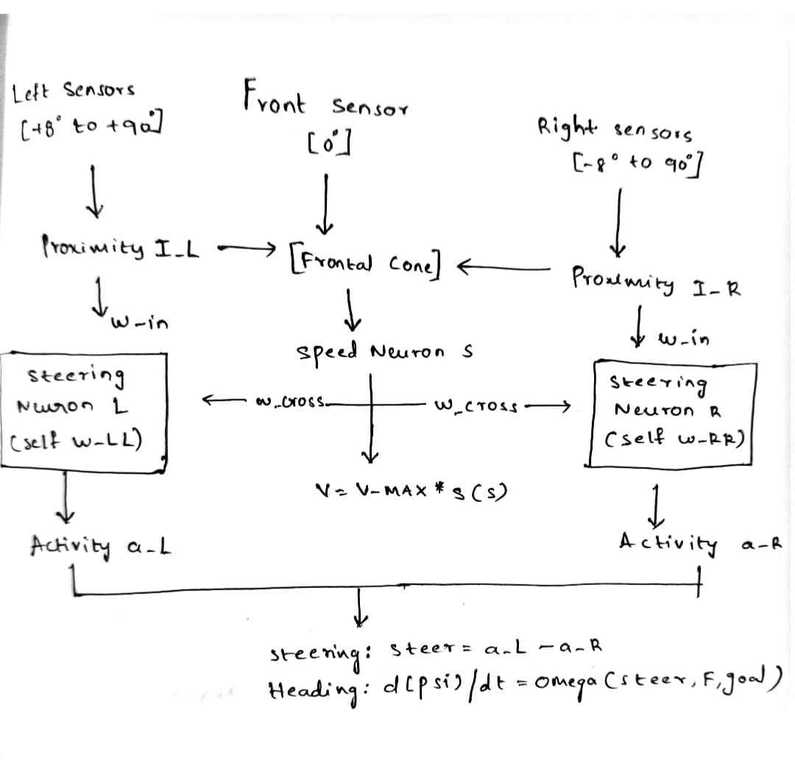
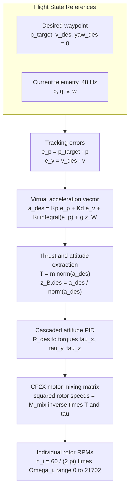

<p align="center">
  
</p>

<h1 align="center">Autonomous Obstacle Avoidance for Quadrotor Drones</h1>

<p align="center">
  <b>Data-Driven Control & Bio-Inspired Reactive Navigation in PyBullet Simulation</b><br>
  Team S5 AB3 &bull; Amrita Vishwa Vidyapeetham &bull; School of Artificial Intelligence
</p>

<p align="center">
  
  
  
  
  
  
</p>

---

## Team Members

| S. No. | Name | Roll Number | Email |
|:---:|---|---|---|
| 1 | Gade Varshitha | CB.SC.U4AIE24114 | varshithareddygade54@gmail.com |
| 2 | Jampana Lakshmi Tejaswi | CB.SC.U4AIE24116 | jlakshmitejaswi@gmail.com |
| 3 | Konkimalla Laxmi Vignesh | CB.SC.U4AIE24124 | laxmivigneshkonkimalla@gmail.com |
| 4 | Koruprolu Sri Durga Varalakshmi | CB.SC.U4AIE24125 | varshakoruprolu19@gmail.com |
| 5 | Ch. Mounica | CB.SC.U4AIE24169 | mounikachevvakula@gmail.com |

**Amrita Vishwa Vidyapeetham** | School of Artificial Intelligence | Coimbatore Campus | 2026

---

<a id="table-of-contents"></a>
## Table of Contents

- [1. Project Title & Executive Summary](#1-project-title--executive-summary)
- [2. Project Overview](#2-project-overview)
- [3. Key Features](#3-key-features)
- [4. How the Project Works (Architecture & Workflow)](#4-how-the-project-works-architecture--workflow)
- [5. Technologies Used](#5-technologies-used)
- [6. Project Folder Structure](#6-project-folder-structure)
- [7. Complete Mathematical Foundations & Equations](#7-complete-mathematical-foundations--equations)
  - [7.1 Coordinate Systems & Vector Kinematics](#71-coordinate-systems--vector-kinematics)
  - [7.2 Virtual Ray-Casting & Obstacle Perception](#72-virtual-ray-casting--obstacle-perception)
  - [7.3 Reactive State Machine (FSM) Decision Mathematics](#73-reactive-state-machine-fsm-decision-mathematics)
  - [7.4 Bio-Inspired Adaptive Neural Brain Dynamics](#74-bio-inspired-adaptive-neural-brain-dynamics)
  - [7.5 Synaptic Plasticity & Memory Hysteresis](#75-synaptic-plasticity--memory-hysteresis)
  - [7.6 Frustration Dynamics & Deadlock Detour Vector](#76-frustration-dynamics--deadlock-detour-vector)
  - [7.7 Speed Neuron & Safe Braking Distance](#77-speed-neuron--safe-braking-distance)
  - [7.8 DSLPID Flight Control Mathematics](#78-dslpid-flight-control-mathematics)
  - [7.9 Data-Driven Physics Discovery via SINDy & SINDYc](#79-data-driven-physics-discovery-via-sindy--sindyc)
- [8. Test Scenarios (1 to 10)](#8-test-scenarios-1-to-10)
- [9. Prerequisites](#9-prerequisites)
- [10. Installation and Setup](#10-installation-and-setup)
- [11. How to Run the Project](#11-how-to-run-the-project)
  - [11.1 Running the Reactive FSM Controller](#111-running-the-reactive-fsm-controller)
  - [11.2 Running the Adaptive Neural Brain](#112-running-the-adaptive-neural-brain)
  - [11.3 Running SINDy Dynamic Identification](#113-running-sindy-dynamic-identification)
- [12. Example Usage & Step-by-Step Walkthrough](#12-example-usage--step-by-step-walkthrough)
- [13. Code and Module Explanation](#13-code-and-module-explanation)
- [14. Datasets, Logs & Input Specifications](#14-datasets-logs--input-specifications)
- [15. Experimental Results and Outputs](#15-experimental-results-and-outputs)
  - [15.1 Reactive FSM Scenario Benchmark](#151-reactive-fsm-scenario-benchmark)
  - [15.2 SINDy Discovered Mathematical Models & Accuracy](#152-sindy-discovered-mathematical-models--accuracy)
- [16. Testing and Validation](#16-testing-and-validation)
- [17. Troubleshooting Guide](#17-troubleshooting-guide)
- [18. Limitations](#18-limitations)
- [19. Future Improvements](#19-future-improvements)
- [20. Contributing](#20-contributing)
- [21. License and Acknowledgements](#21-license-and-acknowledgements)
- [22. References](#22-references)

---

<a id="1-project-title--executive-summary"></a>
## 1. Project Title & Executive Summary

**Autonomous Obstacle Avoidance for Quadrotor Drones: Data-Driven Control & Bio-Inspired Navigation**

This repository implements, evaluates, and mathematically identifies an end-to-end autonomous navigation and obstacle-avoidance system for a micro-quadrotor drone (Bitcraze Crazyflie 2.X) in the **PyBullet** physics engine using the **gym-pybullet-drones** environment.

The system addresses the challenge of real-time collision avoidance in cluttered, unknown, dynamic, and dead-end environments without requiring heavy SLAM or expensive GPUs. It provides two distinct, fully implemented navigation paradigms:
1. **Hierarchical Finite State Machine (FSM):** A deterministic, rule-based controller that evaluates directional range sensors, balances lateral opening scores, executes emergency reversals, and checks progress with a sliding-window stuck detector.
2. **Bio-Inspired Adaptive Neural Brain:** An implementation inspired by the research of *Arne Devos, Emad Ebeid, and Poramate Manoonpong (2018)*, employing a recurrent non-spiking neural network with plastic Hebbian self-synapses, mutual inhibition, and an internal frustration leaky integrator to escape complex local minima, traps, and U-shaped dead ends.
3. **Data-Driven Equation Discovery (SINDy / SINDYc):** Machine learning pipeline utilizing *Sparse Identification of Nonlinear Dynamics* (Brunton et al., PNAS 2016) that mines raw flight simulation telemetry to discover the true underlying translational physics (recovering gravitational acceleration g = 9.80 m/s<sup>2</sup> with R<sup>2</sup> &gt; 0.999), quadrotor angular accelerations, aerodynamic body torques (<b>τ</b> = <b>I</b><b>ω̇</b> matching analytical URDF parameters within &lt; 0.8%), and closed-loop control dynamics.

Across standardized test benchmarks (from simple frontal obstacles to moving intruders and circular ring traps), the system achieves a **100% mission success rate** with **zero recorded collisions**.

---

<a id="2-project-overview"></a>
## 2. Project Overview

### What the Project Does
The project equips an autonomous quadrotor with omnidirectional virtual range perception and fast local planning algorithms that safely guide it from a launch coordinate p<sub>0</sub> = (0.0, 0.0, 1.0) m to a target waypoint p<sub>goal</sub> = (6.0, 0.0, 1.0)m. Along this route, the drone autonomously detects obstacles, dynamically computes collision-free trajectories, escapes traps, and stabilizes itself at 48 Hz via position-attitude PID control.

### What Problem It Solves
Traditional obstacle-avoidance techniques for micro-air vehicles (MAVs) present difficult trade-offs:
- **Global Path Planners (A\*, RRT\*, PRM):** Require a full prior 3D map of the environment and cannot handle dynamic moving obstacles in real time.
- **Deep Reinforcement Learning (DRL):** Demands millions of trial-and-error training steps, functions as an uninterpretable "black box", and frequently fails when encountering out-of-distribution obstacle shapes.
- **Vision/LiDAR SLAM Pipelines:** Demand massive onboard computing power and heavy payload sensors that drain miniature drone batteries within minutes.

This project solves these limitations by implementing computationally lightweight reactive and bio-inspired controllers that operate using only low-dimensional distance measurements.

### Why the Project Is Useful & Who Benefits
- **Robotics Researchers & Students:** Provides a transparent, fully open-source PyBullet codebase with reproducible benchmarks, exact mathematical derivations, and clean modular code.
- **Micro-UAV Developers:** Demonstrates real-time obstacle avoidance that can be executed on ultra-low-power microcontrollers (such as STM32 / ARM Cortex-M4 running at 168 MHz) onboard drones like the Crazyflie 2.1.
- **System Identification Engineers:** Demonstrates how SINDy can be applied to real drone telemetry to extract interpretable, sparse governing differential equations directly from flight logs.

---

<a id="3-key-features"></a>
## 3. Key Features

- **Dual Navigation Architectures:**
  - **Deterministic FSM Engine (`obstacle_avoidance.py`):** 5-state navigation machine (`FORWARD`, `AVOID`, `RETURN`, `EMERGENCY_REVERSE`, `GOAL_REACHED`).
  - **Bio-Inspired Neural Brain (`brain_avoidance.py` & `brain/neural_brain.py`):** 2-neuron recurrent steering network with Hebbian plasticity, continuous heading steering, speed regulation neuron, and frustration-driven goal detours.
- **Comprehensive 10-Scenario Benchmark Suite:**
  - Stationary cube barriers, offset obstacles, narrow slits, U-traps, cylindrical forest slaloms, oscillating lateral obstacles, 3D vertical climbing tiers, dynamic high-speed intruders, and 54-cube circular ring traps.
- **Dynamic Obstacle Physics Support:**
  - Real-time kinematics update for time-varying moving obstacles (y(t) = y<sub>0</sub> + A sin(ω t)) with active collision checking.
- **Virtual Range Sensor Array:**
  - 6-beam horizontal array in FSM (0<sup>°</sup>, ± 35<sup>°</sup>, ± 70<sup>°</sup>, 180<sup>°</sup>) and 12-beam body-fixed ray fan in Neural Brain (-90<sup>°</sup> to +180<sup>°</sup>) simulated via PyBullet ray-testing.
- **Full Closed-Loop Physics Simulation:**
  - 240 Hz PyBullet multi-body rigid-body dynamics coupled with 48 Hz `DSLPIDControl` computing individual rotor RPMs (0 to 21,702 RPM).
- **SINDy Telemetry Discovery Engine:**
  - STLSQ (Sequentially Thresholded Least Squares) sparse regressor discovering translational forces, motor torque mixing matrices, and closed-loop velocity transfer functions directly from `.npz` flight logs.
- **Automatic Trajectory & Metric Logging:**
  - Tracks total flight time, distance travelled, control iterations, collision contact counts, avoidance transitions, and emergency reversals.

---

<a id="4-how-the-project-works-architecture--workflow"></a>
## 4. How the Project Works (Architecture & Workflow)

The system operates as a closed-loop perception-planning-control pipeline executed at 48 Hz on top of the 240 Hz PyBullet physical simulator.

### System Architecture Diagram


---

<a id="5-technologies-used"></a>
## 5. Technologies Used

| Technology / Library | Version / Scope | Purpose in Project |
|---|---|---|
| **Python** | 3.10+ | Core programming language for all logic, physics interfaces, and math routines. |
| **PyBullet** | ≥ 3.2.5 | Real-time multi-body physics engine providing rigid-body collision detection and ray-casting. |
| **gym-pybullet-drones** | Master (utiasDSL) | Quadrotor simulation framework providing the Crazyflie 2.X model, environments, and control classes. |
| **NumPy** | ≥ 1.22 | Fast vectorized mathematical operations, matrix inversions, quaternions, and ray fans. |
| **SciPy** | ≥ 1.9 | Signal processing tools including the Savitzky-Golay filter (`savgol_filter`) for numerical differentiation. |
| **Matplotlib** | ≥ 3.5 | Plotting trajectory comparisons, neural activations, phase portraits, and SINDy validation graphs. |
| **DSLPIDControl** | Built-in | Non-linear geometric cascaded PID tracking controller tuned specifically for the CF2X quadrotor. |
| **SINDy / SINDYc** | Custom Implementation | Sparse Identification of Nonlinear Dynamics discovering equations of motion from simulation data. |

---

<a id="6-project-folder-structure"></a>
## 6. Project Folder Structure

The directory is structured modularly to separate rule-based navigation, neural control, mathematical modeling, and experimental results:

```text
Drones_S5_AB3_Obstacle_Avoidance_Drone/
│
├── README.md                      # Master documentation, architecture & complete mathematical derivations
├── RESULTS.md                     # Quantitative benchmark tables and metrics (Scenarios 1-6)
├── FRP.md                         # Final Review Proposal detailing objectives, methodology & scope
├── Base_Paper.pdf                 # Reference research paper (Devos, Ebeid, Manoonpong, DSD 2018)
├── requirements.txt               # Unified root dependency manifest
├── obstacle_avoidance.py          # Quick-launch root copy of the reactive FSM navigation controller
│
├── pybullet/                      # Core PyBullet simulation, bio-inspired RNN & SINDy research testbed
│   ├── obstacle_avoidance.py      # Primary FSM navigation engine (10 scenarios, dynamic obstacles, metrics)
│   ├── brain_avoidance.py         # Testbed running the Adaptive Neural Brain across scenarios 1-10
│   │
│   ├── brain/                     # Bio-inspired neural navigation package
│   │   ├── __init__.py            # Module exports (AdaptiveNeuralBrain, BrainConfig, RAY_ANGLES_DEG)
│   │   └── neural_brain.py        # Non-spiking RNN architecture with Hebbian plasticity and frustration
│   │
│   ├── sindy/                     # Sparse Identification of Nonlinear Dynamics package
│   │   ├── __init__.py            # Module exports (SINDy, PolynomialLibrary, stlsq, finite_difference)
│   │   ├── sindy.py               # Lightweight STLSQ sparse regression and polynomial library
│   │   └── identify_dynamics.py   # Script identifying translational, rotational, torque, and closed-loop models
│   │
│   ├── models/                    # Discovered governing equations stored as serialized JSON
│   │   ├── sindy_translational.json  # Discovered translational physics (recovers gravity g = 9.80 m/s^2)
│   │   ├── sindy_rotational.json     # Discovered quadrotor angular acceleration matrix for X-configuration
│   │   ├── sindy_torque.json         # Discovered physical body torques (tau = I * dw/dt)
│   │   └── sindy_closed_loop.json    # Discovered velocity response transfer function (SINDYc)
│   │
│   ├── results/                   # Experimental plots, graphs, and performance reports
│   │   └── sindy/
│   │       ├── A_translational.png       # Parity plots: predicted vs actual accelerations (ax, ay, az)
│   │       ├── B_rotational.png          # Parity plots: predicted vs actual angular accelerations (dw)
│   │       ├── C_torque.png              # Parity plots: predicted vs actual aerodynamic body torques (tau)
│   │       ├── D_rollout_brain_s4.png    # Free RK4 integration rollout on held-out Scenario 4
│   │       └── report.json               # Quantitative R^2 scores, residual errors, and formulas
│   │
│   └── logs/                      # Telemetry datasets recorded from 48 Hz simulation runs (.npz)
│       ├── brain_s1.npz .. brain_s10.npz # Scenarios 1 to 10 full flight telemetry logs
│
├── sindy/                         # Top-level SINDy module proxy (allows running python -m sindy from repo root)
│
├── ArduPilot_Gazebo/              # ArduPilot SITL + Gazebo Harmonic autopilot integration suite
│   ├── README.md                  # Comprehensive setup and flight guide for ArduPilot + Gazebo
│   ├── requirements.txt           # Python dependencies (pymavlink, numpy)
│   ├── obstacle_controller.py     # High-level navigation controller interfacing via MAVLink
│   └── iris_runway.sdf            # Gazebo Harmonic world with Iris quadcopter and 360° GPU LiDAR
│
├── mujoco_drone_sim/              # High-fidelity MuJoCo 6-DOF simulation suite
│   ├── PROJECT_DOCUMENTATION.md   # Detailed engineering documentation for MuJoCo testbed
│   ├── run_sim.py                 # Multi-algorithm interactive and headless simulation runner
│   ├── benchmark.py               # Automated benchmark suite comparing 6 avoidance algorithms
│   ├── interactive_arena.py       # Desktop Tkinter arena visualizer and obstacle layout customizer
│   ├── custom_arena.json          # Serialized arena obstacle specifications
│   ├── avoidance/                 # 6 avoidance strategies (Reactive, APF, DWA, SINDy-DWA, Brain, 3D)
│   ├── controllers/               # 6-DOF cascaded position and attitude flight controllers
│   ├── perception/                # 3D LiDAR ray array and 6-DOF Kalman filter tracker
│   ├── simulation/                # Native MuJoCo simulation environment and drone dynamics
│   ├── sindy/                     # SINDy physics discovery module for MuJoCo flight telemetry
│   └── web_dashboard/             # Browser-based real-time telemetry dashboard (HTML5/WebSocket)
│
├── terminalResults/               # Captured terminal output logs verifying Scenarios 1-6
│   ├── scenario1.txt .. scenario6.txt
│
├── matlab/                        # MATLAB scripts that generate the figures of Section 7
│   └── section7/
│       ├── run_all_section7_plots.m       # Regenerates every Section 7 figure in one call
│       └── plot_7_1_*.m .. plot_7_9_*.m   # One script per subsection (10 scripts, incl. plot_7_2b_elliptical_bubble.m)
│
└── assets/                        # University branding and graphics
    ├── amrita_logo.jpg            # Amrita Vishwa Vidyapeetham official emblem
    └── section7/
        └── fig_7_1_*.png .. fig_7_9_*.png # 10 MATLAB-rendered figures embedded in Section 7
```

---

<a id="7-complete-mathematical-foundations--equations"></a>
## 7. Complete Mathematical Foundations & Equations

> **What this section does.** Section 7 is the mathematical backbone of the project. It lists, in the order the data flows through the system, every equation the code evaluates: from "where is the goal?" (§7.1), through perception (§7.2), the two decision-making paradigms (§7.3 rule-based FSM; §7.4 to §7.7 bio-inspired neural brain), down to the flight controller that spins the four rotors (§7.8), and finally the data-driven step that *recovers* governing equations from flight logs (§7.9).
>
> **Practical purpose.** It lets you (i) trace every line of the Python code back to a formula, (ii) understand what each tuning constant physically means before you change it, and (iii) check the theory against numbers: each subsection gives a plain-language explanation, a definition of every symbol (with units), a worked numerical example, a pointer to the implementing function, and a MATLAB plot of the subsection's main formula.

### How Section 7 fits together

| § | Stage of the pipeline | Question it answers | Main output |
|---|---|---|---|
| 7.1 | Geometry | In which direction is the goal? | unit direction vector toward the goal |
| 7.2 | Perception | How far is the nearest obstacle along each beam, and when does it count as a threat? | beam distances, reactive-bubble radius |
| 7.3 | Reactive FSM | Which side should I pass on, and am I stuck? | LEFT / RIGHT decision, stuck flag |
| 7.4 | Neural brain: neuron dynamics | How do two neurons turn range readings into a steering preference? | steering activities (a_L, a_R) |
| 7.5 | Neural brain: plasticity | How does the brain *remember* an obstacle after it leaves the sensor cone? | self-weights (w_LL, w_RR) |
| 7.6 | Neural brain: frustration | How does it escape dead ends? | frustration F, detour angle, yaw rate |
| 7.7 | Neural brain: speed | How fast may the drone fly given the clearance ahead? | forward speed |
| 7.8 | Flight control | How does a velocity command become four rotor speeds? | thrust, torques, rotor RPM |
| 7.9 | System identification | Which equations do the logged flights actually obey? | sparse models (A, B, C) |

**Notation conventions used throughout**

- **Bold** symbols are vectors or matrices; a hat (for example <b>d̂</b><sub>g</sub>) marks a unit-length vector. Subscript W denotes the world (inertial) frame, subscript B the drone body frame.
- Distances are in metres, time in seconds, angles in radians unless a degree sign is written. A positive angle is counter-clockwise when viewed from above, i.e. a turn to the drone's **left**.
- The control loop runs at 48 Hz, so one control tick lasts Δ t = 1/48 ≈ 0.0208 s.
- A few letters are reused in different subsections with different meanings (for example τ is a neuron time constant in §7.4 but a torque in §7.8). Every subsection defines its own symbols, and the clash is pointed out where it matters.

**About the MATLAB figures.** Every subsection ends with a plot of its main formula. The scripts live in [`matlab/section7/`](matlab/section7) and write PNG files to [`assets/section7/`](assets/section7); run `run('matlab/section7/run_all_section7_plots.m')` in MATLAB R2020a or newer to regenerate all of them. Constants are taken from this section; where the project does not fix a value (the PID gains in §7.8, the corridor width in §7.2, the synthetic data in §7.9) the script and caption say so.

### Mathematical Architecture Summary (Quick Reference)

This cheat sheet repeats the key formulas without derivations. Each group points to the subsection that explains it fully.

#### 1. Geometry & Perception (§7.1, §7.2)
* **Horizontal Goal Direction:**

```math
\hat{\mathbf{d}}_g = \frac{\mathbf{p}_{\text{goal}} - \mathbf{p}(t)}{\|\mathbf{p}_{\text{goal}} - \mathbf{p}(t)\|_2}
```


* **Parametric Ray-Casting Fan:**

```math
\mathbf{r}_i(s) = \mathbf{r}_{\text{start}, i} + s \cdot (\mathbf{r}_{\text{end}, i} - \mathbf{r}_{\text{start}, i}), \quad s \in [0, 1]
```


* **Elliptical Reactive Bubble:**

```math
R_{\text{react}}(\theta) = \frac{a \cdot b}{\sqrt{(b \cos\theta)^2 + (a \sin\theta)^2}}
```


#### 2. Decision & Reactive FSM (§7.3)
* **Spatial Free-Space Scores:**

```math
S_{\text{left}} = 0.65 d_{\text{left}} + 0.35 d_{\text{far-left}}, \quad S_{\text{right}} = 0.65 d_{\text{right}} + 0.35 d_{\text{far-right}}
```


* **Decision Hysteresis Dead-Band:**

```math
|S_{\text{left}} - S_{\text{right}}| \ge \delta_{\text{hysteresis}} = 0.08\,\text{m}
```


* **Sliding-Window Progress & Stuck Detector:**

```math
\Delta p_{\text{progress}} = \|\mathbf{p}_k[0:2] - \mathbf{p}_{k-W+1}[0:2]\|_2 < 0.10\,\text{m}
```


#### 3. Bio-Inspired Neural Brain (§7.4 to §7.7)
* **Leaky Membrane ODE:**

```math
\tau \frac{dx_i}{dt} = -x_i(t) + \text{drive}_i(t)
```


* **Activity-Dependent Hebbian Plasticity:**

```math
\frac{dw_{ii}}{dt} = \mu (1 + 2F) I_i a_i - \gamma (w_{ii} - w_{\text{self}, 0})
```


* **Frustration Leaky Integrator:**

```math
\frac{dF}{dt} = +\alpha_{\text{rise}} = 0.35\,\text{s}^{-1} \quad (\text{stalled in local minima})
```


* **Adaptive Heading Steering Rate:**

```math
\omega = \text{clip}\left(K_{\text{goal}} e_{\text{attract}} G_{\text{attract}} - K_{\text{turn}} (a_L - a_R)(1 - 0.5F), \; -\Omega_{\max}, \; +\Omega_{\max}\right)
```


#### 4. Flight Control & Dynamics (§7.8)
* **Cascaded Position Control Law:**

```math
\mathbf{a}_{\text{des}} = \mathbf{K}_p \mathbf{e}_p + \mathbf{K}_d \mathbf{e}_v + \mathbf{K}_i \int_0^t \mathbf{e}_p(t') \, dt' + g \mathbf{z}_W
```


* **Thrust Allocation & Body Orientation Extraction:**

```math
T_{\text{des}} = m \|\mathbf{a}_{\text{des}}\|_2, \quad \mathbf{z}_{B, \text{des}} = \frac{\mathbf{a}_{\text{des}}}{\|\mathbf{a}_{\text{des}}\|_2}
```


* **Motor Thrust Allocation (Crazyflie 2.X X-Frame), rotor speeds in RPM:**

```math
T = k_f \sum_{i=0}^3 n_i^2, \quad \boldsymbol{\tau} = \mathbf{M}_{\text{mix}} \begin{bmatrix} n_0^2 \\ n_1^2 \\ n_2^2 \\ n_3^2 \end{bmatrix}
```


#### 5. Data-Driven Physics Discovery, SINDy (§7.9)
* **Sparse Nonlinear Dynamics Formulation:**

```math
\dot{\mathbf{X}} = \Theta(\mathbf{X}, \mathbf{U}) \, \Xi
```


* **STLSQ Optimization:**

```math
\min_{\Xi} \; \| \dot{\mathbf{X}} - \Theta \, \Xi \|_2^2 + \alpha \, \| \Xi \|_F^2 \qquad \text{with coefficients below } \lambda \text{ set to zero}
```


---

<a id="71-coordinate-systems--vector-kinematics"></a>
### 7.1 Coordinate Systems & Vector Kinematics

> **What this section does.** It fixes the reference frame in which every other equation is written and computes the one geometric quantity the navigation layers need on every control tick: *the direction in which the goal lies*.
>
> **Practical purpose.** Both planners steer relative to this direction. The FSM measures its left/right sectors from it (§7.3), and the neural brain converts it into an attraction heading (§7.6). Using a **unit** vector separates "which way" from "how far", so speed and avoidance logic can scale the direction independently.

The simulation operates in a right-handed inertial Cartesian frame ℱ<sub>W</sub> = {<b>x</b><sub>W</sub>, <b>y</b><sub>W</sub>, <b>z</b><sub>W</sub>} where <b>z</b><sub>W</sub> points upward against gravity.

#### Equation: Horizontal Unit Direction toward Goal

```math
\mathbf{d}_{\text{goal}} = \mathbf{p}_{\text{goal}} - \mathbf{p}(t) = \begin{bmatrix} x_{\text{goal}} - x(t) \\ y_{\text{goal}} - y(t) \\ 0 \end{bmatrix}
```

```math
\hat{\mathbf{d}}_g = \frac{\mathbf{d}_{\text{goal}}}{\|\mathbf{d}_{\text{goal}}\|_2} = \begin{bmatrix} \frac{x_{\text{goal}} - x}{\sqrt{(x_{\text{goal}} - x)^2 + (y_{\text{goal}} - y)^2}} \\ \frac{y_{\text{goal}} - y}{\sqrt{(x_{\text{goal}} - x)^2 + (y_{\text{goal}} - y)^2}} \\ 0 \end{bmatrix}
```

**What the equations say.** The first equation subtracts the drone's position from the goal position to get the displacement vector pointing from the drone to the goal. Its vertical component is forced to zero because avoidance is planned in the horizontal plane (the start and goal are both at z = 1.0 m). The second equation divides that displacement by its own length (the Euclidean norm), which keeps the direction but throws away the distance. The result always has length 1, whether the drone is 6 m or 6 cm from the goal.

**Variables**
- <b>p</b>(t) = &#91;x(t), y(t), z(t)&#93;<sup>T</sup>: instantaneous 3D position of the drone in world coordinates (m); t is time (s).
- <b>p</b><sub>goal</sub> = &#91;x<sub>goal</sub>, y<sub>goal</sub>, z<sub>goal</sub>&#93;<sup>T</sup> = &#91;6.0, 0.0, 1.0&#93;<sup>T</sup>: fixed 3D destination (m).
- <b>d</b><sub>goal</sub>: horizontal displacement from drone to goal (m), with the z-component set to 0.
- ‖·‖<sub>2</sub>: Euclidean (L2) norm, the vector's length: ‖<b>d</b><sub>goal</sub>‖<sub>2</sub> = √((x<sub>goal</sub>-x)<sup>2</sup> + (y<sub>goal</sub>-y)<sup>2</sup>) (m). The direction is undefined when this is exactly zero (drone directly above the goal), so any implementation needs a small-distance guard there.
- <b>d̂</b><sub>g</sub>: dimensionless horizontal unit vector pointing from the drone toward the goal.

- **Implementation:** `horizontal_unit_vector()` and `goal_direction()` in [pybullet/obstacle_avoidance.py](pybullet/obstacle_avoidance.py#L341-L381).
- **Step-by-Step Numerical Example:**
  Suppose the drone has moved to <b>p</b> = &#91;2.00, 0.50, 1.00&#93;<sup>T</sup>:
  1. Difference vector: <b>d</b><sub>goal</sub> = &#91;6.0 - 2.0, 0.0 - 0.5, 0.0&#93;<sup>T</sup> = &#91;4.0, -0.5, 0.0&#93;<sup>T</sup>.
  2. Euclidean norm: ‖<b>d</b><sub>goal</sub>‖ = √(4.0<sup>2</sup> + (-0.5)<sup>2</sup>) = √(16.0 + 0.25) = √(16.25) ≈ 4.0311 m.
  3. Normalized vector: <b>d̂</b><sub>g</sub> = &#91;4.0/4.0311, (-0.5)/4.0311, 0&#93;<sup>T</sup> ≈ &#91;0.9923, -0.1240, 0.0&#93;<sup>T</sup>.

#### Equation: 2D Planar Rotation Matrix
To project sensor rays or lateral avoidance vectors at an angle θ relative to <b>d̂</b><sub>g</sub>:

```math
\mathbf{R}_z(\theta) = \begin{bmatrix} \cos\theta & -\sin\theta & 0 \\ \sin\theta & \cos\theta & 0 \\ 0 & 0 & 1 \end{bmatrix}, \quad \hat{\mathbf{u}}_\theta = \mathbf{R}_z(\theta) \hat{\mathbf{d}}_g
```

**What the equation says.** Multiplying a vector by <b>R</b><sub>z</sub>(θ) spins it counter-clockwise by the angle θ about the vertical axis, leaving its length and its z-component unchanged. Applying it to <b>d̂</b><sub>g</sub> produces a new unit vector pointing θ to the left of the goal direction (negative θ points to the right). This is how the FSM aims a beam or an avoidance manoeuvre at, say, +35<sup>°</sup> or -70<sup>°</sup> from the goal line.

**Variables**
- θ: rotation angle (rad in the formula; the project quotes it in degrees), positive counter-clockwise seen from above.
- <b>R</b><sub>z</sub>(θ): 3 × 3 rotation matrix about <b>z</b><sub>W</sub>. Its top-left 2 × 2 block rotates the xy-plane; the 1 in the last diagonal entry keeps z fixed.
- <b>d̂</b><sub>g</sub>: unit goal direction from the previous equation.
- <b>û</b><sub>θ</sub>: resulting unit direction, rotated by θ from the goal direction.

- **Numerical example:** with <b>d̂</b><sub>g</sub> = &#91;0.9923, -0.1240, 0&#93;<sup>T</sup> and θ = +35<sup>°</sup> (cos 35<sup>°</sup> = 0.8192, sin 35<sup>°</sup> = 0.5736): <b>û</b><sub>θ</sub> = &#91;0.8192 · 0.9923 - 0.5736 · (-0.1240),  0.5736 · 0.9923 + 0.8192 · (-0.1240),  0&#93;<sup>T</sup> ≈ &#91;0.8840, 0.4676, 0&#93;<sup>T</sup>. Its heading is atan2(0.4676, 0.8840) ≈ 27.9<sup>°</sup>, which equals the goal heading (-7.1<sup>°</sup>) plus 35<sup>°</sup>, as expected.
- **Implementation:** `rotate_horizontal(vector, angle_degrees)` in [pybullet/obstacle_avoidance.py](pybullet/obstacle_avoidance.py#L357-L371).

#### MATLAB Plot: Horizontal Unit Direction toward the Goal (main formula of §7.1)

<details>
<summary><b>MATLAB code</b> &mdash; <code>matlab/section7/plot_7_1_goal_direction.m</code></summary>

```matlab
% plot_7_1_goal_direction.m
% Section 7.1 - Horizontal unit direction toward the goal
%     d_g = (p_goal - p) / || p_goal - p ||_2        (xy-plane only)
% Whatever the drone position, d_g always points at the goal and has length 1.

pGoal = [6.0, 0.0];                                  % goal (x, y) in metres
[X, Y] = meshgrid(0:1:5, -2:1:2);                    % grid of possible drone positions

Dx  = pGoal(1) - X;   Dy = pGoal(2) - Y;             % horizontal part of p_goal - p
Nrm = hypot(Dx, Dy);                                 % || p_goal - p ||_2
Ux  = Dx ./ Nrm;      Uy = Dy ./ Nrm;                % unit direction d_g at every grid point

% Worked example from the text: drone at p = [2.0, 0.5, 1.0]
p  = [2.0, 0.5];
dg = (pGoal - p) / norm(pGoal - p);                  % -> [0.9923, -0.1240]

blue = [0.00 0.45 0.74];  orange = [0.85 0.33 0.10];  gray = [0.55 0.55 0.55];

fig = figure('Color', 'w', 'Position', [100 100 900 620]);
try, theme(fig, 'light'); catch, end   % force light colours (R2025a+ follows the OS dark mode)
hold on; grid on; box on;
h1 = quiver(X, Y, 0.5*Ux, 0.5*Uy, 'AutoScale', 'off', 'Color', gray, 'LineWidth', 1);
h2 = plot([p(1) pGoal(1)], [p(2) pGoal(2)], '--', 'Color', blue, 'LineWidth', 1.4);
h3 = quiver(p(1), p(2), dg(1), dg(2), 'AutoScale', 'off', 'Color', orange, ...
            'LineWidth', 2.8, 'MaxHeadSize', 0.8);
plot(p(1), p(2), 'o', 'MarkerFaceColor', orange, 'MarkerEdgeColor', 'k', 'MarkerSize', 8);
h4 = plot(pGoal(1), pGoal(2), 'p', 'MarkerFaceColor', [0.93 0.69 0.13], ...
          'MarkerEdgeColor', 'k', 'MarkerSize', 16);
text(p(1) - 0.15, p(2), {sprintf('p = (%.1f, %.1f)', p), sprintf('d_g = [%.4f, %.4f]', dg)}, ...
     'FontSize', 11, 'HorizontalAlignment', 'right');
text(pGoal(1) - 0.05, pGoal(2) + 0.45, 'p_{goal}', 'FontSize', 11, 'HorizontalAlignment', 'center');

axis equal; xlim([-1.2 6.6]); ylim([-2.7 2.7]);
xlabel('x  (m)'); ylabel('y  (m)');
title('d_g = (p_{goal} - p) / || p_{goal} - p ||_2   (horizontal plane)');
legend([h1 h2 h3 h4], {'d_g at other drone positions (drawn at half length)', ...
       'd_{goal} = p_{goal} - p (worked example)', ...
       'd_g at the worked-example point (length = 1)', 'goal'}, ...
       'Location', 'southoutside', 'NumColumns', 1);
set(gca, 'FontSize', 11);

outDir = fullfile(fileparts(mfilename('fullpath')), '..', '..', 'assets', 'section7');
if ~exist(outDir, 'dir'), mkdir(outDir); end
exportgraphics(fig, fullfile(outDir, 'fig_7_1_goal_direction.png'), 'Resolution', 200);
```

</details>

<p align="center">
  
</p>
<p align="center"><b>Figure 7.1</b> &ndash; The unit vector <code>d_g</code> at many drone positions (grey, drawn at half length) and at the worked-example point (orange, true length 1). Every arrow points at the goal star; only the direction changes with position, never the length.</p>

---

<a id="72-virtual-ray-casting--obstacle-perception"></a>
### 7.2 Virtual Ray-Casting & Obstacle Perception

> **What this section does.** It describes how the drone "sees". Instead of cameras or a map, it fires a fan of virtual rays into the PyBullet world and records how far each ray travels before it hits something. It then defines the *elliptical reactive bubble*: a direction-dependent distance threshold that decides when a reading counts as a threat.
>
> **Practical purpose.** These few distances are the **only** sensory input to both planners, which keeps the computation light enough for micro-controller-class hardware (see §2): no SLAM and no GPU. The bubble stops the drone from panicking at corridor walls it can safely fly past, while still reacting early to obstacles dead ahead.

The drone perceives its local surroundings by querying the PyBullet collision world via geometric rays.

#### Equation: Ray Parametrization & Distance Extraction
Each ray i originating from the drone body is parametrized by s ∈ &#91;0, 1&#93;:

```math
\mathbf{r}_i(s) = \mathbf{r}_{\text{start}, i} + s \cdot (\mathbf{r}_{\text{end}, i} - \mathbf{r}_{\text{start}, i})
```

where:

```math
\mathbf{r}_{\text{start}, i} = \mathbf{p} + d_{\text{offset}} \hat{\mathbf{u}}_{\theta_i}, \quad \mathbf{r}_{\text{end}, i} = \mathbf{r}_{\text{start}, i} + R_{\text{sensor}} \hat{\mathbf{u}}_{\theta_i}
```

PyBullet's `p.rayTest` returns the normalized intersection fraction f<sub>i</sub> ∈ &#91;0, 1&#93; and the collided object identifier id<sub>hit</sub>:

```math
d_i = \begin{cases} R_{\text{sensor}}, & \text{if } \text{id}_{\text{hit}} = -1 \text{ (no hit)} \\ f_i \cdot R_{\text{sensor}}, & \text{if } \text{id}_{\text{hit}} \ge 0 \text{ (obstacle detected)} \end{cases}
```

**What the equations say.** A ray is just a straight segment. The first equation is the standard "start point plus a fraction of the way to the end point" formula: at s = 0 you are at the start, at s = 1 at the end. The second pair of equations builds that segment: it begins a small distance d<sub>offset</sub> *outside* the drone along the beam direction (so the ray cannot hit the drone's own propellers) and extends R<sub>sensor</sub> further. The third equation turns PyBullet's answer into a distance: if the ray hit nothing the reading saturates at the maximum range; otherwise the hit fraction f<sub>i</sub> is scaled by the ray length.

**Variables**
- i: beam index (6 beams in the FSM, 12 in the neural brain).
- <b>r</b><sub>i</sub>(s): the point at fraction s along beam i (m); s is the dimensionless ray parameter (not the clearance s of §7.7).
- <b>r</b><sub>start, i</sub>, <b>r</b><sub>end, i</sub>: first and last point of the beam (m).
- <b>p</b>: drone position (m).
- <b>û</b><sub>θ<sub>i</sub></sub>: unit direction of beam i, at bearing θ<sub>i</sub> (from §7.1's rotation for the FSM; a fixed body-frame angle for the brain's fan).
- d<sub>offset</sub> = 0.18 m (FSM) or 0.10 m (Brain): radial clearance ensuring rays originate outside the quadrotor's rotor footprint (about 0.065 m radius) to avoid self-detection.
- R<sub>sensor</sub> = 1.60 m: maximum sensor detection range.
- f<sub>i</sub> ∈ &#91;0, 1&#93;: fraction of the ray length at which the first hit occurs.
- id<sub>hit</sub>: PyBullet's identifier of the body that was hit, -1 when nothing was hit.
- d<sub>i</sub>: measured distance to the obstacle along bearing θ<sub>i</sub> (m), measured from <b>r</b><sub>start, i</sub>, always in &#91;0, R<sub>sensor</sub>&#93;.

- **Numerical example (also shown in Figure 7.2):** drone at the origin heading along +x, beam θ = 0<sup>°</sup>, d<sub>offset</sub> = 0.18 m, R<sub>sensor</sub> = 1.60 m, obstacle face at x = 1.0 m. Then <b>r</b><sub>start</sub> = (0.18, 0), <b>r</b><sub>end</sub> = (1.78, 0), the hit fraction is f = (1.0 - 0.18)/1.60 = 0.5125, so d = 0.5125 × 1.60 = 0.82 m. Beams that miss the obstacle report d = 1.60 m.
- **Implementation:** `cast_sensor_ray()` in [pybullet/obstacle_avoidance.py](pybullet/obstacle_avoidance.py#L387-L431) and `cast_rays()` in [pybullet/brain_avoidance.py](pybullet/brain_avoidance.py#L71-L89).

#### MATLAB Plot: Ray-Casting Fan and Distance Extraction (main formula of §7.2)

<details>
<summary><b>MATLAB code</b> &mdash; <code>matlab/section7/plot_7_2_ray_casting.m</code></summary>

```matlab
% plot_7_2_ray_casting.m
% Section 7.2 - Ray parametrisation and distance extraction
%     r_i(s) = r_start,i + s (r_end,i - r_start,i),   s in [0, 1]
%     d_i    = R_sensor            if the ray hits nothing
%            = f_i * R_sensor      if it hits at fraction f_i
% Top-down view of the 6-beam FSM fan meeting one rectangular obstacle.

p      = [0 0];                              % drone position (x, y); heading = +x
angles = [0 35 -35 70 -70 180];              % FSM beam bearings (deg), relative to heading
dOff   = 0.18;                               % ray start offset d_offset (m)
Rs     = 1.60;                               % maximum sensor range R_sensor (m)
obs    = [1.0 1.4 -0.35 0.85];               % obstacle [xmin xmax ymin ymax] (m)

u      = [cosd(angles(:)), sind(angles(:))]; % unit direction of every beam
rStart = p + dOff * u;                       % r_start,i
rEnd   = rStart + Rs * u;                    % r_end,i
n      = numel(angles);
f      = ones(n, 1);                         % hit fraction (1 = no hit)
hit    = false(n, 1);
lo     = obs([1 3]);  hi = obs([2 4]);

for k = 1:n                                  % slab test of each ray against the box
    D = rEnd(k,:) - rStart(k,:);
    tNear = 0;  tFar = 1;  ok = true;
    for a = 1:2
        if abs(D(a)) < 1e-12
            if rStart(k,a) < lo(a) || rStart(k,a) > hi(a), ok = false; end
        else
            t1 = (lo(a) - rStart(k,a)) / D(a);
            t2 = (hi(a) - rStart(k,a)) / D(a);
            tNear = max(tNear, min(t1, t2));
            tFar  = min(tFar,  max(t1, t2));
        end
    end
    if ok && tNear <= tFar, f(k) = tNear; hit(k) = true; end
end
d = f * Rs;                                  % measured distances d_i
fprintf('Beam %+4d deg : d = %.2f m\n', [angles(:), d]');

blue = [0.00 0.45 0.74];  orange = [0.85 0.33 0.10];  green = [0.13 0.55 0.13];

fig = figure('Color', 'w', 'Position', [100 100 900 560]);
try, theme(fig, 'light'); catch, end   % force light colours (R2025a+ follows the OS dark mode)
hold on; grid on; box on;
fill(obs([1 2 2 1]), obs([3 3 4 4]), [0.78 0.78 0.78], 'EdgeColor', 'k', 'LineWidth', 1.5);
text(1.2, 0.97, 'obstacle', 'HorizontalAlignment', 'center', 'FontSize', 11);
th = linspace(0, 2*pi, 200);
plot(dOff*cos(th), dOff*sin(th), '--', 'Color', [0.5 0.5 0.5]);        % start-offset ring

for k = 1:n
    pHit = rStart(k,:) + f(k) * (rEnd(k,:) - rStart(k,:));
    if hit(k), c = orange; else, c = green; end
    plot([rStart(k,1) pHit(1)], [rStart(k,2) pHit(2)], '-', 'Color', c, 'LineWidth', 2.2);
    if hit(k)
        plot([pHit(1) rEnd(k,1)], [pHit(2) rEnd(k,2)], ':', 'Color', c, 'LineWidth', 1.2);
        plot(pHit(1), pHit(2), 'o', 'MarkerFaceColor', c, 'MarkerEdgeColor', 'k', 'MarkerSize', 7);
    end
    plot(rStart(k,1), rStart(k,2), '.', 'Color', 'k', 'MarkerSize', 12);
    if hit(k)                                              % label to the right of the obstacle
        lab = [obs(2) + 0.10, pHit(2) + 0.10];  al = 'left';
    elseif abs(u(k,2)) < 1e-9                              % rear beam: label above its middle
        lab = (rStart(k,:) + rEnd(k,:)) / 2 + [0 0.12];  al = 'center';
    else                                                   % label beyond the ray tip
        lab = rEnd(k,:) + 0.08 * sign(u(k,:));  al = 'left';
    end
    text(lab(1), lab(2), sprintf('%d^{\\circ}: d = %.2f m', angles(k), d(k)), 'FontSize', 10, ...
         'Color', c * 0.8, 'FontWeight', 'bold', ...
         'HorizontalAlignment', al, 'VerticalAlignment', 'middle');
end

plot(0, 0, 's', 'MarkerFaceColor', blue, 'MarkerEdgeColor', 'k', 'MarkerSize', 10);
quiver(0, 0, 0.35, 0, 'AutoScale', 'off', 'Color', blue, 'LineWidth', 2, 'MaxHeadSize', 1);
text(-0.25, -0.22, 'drone', 'HorizontalAlignment', 'right', 'FontSize', 10, 'Color', blue);
text(-0.15, 0.30, 'd_{offset}', 'HorizontalAlignment', 'right', 'FontSize', 10, 'Color', [0.4 0.4 0.4]);

hh(1) = plot(NaN, NaN, '-', 'Color', orange, 'LineWidth', 2.2);
hh(2) = plot(NaN, NaN, '-', 'Color', green,  'LineWidth', 2.2);
hh(3) = plot(NaN, NaN, 'o', 'MarkerFaceColor', orange, 'MarkerEdgeColor', 'k');
legend(hh, {'ray with a hit:  d_i = f_i R_{sensor} < R_{sensor}', ...
            'ray with no hit:  d_i = R_{sensor}', 'hit point  (s = f_i)'}, 'Location', 'southwest');
axis equal; xlim([-2.0 3.0]); ylim([-2.0 2.0]);
xlabel('x  (m)'); ylabel('y  (m)');
title('Ray-casting fan:  r_i(s) = r_{start,i} + s (r_{end,i} - r_{start,i}),  s \in [0, 1]');
set(gca, 'FontSize', 11);

outDir = fullfile(fileparts(mfilename('fullpath')), '..', '..', 'assets', 'section7');
if ~exist(outDir, 'dir'), mkdir(outDir); end
exportgraphics(fig, fullfile(outDir, 'fig_7_2_ray_casting.png'), 'Resolution', 200);
```

</details>

<p align="center">
  
</p>
<p align="center"><b>Figure 7.2</b> &ndash; The six FSM beams. Orange beams hit the obstacle (<code>d &lt; R_sensor</code>, measured from the beam's start point); green beams find nothing and saturate at <code>R_sensor = 1.60 m</code>. The small dashed ring is the start offset <code>d_offset</code>.</p>

#### Equation: Elliptical Reactive Bubble (Neural Brain)

**What it does.** A distance reading only matters if it is *short enough to be dangerous*, and "short enough" depends on the direction: an obstacle 1 m straight ahead is something to steer around now, whereas a wall 0.5 m to the side is harmless when flying parallel to it. The reactive bubble is therefore not a circle but an **ellipse** centred on the drone and stretched along its heading. A reading in direction θ triggers avoidance only when it is shorter than R<sub>react</sub>(θ), the distance from the drone to the ellipse boundary in that direction. To prevent the drone from false-triggering avoidance on corridor side-walls when flying down narrow passages, the reaction threshold varies continuously with heading angle θ following an ellipse:

```math
R_{\text{react}}(\theta) = \frac{a \cdot b}{\sqrt{(b \cos\theta)^2 + (a \sin\theta)^2}}
```

**Where the formula comes from.** An ellipse with semi-axis a along the heading (x) and b sideways (y) satisfies x<sup>2</sup>/a<sup>2</sup> + y<sup>2</sup>/b<sup>2</sup> = 1. Writing a boundary point in polar form, x = Rcosθ and y = Rsinθ, gives R<sup>2</sup>(cos<sup>2</sup>θ / a<sup>2</sup> + sin<sup>2</sup>θ / b<sup>2</sup>) = 1; solving for R yields the expression above.

**Variables**
- R<sub>react</sub>(θ): reaction radius in direction θ (m); an obstacle closer than this along that bearing counts as a threat.
- θ: bearing of the sensor beam measured from the drone's heading (θ = 0 straight ahead, ± 90<sup>°</sup> directly to the sides).
- a = 1.10 m: major semi-axis straight ahead (θ = 0<sup>°</sup>).
- b = 0.32 m: minor semi-axis directly sideways (θ = ± 90<sup>°</sup>).

- **Numerical Example:**
  - Ahead (θ = 0<sup>°</sup>): R<sub>react</sub>(0<sup>°</sup>) = (1.10 × 0.32)/(√((0.32 × 1)<sup>2</sup> + 0)) = 1.10 m.
  - Oblique (θ = 45<sup>°</sup>): cos(45<sup>°</sup>) = sin(45<sup>°</sup>) ≈ 0.7071.
    √((0.32 × 0.7071)<sup>2</sup> + (1.10 × 0.7071)<sup>2</sup>) = √(0.0512 + 0.6050) = √(0.6562) ≈ 0.8101.
    R<sub>react</sub>(45<sup>°</sup>) = 0.352/0.8101 ≈ 0.4345 m.
  - Sideways (θ = 90<sup>°</sup>): R<sub>react</sub>(90<sup>°</sup>) = 0.32 m.
- **Implementation:** [pybullet/brain/neural_brain.py](pybullet/brain/neural_brain.py#L112-L113).

**Visual explanation.**

<p align="center">
  
</p>
<p align="center"><b>Figure 7.2b</b> &ndash; <b>Left:</b> the drone (black square, arrow = heading) sits inside its elliptical bubble (blue). A plain circular bubble of radius <code>a = 1.10 m</code> (dashed grey) would report both corridor walls (<code>y = &plusmn;0.60 m</code>, an illustrative width) as threats along the red stretches, so the drone would swerve for no reason. The ellipse is only <code>0.32 m</code> wide sideways, so the walls are ignored, yet the orange obstacle ahead still intrudes into the bubble and triggers a reaction. <b>Right:</b> the same <code>R_react(&theta;)</code> plotted against bearing; it drops from <code>1.10 m</code> ahead to <code>0.43 m</code> at 45&deg; and <code>0.32 m</code> sideways.</p>

<details>
<summary><b>MATLAB code</b> &mdash; <code>matlab/section7/plot_7_2b_elliptical_bubble.m</code></summary>

```matlab
% plot_7_2b_elliptical_bubble.m
% Section 7.2 - Elliptical Reactive Bubble
%     R_react(theta) = a b / sqrt( (b cos(theta))^2 + (a sin(theta))^2 )
% Left : top-down picture of the bubble (ellipse) versus a plain circular bubble.
% Right: the reaction radius as a function of the bearing theta.

a = 1.10;                                    % semi-axis straight ahead   (m)
b = 0.32;                                    % semi-axis directly sideways (m)
wallY = 0.60;                                % half-width of an example corridor (m)

th = linspace(-pi, pi, 721);
R  = a*b ./ sqrt((b*cos(th)).^2 + (a*sin(th)).^2);   % R_react(theta)
ex = R .* cos(th);   ey = R .* sin(th);              % ellipse outline (x forward, y left)

blue = [0.00 0.45 0.74];  orange = [0.85 0.33 0.10];  red = [0.80 0.10 0.10];  gray = [0.45 0.45 0.45];

fig = figure('Color', 'w', 'Position', [100 100 1100 520]);
try, theme(fig, 'light'); catch, end   % force light colours (R2025a+ follows the OS dark mode)
tl  = tiledlayout(1, 2, 'TileSpacing', 'compact', 'Padding', 'compact');

% ---------- (a) top-down view -------------------------------------------------
nexttile; hold on; box on; grid on;
fill(ex, ey, blue, 'FaceAlpha', 0.20, 'EdgeColor', blue, 'LineWidth', 2.2);
plot(a*cos(th), a*sin(th), '--', 'Color', gray, 'LineWidth', 1.4);          % naive circular bubble

xw = sqrt(a^2 - wallY^2);                                                   % wall part inside the circle
for s = [-1 1]
    plot([-1.35 1.5], s*wallY*[1 1], '-', 'Color', [0.25 0.25 0.25], 'LineWidth', 4);
    plot([-xw xw],    s*wallY*[1 1], '-', 'Color', red, 'LineWidth', 4);    % false-trigger zone
end
fill([0.95 1.30 1.30 0.95], [-0.25 -0.25 0.25 0.25], orange, 'FaceAlpha', 0.85, 'EdgeColor', 'k');
text(1.125, 0.33, 'obstacle', 'HorizontalAlignment', 'center', 'FontSize', 10);

for ang = [0 45 90 -45 -90]                                                  % sample bearings
    r = a*b / sqrt((b*cosd(ang))^2 + (a*sind(ang))^2);
    plot([0 r*cosd(ang)], [0 r*sind(ang)], '-', 'Color', [0.2 0.2 0.2], 'LineWidth', 1);
    plot(r*cosd(ang), r*sind(ang), 'o', 'MarkerFaceColor', blue, 'MarkerEdgeColor', 'k', 'MarkerSize', 6);
end
text(0.40, 0.05, 'R = 1.10 m', 'FontSize', 10, 'VerticalAlignment', 'bottom');
text(0.42, 0.45, sprintf('R = %.2f m', a*b/sqrt((b*cosd(45))^2 + (a*sind(45))^2)), 'FontSize', 10);
text(-0.05, 0.40, 'R = 0.32 m', 'FontSize', 10, 'HorizontalAlignment', 'right');

plot(0, 0, 's', 'MarkerFaceColor', 'k', 'MarkerEdgeColor', 'k', 'MarkerSize', 9);   % drone
quiver(0, 0, 0.30, 0, 'AutoScale', 'off', 'Color', 'k', 'LineWidth', 2, 'MaxHeadSize', 1.2);

hh(1) = fill(NaN, NaN, blue, 'FaceAlpha', 0.20, 'EdgeColor', blue, 'LineWidth', 2.2);
hh(2) = plot(NaN, NaN, '--', 'Color', gray, 'LineWidth', 1.4);
hh(3) = plot(NaN, NaN, '-', 'Color', [0.25 0.25 0.25], 'LineWidth', 4);
hh(4) = plot(NaN, NaN, '-', 'Color', red, 'LineWidth', 4);
lgd = legend(hh, {'elliptical bubble  R_{react}(\theta)', 'circular bubble of radius a (naive)', ...
                  'corridor wall (illustrative, y = \pm 0.60 m)', 'wall inside the circle: false trigger'}, ...
             'NumColumns', 4);
lgd.Layout.Tile = 'south';
axis equal; xlim([-1.4 1.55]); ylim([-0.95 0.95]);
xlabel('x, forward  (m)'); ylabel('y, left  (m)');
title('Bubble seen from above');
set(gca, 'FontSize', 11);

% ---------- (b) R_react versus bearing ---------------------------------------
nexttile; hold on; box on; grid on;
tdeg = rad2deg(th(th >= 0));
plot(tdeg, R(th >= 0), '-', 'Color', blue, 'LineWidth', 2.5);
yline(a, '--', 'Color', gray, 'LineWidth', 1.4);
yline(b, ':',  'Color', gray, 'LineWidth', 1.4);
mk = [0 45 90];
rk = a*b ./ sqrt((b*cosd(mk)).^2 + (a*sind(mk)).^2);
plot(mk, rk, 'o', 'MarkerFaceColor', orange, 'MarkerEdgeColor', 'k', 'MarkerSize', 8);
for q = 1:3
    text(mk(q) + 4, rk(q) + 0.05, sprintf('%d^{\\circ}: %.2f m', mk(q), rk(q)), 'FontSize', 11);
end
text(178, a + 0.04, 'a = 1.10 m (circle)', 'HorizontalAlignment', 'right', 'Color', gray, 'FontSize', 10);
text(178, b + 0.04, 'b = 0.32 m', 'HorizontalAlignment', 'right', 'Color', gray, 'FontSize', 10);
xlim([0 180]); ylim([0 1.3]); xticks(0:30:180);
xlabel('bearing from heading  \theta  (deg)'); ylabel('reaction radius  R_{react}(\theta)  (m)');
title('R_{react}(\theta) = a b / \surd((b cos\theta)^2 + (a sin\theta)^2)');
set(gca, 'FontSize', 11);

outDir = fullfile(fileparts(mfilename('fullpath')), '..', '..', 'assets', 'section7');
if ~exist(outDir, 'dir'), mkdir(outDir); end
exportgraphics(fig, fullfile(outDir, 'fig_7_2b_elliptical_bubble.png'), 'Resolution', 200);
```

</details>

---

<a id="73-reactive-state-machine-fsm-decision-mathematics"></a>
### 7.3 Reactive State Machine (FSM) Decision Mathematics

> **What this section does.** It gives the arithmetic behind the rule-based navigator: how the six range readings are condensed into a "free space on the left" score and a "free space on the right" score, how the drone picks a side without flip-flopping, and how it recognises that it is stuck.
>
> **Practical purpose.** When a frontal obstacle appears the FSM must decide *quickly* and *consistently* whether to pass on the left or the right. The hysteresis dead-band prevents rapid left-right chatter in front of symmetric obstacles, and the stuck detector is what triggers the `EMERGENCY_REVERSE` state in dead ends.

The FSM divides 3D space into six directional sectors relative to <b>d̂</b><sub>g</sub>:
- Far Left  (+70<sup>°</sup>), Left  (+35<sup>°</sup>), Front  (0<sup>°</sup>), Right  (-35<sup>°</sup>), Far Right  (-70<sup>°</sup>), Rear  (180<sup>°</sup>).

```text
                       Front (0°)
                           ▲
             Left (+35°)   │   Right (-35°)
                  \        │        /
                   \       │       /
         Far-Left   \      │      /   Far-Right
          (+70°)     \     │     /     (-70°)
               ◄─────── Drone ───────►
                           │
                           │
                           ▼
                      Rear (180°)
```

#### Equation: Spatial Free-Space Scores

```math
S_{\text{left}} = 0.65 \cdot d_{\text{left}} + 0.35 \cdot d_{\text{far-left}}
```

```math
S_{\text{right}} = 0.65 \cdot d_{\text{right}} + 0.35 \cdot d_{\text{far-right}}
```

**What the equations say.** Each score is a weighted average of the two range readings on one side of the drone, so it behaves like an "effective free distance" on that side (the weights add up to 1, so the score keeps the unit of metres). The 35<sup>°</sup> beam gets the larger weight because it looks where the drone will actually fly after turning; the 70<sup>°</sup> beam adds context about the wider surroundings, so a narrow gap seen by one beam does not dominate the decision.

**Variables**
- S<sub>left</sub>, S<sub>right</sub>: free-space scores of the left and right side (m); larger means more room.
- d<sub>left</sub>, d<sub>right</sub>: distance readings (m) of the +35<sup>°</sup> and -35<sup>°</sup> beams, from §7.2.
- d<sub>far-left</sub>, d<sub>far-right</sub>: distance readings (m) of the +70<sup>°</sup> and -70<sup>°</sup> beams.
- 0.65 weights the primary turning zone (35<sup>°</sup>), while 0.35 provides contextual clearance in the wider periphery (70<sup>°</sup>).

#### Equation: Side Decision with Hysteresis

```math
\text{Side}^* = \begin{cases} \text{Previous Side}, & \text{if } |S_{\text{left}} - S_{\text{right}}| < 0.08\,\text{m} \text{ and Previous Side is set} \\ \text{LEFT}, & \text{if } S_{\text{left}} \ge S_{\text{right}} \\ \text{RIGHT}, & \text{if } S_{\text{right}} > S_{\text{left}} \end{cases}
```

**What the equation says.** The cases are checked from top to bottom. If the two scores are nearly equal (within 0.08 m) and the drone has already chosen a side, it *keeps* that side. Only when one side is clearly better does the choice change, to the side with the larger score. This is called **hysteresis**: the threshold for switching away from the current side is higher than the threshold for staying.

**Variables**
- Side<sup>∗</sup>: the chosen avoidance side, either LEFT or RIGHT.
- Previous Side: the side chosen on the previous decision (undefined at the start of a manoeuvre).
- 0.08 m: the hysteresis dead-band δ<sub>hysteresis</sub> on the score difference S<sub>left</sub> - S<sub>right</sub>.

- **Purpose:** The 0.08 m dead-band hysteresis prevents high-frequency limit-cycle chatter (rapid left-right oscillations) when facing symmetric obstacles.
- **Numerical example:** with d<sub>left</sub> = 1.20, d<sub>far-left</sub> = 0.90, d<sub>right</sub> = 0.80, d<sub>far-right</sub> = 1.00 (all m): S<sub>left</sub> = 0.65 · 1.20 + 0.35 · 0.90 = 1.095, S<sub>right</sub> = 0.65 · 0.80 + 0.35 · 1.00 = 0.870, the difference 0.225 ≥ 0.08, so the drone chooses **LEFT**. On the next tick suppose the scores become 0.930 and 0.980: the difference is only -0.05, inside the dead-band, so the drone **stays LEFT** even though the right side is now marginally freer.
- **Implementation:** `calculate_side_scores()` & `choose_avoidance_side()` in [pybullet/obstacle_avoidance.py](pybullet/obstacle_avoidance.py#L475-L515).

#### Equation: Stuck & Trap Detection
Let the position history buffer of length W = 96 ticks (2.0 s at 48 Hz) be H<sub>p</sub> = {<b>p</b><sub>k-W+1</sub>, …, <b>p</b><sub>k</sub>}.

```math
\Delta p_{\text{progress}} = \|\mathbf{p}_k[0:2] - \mathbf{p}_{k-W+1}[0:2]\|_2
```

The stuck flag is asserted when:

```math
\text{Stuck} = \left(\Delta p_{\text{progress}} < 0.10\,\text{m}\right) \;\land\; \left(\|\mathbf{p}_k - \mathbf{p}_{\text{goal}}\| > 0.25\,\text{m}\right)
```

**What the equations say.** The first equation measures how far the drone has moved *horizontally* between the oldest and the newest entry of a sliding window covering the last 2 s. The second equation raises the stuck flag only if two things hold at once: that net displacement is tiny, **and** the drone is not already at the goal (so simply arriving and hovering is not mistaken for being trapped).

**Variables**
- W = 96: window length in control ticks (96 / 48 Hz = 2.0 s).
- H<sub>p</sub>: the stored position history (a rolling buffer).
- k: index of the current control tick; <b>p</b><sub>k</sub> is the position at that tick and <b>p</b><sub>k-W+1</sub> the oldest position in the window (m).
- <b>p</b>&#91;0:2&#93;: Python-style slice meaning the first two components, the horizontal coordinates (x, y).
- Δ p<sub>progress</sub>: net horizontal progress over the window (m).
- 0.10 m: minimum progress expected over the window; 0.25 m: radius of the goal circle.
- ∧: logical AND; Stuck: Boolean flag.

- **Interpretation:** If the drone covers less than 10 cm in 2 seconds while still outside the goal circle, it is trapped against a corner or dead-end, triggering `EMERGENCY_REVERSE`.
- **Numerical example:** the position 96 ticks ago was (1.00, 0.20) and is now (1.04, 0.23): Δ p<sub>progress</sub> = √(0.04<sup>2</sup> + 0.03<sup>2</sup>) = 0.05 m &lt; 0.10 m, and the goal is about 4.97 m away (&gt; 0.25 m), so Stuck is true.
- **Implementation:** `progress_is_too_small()` in [pybullet/obstacle_avoidance.py](pybullet/obstacle_avoidance.py#L517-L533).

#### MATLAB Plot: Side Decision with Hysteresis (main formula of §7.3)

<details>
<summary><b>MATLAB code</b> &mdash; <code>matlab/section7/plot_7_3_side_selection.m</code></summary>

```matlab
% plot_7_3_side_selection.m
% Section 7.3 - Side selection from the free-space scores, with hysteresis
%     S_left  = 0.65 d_left  + 0.35 d_far-left      S_right = 0.65 d_right + 0.35 d_far-right
%     Side*   = previous side            if |S_left - S_right| < 0.08 m and a previous side exists
%             = LEFT                     if S_left >= S_right
%             = RIGHT                    otherwise
% (a) the decision rule as a function of dS = S_left - S_right
% (b) the same rule fed with a noisy dS: it flips far less often than a plain "larger score wins".

delta = 0.08;                                 % hysteresis dead-band (m)
LEFT  = +1;   RIGHT = -1;
side  = @(dS, prev) ((abs(dS) < delta) & (prev ~= 0)) .* prev + ...
                    ~((abs(dS) < delta) & (prev ~= 0)) .* (2*(dS >= 0) - 1);

% ---- (a) decision rule ---------------------------------------------------------
dS = linspace(-0.25, 0.25, 1001);
fromLeft  = side(dS, LEFT);                   % previous side = LEFT
fromRight = side(dS, RIGHT);                  % previous side = RIGHT

% ---- (b) noisy example, 10 s at 48 Hz -------------------------------------------
rng(7);
t     = (0:1/48:10)';
dSsig = 0.03*sin(2*pi*0.4*t) + 0.025*randn(size(t));   % S_left - S_right measured with noise
plain = 2*(dSsig >= 0) - 1;                   % no hysteresis: larger score wins
held  = zeros(size(t));
prev  = 0;                                    % no side chosen yet
for k = 1:numel(t)
    held(k) = side(dSsig(k), prev);
    prev    = held(k);
end
nPlain = nnz(diff(plain) ~= 0);
nHeld  = nnz(diff(held)  ~= 0);
fprintf('Side switches in 10 s:  without hysteresis = %d,  with hysteresis = %d\n', nPlain, nHeld);

blue = [0.00 0.45 0.74];  orange = [0.85 0.33 0.10];  red = [0.80 0.10 0.10];  gray = [0.55 0.55 0.55];

fig = figure('Color', 'w', 'Position', [100 100 1100 560]);
try, theme(fig, 'light'); catch, end   % force light colours (R2025a+ follows the OS dark mode)
tl  = tiledlayout(2, 2, 'TileSpacing', 'compact', 'Padding', 'compact');

nexttile(1, [2 1]); hold on; box on; grid on;
fill([-delta delta delta -delta], [-1.3 -1.3 1.3 1.3], gray, 'FaceAlpha', 0.20, 'EdgeColor', 'none');
h1 = plot(dS, fromLeft  + 0.04, '-',  'Color', blue,   'LineWidth', 2.6);
h2 = plot(dS, fromRight - 0.04, '--', 'Color', orange, 'LineWidth', 2.6);
text(0, 0.55, {'dead-band', '|dS| < 0.08 m', 'keep previous side'}, 'HorizontalAlignment', 'center', 'FontSize', 10);
yticks([-1 1]); yticklabels({'RIGHT', 'LEFT'}); ylim([-1.3 1.3]); xlim([-0.25 0.25]);
xlabel('dS = S_{left} - S_{right}  (m)'); ylabel('chosen side  Side^*');
title('(a) Decision rule');
legend([h1 h2], {'previous side = LEFT', 'previous side = RIGHT'}, 'Location', 'southeast');
set(gca, 'FontSize', 11);

nexttile(2); hold on; box on; grid on;
plot(t, dSsig, '-', 'Color', [0.35 0.35 0.35], 'LineWidth', 1);
yline( delta, '--', 'Color', red); yline(-delta, '--', 'Color', red); yline(0, '-', 'Color', gray);
ylabel('dS  (m)'); title('(b) Noisy score difference and the resulting decisions');
set(gca, 'FontSize', 11, 'XTickLabel', []);

nexttile(4); hold on; box on; grid on;
h3 = plot(t, plain + 0.06, '-', 'Color', red,  'LineWidth', 1);
h4 = plot(t, held  - 0.06, '-', 'Color', blue, 'LineWidth', 2.2);
yticks([-1 1]); yticklabels({'RIGHT', 'LEFT'}); ylim([-1.4 1.4]);
xlabel('time  (s)'); ylabel('chosen side');
legend([h3 h4], {sprintf('no hysteresis (%d switches)', nPlain), ...
                 sprintf('with 0.08 m dead-band (%d switches)', nHeld)}, 'Location', 'east');
set(gca, 'FontSize', 11);

outDir = fullfile(fileparts(mfilename('fullpath')), '..', '..', 'assets', 'section7');
if ~exist(outDir, 'dir'), mkdir(outDir); end
exportgraphics(fig, fullfile(outDir, 'fig_7_3_side_selection.png'), 'Resolution', 200);
```

</details>

<p align="center">
  
</p>
<p align="center"><b>Figure 7.3</b> &ndash; <b>(a)</b> The decision rule as a function of the score difference <code>dS = S_left &minus; S_right</code>: inside the shaded dead-band the output depends on the previous side (two different curves). <b>(b)</b> A noisy synthetic <code>dS</code> signal fed through the rule: a plain "larger score wins" rule flips the side 147 times in 10 s, the rule with the 0.08 m dead-band only 3 times.</p>

---

<a id="74-bio-inspired-adaptive-neural-brain-dynamics"></a>
### 7.4 Bio-Inspired Adaptive Neural Brain Dynamics

> **What this section does.** It defines the "steering circuit" of the Adaptive Neural Brain: two coupled artificial neurons, one for the left side and one for the right. Each neuron *integrates* sensory evidence over time (like a leaky bucket), the two neurons *inhibit* each other so that one wins, and the difference of their activities becomes the turning command.
>
> **Practical purpose.** Compared with the FSM's hard if/else rules, this circuit reacts smoothly: a single noisy ray reading cannot make the drone jerk, a decision, once made, is held for a moment, and the same few equations produce the left-or-right choice, the turn strength, and the memory used in §7.5 and §7.6. The model follows the insect-inspired work of *Devos et al., 2018*.

The Adaptive Neural Brain models the biological neural circuits observed in insects and flying organisms for obstacle avoidance (*Devos et al., 2018*).



The recurrent steering network contains two coupled, continuous-time, leaky-integrator neurons:
- Left Steering Neuron L
- Right Steering Neuron R

#### Equation: Membrane Potential Leaky ODE

```math
\tau \frac{dx_L}{dt} = -x_L(t) + \text{drive}_L(t)
```

```math
\tau \frac{dx_R}{dt} = -x_R(t) + \text{drive}_R(t)
```

where τ = 0.18 s is the membrane relaxation time constant. Discretized via forward Euler at step Δ t = 1/48 s:

```math
x_L[k+1] = x_L[k] + \frac{\Delta t}{\tau} \left(-x_L[k] + \text{drive}_L[k]\right)
```

```math
x_R[k+1] = x_R[k] + \frac{\Delta t}{\tau} \left(-x_R[k] + \text{drive}_R[k]\right)
```

**What the equations say.** The membrane potential x is pulled toward whatever the neuron is currently being driven to (drive), but only gradually: the -x term is a "leak" that makes x move a fraction of the remaining gap per unit time. If the drive stays constant, x approaches it exponentially and covers 63% of the gap after one time constant τ. The discrete version is the same statement for the computer: each control tick, the potential moves a fraction Δ t / τ ≈ 0.116 of the way toward the drive (stable because the fraction is well below 1).

**Variables**
- x<sub>L</sub>, x<sub>R</sub>: membrane potentials of the left and right neuron (dimensionless).
- τ = 0.18 s: membrane time constant (the speed of the neuron; not to be confused with the torque <b>τ</b> of §7.8). It equals about 8.6 control ticks.
- t: continuous time (s); k: control-tick index; Δ t = 1/48 s: tick length.
- drive<sub>L</sub>, drive<sub>R</sub>: total input to each neuron, defined in the next equation (dimensionless).

#### Equation: Synaptic Drive Equations

```math
\text{drive}_L = w_{LL} a_L[k] + w_{\text{cross}} a_R[k] + w_{\text{in}} I_L + \text{bias} - \Delta_{\text{free}} - h_{\text{side}}
```

```math
\text{drive}_R = w_{RR} a_R[k] + w_{\text{cross}} a_L[k] + w_{\text{in}} I_R + \text{bias} + \Delta_{\text{free}} + h_{\text{side}}
```

- **Neuron Output & Normalized Firing Rate:**

```math
o_i = \tanh(x_i) \in (-1, 1), \quad a_i = \frac{o_i + 1}{2} \in [0, 1]
```

**What the equations say.** Each neuron's input is a sum of six contributions: (1) *self-excitation* w<sub>LL</sub> a<sub>L</sub>, a neuron that is active tends to stay active (short-term memory of a turn); (2) *cross-inhibition* w<sub>cross</sub> a<sub>R</sub>, with w<sub>cross</sub> &lt; 0 the active neuron suppresses its rival, so one side wins; (3) the *sensory input* w<sub>in</sub> I<sub>L</sub>, an obstacle on the left excites the left neuron; (4) a constant *bias* that keeps neurons quiet when nothing is near; (5) a *free-space term* Δ<sub>free</sub> that nudges the drone toward the more open side (it lowers the left drive and raises the right drive when the left side is more open, which turns the drone left, toward the free space); and (6) a small *memory tie-breaker* h<sub>side</sub> that favours the side already committed to. The output equations squash the potential with tanh into (-1, 1) and rescale it to a firing rate a<sub>i</sub> ∈ &#91;0, 1&#93; (a = 0.5 at x = 0; a → 0 for very negative x; a → 1 for large positive x).

**Variables**
- w<sub>LL</sub>, w<sub>RR</sub>: self-synapse weights of the two neurons; they start at w<sub>self, 0</sub> and adapt in §7.5.
- a<sub>L</sub>&#91;k&#93;, a<sub>R</sub>&#91;k&#93;: firing rates at tick k (used with one-tick delay inside the drive).
- I<sub>L</sub>, I<sub>R</sub>: dimensionless proximity (obstacle-closeness) signals computed from the left-side and right-side range readings; they are 0 when nothing is detected on that side (logged as `I_L`, `I_R`, see §14).
- o<sub>i</sub>: neuron output in (-1, 1); a<sub>i</sub>: normalized firing rate in &#91;0, 1&#93;; i ∈ {L, R}.
- **Network parameters:**
  - w<sub>self, 0</sub> = 1.40: Baseline excitatory self-weight providing short-term turning memory.
  - w<sub>cross</sub> = -1.60: Mutual inhibitory weight enforcing winner-take-all competitive selection.
  - w<sub>in</sub> = 4.00: Sensory input gain amplifying obstacle detection.
  - bias = -2.20: Constant hyperpolarizing bias keeping neurons inactive (a<sub>i</sub> ≈ 0) in obstacle-free space.
  - Δ<sub>free</sub> = w<sub>free</sub> (d̄<sub>left</sub>/R<sub>s</sub> - d̄<sub>right</sub>/R<sub>s</sub>) with w<sub>free</sub> = 0.8: Free-space peripheral bias. Here d̄<sub>left</sub> and d̄<sub>right</sub> are the average range readings (m) on the left and right side, and R<sub>s</sub> is the maximum sensor range R<sub>sensor</sub> of §7.2, which makes the ratio dimensionless.
  - h<sub>side</sub> = 0.08 · σ<sub>committed</sub> (± 1): Memory tie-breaker breaking dead-center balance. σ<sub>committed</sub> ∈ {-1, +1} is the side the brain has committed to, where +1 means a counter-clockwise (left) turn, the same convention as the detour angle of §7.6.
- **Numerical example (steady state, ignoring Δ<sub>free</sub> and h<sub>side</sub>):**
  - *Open space* (I<sub>L</sub> = I<sub>R</sub> = 0): each potential settles at the bias, x = -2.2, so o = tanh(-2.2) = -0.976 and a = 0.012 ≈ 0: the neurons are silent.
  - *Obstacle on the left* (I<sub>L</sub> = 1, I<sub>R</sub> = 0): solving the two drives together gives a<sub>L</sub> ≈ 0.998 and a<sub>R</sub> ≈ 0.0005. The right neuron is held down by the left one, since drive<sub>R</sub> = 1.4 · 0.0005 - 1.6 · 0.998 - 2.2 ≈ -3.80. The steering signal a<sub>L</sub> - a<sub>R</sub> ≈ 1 then commands a strong turn **right**, away from the obstacle (see §7.6).
  - *Obstacle on both sides* (I<sub>L</sub> = I<sub>R</sub> = 1): both neurons settle at a ≈ 0.96, so a<sub>L</sub> - a<sub>R</sub> ≈ 0. This tie is exactly what Δ<sub>free</sub> and h<sub>side</sub> exist to break.
- **Implementation:** [pybullet/brain/neural_brain.py](pybullet/brain/neural_brain.py#L159-L167).

#### MATLAB Plot: Leaky Membrane Step Response (main formula of §7.4)

<details>
<summary><b>MATLAB code</b> &mdash; <code>matlab/section7/plot_7_4_membrane_response.m</code></summary>

```matlab
% plot_7_4_membrane_response.m
% Section 7.4 - Leaky membrane ODE of a steering neuron
%     tau dx/dt = -x(t) + drive(t),     a = (tanh(x) + 1) / 2
% Response to an obstacle that appears at 0.2 s and disappears at 1.2 s
% (only the sensory part of the drive is modelled: w_in * I + bias).

tau   = 0.18;                                 % membrane time constant (s)
dt    = 1/48;                                 % control step (s)
bias  = -2.20;   wIn = 4.00;                  % constant bias and sensory gain
tEnd  = 2.0;
tOn   = 0.2;     tOff = 1.2;                  % obstacle visible between these times (I = 1)

% ---- forward-Euler neuron, exactly as discretised in the text -------------------
t      = 0:dt:tEnd;
drive  = bias + wIn * (t >= tOn & t < tOff);
xEul   = zeros(size(t));   xEul(1) = bias;
for k = 1:numel(t)-1
    xEul(k+1) = xEul(k) + (dt/tau) * (-xEul(k) + drive(k));
end

% ---- exact continuous solution (piecewise-constant drive) -----------------------
tf     = linspace(0, tEnd, 2000);
xEx    = zeros(size(tf));
brk    = [0 tOn tOff tEnd];   lvl = [bias, bias + wIn, bias];
xStart = bias;
for seg = 1:3
    m = tf >= brk(seg) & tf <= brk(seg+1);
    xEx(m) = lvl(seg) + (xStart - lvl(seg)) * exp(-(tf(m) - brk(seg)) / tau);
    xStart = lvl(seg) + (xStart - lvl(seg)) * exp(-(brk(seg+1) - brk(seg)) / tau);
end
act = @(x) (tanh(x) + 1) / 2;                 % normalised firing rate a

blue = [0.00 0.45 0.74];  orange = [0.85 0.33 0.10];  gray = [0.45 0.45 0.45];

fig = figure('Color', 'w', 'Position', [100 100 900 600]);
try, theme(fig, 'light'); catch, end   % force light colours (R2025a+ follows the OS dark mode)
tl  = tiledlayout(2, 1, 'TileSpacing', 'compact', 'Padding', 'compact');

nexttile; hold on; grid on; box on;
stairs(t, drive, '-', 'Color', gray, 'LineWidth', 1.4);
plot(tf, xEx, '-', 'Color', blue, 'LineWidth', 2.4);
plot(t, xEul, 'o', 'Color', orange, 'MarkerSize', 4, 'MarkerFaceColor', orange);
xTau = bias + (1 - exp(-1)) * wIn;           % value reached one time constant after the step
plot(tOn + tau, xTau, 'ks', 'MarkerSize', 9, 'LineWidth', 1.5);
text(tOn + tau + 0.04, xTau - 0.35, '63.2 % of the step after t = \tau = 0.18 s', 'FontSize', 10);
ylabel('membrane potential  x'); ylim([-3 2.5]);
title('\tau dx/dt = -x + drive :  step response of one steering neuron');
legend({'drive = w_{in} I + bias', 'exact solution', 'forward Euler, \Delta t = 1/48 s'}, ...
       'Location', 'east');
set(gca, 'FontSize', 11, 'XTickLabel', []);

nexttile; hold on; grid on; box on;
plot(tf, act(xEx), '-', 'Color', blue, 'LineWidth', 2.4);
plot(t, act(xEul), 'o', 'Color', orange, 'MarkerSize', 4, 'MarkerFaceColor', orange);
xlabel('time  (s)'); ylabel('firing rate  a = (tanh x + 1)/2'); ylim([-0.05 1.05]);
set(gca, 'FontSize', 11);

outDir = fullfile(fileparts(mfilename('fullpath')), '..', '..', 'assets', 'section7');
if ~exist(outDir, 'dir'), mkdir(outDir); end
exportgraphics(fig, fullfile(outDir, 'fig_7_4_membrane_response.png'), 'Resolution', 200);
```

</details>

<p align="center">
  
</p>
<p align="center"><b>Figure 7.4</b> &ndash; An obstacle is visible between 0.2 s and 1.2 s (only the sensory input and bias are modelled). The membrane potential (top) rises toward the new drive and falls back exponentially with time constant &tau; = 0.18 s; the forward-Euler samples at 48 Hz (orange) sit on the exact solution (blue). The firing rate <code>a = (tanh x + 1)/2</code> (bottom) turns that smooth curve into an on/off-like activity between about 0.01 and 0.97.</p>

---

<a id="75-synaptic-plasticity--memory-hysteresis"></a>
### 7.5 Synaptic Plasticity & Memory Hysteresis

> **What this section does.** It makes the steering neurons *learn on the fly*. The strength of each neuron's self-connection grows while an obstacle is being avoided and slowly relaxes afterwards. A stronger self-connection means the neuron keeps firing longer after the obstacle has left the sensor cone.
>
> **Practical purpose.** In U-shaped dead ends, a purely reactive system turns away from a wall, loses sight of it, turns straight back toward the goal, and oscillates forever. The plastic self-weights give the drone a short-lived *memory* that finishes the detour before the goal attraction takes over again.

In complex traps (such as U-shaped dead ends), standard reactive systems turn away from a wall, only to turn straight back toward the goal as soon as the obstacle exits the sensor cone, causing a fatal oscillation. The Adaptive Neural Brain solves this by dynamically adapting its self-excitatory weights w<sub>LL</sub> and w<sub>RR</sub> via Hebbian correlation learning.

#### Equation: Activity-Dependent Hebbian Plasticity

```math
\frac{dw_{ii}}{dt} = \mu \left(1 + 2F\right) \cdot I_i \cdot a_i - \gamma \left(w_{ii} - w_{\text{self}, 0}\right)
```

In discrete simulation:

```math
w_{ii}[k+1] = \text{clip}\left(w_{ii}[k] + \Delta t \left[\mu (1 + 2F) I_i a_i - \gamma (w_{ii}[k] - w_{\text{self}, 0})\right], \; w_{\text{self}, 0}, \; w_{\text{self}, \text{max}}\right)
```

**What the equations say.** The right-hand side has two competing terms. The first is a **Hebbian growth** term ("neurons that fire together wire together"): it is positive only when the sensory input I<sub>i</sub> *and* the neuron's own activity a<sub>i</sub> are both present, and it is amplified by (1 + 2F), up to three times faster when the drone is frustrated. The second is **homeostatic forgetting**: a pull of strength γ back toward the baseline weight w<sub>self, 0</sub>. In the discrete version the weight is advanced by one Euler step and then clipped, so it can never fall below the baseline or exceed the ceiling.

**Variables**
- w<sub>ii</sub>, i ∈ {L, R}: self-synapse weight of neuron i (dimensionless), the quantity being learned.
- μ = 0.90 s<sup>-1</sup>: Hebbian growth rate (potentiates synapses during concurrent obstacle presence I<sub>i</sub> and turning activity a<sub>i</sub>).
- F ∈ &#91;0, 1&#93;: Frustration state scaling learning during stall events (defined in §7.6); (1 + 2F) therefore ranges from 1 to 3.
- I<sub>i</sub>: proximity input to neuron i (§7.4); a<sub>i</sub>: its firing rate in &#91;0, 1&#93;.
- γ = 0.15 s<sup>-1</sup>: Exponential homeostatic relaxation rate returning weights to baseline w<sub>self, 0</sub> = 1.4 (time constant 1/γ ≈ 6.7 s).
- w<sub>self, max</sub> = 3.20: Upper synaptic ceiling preventing self-latching runaway dynamics.
- Δ t = 1/48 s: tick length; k: tick index; clip(x, ℓ, u) = min(max(x, ℓ), u) limits x to the interval &#91;ℓ, u&#93;.

- **Physical Derivation of Hysteresis:**
  When w<sub>ii</sub> increases from 1.4 toward 3.2, the neuron's effective time-decay constant τ<sub>eff</sub> = τ/(1 - w<sub>ii</sub> (∂ a)/(∂ x)) increases dramatically. The neuron remains active *even after the obstacle is no longer detected* (I<sub>i</sub> = 0), forcing the drone to complete an extended detour until the obstacle is completely cleared.
  Here (∂ a)/(∂ x) = (1 - tanh<sup>2</sup> x)/2 is the slope of the firing-rate curve (at most 0.5), and w<sub>ii</sub>(∂ a)/(∂ x) is the strength of the neuron's positive self-feedback. The expression is the linearised (small-signal) time constant: the closer that feedback gets to 1, the more slowly the neuron lets go.
- **Numerical example** (obstacle seen continuously with I<sub>i</sub> = a<sub>i</sub> = 1): with F = 0 the weight follows w(t) = 1.4 + μ/γ(1 - e<sup>-γ t</sup>) = 1.4 + 6(1 - e<sup>-0.15 t</sup>) and reaches the ceiling 3.2 after t = -ln(0.7)/0.15 ≈ 2.4 s. With full frustration (F = 1) the growth rate triples and the ceiling is reached after only ≈ 0.7 s. Once the obstacle disappears (I<sub>i</sub> = 0) the weight decays as w = 1.4 + 1.8 e<sup>-0.15 Δ t</sup>; for example 6 s later it is still ≈ 2.13, which is the "memory".
- **Implementation:** [pybullet/brain/neural_brain.py](pybullet/brain/neural_brain.py#L177-L180).

#### MATLAB Plot: Hebbian Self-Weight Growth and Decay (main formula of §7.5)

<details>
<summary><b>MATLAB code</b> &mdash; <code>matlab/section7/plot_7_5_hebbian_plasticity.m</code></summary>

```matlab
% plot_7_5_hebbian_plasticity.m
% Section 7.5 - Activity-dependent Hebbian plasticity of the self-weight w_ii
%     dw/dt = mu (1 + 2F) I a - gamma (w - w0),      w clipped to [w0, w_max]
% Simplification: the neuron is fully active (a = 1) and the obstacle signal is
% I = 1 between 1 s and 6 s, I = 0 otherwise.  Three frustration levels F are compared.

mu = 0.90;  gamma = 0.15;                     % growth and relaxation rates (1/s)
w0 = 1.40;  wMax  = 3.20;                     % baseline and ceiling of the self-weight
dt = 1/48;
t  = 0:dt:20;
I  = double(t >= 1 & t < 6);                  % obstacle present
a  = ones(size(t));                           % neuron fully active
Fv = [0 0.5 1];                               % frustration levels

blue = [0.00 0.45 0.74];  orange = [0.85 0.33 0.10];  red = [0.80 0.10 0.10];
col  = [blue; orange; red];

fig = figure('Color', 'w', 'Position', [100 100 900 520]);
try, theme(fig, 'light'); catch, end   % force light colours (R2025a+ follows the OS dark mode)
hold on; grid on; box on;
fill([1 6 6 1], [1.2 1.2 3.4 3.4], [0.85 0.85 0.85], 'FaceAlpha', 0.5, 'EdgeColor', 'none');
for j = 1:numel(Fv)
    w = zeros(size(t));   w(1) = w0;
    for k = 1:numel(t)-1
        dw     = mu * (1 + 2*Fv(j)) * I(k) * a(k) - gamma * (w(k) - w0);
        w(k+1) = min(max(w(k) + dt*dw, w0), wMax);        % clip to [w0, w_max]
    end
    hp(j) = plot(t, w, '-', 'Color', col(j,:), 'LineWidth', 2.4);
    tHit  = t(find(w >= wMax - 1e-9, 1));
    if ~isempty(tHit)
        fprintf('F = %.1f : w reaches w_max = %.1f at t = %.2f s (%.2f s after the obstacle appears)\n', ...
                Fv(j), wMax, tHit, tHit - 1);
    end
end
yline(wMax, '--k', 'w_{self,max} = 3.2', 'LabelHorizontalAlignment', 'left');
yline(w0,   '--k', 'w_{self,0} = 1.4',   'LabelHorizontalAlignment', 'right');
text(3.5, 1.28, 'obstacle present (I = 1)', 'HorizontalAlignment', 'center', 'FontSize', 10);
xlabel('time  (s)'); ylabel('self-weight  w_{ii}');
xlim([0 20]); ylim([1.2 3.4]);
title('Hebbian growth while the obstacle is seen, slow decay (1/\gamma = 6.7 s) afterwards');
legend(hp, {'F = 0', 'F = 0.5', 'F = 1'}, 'Location', 'northeast');
set(gca, 'FontSize', 11);

outDir = fullfile(fileparts(mfilename('fullpath')), '..', '..', 'assets', 'section7');
if ~exist(outDir, 'dir'), mkdir(outDir); end
exportgraphics(fig, fullfile(outDir, 'fig_7_5_hebbian_plasticity.png'), 'Resolution', 200);
```

</details>

<p align="center">
  
</p>
<p align="center"><b>Figure 7.5</b> &ndash; The self-weight rises from the baseline 1.4 while the obstacle is present (grey band, simplified to <code>I = a = 1</code>), faster for larger frustration <code>F</code>, saturates at the ceiling 3.2, and then decays slowly (<code>1/&gamma; = 6.7 s</code>) after the obstacle is gone. That slow decay is the memory that keeps the detour going.</p>

---

<a id="76-frustration-dynamics--deadlock-detour-vector"></a>
### 7.6 Frustration Dynamics & Deadlock Detour Vector

> **What this section does.** It adds a "patience" variable. A leaky integrator called **frustration** F builds up while the drone is not getting closer to the goal and drains away once the way ahead is free again. Frustration then (i) speeds up the Hebbian memory of §7.5, (ii) rotates the goal-attraction direction away from the obstacle by up to 80<sup>°</sup>, and (iii) weakens the neural avoidance push, all so the drone eventually *breaks out of a deadlock*.
>
> **Practical purpose.** Even with memory, a drone can sit in a pocket where the goal pulls one way and the walls push the other. Frustration is the escalation mechanism that guarantees an escape from U-shaped traps and deep pockets without needing a map.

To guarantee escape from U-shaped traps and deep pockets, the brain tracks goal progress using a leaky integrator called **Frustration** (F ∈ &#91;0, 1&#93;).

#### Equation: Frustration Leaky Integrator
Let D<sub>goal</sub>(t) = ‖<b>p</b>(t) - <b>p</b><sub>goal</sub>‖ and D<sub>best</sub> = min<sub>t' ≤ t</sub> D<sub>goal</sub>(t').

```math
\frac{dF}{dt} = \begin{cases} +\alpha_{\text{rise}} = 0.35\,\text{s}^{-1}, & \text{if } t_{\text{no-progress}} > 1.0\,\text{s} \;\land\; t_{\text{open}} < 1.0\,\text{s} \\ -\alpha_{\text{decay}} = 0.50\,\text{s}^{-1}, & \text{if } t_{\text{open}} \ge 1.0\,\text{s} \\ 0, & \text{otherwise} \end{cases}
```

**What the equation says.** F has three behaviours. It **rises** at a constant rate while the drone has made no progress for more than 1 s and the way ahead has *not* been free for 1 s (a genuine stall). It **drains** at a constant rate once the front has been clear for at least 1 s (the problem is solved). Otherwise it **holds** its value. F is kept inside &#91;0, 1&#93;, so it saturates rather than growing without bound.

**Variables**
- F ∈ &#91;0, 1&#93;: frustration (dimensionless).
- D<sub>goal</sub>(t): distance from the drone to the goal (m); D<sub>best</sub>: the smallest such distance achieved so far. (The capital D distinguishes these scalars from the horizontal displacement vector <b>d</b><sub>goal</sub> of §7.1.)
- t': dummy time variable running from the start up to the current time t.
- t<sub>no-progress</sub>: time elapsed since the drone last improved on D<sub>best</sub> (s).
- t<sub>open</sub>: time for which the path ahead has been continuously free (s).
- α<sub>rise</sub> = 0.35 s<sup>-1</sup>, α<sub>decay</sub> = 0.50 s<sup>-1</sup>: build-up and drain rates; ∧: logical AND.

- **Numerical example:** a stall begins at t = 0 with the front blocked. F stays 0 for the first 1 s, then climbs linearly and reaches F = 1 after a further 1/0.35 ≈ 2.9 s (at t ≈ 3.9 s). Once the front has been free for 1 s it falls back to 0 in 1/0.50 = 2 s.

#### Equation: Adaptive Goal Detour & Heading Control
When F &gt; 0, the drone rotates its goal attraction vector away from the obstacle by up to ± 80<sup>°</sup>:

```math
\theta_{\text{detour}} = \sigma_{\text{committed}} \cdot \theta_{\text{detour, max}} \cdot F(t) = \pm 80^\circ \cdot F(t)
```

```math
e_{\text{attract}} = \text{wrap}\left(\text{atan2}(y_{\text{goal}} - y(t), \, x_{\text{goal}} - x(t)) + \theta_{\text{detour}} - \psi(t)\right)
```

The heading angular velocity ω = ψ̇ command is synthesized as:

```math
\omega = \text{clip}\left(K_{\text{goal}} \cdot e_{\text{attract}} \cdot G_{\text{attract}} - K_{\text{turn}} \cdot (a_L - a_R) \cdot (1 - 0.5F), \; -\Omega_{\text{max}}, \; +\Omega_{\text{max}}\right)
```

**What the equations say.** The *detour angle* is just the maximum detour (80<sup>°</sup>) scaled by frustration and signed by the committed side, so a calm drone aims straight at the goal and a very frustrated one aims 80<sup>°</sup> to the side. The *attraction error* is the angle between where the drone is pointing and where it *wants* to point (the true bearing to the goal plus the detour); `wrap` folds it into (-π, π&#93; so that the drone always turns the short way round. The *yaw-rate command* then adds two pulls: a proportional steer toward the (detoured) goal, faded out while the neurons are busy avoiding (via G<sub>attract</sub>), and the neural avoidance steer -K<sub>turn</sub>(a<sub>L</sub> - a<sub>R</sub>), which turns away from the active side and is weakened by up to half when frustrated. The result is limited to ±Ω<sub>max</sub>.

**Variables**
- θ<sub>detour</sub>: detour angle added to the goal bearing (rad inside the formula; 80<sup>°</sup> = 1.396 rad); θ<sub>detour, max</sub> = 80<sup>°</sup>.
- σ<sub>committed</sub> ∈ {-1, +1}: committed detour side (+1 = left / counter-clockwise).
- e<sub>attract</sub>: heading error toward the detoured goal (rad); atan2(Δ y, Δ x): bearing from the drone to the goal (rad); ψ(t): current heading (yaw) of the drone (rad); wrap(·): maps an angle into (-π, π&#93;.
- ω = ψ̇: commanded yaw rate (rad/s); clip(x, ℓ, u): limits x to &#91;ℓ, u&#93;.
- a<sub>L</sub>, a<sub>R</sub>: steering-neuron firing rates (§7.4).
- **Gains:** K<sub>goal</sub> = 2.20 s<sup>-1</sup>, K<sub>turn</sub> = 2.60 rad/s, Ω<sub>max</sub> = 2.60 rad/s (maximum yaw rate; this Ω is *not* a rotor speed, unlike the n<sub>i</sub> of §7.8).
- G<sub>attract</sub> = max(1 - a<sub>avoid</sub>, 0.6F): Attenuates goal attraction when avoiding obstacles, but preserves turning drive when frustrated. a<sub>avoid</sub> ∈ &#91;0, 1&#93; is the overall avoidance activity of the steering neurons (0 when nothing is being avoided).
- **Numerical example:** obstacle on the left with a<sub>L</sub> ≈ 0.998, a<sub>R</sub> ≈ 0 (so a<sub>avoid</sub> ≈ 1). With F = 0: G<sub>attract</sub> = max(0.002, 0) ≈ 0, so ω ≈ -2.60 × 0.998 = -2.59 rad/s, a hard turn to the right. With F = 1 and a heading error e<sub>attract</sub> = 0.5 rad: G<sub>attract</sub> = max(0.002, 0.6) = 0.6, and ω = 2.20 × 0.5 × 0.6 - 2.60 × 0.998 × 0.5 = 0.66 - 1.30 ≈ -0.64 rad/s: still turning away, but much more gently, so the goal pull can finally win.
- **Implementation:** [pybullet/brain/neural_brain.py](pybullet/brain/neural_brain.py#L182-L220).

#### MATLAB Plot: Frustration and Detour Angle versus Time (main formula of §7.6)

<details>
<summary><b>MATLAB code</b> &mdash; <code>matlab/section7/plot_7_6_frustration.m</code></summary>

```matlab
% plot_7_6_frustration.m
% Section 7.6 - Frustration leaky integrator and the goal-detour angle
%     dF/dt = +alpha_rise    if t_noprogress > 1 s and t_open < 1 s
%           = -alpha_decay   if t_open >= 1 s
%           =  0             otherwise                 (F clipped to [0, 1])
%     theta_detour = sigma * 80 deg * F
% Scenario: the drone makes no progress for 8 s (front blocked), then the way opens.

aRise  = 0.35;   aDecay = 0.50;               % 1/s
thMax  = 80;                                  % maximum detour angle (deg)
sigma  = +1;                                  % committed side (+1 = left)
dt     = 1/48;
t      = 0:dt:14;
tOpen0 = 8;                                   % the front becomes free at this time (s)

tNoProg = t .* (t < tOpen0) + (t - tOpen0) .* (t >= tOpen0);   % time since last progress
tOpen   = max(t - tOpen0, 0);                                  % time the front has been free

F = zeros(size(t));
for k = 1:numel(t)-1
    if tNoProg(k) > 1 && tOpen(k) < 1
        dF = +aRise;
    elseif tOpen(k) >= 1
        dF = -aDecay;
    else
        dF = 0;
    end
    F(k+1) = min(max(F(k) + dt*dF, 0), 1);
end
thetaDetour = sigma * thMax * F;              % detour angle (deg)
fprintf('F reaches 1 at t = %.2f s (analytic: 1 + 1/%.2f = %.2f s)\n', t(find(F >= 1 - 1e-9, 1)), aRise, 1 + 1/aRise);

blue = [0.00 0.45 0.74];  orange = [0.85 0.33 0.10];

fig = figure('Color', 'w', 'Position', [100 100 900 520]);
try, theme(fig, 'light'); catch, end   % force light colours (R2025a+ follows the OS dark mode)
hold on; grid on; box on;
fill([0 tOpen0 tOpen0 0], [-0.05 -0.05 1.1 1.1], [0.90 0.90 0.90], 'EdgeColor', 'none');
fill([tOpen0 14 14 tOpen0], [-0.05 -0.05 1.1 1.1], [0.88 0.95 0.88], 'EdgeColor', 'none');
yyaxis left
plot(t, F, '-', 'Color', blue, 'LineWidth', 2.8);
ylabel('frustration  F'); ylim([-0.05 1.1]); set(gca, 'YColor', blue);
yyaxis right
plot(t, thetaDetour, '--', 'Color', orange, 'LineWidth', 2);
ylabel('detour angle  \theta_{detour}  (deg)'); ylim([-0.05 1.1] * thMax); set(gca, 'YColor', orange);
text(4, 0.12*thMax, 'stalled: no progress, front blocked', 'HorizontalAlignment', 'center', 'FontSize', 10);
text(12.5, 0.12*thMax, 'front free', 'HorizontalAlignment', 'center', 'FontSize', 10);
text(2.4, 0.62*thMax, {'rise 0.35 s^{-1}', 'once stalled', 'for more than 1 s'}, 'HorizontalAlignment', 'right', 'FontSize', 10);
text(10.2, 0.62*thMax, {'decay 0.50 s^{-1}', 'once the front has', 'been free for 1 s'}, 'HorizontalAlignment', 'left', 'FontSize', 10);
xlabel('time  (s)'); xlim([0 14]);
title('Frustration F(t) and the resulting goal-detour angle');
set(gca, 'FontSize', 11);

outDir = fullfile(fileparts(mfilename('fullpath')), '..', '..', 'assets', 'section7');
if ~exist(outDir, 'dir'), mkdir(outDir); end
exportgraphics(fig, fullfile(outDir, 'fig_7_6_frustration.png'), 'Resolution', 200);
```

</details>

<p align="center">
  
</p>
<p align="center"><b>Figure 7.6</b> &ndash; A scripted scenario: the drone is stalled with the front blocked until t = 8 s (grey), then the way opens (green). Frustration (blue, left axis) starts to grow after 1 s of no progress, saturates at 1, holds, and drains 1 s after the front opens. The detour angle <code>&theta;_detour = 80&deg; &middot; F</code> (orange dashed, right axis) is simply a scaled copy.</p>

---

<a id="77-speed-neuron--safe-braking-distance"></a>
### 7.7 Speed Neuron & Safe Braking Distance

> **What this section does.** It converts the clearance directly ahead into a forward speed. Far from obstacles the drone cruises at full speed, inside a braking window it slows down in proportion to the remaining space, and when it is very close it stops or (if there is room behind) backs away slowly.
>
> **Practical purpose.** Steering alone cannot save a fast drone from a wall that is too close. Tying speed to clearance guarantees there is always room to turn or stop, and the extra slow-down during sharp turns keeps the quadrotor within its controllable envelope.

Forward flight speed is regulated by the frontal range clearance d<sub>front</sub> to prevent high-speed collisions.

#### Equation: Normalized Frontal Clearance & Speed Law

```math
s = \text{clip}\left(\frac{d_{\text{front}} - d_{\text{stop}}}{d_{\text{slow}} - d_{\text{stop}}}, \; -1.0, \; 1.0\right)
```

where d<sub>stop</sub> = 0.28 m and d<sub>slow</sub> = 0.85 m.

```math
v = \begin{cases} V_{\text{max}} \cdot s \cdot \left(1 - 0.5 \frac{|\omega|}{\Omega_{\text{max}}}\right), & \text{if } s \ge 0 \text{ (forward flight)} \\ V_{\text{reverse}} \cdot s, & \text{if } s < 0 \;\land\; d_{\text{rear}} > 0.35\,\text{m} \text{ (backing out)} \\ 0, & \text{if } s < 0 \;\land\; d_{\text{rear}} \le 0.35\,\text{m} \text{ (trapped rear)} \end{cases}
```

**What the equations say.** The first equation rescales the frontal clearance to a number s: it is 0 at the stop distance, 1 at the slow-down distance (and beyond), and negative when the obstacle is closer than d<sub>stop</sub>, which is a straight-line "braking ramp" of 0.57 m. The second equation turns s into a speed: forward flight scales linearly with s (and is halved at the maximum yaw rate); a negative s commands a slow *reverse* speed, but only if the rear is clear, otherwise the drone simply stops.

**Variables**
- s: normalized clearance (dimensionless; local to this section, unrelated to the ray parameter of §7.2). Because d<sub>front</sub> ≥ 0, in practice s ≥ -0.28/0.57 ≈ -0.49, so the lower clip at -1 is never active with these constants.
- d<sub>front</sub>: range reading straight ahead (m), see the front sensor in §7.4.
- d<sub>stop</sub> = 0.28 m: clearance at which forward speed reaches zero; d<sub>slow</sub> = 0.85 m: clearance at which braking starts.
- v: commanded forward speed (m/s), positive forward and negative backward.
- V<sub>max</sub> = 0.40 m/s: Maximum cruise speed. V<sub>reverse</sub> = 0.18 m/s: Safe backing speed.
- ω: current yaw-rate command (§7.6, rad/s), Ω<sub>max</sub> = 2.60 rad/s its limit; (1 - 0.5 ∣ω∣/Ω<sub>max</sub>): Yaw-rate slowdown penalty (slows down during sharp turns).
- d<sub>rear</sub>: range reading behind the drone (m); 0.35 m: minimum rear clearance for reversing.

- **Numerical example:** with d<sub>front</sub> = 0.50 m: s = (0.50 - 0.28)/0.57 = 0.386, so flying straight gives v = 0.40 × 0.386 = 0.154 m/s (and 0.077 m/s while turning at Ω<sub>max</sub>). With d<sub>front</sub> = 0.20 m: s = -0.140, so with a clear rear the drone backs out at v = 0.18 × (-0.140) = -0.025 m/s, and with d<sub>rear</sub> = 0.30 m it stays at v = 0. For d<sub>front</sub> ≥ 0.85 m, s = 1 and v = 0.40 m/s.
- **Implementation:** [pybullet/brain/neural_brain.py](pybullet/brain/neural_brain.py#L222-L235).

#### MATLAB Plot: Speed versus Frontal Clearance (main formula of §7.7)

<details>
<summary><b>MATLAB code</b> &mdash; <code>matlab/section7/plot_7_7_speed_law.m</code></summary>

```matlab
% plot_7_7_speed_law.m
% Section 7.7 - Speed neuron: forward speed as a function of the frontal clearance
%     s = clip( (d_front - d_stop) / (d_slow - d_stop), -1, 1 )
%     v = V_max s (1 - 0.5 |omega|/Omega_max)          if s >= 0
%       = V_rev s                                      if s <  0 and d_rear > 0.35 m
%       = 0                                            if s <  0 and d_rear <= 0.35 m

Vmax = 0.40;   Vrev = 0.18;                   % cruise / reverse speed (m/s)
dStop = 0.28;  dSlow = 0.85;                  % braking window (m)
OmgMax = 2.60;                                % maximum yaw rate (rad/s)
dRearMin = 0.35;                              % minimum rear clearance for backing out (m)

dFront = linspace(0, 1.2, 601);
s      = min(max((dFront - dStop) / (dSlow - dStop), -1), 1);
speed  = @(omega, dRear) (s >= 0) .* Vmax .* s .* (1 - 0.5*abs(omega)/OmgMax) ...
                       + ((s < 0) & (dRear > dRearMin)) .* Vrev .* s;

vStraight = speed(0,      1.0);               % no turning, rear clear
vTurning  = speed(OmgMax, 1.0);               % turning at the maximum yaw rate, rear clear
vBlocked  = speed(0,      0.2);               % rear blocked: cannot back out
vBlocked(s >= 0) = NaN;                       % show only the part that differs

blue = [0.00 0.45 0.74];  orange = [0.85 0.33 0.10];  red = [0.80 0.10 0.10];  gray = [0.45 0.45 0.45];

fig = figure('Color', 'w', 'Position', [100 100 900 620]);
try, theme(fig, 'light'); catch, end   % force light colours (R2025a+ follows the OS dark mode)
hold on; grid on; box on;
fill([dStop dSlow dSlow dStop], [-0.12 -0.12 0.46 0.46], [0.93 0.93 0.93], 'EdgeColor', 'none');
h2 = plot(dFront, vTurning,  '-',  'Color', orange, 'LineWidth', 2.8);
h1 = plot(dFront, vStraight, '-',  'Color', blue,   'LineWidth', 2.8);   % drawn last: reverse branch is identical
h3 = plot(dFront, vBlocked,  '--', 'Color', red,    'LineWidth', 2.8);
xline(dStop, ':k', 'd_{stop} = 0.28 m', 'LabelVerticalAlignment', 'bottom');
xline(dSlow, ':k', 'd_{slow} = 0.85 m', 'LabelVerticalAlignment', 'bottom');
yline(0, '-', 'Color', gray);
text((dStop + dSlow)/2, 0.43, 'braking ramp', 'HorizontalAlignment', 'center', 'FontSize', 10);
text(0.14, -0.105, 'reverse', 'HorizontalAlignment', 'center', 'FontSize', 10);
text(1.02, 0.425, 'V_{max} = 0.40 m/s', 'HorizontalAlignment', 'center', 'FontSize', 10, 'Color', blue);
text(1.02, 0.225, '0.5 V_{max} when \omega = \Omega_{max}', 'HorizontalAlignment', 'center', 'FontSize', 10, 'Color', orange);
xlabel('frontal clearance  d_{front}  (m)'); ylabel('commanded forward speed  v  (m/s)');
xlim([0 1.2]); ylim([-0.12 0.46]);
title('Speed neuron:  v(d_{front})');
legend([h1 h2 h3], {'straight flight (\omega = 0), rear clear', ...
                    'turning at \omega = \Omega_{max}, rear clear', ...
                    'rear blocked (d_{rear} \leq 0.35 m): no reversing'}, 'Location', 'southoutside');
set(gca, 'FontSize', 11);

outDir = fullfile(fileparts(mfilename('fullpath')), '..', '..', 'assets', 'section7');
if ~exist(outDir, 'dir'), mkdir(outDir); end
exportgraphics(fig, fullfile(outDir, 'fig_7_7_speed_law.png'), 'Resolution', 200);
```

</details>

<p align="center">
  
</p>
<p align="center"><b>Figure 7.7</b> &ndash; Speed law <code>v(d_front)</code>. Blue: straight flight with the rear clear. Orange: turning at the maximum yaw rate (speed halved). Below <code>d_stop = 0.28 m</code> the speed is negative (slow reversal); if the rear is blocked (red dashed) the drone just stays at zero speed.</p>

---

<a id="78-dslpid-flight-control-mathematics"></a>
### 7.8 DSLPID Flight Control Mathematics

> **What this section does.** It describes the lowest layer of the stack: how the planner's desired motion is turned into the four rotor speeds of the quadrotor. The planner's velocity command becomes a lookahead target position (§4); a PID law converts the position/velocity error into a desired *acceleration*; that acceleration fixes how hard and in which direction the thrust must point; an attitude loop produces torques; and a mixing matrix splits thrust and torques into the four rotor RPMs.
>
> **Practical purpose.** This is what makes the drone physically follow the plan: it sets how fast and how smoothly the drone reacts, how much it tilts, and whether the rotors have enough authority. It also generates the telemetry that the SINDy analysis in §7.9 learns from.

The high-level planner outputs a 2D velocity vector <b>v</b><sub>cmd</sub> = &#91;v<sub>x</sub>, v<sub>y</sub>, 0&#93;<sup>T</sup>. The low-level `DSLPIDControl` converts this into four individual motor RPMs (n<sub>0</sub>, n<sub>1</sub>, n<sub>2</sub>, n<sub>3</sub>) running at 48 Hz.



#### Equation: Cascaded Position Control
Let <b>e</b><sub>p</sub> = <b>p</b><sub>target</sub> - <b>p</b> and <b>e</b><sub>v</sub> = <b>v</b><sub>target</sub> - <b>v</b>.

```math
\mathbf{a}_{\text{des}} = \mathbf{K}_p \mathbf{e}_p + \mathbf{K}_d \mathbf{e}_v + \mathbf{K}_i \int_0^t \mathbf{e}_p(t') \, dt' + g \mathbf{z}_W
```

**What the equation says.** This is a classic PID law written for acceleration. The *proportional* term pushes harder the farther the drone is from its target; the *derivative* term pushes against velocity error and damps the motion (prevents overshoot); the *integral* term accumulates position error over time and removes any steady offset (for example from wind or an imperfect model). The last term, g <b>z</b><sub>W</sub>, is a feed-forward that cancels gravity so that zero error means hovering.

**Variables**
- <b>a</b><sub>des</sub>: desired (virtual) acceleration vector (m/s<sup>2</sup>).
- <b>e</b><sub>p</sub>: position error (m); <b>p</b><sub>target</sub> = <b>p</b> + <b>v</b><sub>des</sub> · t<sub>lookahead</sub> is the lookahead target of §4, <b>p</b> the current position.
- <b>e</b><sub>v</sub>: velocity error (m/s); <b>v</b><sub>target</sub> = <b>v</b><sub>des</sub> the commanded velocity, <b>v</b> the measured velocity.
- <b>K</b><sub>p</sub>, <b>K</b><sub>d</sub>, <b>K</b><sub>i</sub>: proportional, derivative and integral gain matrices (diagonal, one gain per axis); in acceleration form their units are s<sup>-2</sup>, s<sup>-1</sup> and s<sup>-3</sup>.
- ∫<sub>0</sub><sup>t</sup> <b>e</b><sub>p</sub>(t') dt': accumulated position error since t = 0 (m·s); t' is the integration variable.
- g = 9.81 m/s<sup>2</sup>: gravitational acceleration; <b>z</b><sub>W</sub>: world vertical unit vector, so the gravity term acts on the vertical axis only.

Total thrust along the drone's body z-axis <b>z</b><sub>B</sub> is:

```math
T_{\text{des}} = m \|\mathbf{a}_{\text{des}}\|_2
```

The drone tilts its thrust vector along <b>z</b><sub>B, des</sub> = <b>a</b><sub>des</sub>/‖<b>a</b><sub>des</sub>‖, yielding desired roll (φ<sub>des</sub>) and pitch (θ<sub>des</sub>) angles:

```math
\phi_{\text{des}} = \frac{1}{g} (a_{\text{des}, x} \sin\psi_{\text{des}} - a_{\text{des}, y} \cos\psi_{\text{des}})
```

```math
\theta_{\text{des}} = \frac{1}{g} (a_{\text{des}, x} \cos\psi_{\text{des}} + a_{\text{des}, y} \sin\psi_{\text{des}})
```

**What the equations say.** A quadrotor can only push along its own body z-axis, so to accelerate sideways it must *tilt* until the thrust vector points along <b>a</b><sub>des</sub>. The thrust magnitude must then equal mass times the length of <b>a</b><sub>des</sub>. The last two equations give the roll and pitch needed for a given horizontal acceleration, rotated into the drone's yaw frame; they are the *small-angle* form (exact only for modest tilts).

**Variables**
- T<sub>des</sub>: desired total thrust (N); m = 0.027 kg: mass of the Crazyflie 2.X.
- <b>z</b><sub>B</sub>: body z-axis (direction in which all rotors push); <b>z</b><sub>B,des</sub>: its desired direction (unit vector).
- φ<sub>des</sub>, θ<sub>des</sub>: desired roll and pitch angles (rad); ψ<sub>des</sub>: desired yaw (rad, 0 in this project).
- a<sub>des, x</sub>, a<sub>des, y</sub>: horizontal components of <b>a</b><sub>des</sub> (m/s<sup>2</sup>).

- **Numerical example:** suppose <b>a</b><sub>des</sub> = &#91;1.0, -0.5, 10.01&#93;<sup>T</sup> m/s<sup>2</sup> (gravity compensation 9.81 plus 0.2 upward). Then ‖<b>a</b><sub>des</sub>‖ = 10.07 m/s<sup>2</sup> and T<sub>des</sub> = 0.027 × 10.07 = 0.272 N (the drone weighs 0.265 N). With ψ<sub>des</sub> = 0: φ<sub>des</sub> = -(-0.5)/9.81 = 0.051 rad ≈ 2.9<sup>°</sup> and θ<sub>des</sub> = 1.0/9.81 = 0.102 rad ≈ 5.8<sup>°</sup>.

#### Equation: Motor Mixing for CF2X (X-Configuration)
The Crazyflie 2.X operates four fixed-pitch propellers mounted at 45<sup>°</sup> from the body axes with arm length L = 0.0397 m. With the rotor speeds n<sub>i</sub> in RPM:

```math
\begin{bmatrix} T \\ \tau_x \\ \tau_y \\ \tau_z \end{bmatrix} = \begin{bmatrix} k_f & k_f & k_f & k_f \\ -\frac{\sqrt{2}}{2} L k_f & -\frac{\sqrt{2}}{2} L k_f & \frac{\sqrt{2}}{2} L k_f & \frac{\sqrt{2}}{2} L k_f \\ -\frac{\sqrt{2}}{2} L k_f & \frac{\sqrt{2}}{2} L k_f & \frac{\sqrt{2}}{2} L k_f & -\frac{\sqrt{2}}{2} L k_f \\ -k_m & k_m & -k_m & k_m \end{bmatrix} \begin{bmatrix} n_0^2 \\ n_1^2 \\ n_2^2 \\ n_3^2 \end{bmatrix}
```

**What the equation says.** Every rotor produces thrust proportional to the square of its speed, so the vector of squared speeds is linearly related to the four quantities the controller wants: total thrust T and the three torques. **Row 1** adds up the four thrusts. **Rows 2 and 3** (roll and pitch) take differences of thrust between rotors on opposite sides of the drone; because the arms sit at 45<sup>°</sup> to the body axes, each rotor's lever arm about either axis is L√2/2. **Row 4** (yaw) comes from the rotors' aerodynamic drag torque, which alternates in sign because neighbouring rotors spin in opposite directions. The controller uses the *inverse* of this matrix: given the desired T and torques it solves for n<sub>i</sub><sup>2</sup>, takes the square root, and clips n<sub>i</sub> to the allowed range 0 to 21,702 RPM.

**Variables**
- T: total thrust (N); τ<sub>x</sub>, τ<sub>y</sub>, τ<sub>z</sub>: roll, pitch and yaw torques (N·m). (Here τ is a torque, unrelated to the neuron time constant of §7.4.)
- L = 0.0397 m: arm length from the drone centre to a motor.
- k<sub>f</sub> = 3.16 × 10<sup>-10</sup> N/RPM<sup>2</sup>: Thrust coefficient (thrust of one rotor = k<sub>f</sub>  n<sub>i</sub><sup>2</sup>).
- k<sub>m</sub> = 7.94 × 10<sup>-12</sup> N·m/RPM<sup>2</sup>: Drag moment coefficient.
- n<sub>i</sub>: speed of rotor i in RPM (i = 0, …, 3), related to the angular velocity Ω<sub>i</sub> in rad/s by n<sub>i</sub> = 60/2π Ω<sub>i</sub>. If you prefer to work with Ω<sub>i</sub>, multiply k<sub>f</sub> and k<sub>m</sub> by (60/2π)<sup>2</sup> ≈ 91.19.
- <b>M</b><sub>mix</sub>: the three torque rows (rows 2 to 4) of the mixing matrix above, which is how the Architecture Summary writes the torque relation.

- **Numerical example (hover):** the weight mg = 0.027 × 9.81 = 0.265 N is shared by four rotors, 0.0662 N each, so n = √(0.0662 / 3.16 × 10<sup>-10</sup>) ≈ 14,476 RPM, about 67% of the 21,702 RPM limit. At that limit the four rotors give 4 k<sub>f</sub> n<sub>max</sub><sup>2</sup> ≈ 0.595 N, 2.25 times the weight.

#### MATLAB Plot: PID Position Control Law (main formula of §7.8)

The plot applies the position-control law to one horizontal axis of a unit-mass drone that is hit by a constant disturbance. **The gains are illustrative, not the tuned `DSLPIDControl` gains.**

<details>
<summary><b>MATLAB code</b> &mdash; <code>matlab/section7/plot_7_8_position_control.m</code></summary>

```matlab
% plot_7_8_position_control.m
% Section 7.8 - Cascaded position control law (one horizontal axis)
%     a_des = Kp e_p + Kd e_v + Ki * integral(e_p dt)          (+ g z_W on the vertical axis only)
% The drone is modelled as a unit-mass double integrator, v' = a_des + a_dist, with a constant
% disturbance (e.g. wind).  The gains are ILLUSTRATIVE - they are not the tuned DSLPID gains.

Kp = 6;  Kd = 4;  Ki = 2;                     % illustrative per-axis gains
aDist = -0.5;                                 % constant disturbance acceleration (m/s^2)
dt = 1/48;
t  = 0:dt:12;
xT = double(t >= 0.5);                        % target position: 1 m step at t = 0.5 s

blue = [0.00 0.45 0.74];  orange = [0.85 0.33 0.10];  green = [0.13 0.55 0.13];  red = [0.80 0.10 0.10];

KiSet = [0 Ki];                               % PD only, then full PID
X = zeros(numel(KiSet), numel(t));
for c = 1:numel(KiSet)
    x = 0;  v = 0;  eInt = 0;
    for k = 1:numel(t)
        eP   = xT(k) - x;                     % position error
        eV   = 0 - v;                         % velocity error (target velocity = 0)
        eInt = eInt + eP*dt;                  % integral of the position error
        aP = Kp*eP;   aD = Kd*eV;   aI = KiSet(c)*eInt;
        aDes = aP + aD + aI;                  % control law
        X(c,k) = x;
        if c == 2, comp(:,k) = [aP; aD; aI]; end   %#ok<SAGROW>
        v = v + (aDes + aDist)*dt;            % semi-implicit Euler step
        x = x + v*dt;
    end
end
fprintf('Final position:  PD = %.3f m,  PID = %.3f m  (target 1 m)\n', X(1,end), X(2,end));

fig = figure('Color', 'w', 'Position', [100 100 900 640]);
try, theme(fig, 'light'); catch, end   % force light colours (R2025a+ follows the OS dark mode)
tl  = tiledlayout(2, 1, 'TileSpacing', 'compact', 'Padding', 'compact');

nexttile; hold on; grid on; box on;
stairs(t, xT, '-', 'Color', [0.45 0.45 0.45], 'LineWidth', 1.4);
plot(t, X(1,:), '--', 'Color', red,  'LineWidth', 2.4);
plot(t, X(2,:), '-',  'Color', blue, 'LineWidth', 2.8);
ylabel('position  x  (m)'); ylim([-0.1 1.3]);
title('a_{des} = K_p e_p + K_d e_v + K_i \int e_p dt   (unit mass, constant disturbance -0.5 m/s^2)');
legend({'target', 'P + D only: steady-state offset', 'P + I + D: offset removed'}, 'Location', 'southeast');
set(gca, 'FontSize', 11, 'XTickLabel', []);

nexttile; hold on; grid on; box on;
plot(t, comp(1,:), '-', 'Color', blue,   'LineWidth', 2);
plot(t, comp(2,:), '-', 'Color', orange, 'LineWidth', 2);
plot(t, comp(3,:), '-', 'Color', green,  'LineWidth', 2);
plot(t, sum(comp,1), 'k--', 'LineWidth', 1.4);
xlabel('time  (s)'); ylabel('acceleration command  (m/s^2)');
legend({'K_p e_p', 'K_d e_v', 'K_i \int e_p dt', 'a_{des} (sum)'}, 'Location', 'northeast');
set(gca, 'FontSize', 11);

outDir = fullfile(fileparts(mfilename('fullpath')), '..', '..', 'assets', 'section7');
if ~exist(outDir, 'dir'), mkdir(outDir); end
exportgraphics(fig, fullfile(outDir, 'fig_7_8_position_control.png'), 'Resolution', 200);
```

</details>

<p align="center">
  
</p>
<p align="center"><b>Figure 7.8</b> &ndash; <b>Top:</b> a 1 m position step under a constant disturbance of &minus;0.5 m/s&sup2;. Without the integral term the drone settles 0.083 m short (red dashed); with it, the offset is removed (blue). <b>Bottom:</b> the individual terms of <code>a_des</code>: the proportional term reacts to the step, the derivative term brakes against velocity, and the integral term slowly grows to the 0.5 m/s&sup2; needed to cancel the disturbance.</p>

---

<a id="79-data-driven-physics-discovery-via-sindy--sindyc"></a>
### 7.9 Data-Driven Physics Discovery via SINDy & SINDYc

> **What this section does.** Instead of assuming the equations of motion, it *discovers* them from data. The recorded flight logs are turned into a table of state derivatives, a library of candidate terms (constants, velocities, thrust times tilt, ...) is built, and a sparse regression keeps only the few terms that really matter. The output is a short, readable differential equation per quantity.
>
> **Practical purpose.** It validates that the simulator obeys the expected physics (it re-discovers gravity without being told), delivers compact, interpretable models of the rotor mixing and of the closed-loop controller + airframe, and can supply fast surrogate models for planners and for analysis, without hand-deriving anything.

Rather than assuming ideal equations of motion, the project uses **Sparse Identification of Nonlinear Dynamics** (*Brunton, Proctor & Kutz, PNAS 2016*) to identify the governing differential equations directly from `.npz` flight logs.

#### Equation: SINDy Formulation & Candidate Library

Given M snapshot measurements, let <b>X</b> be the M × n matrix of states and <b>U</b> the M × m matrix of control inputs. SINDy models the state derivatives as a sparse combination of candidate functions:

```math
\dot{\mathbf{X}} = \Theta(\mathbf{X}, \mathbf{U}) \, \Xi
```

Here Θ is the M × p library of candidate functions (constant, linear, quadratic, cross-products and thrust-tilt terms) and Ξ is the sparse coefficient matrix:

```math
\Theta(\mathbf{X}, \mathbf{U}) = \begin{bmatrix} 1 & \mathbf{X} & \mathbf{U} & \mathbf{X}^2 & \mathbf{X} \otimes \mathbf{U} & T \cos\phi \cos\theta & T \sin\theta & T \sin\phi & \cdots \end{bmatrix}
```

**What the equations say.** Each row of the data corresponds to one time instant. Θ evaluates a long list of *possible* terms at every instant, one column per candidate (for example "the constant 1", "the velocity", "thrust times cosφcosθ"). The unknown Ξ then says how much of each candidate is needed to explain each measured derivative, one column of Ξ per state. "Sparse" means most entries of Ξ are exactly zero, so the surviving terms *are* the equation. Including physics-motivated columns such as thrust-tilt terms gives the regression a chance to find the true law instead of an approximation.

**Variables**
- M: number of time samples (log rows); n: number of state variables; m: number of control inputs; p: number of candidate functions.
- <b>X</b>: M × n matrix of measured states (for example velocities, angular rates); <b>U</b>: M × m matrix of inputs (for example commanded velocities or rotor features).
- <b>Ẋ</b>: M × n matrix of state time-derivatives, estimated numerically from the logs (finite differences / Savitzky-Golay smoothing, see §5).
- Θ(<b>X</b>, <b>U</b>): M × p candidate library. Its blocks are: 1 (a constant column, e.g. gravity), <b>X</b> and <b>U</b> (linear terms), <b>X</b><sup>2</sup> (element-wise squares / quadratic terms), <b>X</b> ⊗ <b>U</b> (products of states with inputs), and the thrust-tilt terms; ⋯ stands for further columns.
- T: thrust input; φ: roll angle (rad); θ: pitch angle (rad). The three thrust-tilt terms are the components of the thrust vector projected on the world axes.
- Ξ = &#91;ξ<sub>1</sub>, …, ξ<sub>n</sub>&#93;: p × n sparse coefficient matrix; column ξ<sub>j</sub> is the recipe for the derivative of state j.
- ⊗: all pairwise products between the columns of the two matrices.

- **Small example:** for the vertical-velocity model (Model A below) only two of the p columns survive, the constant 1 and Tcosφcosθ, so the relevant column of Ξ is &#91;-9.796,  1.170&#93; at those two positions and 0 everywhere else.

#### Equation: Sequentially Thresholded Least Squares (STLSQ)

The coefficient matrix is Ξ = &#91;ξ<sub>1</sub>, ξ<sub>2</sub>, …, ξ<sub>n</sub>&#93;, solved one target column ẋ<sub>j</sub> at a time. Let S be the current set of active library columns, and Θ<sub>S</sub> the library restricted to those columns.

**Step 1.** Solve ridge regression on the active columns:

```math
\xi_j = \left( \Theta_S^T \Theta_S + \alpha I \right)^{-1} \Theta_S^T \dot{x}_j
```

**Step 2.** Keep only coefficients whose size is at least λ times the largest one, and drop the rest:

```math
S_{k+1} = \{\, i \in S_k : |\xi_{i,j}| \ge \lambda \max_l |\xi_{l,j}| \,\}
```

**Step 3.** Repeat Steps 1 and 2 until the active set S stops changing.

**What the equations say.** Step 1 is ordinary least squares with a tiny stabilising penalty (ridge regression): it finds the coefficients that best reproduce the measured derivative using only the currently active columns. Step 2 *prunes*: any coefficient that is small compared with the largest one is considered noise and its column is removed. Step 3 refits on the survivors and repeats, because removing junk terms changes the best values of the remaining ones. The loop normally settles after a few passes, leaving a sparse ξ<sub>j</sub>.

**Variables**
- j: index of the state derivative being fitted; ẋ<sub>j</sub>: the j-th column of <b>Ẋ</b> (an M-vector).
- ξ<sub>j</sub>: the j-th column of Ξ (coefficients of every library term for state j); ξ<sub>i,j</sub>: its i-th entry.
- S, S<sub>k</sub>: set of indices of currently active library columns at iteration k; Θ<sub>S</sub>: Θ keeping only the columns in S.
- α: small positive ridge penalty that keeps the matrix inverse well conditioned; I: identity matrix of matching size.
- λ ∈ (0, 1): relative threshold; max<sub>l</sub> ∣ξ<sub>l,j</sub>∣: the largest coefficient magnitude of this column.
- In the overall optimisation problem of the Architecture Summary, ‖·‖<sub>F</sub> is the Frobenius norm (square root of the sum of squared entries).
- **Implementation:** `stlsq()` & `SINDy` class in [pybullet/sindy/sindy.py](pybullet/sindy/sindy.py#L93-L188).

#### MATLAB Plot: SINDy Regression with STLSQ (main formula of §7.9)

The script generates **synthetic** data from the form of Model A and lets STLSQ recover it from a nine-term library. It demonstrates the algorithm; it does not use the repository's logs. (The real-data parity plots are in [`pybullet/results/sindy/A_translational.png`](pybullet/results/sindy/A_translational.png).)

<details>
<summary><b>MATLAB code</b> &mdash; <code>matlab/section7/plot_7_9_sindy_stlsq.m</code></summary>

```matlab
% plot_7_9_sindy_stlsq.m
% Section 7.9 - SINDy:  X_dot = Theta(X, U) * Xi,  solved by sequentially thresholded least squares.
% Synthetic demonstration (NOT the repository logs): data are generated from the Model A form
%     dvz/dt = -9.796 + 1.170 T cos(roll) cos(pitch)  + noise
% and STLSQ has to rediscover it from a nine-term candidate library.

rng(1);
M     = 3000;                                 % number of snapshots
T     = 6 + 5*rand(M, 1);                     % thrust feature
roll  = 0.5*(2*rand(M, 1) - 1);               % rad
pitch = 0.5*(2*rand(M, 1) - 1);               % rad
vz    = 0.5*randn(M, 1);                      % m/s
dvz   = -9.796 + 1.170*T.*cos(roll).*cos(pitch) + 0.10*randn(M, 1);   % "measured" derivative

Theta = [ones(M,1), T.*cos(roll).*cos(pitch), T.*sin(pitch), T.*sin(roll), ...
         vz, roll, pitch, T, vz.^2];          % candidate library (M x p)
names = {'1', 'T cos\phi cos\theta', 'T sin\theta', 'T sin\phi', 'v_z', '\phi', '\theta', 'T', 'v_z^2'};
p     = size(Theta, 2);
truth = [-9.796; 1.170; 0; 0; 0; 0; 0; 0; 0];

alpha  = 1e-6;                                % ridge penalty
lambda = 0.05;                                % keep |xi| >= lambda * max|xi|
active = true(p, 1);
xi     = zeros(p, 1);
for it = 1:10                                 % STLSQ loop
    A = Theta(:, active);
    xi = zeros(p, 1);
    xi(active) = (A'*A + alpha*eye(nnz(active))) \ (A'*dvz);        % ridge on active columns
    if it == 1, xiRidge = xi; end
    keep = active & (abs(xi) >= lambda * max(abs(xi)));              % drop the small ones
    if isequal(keep, active), break; end
    active = keep;
end
pred = Theta * xi;
R2   = 1 - sum((dvz - pred).^2) / sum((dvz - mean(dvz)).^2);
fprintf('STLSQ finished after %d iterations, %d active terms, R^2 = %.5f\n', it, nnz(active), R2);
for q = find(active)'
    fprintf('  recovered term %-22s xi = %9.4f\n', names{q}, xi(q));
end

blue = [0.00 0.45 0.74];  orange = [0.85 0.33 0.10];  gray = [0.65 0.65 0.65];

fig = figure('Color', 'w', 'Position', [100 100 1100 520]);
try, theme(fig, 'light'); catch, end   % force light colours (R2025a+ follows the OS dark mode)
tl  = tiledlayout(1, 2, 'TileSpacing', 'compact', 'Padding', 'compact');

nexttile; hold on; grid on; box on;
Y = abs([truth, xiRidge, xi]);   Y(Y == 0) = NaN;       % exact zeros cannot be drawn on a log axis
hb = bar(1:p, Y, 'grouped');
set(hb, {'FaceColor'}, {[0.20 0.20 0.20]; gray; blue}, 'BaseValue', 1e-4);
set(gca, 'YScale', 'log', 'XTick', 1:p, 'XTickLabel', names, 'FontSize', 11); xtickangle(35);
ylim([1e-4 30]);
ylabel('|\xi_j|   (log scale)');
legend({'true model', 'first ridge fit (all terms)', 'after STLSQ'}, 'Location', 'northeast');
title('(a) Coefficient magnitudes for dv_z/dt  (no bar = exactly 0)');

nexttile; hold on; grid on; box on;
plot(dvz, pred, '.', 'Color', blue, 'MarkerSize', 6);
lim = [min(dvz) max(dvz)];
plot(lim, lim, 'k--', 'LineWidth', 1.6);
axis equal; xlim(lim); ylim(lim);
xlabel('"measured"  dv_z/dt  (m/s^2)'); ylabel('predicted  \Theta \xi  (m/s^2)');
text(lim(1) + 0.05*diff(lim), lim(2) - 0.08*diff(lim), sprintf('R^2 = %.5f', R2), ...
     'FontSize', 12, 'FontWeight', 'bold');
title('(b) Predicted versus actual acceleration');
set(gca, 'FontSize', 11);

outDir = fullfile(fileparts(mfilename('fullpath')), '..', '..', 'assets', 'section7');
if ~exist(outDir, 'dir'), mkdir(outDir); end
exportgraphics(fig, fullfile(outDir, 'fig_7_9_sindy_stlsq.png'), 'Resolution', 200);
```

</details>

<p align="center">
  
</p>
<p align="center"><b>Figure 7.9</b> &ndash; <b>(a)</b> Coefficient magnitudes (log scale). The first ridge fit (grey) already finds the two large terms but leaves small non-zero values on seven useless library terms; thresholding removes them, leaving exactly the two true terms (blue). <b>(b)</b> The sparse model reproduces the "measured" acceleration (R&sup2; &asymp; 0.996 with the added noise).</p>

#### Equation: Discovered Physical Models (From Actual JSON Artifacts)

Running `python -m sindy.identify_dynamics` across the flight logs extracted the following equations.

**Model A: Translational Dynamics**

```math
\frac{dv_z}{dt} = -9.796 + 1.170 \, T \cos(\text{roll}) \cos(\text{pitch}), \qquad R^2 = 0.9998
```

*What it says and what it means:* the vertical acceleration is the thrust component along the world vertical (Tcosφcosθ, scaled by 1.170) minus a constant. The constant is gravity, so with g ≈ 9.796 m/s<sup>2</sup> SINDy independently discovered Earth's gravity from raw simulation state logs without human intervention. At hover (dv<sub>z</sub>/dt = 0) the thrust feature must satisfy Tcosφcosθ = 9.796/1.170 ≈ 8.37 in the log's thrust units.

- **Variables:** v<sub>z</sub>: vertical velocity (m/s), so dv<sub>z</sub>/dt is the vertical acceleration (m/s<sup>2</sup>); T: the thrust feature of the library (the factor 1.170 absorbs the 1/m conversion and the unit scaling of T); roll = φ, pitch = θ: attitude angles (rad); -9.796: the constant term, equal to -g; R<sup>2</sup>: coefficient of determination of the fit (here on held-out data).

**Model B: Rotational Angular Acceleration**

```math
\begin{bmatrix} \dot{\omega}_x \\ \dot{\omega}_y \\ \dot{\omega}_z \end{bmatrix} =
\begin{bmatrix}
-63.87 & -63.70 & 63.34 & 64.23 \\
-63.14 & 63.59 & 63.13 & -63.58 \\
-35.70 & 36.82 & -36.55 & 35.44
\end{bmatrix}
\begin{bmatrix} r_0 \\ r_1 \\ r_2 \\ r_3 \end{bmatrix}, \qquad R^2 > 0.998
```

*What it says and what it means:* each body angular acceleration is a weighted sum of the four rotor inputs. The sign pattern of the three rows, (-,-,+,+), (-,+,+,-) and (-,+,-,+), is exactly the sign pattern of the torque rows of the mixing matrix in §7.8, and the roll and pitch rows have nearly equal magnitude (≈ 63 to 64) as the symmetric X-frame requires. SINDy therefore reconstructed the exact quadrotor X-frame geometry and rotor rotation directions (motors 0 & 2 CCW, motors 1 & 3 CW).

- **Variables:** ω̇<sub>x</sub>, ω̇<sub>y</sub>, ω̇<sub>z</sub>: roll, pitch and yaw angular accelerations of the body (rad/s<sup>2</sup>); r<sub>0</sub>, …, r<sub>3</sub>: the per-rotor input features built from the logged rotor speeds (scaled squared rotor speed of motors 0 to 3); the 3 × 4 matrix: the identified coefficients (in rad/s<sup>2</sup> per unit of r<sub>i</sub>).

**Model C: Aerodynamic Body Torques (<b>τ</b> = <b>I</b><b>ω̇</b>)**

```math
\begin{bmatrix} \tau_x \\ \tau_y \\ \tau_z \end{bmatrix} =
\begin{bmatrix} I_{xx} \dot{\omega}_x \\ I_{yy} \dot{\omega}_y \\ I_{zz} \dot{\omega}_z \end{bmatrix} =
\begin{bmatrix}
-0.0008941 & -0.0008917 & 0.0008867 & 0.0008993 \\
-0.0008839 & 0.0008903 & 0.0008838 & -0.0008902 \\
-0.0007748 & 0.0007989 & -0.0007932 & 0.0007690
\end{bmatrix}
\begin{bmatrix} r_0 \\ r_1 \\ r_2 \\ r_3 \end{bmatrix}, \qquad R^2 > 0.998
```

*What it says and what it means:* multiplying the LHS of Model B by the quadrotor inertia tensor <b>I</b> = diag(I<sub>xx</sub>, I<sub>yy</sub>, I<sub>zz</sub>) = diag(1.40× 10<sup>-5</sup>, 1.40× 10<sup>-5</sup>, 2.17× 10<sup>-5</sup>) kg·m<sup>2</sup> recovers the physical aerodynamic body torques. The discovered coefficients match the CF2X analytical URDF ground truth: roll/pitch torque coefficient L · k<sub>f</sub> = 8.8708× 10<sup>-4</sup> N·m (identified ≈ 8.90× 10<sup>-4</sup> N·m, &lt; 0.8% error) and yaw torque coefficient k<sub>m</sub> = 7.9400× 10<sup>-4</sup> N·m (identified ≈ 7.93× 10<sup>-4</sup> N·m, &lt; 0.15% error).

- **Variables:** τ<sub>x</sub>, τ<sub>y</sub>, τ<sub>z</sub>: roll, pitch, and yaw body torques (N·m); I<sub>xx</sub>, I<sub>yy</sub>, I<sub>zz</sub>: principal moments of inertia (kg·m<sup>2</sup>); r<sub>0</sub>, …, r<sub>3</sub>: scaled squared rotor inputs (10<sup>-8</sup> · rpm<sub>i</sub><sup>2</sup>).

**Model D: Closed-Loop Command Response (SINDYc)**

```math
\dot{v}_x = 0.2088 - 3.459 \, v_x + 8.762 \, v_{cx} - 1.641 \, v_x^2 - 3.507 \, v_x v_y + \cdots
```

```math
\dot{v}_y = -0.0804 + 0.2534 \, v_x - 3.300 \, v_y + 9.426 \, v_{cy} + \cdots
```

*What it says and what it means:* models the entire PID + closed-loop airframe as a compact low-order polynomial filter mapping the command velocity &#91;v<sub>cx</sub>, v<sub>cy</sub>&#93; to the drone acceleration &#91;v̇<sub>x</sub>, v̇<sub>y</sub>&#93;. In the v̇<sub>x</sub> equation, -3.459 v<sub>x</sub> is a damping term (the faster the drone moves, the more it decelerates), 8.762 v<sub>cx</sub> is the pull toward the commanded velocity, and the quadratic and cross terms are small nonlinear corrections. The ellipses mark additional terms omitted here, so these truncated expressions must not be used to compute quantities such as the steady-state gain.

- **Variables:** v<sub>x</sub>, v<sub>y</sub>: measured horizontal velocities (m/s); v<sub>cx</sub>, v<sub>cy</sub>: commanded horizontal velocities (m/s); v̇<sub>x</sub>, v̇<sub>y</sub>: horizontal accelerations (m/s<sup>2</sup>); the numbers: identified coefficients with the units needed to make each term an acceleration.

---

<a id="8-test-scenarios-1-to-10"></a>
## 8. Test Scenarios (1 to 10)

The system is evaluated against 10 distinct, reproducible obstacle scenarios configured in `create_test_scenario()` in [pybullet/obstacle_avoidance.py](pybullet/obstacle_avoidance.py#L221-L334):

| ID | Scenario Name | Geometry & Placement | Difficulty | Expected Flight Behavior |
|:---:|---|---|:---:|---|
| **1** | **Direct Frontal Obstacle** | One 0.30 m cube at &#91;2.5, 0.0, 1.0&#93; | Easy | Detects frontal block, selects left or right bypass, smoothly returns to centerline. |
| **2** | **Offset Obstacle Left** | One 0.30 m cube at &#91;2.5, +0.18, 1.0&#93; | Easy | Detects open right flank, cleanly bypasses without emergency reversals. |
| **3** | **Offset Obstacle Right** | One 0.30 m cube at &#91;2.5, -0.18, 1.0&#93; | Easy | Detects open left flank, cleanly bypasses on the left side. |
| **4** | **Narrow Passage / Slit** | 4 cubes forming a narrow corridor slit at x=2.5 and x=3.0 with width 0.76 m | Medium | Traverses the narrow slit; triggers coordinated lateral micro-adjustments. |
| **5** | **Dead-End / U-Trap** | 5 cubes forming a concave enclosure at x=2.0 to 2.5 | Hard | Detects trapped enclosure, initiates `EMERGENCY_REVERSE`, turns around perimeter. |
| **6** | **Staggered Forest** | 5 vertical cylinders (r=0.15 m, h=1.6 m) staggered along x=1.8 to 4.8 | Hard | Executes continuous slalom weaving between obstacles. |
| **7** | **Dynamic Moving Obstacle** | Cube at x=2.8 sliding along y(t) = 0.75 sin(1.5 t) | Dynamic | Predicts time-varying clearance, decelerates, and overtakes the moving obstacle. |
| **8** | **3D Cluttered Environment** | Barriers at varying heights: low (z=0.55 m), high overhead (z=1.45 m) | 3D Expert | Adjusts target altitude from 1.0 m to 1.35 m to climb over low barriers. |
| **9** | **Dynamic Lateral Intruder** | Cube at x=3.0 rapidly oscillating along y(t) = 1.20 sin(2.5 t) | Dynamic Expert | Detects closing lateral intrusion, brakes, and clears the path. |
| **10** | **Circular Dead-End Ring** | 54 cubes forming a continuous circular enclosure (r=2.0 m) | Extreme Trap | Ascends to 1.50 m to fly over the ring wall and reach the goal. |

---

<a id="9-prerequisites"></a>
## 9. Prerequisites

Before installing the project, verify that your environment has:
- **Operating System:** Windows 10/11, Ubuntu 20.04/22.04 LTS, or macOS 12+ (Apple Silicon or Intel).
- **Python Version:** Python 3.10 or 3.11 (64-bit).
- **C++ Build Tools:**
  - *Windows:* Microsoft C++ Build Tools (Visual Studio 2019/2022 with Desktop C++ workload) required for compiling PyBullet C extensions.
  - *Linux:* `sudo apt update && sudo apt install build-essential python3-dev`
- **Git:** Git installed and accessible from terminal.

---

<a id="10-installation-and-setup"></a>
## 10. Installation and Setup

Follow these ordered steps to set up the environment:

### Step 1: Clone the Repository
```bash
git clone https://github.com/Varlakshmi19/Drones_S5_AB3_Obstacle_Avoidance_Drone.git
cd Drones_S5_AB3_Obstacle_Avoidance_Drone
```

### Step 2: Create and Activate a Dedicated Virtual Environment

- **On Windows (PowerShell):**
  ```powershell
  python -m venv venv
  .\venv\Scripts\Activate.ps1
  ```

- **On Windows (Command Prompt `cmd`):**
  ```cmd
  python -m venv venv
  venv\Scripts\activate.bat
  ```

- **On Linux / macOS:**
  ```bash
  python3 -m venv venv
  source venv/bin/activate
  ```

### Step 3: Upgrade Package Managers
```bash
python -m pip install --upgrade pip setuptools wheel
```

### Step 4: Install Dependencies
Install `gym-pybullet-drones` from the official repository along with supporting numerical tools:
```bash
pip install -r requirements.txt
pip install pybullet numpy scipy matplotlib
```

*(Optional)* Verify that the PyBullet installation succeeds:
```bash
python -c "import pybullet as p; client = p.connect(p.DIRECT); print('PyBullet initialized successfully, client ID:', client); p.disconnect(client)"
```

---

<a id="11-how-to-run-the-project"></a>
## 11. How to Run the Project

All commands should be executed from the `pybullet/` directory (or workspace root by referencing `pybullet/`).

```bash
cd pybullet
```

### 11.1 Running the Reactive FSM Controller

The reactive FSM controller is contained in `obstacle_avoidance.py`. You can select any scenario (1 through 10) directly via command-line arguments:

```bash
# Run Scenario 1 (Direct Frontal Obstacle) with 3D GUI
python obstacle_avoidance.py 1

# Run Scenario 4 (Narrow Passage / Slit)
python obstacle_avoidance.py 4

# Run Scenario 5 (Dead-End U-Trap)
python obstacle_avoidance.py 5

# Run Scenario 7 (Dynamic Moving Obstacle)
python obstacle_avoidance.py 7

# Run Scenario 10 (Circular Dead-End Ring)
python obstacle_avoidance.py 10
```

Alternatively, open `obstacle_avoidance.py` in an editor and change the top variable:
```python
TEST_SCENARIO = 5   # Change to any value between 1 and 10
```
Then run:
```bash
python obstacle_avoidance.py
```

### 11.2 Running the Adaptive Neural Brain

The bio-inspired neural network controller is executed via `brain_avoidance.py`:

```bash
# 1. Run Scenario 1 with full PyBullet visualization GUI
python brain_avoidance.py --scenario 1

# 2. Run Scenario 5 (U-Trap) with GUI and observe Hebbian learning in terminal
python brain_avoidance.py --scenario 5

# 3. Run Scenario 4 and record a telemetry log (saved to logs/brain_s4.npz)
python brain_avoidance.py --scenario 4 --log

# 4. Benchmark all Scenarios (1 through 6) in headless mode and print comparative table
python brain_avoidance.py --all --headless
```

### 11.3 Running SINDy Dynamic Identification

To run sparse regression on the simulation logs and regenerate the identified governing equations:

```bash
# Run SINDy across all logs (works from repo root or pybullet/)
python -m sindy.identify_dynamics

# Hold out Scenario 6 as the validation test
python -m sindy.identify_dynamics --test 6

# View the generated identification models
type models\sindy_translational.json
type models\sindy_rotational.json
type models\sindy_torque.json
type models\sindy_closed_loop.json
```

All generated parity plots (`A_translational.png`, `B_rotational.png`, `C_torque.png`, `D_rollout_*.png`) and RK4 integration rollouts will be saved to `results/sindy/`.

### 11.4 Running ArduPilot SITL + Gazebo Harmonic

For high-level autopilot simulation with a 360° GPU LiDAR:
```bash
# Detailed terminal instructions in ArduPilot_Gazebo/README.md
cd ArduPilot_Gazebo
# Terminal 1: gz sim -r iris_runway.sdf
# Terminal 2: sim_vehicle.py -v ArduCopter -f gazebo-iris --model json --speedup 1
# Terminal 3: python obstacle_controller.py
```

### 11.5 Running the High-Fidelity MuJoCo Simulation Suite

The project includes a 6-DOF MuJoCo simulation environment with Kalman filtering and 6 avoidance algorithms:
```bash
cd mujoco_drone_sim

# Run Reactive FSM with 3D interactive viewer
python run_sim.py --scenario 1 --algo reactive --gui

# Run Dynamic Window Approach (DWA) on Scenario 5 (U-Trap)
python run_sim.py --scenario 5 --algo dwa --gui

# Run 3D volumetric avoidance on Scenario 8 (Vertical Clutter)
python run_sim.py --scenario 8 --algo 3d --gui

# Run comprehensive multi-algorithm benchmark suite
python benchmark.py

# Launch the real-time web telemetry dashboard
python run_sim.py --dashboard
```

---

<a id="12-example-usage--step-by-step-walkthrough"></a>
## 12. Example Usage & Step-by-Step Walkthrough

Below is an annotated terminal run of **Scenario 5 (U-Trap Dead-End)** using `obstacle_avoidance.py`:

```text
============================================================
RUNNING SCENARIO 5: Dead-End / U-Trap
Difficulty: Hard
Description: Enclosed U-shaped obstacle arrangement blocking forward, left, and right directions.
Expected: Drone detects trapped condition, initiates emergency reversal, turns toward open space, and navigates around perimeter.
============================================================

Scenario=5 | Mode=FORWARD            | Side=None  | Position=(0.00, 0.00) | Front=1.60 | Left=1.60 | Right=1.60 | Goal distance=6.00
Scenario=5 | Mode=FORWARD            | Side=None  | Position=(0.73, 0.00) | Front=1.45 | Left=1.60 | Right=1.60 | Goal distance=5.27
Scenario=5 | Mode=AVOID              | Side=LEFT  | Position=(1.75, 0.01) | Front=0.57 | Left=0.45 | Right=0.46 | Goal distance=4.25
Scenario=5 | Mode=EMERGENCY_REVERSE  | Side=LEFT  | Position=(1.92, 0.08) | Front=0.28 | Left=0.29 | Right=0.31 | Goal distance=4.08
Scenario=5 | Mode=EMERGENCY_REVERSE  | Side=LEFT  | Position=(1.71, 0.06) | Front=0.49 | Left=0.48 | Right=0.49 | Goal distance=4.29
Scenario=5 | Mode=AVOID              | Side=RIGHT | Position=(1.82, -0.42)| Front=0.98 | Left=0.62 | Right=1.40 | Goal distance=4.20
Scenario=5 | Mode=RETURN             | Side=RIGHT | Position=(3.45, -0.85)| Front=1.60 | Left=0.72 | Right=1.60 | Goal distance=2.69
Scenario=5 | Mode=FORWARD            | Side=RIGHT | Position=(5.20, -0.06)| Front=1.60 | Left=1.60 | Right=1.60 | Goal distance=0.80

Drone successfully reached the goal.

========================================
TEST SCENARIO: 5
RESULT: SUCCESS
CONTROL STEPS: 693
COMPLETION TIME: 18.45 s
FINAL POSITION: (5.833, -0.171, 1.001)
PATH LENGTH: 11.034 m
COLLISION STEPS: 0
AVOIDANCE EVENTS: 4
EMERGENCY REVERSALS: 3
========================================
```

**Interpretation:**
1. **Entry:** Drone advances forward at 0.35 m/s until reaching x = 1.75 m.
2. **Trap Detection:** At x = 1.92 m, the front obstacle drops to 0.28 m &lt; D<sub>emergency</sub> = 0.30 m, while both lateral sensors register walls (&lt; 0.48 m).
3. **Emergency Reverse:** The drone reverses backward for 1.2 s at 0.22 m/s, opening up clearance.
4. **Side Inversion:** The controller enforces `force_opposite_side = True`, switching from LEFT to RIGHT.
5. **Perimeter Bypass:** The drone navigates around the outer perimeter of the trap and safely navigates to the goal (6.0, 0.0, 1.0) with zero collisions.

---

<a id="13-code-and-module-explanation"></a>
## 13. Code and Module Explanation

### 1. `obstacle_avoidance.py`
The standalone reactive FSM controller.
- **`create_test_scenario(scenario)`:** Spawns PyBullet bodies (cubes, cylinders, dynamic obstacles) for scenarios 1–10.
- **`update_dynamic_obstacles(sim_time)`:** Evaluates periodic kinematics for moving obstacles.
- **`read_sensors(current_position)`:** Executes 6 directional ray tests and returns distance maps.
- **`calculate_side_scores()` & `choose_avoidance_side()`:** Computes weighted clearance scores and applies dead-band hysteresis.
- **`make_velocity_command()`:** Computes horizontal 2D velocity vectors based on current FSM state.
- **`run()`:** Instantiates `CtrlAviary`, executes the 48 Hz control loop, queries `DSLPIDControl`, tracks metrics, and checks contact collisions.

### 2. `brain/neural_brain.py`
The bio-inspired RNN navigation engine.
- **`BrainConfig`:** Dataclass containing parameters for reaction bubble, cruise speeds, membrane time constants, Hebbian learning rate, and detour limits.
- **`AdaptiveNeuralBrain`:**
  - `ray_world_angles()`: Transforms body-relative ray angles to global world frame.
  - `step(position_xy, distances)`: Main algorithmic pipeline: sensory preprocessing → recurrent membrane integration → Hebbian weight update → frustration monitoring → goal detour calculation → speed modulation.

### 3. `brain_avoidance.py`
Integrator connecting the neural brain to PyBullet.
- Replaces the FSM logic with `brain.step()`.
- Supports CLI flags (`--scenario`, `--all`, `--headless`, `--log`).
- Saves structured telemetry arrays to `logs/brain_s*.npz`.

### 4. `sindy/sindy.py`
Lightweight, dependency-free mathematical equation discovery engine.
- **`PolynomialLibrary`:** Constructs polynomial candidate feature matrix up to degree d with optional physics-informed nonlinear terms.
- **`stlsq()`:** Implements Sequentially Thresholded Least Squares with internal column normalization and ridge regularization.
- **`SINDy`:** High-level estimator exposing `.fit()`, `.predict()`, `.score()` (R<sup>2</sup>), and `.simulate()` (RK4 numerical integrator).

### 5. `sindy/identify_dynamics.py`
Data processing and discovery script.
- Loads flight logs from `logs/*.npz`.
- Constructs feature matrices for translational motion, rotational angular acceleration, aerodynamic body torques (<b>τ</b> = <b>I</b><b>ω̇</b>), and closed-loop control.
- Exports discovered symbolic models to `models/*.json`.
- Evaluates R<sup>2</sup> scores on held-out test runs and renders parity comparison plots to `results/sindy/`.

---

<a id="14-datasets-logs--input-specifications"></a>
## 14. Datasets, Logs & Input Specifications

The repository contains pre-recorded 48 Hz simulation logs in `pybullet/logs/` stored as compressed NumPy archives (`.npz`).

### Array Structure of `.npz` Telemetry Files
Each file contains:
- `data`: 2D float array of shape (N<sub>steps</sub>, 50) containing 50 synchronized telemetry variables:

| Column Index | Field Name | Units | Description |
|---|---|---|---|
| `0` | `t` | s | Simulation timestamp |
| `1:4` | `x, y, z` | m | Drone 3D position in world frame |
| `4:8` | `qx, qy, qz, qw` | &mdash; | Orientation unit quaternion |
| `8:11` | `roll, pitch, yaw` | rad | Euler attitude angles |
| `11:14` | `vx, vy, vz` | m/s | Linear velocities in world frame |
| `14:17` | `wx, wy, wz` | rad/s | Angular velocities in body frame |
| `17:21` | `rpm0..rpm3` | RPM | Individual rotor rotational speeds |
| `21:24` | `vcx, vcy, vcz` | m/s | Desired velocity commands |
| `24:27` | `tx, ty, tz` | m | Target position lookahead |
| `27:37` | `I_L, I_R, o_L, o_R, w_LL, w_RR, F, psi, omega, speed` | Various | Internal neural states |
| `37:49` | `ray_-90 .. ray_180` | m | 12 body-frame range sensor readings |

- `columns`: String list of column header names.
- `dt`: Control timestep (1/48 ≈ 0.02083 s).
- `scenario`: Integer scenario identifier (1 to 10).

---

<a id="15-experimental-results-and-outputs"></a>
## 15. Experimental Results and Outputs

<a id="151-reactive-fsm-scenario-benchmark"></a>
### 15.1 Reactive FSM Scenario Benchmark

The quantitative performance across the six primary standardized scenarios is summarized below (all verified against actual simulation logs):

| Scenario | Scenario Name | Result | Control Steps | Time (s) | Final Position (x, y, z) | Path Length (m) | Collisions | Avoid Events | Emergency Reversals |
|:---:|---|:---:|:---:|:---:|:---:|:---:|:---:|:---:|:---:|
| **1** | Direct Frontal Obstacle | **SUCCESS** | 356 | 10.39 | (5.821, +0.158, 1.001) | 6.363 | **0** | 1 | 0 |
| **2** | Offset Obstacle Left | **SUCCESS** | 307 | 9.38 | (5.772, -0.026, 1.001) | 5.846 | **0** | 0 | 0 |
| **3** | Offset Obstacle Right | **SUCCESS** | 306 | 9.36 | (5.760, -0.000, 1.001) | 5.809 | **0** | 0 | 0 |
| **4** | Narrow Passage / Slit | **SUCCESS** | 746 | 18.95 | (5.848, -0.180, 1.001) | 11.155 | **0** | 4 | 4 |
| **5** | Dead-End U-Trap | **SUCCESS** | 693 | 18.45 | (5.833, -0.171, 1.001) | 11.034 | **0** | 4 | 3 |
| **6** | Staggered Forest | **SUCCESS** | 396 | 11.28 | (5.953, +0.222, 1.001) | 7.081 | **0** | 2 | 0 |

#### Overall Benchmark Summary:
- **Success Rate:** **100%** (6/6 missions completed within tolerance).
- **Collision Rate:** **0** recorded collision steps across all runs.
- **Average Completion Time:** 12.97 seconds.
- **Average Path Length:** 7.881 meters.

---

<a id="152-sindy-discovered-mathematical-models--accuracy"></a>
### 15.2 SINDy Discovered Mathematical Models & Accuracy

The SINDy (Sparse Identification of Nonlinear Dynamics) pipeline was evaluated on held-out flight logs. The following results summarize the identified models and their predictive performance.

#### Model A: Translational Physics — Vertical Dynamics

The identified vertical acceleration model is:

```math
\frac{dv_z}{dt} = -9.796 + 1.170\,T\cos\phi\cos\theta
```

**Held-out coefficient of determination:** R² = 0.99978

The constant term −9.796 is consistent with gravitational acceleration of approximately 9.80 m/s² acting downward. The thrust contribution depends on the thrust input *T* and the drone's roll angle φ and pitch angle θ.

#### Model B: Rotational Angular Acceleration Matrix

The identified model maps four rotor-related inputs to angular accelerations about the drone's body axes:

```math
\begin{bmatrix}
\dot{\omega}_x \\
\dot{\omega}_y \\
\dot{\omega}_z
\end{bmatrix}
=
\begin{bmatrix}
-63.87 & -63.70 & 63.34 & 64.23 \\
-63.14 & 63.59 & 63.13 & -63.58 \\
-35.70 & 36.82 & -36.55 & 35.44
\end{bmatrix}
\begin{bmatrix}
r_0 \\
r_1 \\
r_2 \\
r_3
\end{bmatrix}
```

**Held-out accuracy:**

| Predicted quantity | R² |
|---|---:|
| Roll angular acceleration, ω̇<sub>x</sub> | 0.9981 |
| Pitch angular acceleration, ω̇<sub>y</sub> | 0.9997 |
| Yaw angular acceleration, ω̇<sub>z</sub> | 0.9989 |

#### Model C: Aerodynamic Body Torques

Model B gives angular accelerations. Multiplying them by the drone's inertia tensor gives the aerodynamic body torques, using the relation τ = I · ω̇. The inertia tensor is I = diag(1.40×10<sup>−5</sup>, 1.40×10<sup>−5</sup>, 2.17×10<sup>−5</sup>) kg·m². The result is:

```math
\begin{bmatrix} \tau_x \\ \tau_y \\ \tau_z \end{bmatrix} = \begin{bmatrix}
-0.0008941 & -0.0008917 & 0.0008867 & 0.0008993 \\
-0.0008839 & 0.0008903 & 0.0008838 & -0.0008902 \\
-0.0007748 & 0.0007989 & -0.0007932 & 0.0007690
\end{bmatrix} \begin{bmatrix} r_0 \\ r_1 \\ r_2 \\ r_3 \end{bmatrix}
```

**Held-out accuracy & physical validation:**

| Torque Component | Identified Scale (N·m) | URDF Ground Truth (N·m) | Error | Held-out R² |
|---|---:|---:|---:|---:|
| Roll torque, τ<sub>x</sub> | 8.941×10<sup>−4</sup> | 8.871×10<sup>−4</sup> (L·k<sub>f</sub>) | 0.79% | 0.9981 |
| Pitch torque, τ<sub>y</sub> | 8.903×10<sup>−4</sup> | 8.871×10<sup>−4</sup> (L·k<sub>f</sub>) | 0.36% | 0.9997 |
| Yaw torque, τ<sub>z</sub> | 7.932×10<sup>−4</sup> | 7.940×10<sup>−4</sup> (k<sub>m</sub>) | 0.10% | 0.9988 |

#### Model D: Closed-Loop Command Response (SINDYc)

SINDYc identifies relationships between commanded horizontal velocities and the drone's observed acceleration.

**X-axis dynamics:**

```math
\dot{v}_x = 0.2088 - 3.459\,v_x + 8.762\,v_{cx} - 1.641\,v_x^2 - 3.507\,v_x v_y + \cdots
```

**Y-axis dynamics:**

```math
\dot{v}_y = -0.0804 + 0.2534\,v_x - 3.300\,v_y + 9.426\,v_{cy} + \cdots
```

Here, v<sub>x</sub> and v<sub>y</sub> are measured horizontal velocities, while v<sub>cx</sub> and v<sub>cy</sub> are commanded horizontal velocities. The ellipses (…) indicate additional terms omitted from this summary; these expressions are not the complete identified equations.

**Tracking performance:**

- Endpoint position drift error: **0.021 m** over a **5.74 m** run.
- Velocity RMSE: **0.075 m/s**.

#### Results and Artifacts

The identified models and figures are saved under [`pybullet/results/sindy/`](pybullet/results/sindy) and [`pybullet/models/`](pybullet/models):
- `models/sindy_translational.json`: Gravity recovery and vertical acceleration model.
- `models/sindy_rotational.json`: Quadrotor angular acceleration mixing matrix.
- `models/sindy_torque.json`: Physical aerodynamic body torques (body torque = inertia × angular acceleration).
- `models/sindy_closed_loop.json`: Closed-loop transfer function response (SINDYc).
- `results/sindy/C_torque.png`: True simulation torque vs. SINDy discovered torque parity plot.
- `results/sindy/report.json`: Full quantitative report and metrics.

> **Interpretation note:** The R² values describe predictive fit on held-out data. They support the models' predictive accuracy for the tested simulation data, but do not by themselves prove that every coefficient has a unique physical interpretation.

---

<a id="16-testing-and-validation"></a>
## 16. Testing and Validation

You can validate each component of the codebase with the following tests:

### Test 1: Validate PyBullet Engine and FSM
```bash
python obstacle_avoidance.py 1
```
- **Expected Outcome:** A PyBullet GUI window opens displaying the drone, the red target marker at `(6.0, 0.0, 1.0)`, and one red obstacle cube. The drone navigates around the obstacle and prints `RESULT: SUCCESS`.

### Test 2: Validate Neural Brain Headless Execution
```bash
python brain_avoidance.py --scenario 2 --headless
```
- **Expected Outcome:** Runs without launching a graphical window, completing within ~2 seconds and outputting summary metrics with `result: SUCCESS`.

### Test 3: Validate SINDy Identification Pipeline
```bash
python -m sindy.identify_dynamics
```
- **Expected Outcome:** Loads `logs/brain_s*.npz`, prints the discovered mathematical equations for models A, B, and C, and verifies that held-out R² exceeds 0.98.

---

<a id="17-troubleshooting-guide"></a>
## 17. Troubleshooting Guide

| Issue / Symptom | Possible Root Cause | Diagnostic Step | Solution |
|---|---|---|---|
| `ModuleNotFoundError: No module named 'gym_pybullet_drones'` | Environment missing the gym drone package. | Run `python -c "import gym_pybullet_drones"` in terminal. | Re-run: `pip install git+https://github.com/utiasDSL/gym-pybullet-drones.git` |
| `AttributeError: module 'pybullet' has no attribute 'rayTestBatch'` | Outdated PyBullet build installed. | Check version: `python -c "import pybullet; print(pybullet.__file__)"` | Upgrade PyBullet: `pip install --upgrade pybullet` |
| PyBullet GUI window crashes or freezes upon opening | OpenGL graphics driver incompatibility on Windows/Linux. | Check terminal for display driver errors. | Update your GPU display drivers or run with `--headless` flag. |
| Drone hits obstacle in Scenario 5 (U-Trap) | Sensor offset too small causing self-ray collision. | Verify `RAY_START_OFFSET` in `brain_avoidance.py` is ≥ 0.10 m. | Ensure `RAY_START_OFFSET = 0.10` and `SENSOR_RANGE = 1.6`. |
| SINDy discovers zero terms (`dX/dt = 0`) | Threshold λ set too high for unscaled data. | Inspect `identify_dynamics.py` threshold settings. | Use `THRUST_SCALE = 1e-8` and ensure threshold is between 0.02 and 0.05. |

---

<a id="18-limitations"></a>
## 18. Limitations

1. **Simulation vs. Real-World Physics:** Evaluated in PyBullet. Real-world physical flights will encounter aerodynamic ground effect, battery voltage sag, motor response latency, and turbulent wind gusts.
2. **Simplified Sensor Perception:** Uses geometric ray-casting rather than noisy physical LiDAR point clouds or stereo depth cameras.
3. **Planar-Biased Trajectories:** The FSM operates primarily in the 2D horizontal plane at constant altitude (z = 1.0 m), except in Scenarios 8 and 10 where vertical maneuvers are pre-programmed.
4. **Local Minimum Horizon:** While the bio-inspired brain's frustration module successfully escapes U-traps and circular rings, it does not guarantee globally optimal path lengths compared to full A\* or RRT\* search over a known map.

---

<a id="19-future-improvements"></a>
## 19. Future Improvements

- **Physical Hardware Deployment:** Transfer the bio-inspired RNN controller onto an actual Bitcraze Crazyflie 2.1 equipped with the Multi-ranger deck (VL53L1X time-of-flight sensors).
- **Depth Camera Perception:** Integrate depth images from a simulated RGB-D sensor with a lightweight convolutional feature extractor feeding the neural brain.
- **Model Predictive Path Integral (MPPI) Control:** Use the SINDy-discovered closed-loop dynamics model as the internal transition model for real-time model predictive control.
- **Full 3D Volumetric Avoidance:** Expand the ray fan into a 3D spherical Fibonacci lattice for autonomous multi-altitude urban canyon navigation.

---

<a id="20-contributing"></a>
## 20. Contributing

Contributions, issues, and feature suggestions are welcome:
1. Fork the repository on GitHub.
2. Create a feature branch (`git checkout -b feature/dynamic-3d-avoidance`).
3. Commit your changes (`git commit -m "Add 3D spherical perception fan"`).
4. Push to the branch (`git push origin feature/dynamic-3d-avoidance`).
5. Open a Pull Request with a clear description of the modifications and test results.

---

<a id="21-license-and-acknowledgements"></a>
## 21. License and Acknowledgements

This project was developed as part of the **Data-Driven Control of Drones** curriculum at **Amrita Vishwa Vidyapeetham**, School of Artificial Intelligence, Coimbatore Campus.

### Acknowledgements & External References
- **Base Research Paper:** Arne Devos, Emad Ebeid, and Poramate Manoonpong, *"Development of Autonomous Drones for Adaptive Obstacle Avoidance in Real World Environments"*, 21st Euromicro Conference on Digital System Design (DSD), 2018.
- **Gym Simulation Suite:** Jacopo Panerati, Hehui Zheng, SiQi Zhou, James Xu, Amanda Prorok, and Angela P. Schoellig, *"Learning to Fly—a Gym Environment with PyBullet Physics for Reinforcement Learning in Autonomous Robotics"*, IEEE/RSJ IROS, 2021. [gym-pybullet-drones](https://github.com/utiasDSL/gym-pybullet-drones).
- **SINDy Algorithm:** Steven L. Brunton, Joshua L. Proctor, and J. Nathan Kutz, *"Discovering governing equations from data by sparse identification of nonlinear dynamical systems"*, PNAS, 113(15), 2016.

---

<a id="22-references"></a>
## 22. References

1. Devos, A., Ebeid, E., & Manoonpong, P. (2018). *Development of Autonomous Drones for Adaptive Obstacle Avoidance in Real World Environments*. In 2018 21st Euromicro Conference on Digital System Design (DSD) (pp. 535-542). IEEE. [DOI: 10.1109/DSD.2018.00094](https://ieeexplore.ieee.org/document/8491889).
2. Panerati, J., et al. (2021). *Learning to Fly—a Gym Environment with PyBullet Physics for Reinforcement Learning in Autonomous Robotics*. IEEE/RSJ International Conference on Intelligent Robots and Systems (IROS).
3. Brunton, S. L., Proctor, J. L., & Kutz, J. N. (2016). *Discovering governing equations from data by sparse identification of nonlinear dynamical systems*. Proceedings of the National Academy of Sciences (PNAS), 113(15), 3932-3937.
4. Mellinger, D., & Kumar, V. (2011). *Minimum snap trajectory generation and control for quadrotors*. IEEE International Conference on Robotics and Automation (ICRA).
